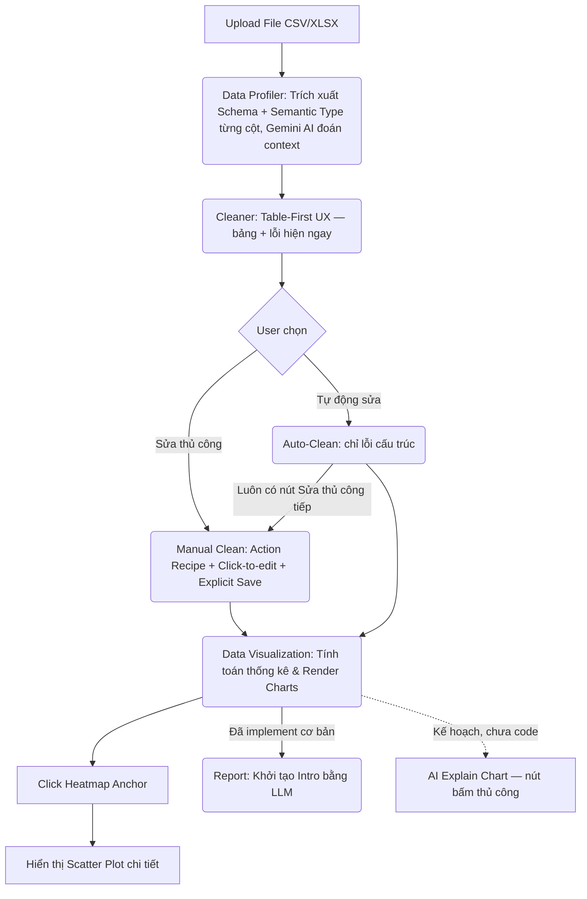

Cập nhật lần cuối: 2026-07-10

# BẢN ĐỒ DỰ ÁN DATAMIND

File này đóng vai trò "bản đồ tổng" quét toàn bộ codebase (frontend + backend) hiện có của dự án. Mọi thông tin ở đây đều phản ánh đúng thực tế code, không phải dự định.

---

## Bước 1 — Cấu Trúc Dự Án

### Backend (`d:\datamind_prod\backend\app`)
Các router chính (nằm trong `routers/`):
- [auth.py](file:///d:/datamind_prod/backend/app/routers/auth.py)
  - `POST /auth/register`: Đăng ký tài khoản (kèm tạo ví Credits).
  - `POST /auth/login`: Đăng nhập lấy JWT Token.
  - `POST /auth/google`: Đăng nhập/Đăng ký qua Google OAuth.
- [credits.py](file:///d:/datamind_prod/backend/app/routers/credits.py)
  - `GET /credits/wallet`: Xem số dư ví hiện tại.
  - `GET /credits/history`: Xem lịch sử giao dịch (cộng/trừ credits).
- [files.py](file:///d:/datamind_prod/backend/app/routers/files.py)
  - `POST /files/profile`: Nhận UploadFile (CSV/XLSX), phân tích Schema (bằng Pandas), đoán context + **semantic_type/confidence từng cột** (bằng LLM), lưu raw file vào cache.
  - `POST /files/session/context`: Lưu lại mô tả ngữ cảnh dataset do user cung cấp.
  - `POST /files/detect-issues`: Quét dữ liệu, phân loại lỗi (Missing, Type, Encoding, Duplicate, **Semantic Error**), trả kèm `preview_data` (100 dòng + `original_index`) để render bảng ngay không cần gọi API riêng.
  - `POST /files/auto-clean`: Tự động sửa lỗi CẤU TRÚC (không đụng lỗi ngữ nghĩa), trả về preview + `error_cells` tính lại trên dữ liệu đã làm sạch.
  - `POST /files/manual-clean-preview`: Nhận `file_hash` + mảng `actions` (Action Recipe: `DROP_COLUMN`, `RENAME_COLUMN`, `FILL_MISSING_*`, `BATCH_EDIT_CELLS`...), trả về bản preview 100 dòng kèm `error_cells` (bao gồm cả semantic error).
  - `POST /files/confirm-clean`: Xác nhận dữ liệu làm sạch, validate lần cuối, khởi tạo `session_id` (lưu kèm metadata/summary vào Redis) và (thử) upload lên Supabase.
- [packages.py](file:///d:/datamind_prod/backend/app/routers/packages.py)
  - `GET /packages`: Lấy danh sách các gói dịch vụ (active).
  - `POST /packages/purchase`: Mua gói dịch vụ (trừ credit).
  - `GET /packages/my-subscription`: Lấy danh sách các gói dịch vụ user đang sở hữu.
- [report.py](file:///d:/datamind_prod/backend/app/routers/report.py)
  - `POST /report/intro`: Tạo đoạn mở đầu (intro) cho báo cáo AI dựa trên thông tin file và các chart. **[Nghi vấn bug — xem Bước 5]**
- [visualize.py](file:///d:/datamind_prod/backend/app/routers/visualize.py)
  - `POST /visualize/compute`: Tính toán thống kê dữ liệu để frontend có data vẽ chart.
  - `POST /visualize/scatter-data`: Trả về dữ liệu điểm phân tán (scatter points) cho một cặp cột (Anchor).

Các service chính (nằm trong `services/`):
- [profiler_service.py](file:///d:/datamind_prod/backend/app/services/profiler_service.py): Phân loại cột bằng Pandas + gọi `llm_service` đoán semantic context.
- [llm_service.py](file:///d:/datamind_prod/backend/app/services/llm_service.py): Gọi Gemini, sinh `domain`, `confidence`, và **`semantic_type` + `confidence` riêng từng cột**; áp dụng fallback về `GENERAL_TEXT` nếu confidence < 0.75.
- [cleaner_service.py](file:///d:/datamind_prod/backend/app/services/cleaner_service.py): `detect_issues`, `_get_error_cells` (SSOT cho việc xác định cell lỗi, dùng chung bởi cả detect-issues và manual-clean-preview), xử lý các action trong Action Recipe (bao gồm `BATCH_EDIT_CELLS` với validate `row_id` nghiêm ngặt).
- [**semantic_rules.py**](file:///d:/datamind_prod/backend/app/services/semantic_rules.py) **(MỚI)**: Single Source of Truth cho toàn bộ rule/regex/threshold/severity của Semantic Error Detection — `SEMANTIC_TYPES`, `validate_cell()`, `get_semantic_severity()`, `is_semantic_error_column()`.
- [visualize_service.py](file:///d:/datamind_prod/backend/app/services/visualize_service.py): Tính toán thống kê thuần túy, trả JSON cho Frontend render.

### Frontend (`d:\datamind_prod\frontend\src`)
Các trang chính (nằm trong `pages/`):
- [Login.jsx](file:///d:/datamind_prod/frontend/src/pages/Login.jsx) / [Register.jsx](file:///d:/datamind_prod/frontend/src/pages/Register.jsx): Render form đăng nhập/đăng ký, gọi API auth.
- [Profiler.jsx](file:///d:/datamind_prod/frontend/src/pages/Profiler.jsx): Render giao diện upload file và hiển thị phân tích schema ban đầu.
- [Cleaner.jsx](file:///d:/datamind_prod/frontend/src/pages/Cleaner.jsx): **(Đã đổi UX đáng kể — xem 2.4)** Render bảng dữ liệu + lỗi NGAY khi vào trang (Table-First UX), không còn ModeSelector chọn mù; có 2 nút hành động "Tự động sửa" / "Sửa thủ công".
- [Visualize.jsx](file:///d:/datamind_prod/frontend/src/pages/Visualize.jsx): Render các biểu đồ dữ liệu bằng Recharts (tương quan, phân phối) từ JSON thống kê của backend.
- [Report.jsx](file:///d:/datamind_prod/frontend/src/pages/Report.jsx): Render trang tổng hợp báo cáo bằng văn bản (gọi AI sinh intro).
- [Pricing.jsx](file:///d:/datamind_prod/frontend/src/pages/Pricing.jsx) / [Wallet.jsx](file:///d:/datamind_prod/frontend/src/pages/Wallet.jsx): Render giao diện mua/bán packages và thông tin ví credits.

Các component đáng chú ý (nằm trong `components/`):
- [**ManualCleanWorkspace.jsx**](file:///d:/datamind_prod/frontend/src/components/cleaner/ManualCleanWorkspace.jsx) **(MỚI)**: Giao diện sửa thủ công dạng bảng (PreviewTable tái sử dụng), hỗ trợ 2 chế độ Guided/Full-edit, click-to-edit cell, cơ chế lưu **Explicit Save** (không còn debounce tự động — xem 2.4).
- [**Sidebar.jsx**](file:///d:/datamind_prod/frontend/src/components/Sidebar.jsx) **(Đã đổi UI)**: Layout kiểu Canva (icon trên, label nhỏ dưới), 3 trạng thái (expanded / collapsed / hidden), lưu trạng thái vào localStorage.

---

## Bước 2 — Các Chức Năng Chính

### 2.1. Authentication (Xác thực)
- **Trạng thái**: Hoạt động.
- **File liên quan**: [auth.py](file:///d:/datamind_prod/backend/app/routers/auth.py), [Login.jsx](file:///d:/datamind_prod/frontend/src/pages/Login.jsx)
- **Input**: `{ "email", "password" }` hoặc Google Credential Token.
- **Output**: `{ "message", "user", "token": { "access_token" } }`.
- **Luồng hoạt động**: User nhập thông tin (hoặc đăng nhập Google) -> Backend kiểm tra DB, băm mật khẩu/xác thực Google -> Cấp JWT -> Frontend lưu để truy cập các route khóa.

### 2.2. Thanh toán & Packages
- **Trạng thái**: Hoạt động.
- **File liên quan**: [credits.py](file:///d:/datamind_prod/backend/app/routers/credits.py), [packages.py](file:///d:/datamind_prod/backend/app/routers/packages.py), [Pricing.jsx](file:///d:/datamind_prod/frontend/src/pages/Pricing.jsx)
- **Input**: ID gói dịch vụ (`package_id`).
- **Output**: `{ "message", "remaining_credits" }`.
- **Luồng hoạt động**: Trang Pricing gọi `GET /packages` hiển thị gói -> User bấm mua -> Gọi `POST /packages/purchase` -> Backend trừ tiền trong `CreditsWallet`, ghi log `CreditTransaction`, cấp/cập nhật `UserSubscription`.

### 2.3. Data Profiler
- **Trạng thái**: Hoạt động.
- **File liên quan**: [files.py](file:///d:/datamind_prod/backend/app/routers/files.py), [profiler_service.py](file:///d:/datamind_prod/backend/app/services/profiler_service.py), [llm_service.py](file:///d:/datamind_prod/backend/app/services/llm_service.py), [Profiler.jsx](file:///d:/datamind_prod/frontend/src/pages/Profiler.jsx)
- **Input**: File upload dạng form-data (`UploadFile`).
- **Output**: Metadata cột (`ProfileResponse` gồm thông tin cột, types, semantic context, **và `semantic_type` + `semantic_confidence` riêng từng cột — dùng làm input cho Semantic Error Detection ở bước Cleaner**).
- **Luồng hoạt động**: User upload file CSV/XLSX -> Pandas đọc vào RAM, loại bỏ cột rác rỗng -> Trích xuất Schema -> Gửi Gemini AI để đoán Context + semantic_type từng cột -> Lưu file bytes + kết quả phân loại vào Redis cache (theo `file_hash`, không gọi lại Gemini ở các bước sau) -> Trả về Client.
- **Phụ thuộc**: Cần chạy trước tất cả module liên quan tới dữ liệu.
- **Lưu ý**: `ColumnProfile.semantic_type/semantic_confidence` là **nguồn dữ liệu chính thức duy nhất (SSOT)** cho semantic type — không có bản lưu trùng ở nơi khác.

### 2.4. Data Cleaner (ĐÃ ĐẠI TU — Table-First UX + Manual Clean + Semantic Error Detection)
- **Trạng thái**: Hoạt động, đã đại tu đáng kể so với bản đồ cũ. **Guided Fix mode nay đã implement đầy đủ** (trước đây ghi "Đang làm dở/Kế hoạch").
- **File liên quan**: `files.py`, `cleaner_service.py`, `semantic_rules.py`, `Cleaner.jsx`, `ManualCleanWorkspace.jsx`.
- **Input**: `{ "file_hash" }` (từ bước Profiler).
- **Output**: `IssueReport` (kèm `preview_data` + `error_cells` + `semantic_errors`), `CleanDatasetResponse`.

#### Luồng hoạt động mới (Table-First UX)
1. Vào `/cleaner` -> gọi `detect-issues` MỘT LẦN -> bảng dữ liệu (100 dòng) + tô màu lỗi hiện NGAY LẬP TỨC, không cần chọn mode trước.
   - Đỏ = lỗi cấu trúc hoặc semantic error severity "error" (EMAIL, SEQUENCE_NUMBER, DATE_TIME).
   - Vàng/cam = semantic "hint" (PERSON_NAME, PHONE_NUMBER, ADDRESS, MONEY, CODE_ID) hoặc cell đã sửa.
2. User chọn 1 trong 2 nút hành động:
   - **"Tự động sửa"**: chạy Auto-Clean (chỉ xử lý Missing/Type/Encoding/Duplicate, **không đụng lỗi ngữ nghĩa**) -> hiển thị bảng đã sạch + luôn có nút "Sửa thủ công tiếp" (không phụ thuộc còn lỗi ngữ nghĩa hay không) + banner cảnh báo cam nếu còn semantic error.
   - **"Sửa thủ công"**: chuyển sang `ManualCleanWorkspace`, tái sử dụng dữ liệu đã fetch (không gọi API lần 2).
3. Trong `ManualCleanWorkspace`:
   - **Action Recipe Pattern**: các thao tác cột (DROP_COLUMN, RENAME_COLUMN, FILL_MISSING_*) áp dụng ngay, ghi vào Recipe List (nhật ký, có undo).
   - **Click-to-edit cell**: Guided mode (mặc định, chỉ sửa được cell lỗi) / Full-edit mode (sửa mọi cell).
   - **Explicit Save Architecture** (đã thay thế cơ chế debounce 2s tự động đồng bộ do gây bug mất dữ liệu): sửa nhiều cell -> lưu tạm ở `pendingCellEdits` (state client, chưa gọi API) -> user bấm nút **"Lưu thay đổi (N)"** -> gộp thành 1 `BATCH_EDIT_CELLS` duy nhất gửi lên server. Có `window.confirm` cảnh báo nếu rời trang/đổi mode khi còn thay đổi chưa lưu. Nếu Save thất bại, giữ nguyên pending để retry, không mất dữ liệu.
   - Backend validate `row_id` nghiêm ngặt trong `BATCH_EDIT_CELLS` (raise `ValueError` -> 400 rõ ràng nếu row_id rỗng/không tồn tại) — tránh lặp lại bug từng khiến cả cột bị null.
4. `confirm-clean`: chốt file, khởi tạo `session_id` kèm metadata/summary lưu vào Redis, cấp cho bước Visualization.

#### Semantic Error Detection (module mới, tách biệt khỏi 4 lỗi cấu trúc cũ)
- 9 nhãn: `SEQUENCE_NUMBER`, `PERSON_NAME`, `PHONE_NUMBER`, `EMAIL`, `ADDRESS`, `MONEY`, `GENERAL_TEXT`, `DATE_TIME`, `CODE_ID`.
- Severity "error" (đỏ): `EMAIL`, `SEQUENCE_NUMBER`, `DATE_TIME`. Severity "hint" (vàng/cam): `PERSON_NAME`, `PHONE_NUMBER`, `ADDRESS`, `MONEY`, `CODE_ID` (độ tin cậy regex thấp hơn với dữ liệu đa dạng/không chuẩn quốc gia).
- Threshold cấp cột: `MAX(3 cells, 5%)` — cố định (chưa configurable theo domain/ngành).
- Fallback: confidence Gemini < 0.75 -> ép về `GENERAL_TEXT` (không áp rule).
- `PHONE_REGEX` dùng pattern quốc tế tổng quát (`^\+?\d{7,15}$`), không giới hạn định dạng Việt Nam.
- Auto-Clean **không** tự động sửa lỗi ngữ nghĩa — chỉ hiển thị để user tự quyết định qua Manual Clean.
- `semantic_rules.py` là SSOT — cả `detect-issues` và `manual-clean-preview` dùng chung, đảm bảo không lệch kết quả.

#### Việc còn TỒN ĐỌNG (chưa xử lý, tạm hoãn theo quyết định của user)
- Cột có tỷ lệ Missing rất cao (ví dụ 70%) khi Auto-Clean fill mean có thể tạo ra cột phần lớn là giá trị "bịa" — chưa có cơ chế cảnh báo/ngưỡng chặn riêng cho trường hợp này.
- Nghi vấn: giá trị dạng text `"N/A"`/`"Null"` (chuỗi, không phải NaN thật) có thể đang KHÔNG được tính là Missing — cần xác minh lại logic `detect_issues`.

- **Được dùng bởi**: Data Visualization (cần dataset sạch để chạy).

### 2.5. Data Visualization (Trực quan hóa & Heatmap)
- **Trạng thái**: Hoạt động.
- **File liên quan**: [visualize.py](file:///d:/datamind_prod/backend/app/routers/visualize.py), [visualize_service.py](file:///d:/datamind_prod/backend/app/services/visualize_service.py), [Visualize.jsx](file:///d:/datamind_prod/frontend/src/pages/Visualize.jsx)
- **Input**: `{ "session_id" }` (lấy từ Data Cleaner) và `{ "session_id", "col_x", "col_y" }` (cho Scatter data).
- **Output**: JSON thống kê (min, max, mean, correlation matrix) và list các points cho Scatter Chart.
- **Luồng hoạt động**: Trang Visualize tải `session_id` -> Backend đọc file từ RAM/Redis, chạy tính toán `compute_statistics` trả về JSON -> Frontend Recharts render biểu đồ. Khi user click vào ô Heatmap -> Gửi cặp cột lấy `scatter-data`.
- **Kế hoạch tiếp theo (CHƯA implement)**: Tính năng "AI Explain Chart" — nút bấm thủ công để Gemini giải thích chart bằng lời (khác với Report Intro). Quyết định đã chốt: trigger bằng nút bấm (không tự động, tránh tốn quota Gemini free tier). Còn đang bàn: phạm vi áp dụng (chỉ Correlation Matrix hay cả Scatter Plot) và dữ liệu gửi cho Gemini (chỉ số liệu thống kê hay kèm mẫu dữ liệu thô).

### 2.6. Report
- **Trạng thái**: Hoạt động nhưng **có nghi vấn bug** — xem Bước 5.
- **File liên quan**: [report.py](file:///d:/datamind_prod/backend/app/routers/report.py), [Report.jsx](file:///d:/datamind_prod/frontend/src/pages/Report.jsx)
- **Input/Output**: Xem router `/report/intro`.

---

## Bước 3 — Sơ Đồ Luồng Tổng

- **Đã implement**: Upload, Data Profiler (kèm Semantic Type), Data Cleaner Table-First UX (Auto + Manual + Semantic Error Detection), Click Anchor Heatmap, Report Intro (có nghi vấn bug).
- **Đang làm dở / Kế hoạch**: AI Explain Chart (Visualization), xử lý ngưỡng Missing cao + phát hiện text "N/A"/"Null" (Cleaner).
- **Đã hoàn thành, không còn "dở"**: Guided Fix / Manual Clean (trước đây ghi là kế hoạch, nay đã hoạt động đầy đủ).

---

## Bước 4 — Đối Chiếu Với Tài Liệu Đã Có

- **Điểm KHỚP nhau**:
  - `feature_data_cleaner.md` phân loại lỗi dữ liệu (Missing Values, Sai kiểu, Encoding, Duplicate) hoàn toàn khớp với code `detect_issues` trong `files.py`. Luồng "Auto Clean" đã được đưa lên backend đúng quy chuẩn.
  - Logic tách biệt việc tính toán Backend (Module 3) và Frontend Render bằng Recharts (Module 4) được tuân thủ sát sao (thấy rõ ở `visualize_service.py` chỉ trả về JSON, `Visualize.jsx` lo việc render).
  - Walkthrough Heatmap Anchor khớp hoàn toàn với code (`POST /visualize/scatter-data`).
  - **[MỚI]** Chế độ "Guided Fix" mà `feature_data_cleaner.md` từng nhắc tới (nhưng code chưa có) — nay đã được triển khai đầy đủ dưới dạng Manual Clean Workspace (Action Recipe + Click-to-edit + Explicit Save).

- **Điểm tài liệu CÓ nhưng code KHÔNG thấy (hoặc mới dở dang)**:
  - Tài liệu `feature_data_visualization.md` bảo kết quả tính toán (`statistical_summary`) phải được lưu vào **Postgres** (JSON Column), nhưng hiện tại ở file `visualize.py`, tính toán xong được trả thẳng về cho Frontend mà không có bất kỳ logic lưu `db.add()` nào.
  - Tài liệu yêu cầu đẩy file sạch lên **Supabase Storage** nhưng function `_upload_to_supabase` hiện tại mới dùng fallback dev giả.

- **Điểm code CÓ nhưng tài liệu KHÔNG nhắc tới**:
  - Hệ thống Auth, ví Credits, Subscriptions (`auth.py`, `credits.py`, `packages.py`) hoàn toàn không được nhắc đến trong 3 file markdown Data Profile/Cleaner/Visualization, mặc dù chúng đang là xương sống quản lý request người dùng ở backend.
  - **[MỚI]** Semantic Error Detection (`semantic_rules.py`, 9 nhãn, threshold, severity) là tính năng hoàn toàn mới, chưa từng có trong bất kỳ tài liệu markdown cũ nào.

---

## Bước 5 — Known Complexity / Rủi Ro Cần Chú Ý

- **`files.py` - Session Expiration/Cache**:
  - Hệ thống nay đã dùng `ERR_SYS_CACHE_EXPIRED` (Severity: CRITICAL) để Frontend chuẩn bị bắt và xử lý.
  - Toàn bộ dataset được lưu tạm trong RAM thông qua Redis `cache.set_file_bytes` với TTL 1 giờ (thời gian có thể điều chỉnh). Khi người dùng thao tác chậm hoặc mở tab lâu quá 1 tiếng, gọi `/detect-issues` hoặc `/visualize/compute` sẽ bị lỗi 404/410 do mất file trong cache.
- **`files.py` - Logic Upload lên Supabase đang dở**:
  - Có comment `#Need checking!`. Logic fallback sử dụng URL giả `https://dev-placeholder.local/...` có thể gây lỗi ảnh hưởng đến các Module phía sau nếu code Frontend lỡ request đọc file bằng URL này. Cần test kỹ khi lên thực tế.
- **`visualize.py` - Tốn RAM / Tái parse liên tục**:
  - Khi người dùng click Heatmap (gọi `/visualize/scatter-data`), Backend thực hiện việc đọc lại toàn bộ file bytes từ Redis -> parse toàn bộ df -> lọc lấy 2 cột. Việc này lặp lại mỗi cú click, với dataset nặng dễ dẫn tới nghẽn CPU/RAM (Out of Memory).
- **Race Condition Frontend Scatter Plot**:
  - Có `abortRef (AbortController)` để fix race condition khi click nhanh ô Heatmap. Cần lưu ý nếu code này thay đổi sau này, user click liên tục nhiều ô trên Heatmap có thể gây treo trình duyệt.
- **[MỚI] Gemini có thể phân loại sai `semantic_type` dựa theo TÊN cột thay vì XEM giá trị thực tế**:
  - Đã phát hiện 1 lần: cột `sequence_id` chứa giá trị `"SEQ-101"` bị phân loại nhầm thành `SEQUENCE_NUMBER` (severity error), khiến toàn bộ cột bị tô đỏ sai. Đã thêm safety net: nếu tỷ lệ vi phạm 1 cột vượt ngưỡng bất thường (>50%), tự động hạ xuống "hint" thay vì giữ "error" cứng, và ghi log để review. Đây là rủi ro có thể tái diễn với các pattern cột khác, cần theo dõi thêm.
- **[MỚI] Hạ tầng Free Tier — ràng buộc thiết kế mọi tính năng liên quan LLM/API dồn dập**:
  - Backend chạy trên **Render free tier** (cold start/sleep khi không hoạt động — độ trễ 30-50s khi "đánh thức").
  - Cache dùng **Upstash Redis free tier** (giới hạn số lượng command/ngày).
  - **Gemini API** có giới hạn rate limit.
  - Đây là lý do kiến trúc Cell Edit đã đổi từ "debounce tự động đồng bộ" sang "Explicit Save button" — giảm số lượng request rải rác. Mọi tính năng mới (đặc biệt AI Explain Chart sắp tới) cần thiết kế theo nguyên tắc: gộp request, cache kết quả theo session, tránh gọi API/LLM tự động liên tục.
- **[MỚI] `PAGE.wrapper` (class CSS dùng chung nhiều trang) đã bị đổi `max-w-5xl` -> `max-w-[1400px]` để phục vụ Cleaner** — thay đổi này áp dụng TOÀN CỤC cho mọi trang dùng chung class, **chưa được xác nhận đầy đủ** liệu có ảnh hưởng xấu tới layout của Report/Pricing/Profiler/Visualize hay không. Cần kiểm tra lại.
- **[MỚI] Report Intro nghi vấn bug**: `/report/intro` từng trả về câu chung chung dạng fallback cứng (`"Tập dữ liệu đã được xử lý thành công..."`), nghi ngờ lệnh gọi Gemini bị fail âm thầm mà không có log/exception rõ ràng rơi ra ngoài. Chưa điều tra nguyên nhân gốc — tạm hoãn xử lý.
- **[MỚI] Auto-Clean fill Missing với tỷ lệ cao**: khi 1 cột có tỷ lệ Missing rất lớn (ví dụ 70%), Auto-Clean vẫn fill mean/median như tỷ lệ thấp bình thường, có thể tạo ra dữ liệu phần lớn "bịa" mà không cảnh báo user. Chưa có ngưỡng riêng cho trường hợp này.