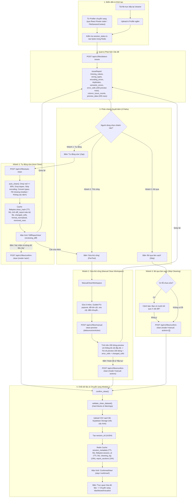
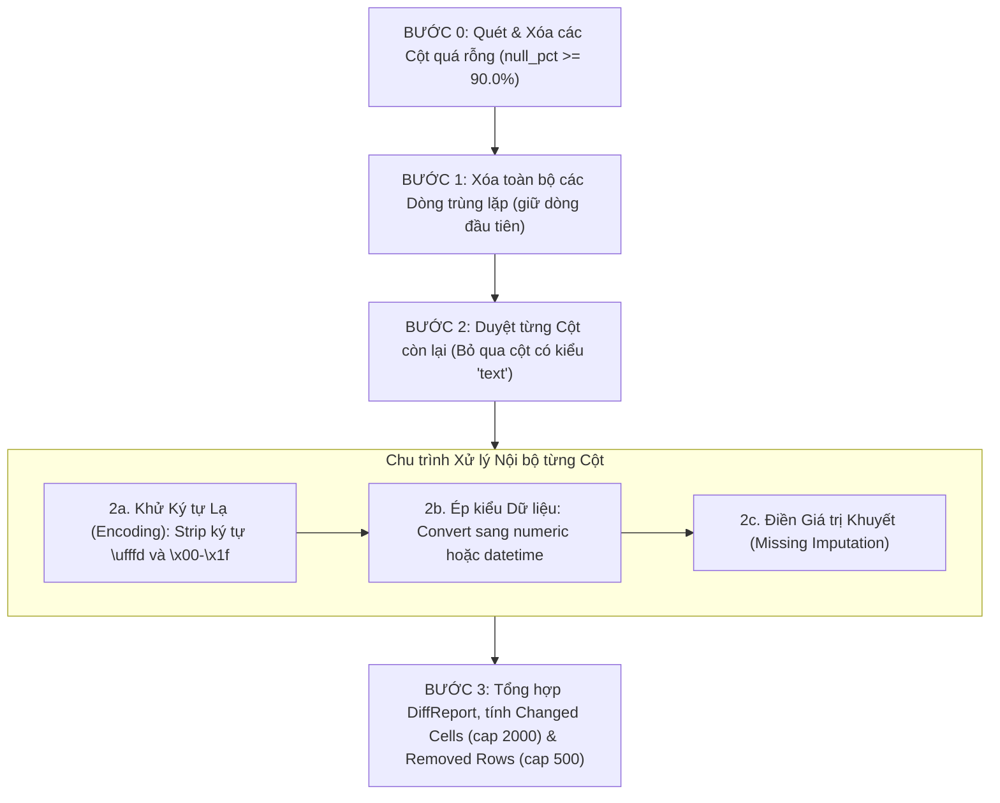

# Hướng dẫn Chuyên sâu & Đặc tả Kỹ thuật Module Cleaner (Làm sạch Dữ liệu)

> **Tài liệu tham chiếu chuẩn (Single Source of Truth) dành cho Người dùng cuối, Kỹ sư Hệ thống và Đội ngũ Phát triển DataMind.**  
> *Phiên bản áp dụng:* `2026.11-v1` | *Cập nhật:* Tháng 11/2026 | *Định dạng mã hóa:* UTF-8 (Unicode Normalization Form C - NFC).

---

## Mục lục tổng quan

- [PART A — Hành trình người dùng & Kiến trúc luồng dữ liệu](#part-a--hành-trình-người-dùng--kiến-trúc-luồng-dữ-liệu)
  - [1. Sơ đồ luồng dữ liệu tổng thể (Mermaid Architecture)](#1-sơ-đồ-luồng-dữ-liệu-tổng-thể-mermaid-architecture)
  - [2. Chi tiết 3 nhánh hành vi người dùng](#2-chi-tiết-3-nhánh-hành-vi-người-dùng)
  - [3. Đặc tả 4 API Endpoints và Hàm phụ trợ](#3-đặc-tả-4-api-endpoints-và-hàm-phụ-trợ)
  - [4. Cơ chế Caching, Khóa phiên & Quản lý Thời hạn (TTLs)](#4-cơ-chế-caching-khóa-phiên--quản-lý-thời-hạn-ttls)
- [PART B — Mỗi thứ trên màn hình (UI/UX Elements Deep-Dive)](#part-b--mỗi-thứ-trên-màn-hình-uiux-elements-deep-dive)
  - [Màn hình 1: Tải file trực tiếp (Upload Fallback Zone)](#màn-hình-1-tải-file-trực-tiếp-upload-fallback-zone)
  - [Màn hình 2: Trạng thái Đang quét / Đang xử lý (Scanning & Loading)](#màn-hình-2-trạng-thái-đang-quét--đang-xử-lý-scanning--loading)
  - [Màn hình 3: Xem trước Vấn đề Dữ liệu (Issue Preview Screen)](#màn-hình-3-xem-trước-vấn-đề-dữ-liệu-issue-preview-screen)
  - [Màn hình 4: Báo cáo Sai khác Tự động (Auto-Clean Diff Report)](#màn-hình-4-báo-cáo-sai-khác-tự-động-auto-clean-diff-report)
  - [Màn hình 5: Không gian Sửa thủ công (Manual Clean Workspace)](#màn-hình-5-không-gian-sửa-thủ-công-manual-clean-workspace)
  - [Màn hình 6: Chốt Tập dữ liệu Sạch (Confirmed Dataset View)](#màn-hình-6-chốt-tập-dữ-liệu-sạch-confirmed-dataset-view)
  - [Màn hình 7: Màn hình Xử lý Lỗi (Error Handling Screen)](#màn-hình-7-màn-hình-xử-lý-lỗi-error-handling-screen)
- [PART C — Phát hiện lỗi (Issue Detection Engine Deep-Dive)](#part-c--phát-hiện-lỗi-issue-detection-engine-deep-dive)
  - [1. Lỗi Cấu trúc Cơ bản (Structural Issues)](#1-lỗi-cấu-trúc-cơ-bản-structural-issues)
  - [2. Lỗi Ngữ nghĩa Miền (Semantic Issues Engine)](#2-lỗi-ngữ-nghĩa-miền-semantic-issues-engine)
  - [3. Phụ thuộc Trí tuệ Nhân tạo (AI Profiler Context Dependency)](#3-phụ-thuộc-trí-tuệ-nhân-tạo-ai-profiler-context-dependency)
- [PART D — Tự động sửa (Auto-Clean Engine)](#part-d--tự-động-sửa-auto-clean-engine)
  - [1. Thứ tự thực thi 3 tầng quy tắc (Rule Execution Pipeline)](#1-thứ-tự-thực-thi-3-tầng-quy-tắc-rule-execution-pipeline)
  - [2. Tương tác với Ép kiểu từ Profiler (Overrides Interaction)](#2-tương-tác-với-ép-kiểu-từ-profiler-overrides-interaction)
  - [3. Ví dụ Before/After thực tế & Cơ chế Theo dõi Sai khác ô (Diff Tracking)](#3-ví-dụ-beforeafter-thực-tế--cơ-cế-theo-dõi-sai-khác-ô-diff-tracking)
- [PART E — Sửa thủ công (Manual Clean Workspace)](#part-e--sửa-thủ-công-manual-clean-workspace)
  - [1. Danh mục 12 Thao tác Làm sạch (Manual Action Recipe)](#1-danh-mục-12-thao-tác-làm-sạch-manual-action-recipe)
  - [2. Cơ chế Hoàn tác (Undo Mechanism) & Lưu tạm (Pending Sync)](#2-cơ-chế-hoàn-tác-undo-mechanism--lưu-tạm-pending-sync)
  - [3. Chế độ Hướng dẫn (Guided Mode) vs Chế độ Sửa Tự do (Full Edit Mode)](#3-chế-độ-hướng-dẫn-guided-mode-vs-chế-độ-sửa-tự-do-full-edit-mode)
  - [4. Các trường hợp biên & Ràng buộc toàn vẹn (Edge Cases)](#4-các-trường-hợp-biên--ràng-buộc-toàn-vẹn-edge-cases)
- [PART F — Số liệu, Ngưỡng & Thời hạn (System Limits & Constants)](#part-f--số-liệu-ngưỡng--thời-hạn-system-limits--constants)
- [PART G — Vấn đề phát hiện được & Khuyến nghị kỹ thuật](#part-g--vấn-đề-phát-hiện-được--khuyến-nghị-kỹ-thuật)

---

## PART A — Hành trình người dùng & Kiến trúc luồng dữ liệu

Module **Cleaner (Làm sạch Dữ liệu)** là chặng thứ 2 trong chuỗi xử lý dữ liệu (Data Pipeline) của DataMind, nằm giữa Module 1 (**Profiler**) và Module 3 (**Visualizer**).

### 1. Sơ đồ luồng dữ liệu tổng thể (Mermaid Architecture)



### 2. Chi tiết 3 nhánh hành vi người dùng

1. **Nhánh 1: Tự động sửa (`Auto Clean`)**
   - **Mục đích:** Dành cho người dùng muốn hệ thống tự động giải quyết các lỗi phổ biến chỉ với 1 cú click chuột dựa trên các quy tắc chuẩn công nghiệp.
   - **Quy trình:**
     - Người dùng bấm nút **Tự động sửa** (`#clean-mode-auto-btn`) tại thanh điều hướng đáy.
     - Frontend gọi `POST /api/v1/files/auto-clean` kèm `{ file_hash, overridden_types }`.
     - Backend đọc dữ liệu gốc từ Redis, áp dụng quy trình `auto_clean()`, lưu tạm bản sạch vào Redis key `filebytes:{user_id, file_hash}_clean` (TTL 5 giờ = 18.000 giây).
     - Frontend chuyển sang bước `reviewing_diff`, hiển thị bảng tổng kết sai khác (`DiffReportView`), các chip cột thay đổi, bảng dữ liệu 200 dòng mẫu (`CLEANER_PREVIEW_ROWS`) với các ô đổi màu xanh lá (`bg-[#EBF7EE]`), có tooltip thể hiện `Giá trị cũ → Giá trị mới` (các chuyển đổi chỉ đổi định dạng `format_normalized` không bị tô màu ô).
     - Người dùng bấm **Xác nhận và dùng dữ liệu này** (`#cleaner-confirm-btn`) để gọi `POST /api/v1/files/confirm-clean` với `clean_mode: "auto"`.

2. **Nhánh 2: Sửa thủ công (`Manual Clean Workspace`)**
   - **Mục đích:** Dành cho người dùng cần kiểm soát chi tiết từng ô dữ liệu hoặc áp dụng các công thức điền khuyết tùy chỉnh (Mean thay vì Median, điền giá trị tùy ý, xóa dòng trùng, đổi tên cột, xóa cột không cần thiết).
   - **Quy trình:**
     - Người dùng bấm nút **Sửa thủ công** (`#clean-mode-manual-btn`) từ thanh điều hướng đáy hoặc bấm **Sửa thủ công thêm** từ bảng sai khác Auto-Clean.
     - Frontend chuyển sang giao diện `manual_workspace`. Người dùng có thể click vào bất kỳ ô nào để xem popup **Guided Fix**, chọn:
       - *Áp dụng gợi ý* (nếu backend có gợi ý cụ thể).
       - *Sửa giá trị* (nhập trực tiếp giá trị mới).
       - *Đặt thành rỗng (null)* (chuyển ô về `None`/null thực sự).
       - *Bỏ qua lỗi* (chuyển trạng thái sang `ignored`).
     - Khi thực hiện các thao tác mức cột (Đổi tên, Xóa cột, Điền khuyết) hoặc lưu chuỗi sửa ô (`BATCH_EDIT_CELLS`), frontend gửi mảng `actions` lên `POST /api/v1/files/manual-clean-preview`. Backend áp dụng danh sách thao tác trên 200 dòng xem trước (`preview_df`) kết hợp tính toán thống kê toàn cột một lần trên toàn file, trả về dữ liệu mẫu cập nhật tức thì (< 500 ms).
     - Khi đã hoàn tất kiểm tra, người dùng bấm **Hoàn tất & Tiếp tục** (`#cleaner-manual-finalize-btn`) để gọi `POST /api/v1/files/confirm-clean` với `clean_mode: "manual"` và toàn bộ danh sách `actions`.

3. **Nhánh 3: Bỏ qua làm sạch (`Skip Cleaning`)**
   - **Mục đích:** Dành cho tập dữ liệu đã hoàn toàn sạch sẽ, hoặc người dùng chấp nhận giữ nguyên toàn bộ dữ liệu gốc (kể cả ô trống, lỗi ký tự, lỗi định dạng) để chuyển thẳng sang Module Trực quan hóa.
   - **Quy trình:**
     - Người dùng bấm nút **Bỏ qua làm sạch** (`#clean-mode-skip-btn`).
     - Nếu hệ thống phát hiện vẫn còn lỗi cấu trúc hoặc ngữ nghĩa (`totalIssues > 0`), trình duyệt hiển thị hộp thoại xác nhận: `Dữ liệu còn {count} vấn đề chưa xử lý. Bạn có chắc chắn muốn bỏ qua?`
     - Khi người dùng đồng ý, frontend gửi `POST /api/v1/files/confirm-clean` với `clean_mode: "manual"` và mảng `actions: []` (danh sách thao tác rỗng).
     - Backend đọc dữ liệu gốc, chạy qua bộ kiểm định `validate_clean_dataset()`, lưu session và chuyển người dùng đến màn hình chốt với nhãn *Đã bỏ qua làm sạch*.

### 3. Đặc tả 4 API Endpoints và Hàm phụ trợ

| Endpoint / Hàm | Phương thức | Đầu vào chính | Đầu ra chính | Mục đích & Nghiệp vụ |
| :--- | :--- | :--- | :--- | :--- |
| `/api/v1/files/detect-issues` | `POST` | `IssueDetectRequest`<br>• `file_hash: str`<br>• `overridden_types: dict` | `IssueReport`<br>• `missing_values: list`<br>• `wrong_types: list`<br>• `encoding_errors: list`<br>• `duplicates: dict`<br>• `semantic_errors: list`<br>• `error_cells: list` (200 preview rows)<br>• `column_issue_counts: dict`<br>• `preview_data: list` (200 dòng)<br>• `semantic_checked: bool` | Quét toàn bộ DataFrame từ cache Redis. Đánh giá lỗi cấu trúc, so khớp quy tắc ngữ nghĩa theo metadata từ Profiler, trả về số đếm lỗi toàn file `column_issue_counts`, danh sách ô lỗi trong 200 dòng preview và cờ `semantic_checked`. |
| `/api/v1/files/auto-clean` | `POST` | `AutoCleanRequest`<br>• `file_hash: str`<br>• `overridden_types: dict` | `AutoCleanResponse`<br>• `diff_report: DiffReport`<br>• `validation: ValidationResult`<br>• `preview_data: list` (200 dòng)<br>• `error_cells: list`<br>• `changed_cells: list` (tối đa 2.000)<br>• `removed_rows: list`<br>• `changed_truncated: bool` | Thực thi quy tắc dọn dẹp mặc định trên toàn bộ dataset: xóa cột trống >= 90%, xóa trùng, sửa lỗi encoding, ép kiểu, điền khuyết. Ghi nhận `invalid_replaced` và `format_normalized`. Lưu tạm CSV sạch vào Redis key `filebytes:{user_id, file_hash}_clean` với TTL 5h. |
| `/api/v1/files/manual-clean-preview`| `POST` | `ManualCleanPreviewRequest`<br>• `file_hash: str`<br>• `actions: list[CleanAction]` | `dict`<br>• `preview_data: list` (200 dòng)<br>• `error_cells: list`<br>• `changed_cells: list` (tối đa 2.000)<br>• `removed_rows: list`<br>• `changed_truncated: bool` | Áp dụng tuần tự danh sách thao tác thủ công lên 200 dòng preview kết hợp thống kê cột từ toàn file, trả về kết quả xem trước tức thì mà **không ghi đè** vào cache lưu trữ chính. |
| `/api/v1/files/confirm-clean` | `POST` | `ConfirmCleanRequest`<br>• `file_hash: str`<br>• `clean_mode: "auto" \| "manual"`<br>• `overridden_types: dict`<br>• `actions: list[CleanAction]`<br>• `ignored_cells_count: int` | `CleanDatasetResponse`<br>• `session_id: str` (UUID4)<br>• `filename: str`<br>• `clean_file_url: str \| None`<br>• `clean_report: DiffReport`<br>• `summary_for_module3: SummaryForModule3`<br>• `validation: ValidationResult`<br>• `preview_data: list` (200 dòng) | Chốt dữ liệu sạch lần cuối trên toàn bộ file. Tính DiffReport thật trên toàn file cho cả auto và manual. Chạy kiểm định 2 tầng (`validate_clean_dataset`). Xuất CSV bytes, upload Supabase Storage, lưu Redis TTL 5h. |
| `_upload_to_supabase` | Hàm nội bộ backend | `csv_bytes: bytes`<br>`original_filename: str`<br>`user_id: int` | `str \| None` (Signed URL 7 ngày hoặc dev fallback URL) | Chuyển tên file thành ký tự an toàn ASCII (bỏ dấu tiếng Việt, ký tự đặc biệt), sinh mã hash nội dung MD5 8 ký tự, upload lên bucket `datasets` tại đường dẫn `clean/{user_id}/{stem}_{hash}_clean.csv`. Tạo signed URL có thời hạn 604.800 giây (7 ngày). |
| `/api/v1/files/session-status` | `GET` | Query param: `file_hash` | `dict` (`has_session, is_clean, clean_filename, rows, cols`) | Kiểm tra xem file hiện tại đã từng có phiên làm sạch hợp lệ trong Redis hay chưa. Nếu có, cho phép frontend khôi phục trạng thái làm việc mà không cần quét lại từ đầu. |

### 4. Cơ chế Caching, Khóa phiên & Quản lý Thời hạn (TTLs)

DataMind áp dụng chiến lược Caching 2 tầng chặt chẽ trên nền tảng **Upstash Redis**:

1. **Khóa nhị phân File (`filebytes:{user_id, file_hash}`)**:
   - **TTL:** `18.000 giây` (**đúng 5 giờ** — quy định tại `FILE_BYTES_TTL` trong `app/core/rules.py` và `_FILE_BYTES_TTL` trong `app/core/cache.py`).
   - **Dữ liệu lưu trữ:** Chuỗi JSON chứa `bytes_b64` (nội dung nhị phân được mã hóa base64), `filename`, và phần mở rộng `ext`.
   - **Ý nghĩa:** Đây là dữ liệu gốc phục vụ cho toàn bộ quá trình quét lỗi (`detect-issues`), chạy tự động sửa (`auto-clean`) và xem trước thủ công (`manual-clean-preview`). Nếu người dùng mở lại trang sau 5 giờ kể từ lần cuối tương tác, cache sẽ hết hạn, trả về mã lỗi `ERR_SYS_CACHE_EXPIRED` (HTTP 410).

2. **Dữ liệu Tự động làm sạch đệm (`filebytes:{user_id, file_hash}_clean`)**:
   - **TTL:** `18.000 giây` (**5 giờ**).
   - **Ý nghĩa:** Lưu trữ kết quả CSV sau khi chạy `auto_clean()` ở bước xem trước Diff. Khi người dùng bấm *Xác nhận*, endpoint `confirm-clean` có thể tái sử dụng ngay lập tức mà không cần tính toán lại toàn bộ tệp lớn.

3. **Metadata Phiên hoạt động (`session_metadata:{user_id, session_id}`)**:
   - **TTL:** `18.000 giây` (**5 giờ**).
   - **Dữ liệu lưu trữ:** Cấu trúc schema của dữ liệu sau làm sạch, danh sách cột số (`numeric_columns`), cột danh mục (`categorical_columns`), kiểu dữ liệu (`dtypes`), số dòng, số cột, và mã `file_hash` gốc để truy vết nguồn gốc dữ liệu.

4. **Nội dung file sau làm sạch (`filebytes:{user_id, session_id}`)**:
   - **TTL:** `18.000 giây` (**5 giờ**).
   - **Ý nghĩa:** Lưu trữ CSV bytes sạch hoàn toàn gắn với `session_id`, sẵn sàng để Module 3 (Visualizer) tải lên vẽ biểu đồ và phân tích thống kê chuyên sâu.

5. **Nhật ký thao tác làm sạch (`cleaning_log:{user_id, file_hash}`)**:
   - **TTL:** `86.400 giây` (**24 giờ**).
   - **Ý nghĩa:** Ghi lại mảng các hành động đã thực hiện (ví dụ: xóa cột nào, điền median vào cột nào, bao nhiêu dòng bị ảnh hưởng) để phục vụ cho việc tổng hợp Báo cáo Xuất khẩu (Export Report).

6. **Phần báo cáo tổng hợp (`report_sections:{user_id, file_hash}`)**:
   - **TTL:** `86.400 giây` (**24 giờ**).
   - **Ý nghĩa:** Lưu section `cleaner` gồm nhật ký, chế độ làm sạch, thống kê trước/sau và số ô lỗi người dùng đã cố tình bỏ qua. Khi xác nhận làm sạch, hệ thống đồng thời kích hoạt hàm `invalidate_downstream_state()`, tự động xóa section `visualize` cũ nhằm ngăn chặn biểu đồ cũ vẽ sai dữ liệu mới.

---

## PART B — Mỗi thứ trên màn hình (UI/UX Elements Deep-Dive)

Tất cả văn bản hiển thị trên giao diện đều được trích xuất trực tiếp từ các file ngôn ngữ `frontend/src/i18n/locales/vi.json` và `en.json`.

---

### Màn hình 1: Tải file trực tiếp (Upload Fallback Zone)

Xuất hiện khi người dùng truy cập trực tiếp URL `/dashboard/cleaner` mà chưa qua bước Profiler (`fileHash === null`).

#### 1. Header Trang (`#cleaner-page-header`)
- **Nhãn hiển thị:**
  - Tiếng Việt: `Làm sạch dữ liệu` / Phụ đề: `Phát hiện và xử lý dữ liệu thiếu, sai kiểu, lỗi font tự động hoặc thủ công`
  - Tiếng Anh: `Data Cleaner` / Phụ đề: `Detect and handle missing values, wrong types, encoding errors automatically or manually`
- **Ý nghĩa & Mục đích:** Khẳng định phân hệ làm việc, cung cấp định hướng nhanh cho người dùng về khả năng xử lý của module.
- **Quy tắc & Tính toán:** Luôn cố định ở đầu trang qua component `PageHeader`. Nếu đã có file, phụ đề sẽ tự động đổi sang `cleaner.subtitle_cleaning` (`Đang làm sạch: {fileName}`).
- **Ví dụ hiển thị:** Khi mở trang lần đầu mà chưa có file, hiển thị phụ đề mặc định.
- **Thao tác & Chi phí:** Chỉ xem, hoàn toàn miễn phí.
- **Tác động hạ nguồn:** Không.
- **Trường hợp biên:** Nếu tên file quá dài (> 50 ký tự), component `PageHeader` tự động ngắt dòng mềm.
- **Vị trí mã nguồn:** [Cleaner.jsx:1113-1139](file:///d:/datamind_prod/frontend/src/pages/Cleaner.jsx#L1113-L1139).
- **Tooltip:** Không có tooltip riêng.
- **Mô tả chi tiết:**
  - *Tiếng Việt:* Tiêu đề chính định vị mô-đun Làm sạch Dữ liệu của hệ sinh thái DataMind. Nó giúp người dùng nhận diện ngay lập tức mình đang ở chặng thứ hai của quy trình phân tích. Phụ đề tóm tắt ngắn gọn các nghiệp vụ cốt lõi: xử lý dữ liệu khuyết, chuẩn hóa kiểu và khử lỗi font.
  - *English:* Main header identifying DataMind's Data Cleaner module. It immediately informs users they are at the second stage of the data pipeline. The subtitle succinctly summarizes the core functions: handling missing values, type casting, and fixing font/encoding issues.

#### 2. Nút Hướng dẫn Trang (`#cleaner-help-docs-btn`)
- **Nhãn hiển thị:** Icon tài liệu kèm chữ `Hướng dẫn` (`Help & Docs`).
- **Ý nghĩa & Mục đích:** Mở khay trượt tài liệu hướng dẫn nhanh 7 bước làm sạch dữ liệu ngay trong màn hình làm việc mà không làm gián đoạn luồng làm việc.
- **Quy tắc & Tính toán:** Render component `PageHelpDocs` với thuộc tính `pageId="cleaner"`.
- **Ví dụ hiển thị:** Luôn xuất hiện ở góc trên bên phải header trang.
- **Thao tác & Chi phí:** Click chuột; không tốn phí, không gọi API.
- **Tác động hạ nguồn:** Giúp người dùng nắm bắt quy tắc điền khuyết và cách hệ thống xử lý trước khi bấm nút xác nhận.
- **Trường hợp biên:** Mở được ở mọi kích thước màn hình (kể cả mobile 375px).
- **Vị trí mã nguồn:** [Cleaner.jsx:1118](file:///d:/datamind_prod/frontend/src/pages/Cleaner.jsx#L1118).
- **Tooltip:** `Xem tài liệu hướng dẫn` / `View documentation`.
- **Mô tả chi tiết:**
  - *Tiếng Việt:* Nút mở bảng hướng dẫn quy trình làm sạch dữ liệu theo tiêu chuẩn DataMind. Bảng này tóm tắt 7 bước hành động từ nhận diện lỗi đến chốt dữ liệu sang Visualizer. Người dùng có thể tra cứu nhanh quy tắc xử lý ô trống mà không cần thoát khỏi trang.
  - *English:* Button to toggle the quick-reference guide for DataMind's data cleaning workflow. It outlines the 7 key steps from issue identification to dataset finalization for Visualizer. Users can review missing-value rules on the fly without navigating away.

#### 3. Khung Kéo Thả Tải File (`#upload-zone`)
- **Nhãn hiển thị:**
  - Tiếng Việt: `Kéo thả file vào đây, hoặc bấm để chọn file` / Ghi chú định dạng: `Hỗ trợ .csv, .xlsx, .xls — Dung lượng tối đa 50MB`
  - Tiếng Anh: `Drag & drop file here, or click to browse` / Ghi chú định dạng: `Supports .csv, .xlsx, .xls — Max 50MB`
- **Ý nghĩa & Mục đích:** Cho phép nạp trực tiếp tập dữ liệu vào Cleaner khi người dùng muốn bỏ qua bước Profiler chuyên sâu.
- **Quy tắc & Tính toán:** Ràng buộc `accept=".csv,.xlsx,.xls"`. Kiểm tra kích thước file <= 50MB (`52,428,800 bytes`). Khi tải lên, hệ thống gọi ngầm `profileFile()` để sinh metadata và nạp file bytes vào Redis (TTL 5 giờ).
- **Ví dụ hiển thị:** Khung viền nét đứt màu xanh rêu (`#1B4324`), khi kéo file đè lên sẽ chuyển màu nền nhạt (`bg-[#EAF2EB]`).
- **Thao tác & Chi phí:** Chọn file từ máy tính; tốn tài nguyên tải file lên server.
- **Tác động hạ nguồn:** Tạo ra `fileHash`, `profileData` trong `FileSessionContext`, kích hoạt ngay lập tức bước quét lỗi (`detect-issues`).
- **Trường hợp biên:** Nếu file vượt quá 50MB hoặc sai định dạng (ví dụ `.pdf`), hiển thị Toast thông báo lỗi ngay lập tức (`cleaner.toast_upload_invalid_format`).
- **Vị trí mã nguồn:** [Cleaner.jsx:1190-1218](file:///d:/datamind_prod/frontend/src/pages/Cleaner.jsx#L1190-L1218).
- **Tooltip:** Không có tooltip riêng.
- **Mô tả chi tiết:**
  - *Tiếng Việt:* Vùng tương tác kéo thả file chuẩn mực hỗ trợ các định dạng bảng phổ biến (CSV, Excel). Khi người dùng đưa file vào, hệ thống tự động xử lý đọc cấu trúc ngầm để thiết lập phiên làm việc. Nó giúp rút ngắn thời gian cho những người dùng đã quen thuộc với dữ liệu của mình.
  - *English:* Standard drag-and-drop zone supporting common tabular formats (CSV, Excel). Once a file is dropped, the system runs an automatic background profile to initialize the session. It provides a direct shortcut for users who already know their dataset.

#### 4. Khối Ghi chú Quy tắc Làm sạch (`#cleaner-notes-card`)
- **Nhãn hiển thị:**
  - Tiêu đề: `Lưu ý khi làm sạch dữ liệu` (`Notes on data cleaning`)
  - Gạch đầu dòng 1: `Giữ nguyên file gốc:` `DataMind không bao giờ chỉnh sửa file gốc của bạn. Mọi thao tác làm sạch tạo ra một phiên bản mới.`
  - Gạch đầu dòng 2: `Tự động thông minh:` `Hệ thống tự động phát hiện kiểu dữ liệu, điền giá trị thiếu và chuẩn hóa định dạng.`
  - Gạch đầu dòng 3: `Toàn quyền kiểm soát:` `Bạn có thể xem trước kết quả và hoàn tác bất kỳ thao tác nào trước khi xác nhận.`
- **Ý nghĩa & Mục đích:** Đảm bảo tâm lý an tâm cho người dùng, khẳng định tính toàn vẹn của dữ liệu gốc và khả năng hoàn tác.
- **Quy tắc & Tính toán:** Nội dung tĩnh rendered từ `cleaner.cleaning_notes_title` và các keys `note_*`.
- **Ví dụ hiển thị:** Khối card màu trắng viền xám nhạt với icon `Info` màu xanh rừng ở góc trái.
- **Thao tác & Chi phí:** Chỉ đọc; hoàn toàn miễn phí.
- **Tác động hạ nguồn:** Giúp người dùng mạnh dạn thử nghiệm các tính năng làm sạch.
- **Trường hợp biên:** Tự động co giãn theo chiều dọc trên màn hình hẹp.
- **Vị trí mã nguồn:** [Cleaner.jsx:1220-1230](file:///d:/datamind_prod/frontend/src/pages/Cleaner.jsx#L1220-L1230).
- **Tooltip:** Không có.
- **Mô tả chi tiết:**
  - *Tiếng Việt:* Bảng ghi chú nguyên tắc an toàn dữ liệu nhằm khẳng định tính phi phá hủy của DataMind. Người dùng được bảo đảm rằng tệp ban đầu trên máy tính sẽ không bị ghi đè. Bảng cũng làm rõ cơ chế kiểm soát minh bạch và khả năng hoàn tác toàn diện.
  - *English:* Data safety advisory box reassuring users of DataMind's non-destructive architecture. It guarantees that original source files remain completely untouched. The panel also highlights user transparency and full undo capabilities.

---

### Màn hình 2: Trạng thái Đang quét / Đang xử lý (Scanning & Loading)

Xuất hiện khi hệ thống đang chạy phân tích lỗi (`step === "detecting"`) hoặc đang chạy quy trình tự động sửa (`step === "cleaning"`).

#### 5. Thanh Tiến trình Đang quét Lỗi (`#cleaner-loading-step`)
- **Nhãn hiển thị:**
  - Khi quét lỗi: `Đang quét và phân loại vấn đề dữ liệu...` (`Scanning and classifying data issues...`)
  - Khi tự động sửa: `Đang áp dụng quy tắc làm sạch tự động...` (`Applying auto-cleaning rules...`)
  - Khi lưu dữ liệu: `Đang lưu...` (`Saving...`)
- **Ý nghĩa & Mục đích:** Phản hồi trực quan trạng thái bất đồng bộ của backend, ngăn chặn người dùng bấm nhiều lần gây xung đột.
- **Quy tắc & Tính toán:** Sử dụng SVG spinner xoay liên tục kết hợp thanh ngang có hiệu ứng chuyển động vô tận `animate-[progress_2s_ease-in-out_infinite]` đặt ở mức chiều rộng mô phỏng 60%.
- **Ví dụ hiển thị:** Hiện ra ngay giữa màn hình khi chuyển từ Profiler sang hoặc khi bấm nút Tự động sửa.
- **Thao tác & Chi phí:** Trạng thái chờ; có cờ `isDetectingRef` và `isAutoCleaningRef` chặn click kép.
- **Tác động hạ nguồn:** Giữ giao diện đồng bộ trong thời gian backend xử lý dữ liệu lớn (tối đa 5-10 giây cho file 100.000 dòng).
- **Trường hợp biên:** Nếu quá trình bị hủy (người dùng rời trang), `AbortController` tự động hủy request HTTP để tiết kiệm tài nguyên.
- **Vị trí mã nguồn:** [Cleaner.jsx:734-749, 1251-1254, 1289-1292](file:///d:/datamind_prod/frontend/src/pages/Cleaner.jsx#L734-L749).
- **Tooltip:** Không có.
- **Mô tả chi tiết:**
  - *Tiếng Việt:* Chỉ báo trạng thái chờ dạng thanh tiến trình động kèm thông báo ngữ cảnh theo từng pha xử lý. Thiết kế này giải tỏa cảm giác chờ đợi khi hệ thống phải duyệt qua hàng trăm nghìn dòng dữ liệu. Cơ chế cờ tham chiếu ngăn chặn triệt để tình trạng gọi API trùng lặp.
  - *English:* Dynamic loading indicator featuring a progress bar and contextual status messages. This UI pattern prevents user frustration during heavy computations on large datasets. Internal ref-based guards eliminate duplicate asynchronous API calls.

---

### Màn hình 3: Xem trước Vấn đề Dữ liệu (Issue Preview Screen)

Trạng thái `step === "previewing_issues"`, sau khi API `/files/detect-issues` hoàn thành thành công.

#### 6. Thanh Điều hướng Cố định (`#cleaner-persistent-nav`)
- **Nhãn hiển thị:**
  - Bên trái (khi ở bước sau): `← Về dữ liệu gốc` (`← Back to original`)
  - Bên trái (khi ở bước xem trước): Hiển thị tên file gốc (ví dụ: `sales_data_2026.csv`)
  - Bên phải: `Bắt đầu lại` (`Start over`) kèm icon `RefreshCw`
- **Ý nghĩa & Mục đích:** Điểm neo điều hướng luôn hiện diện, cho phép quay về trạng thái ban đầu hoặc hủy toàn bộ phiên để làm việc với file khác.
- **Quy tắc & Tính toán:** Nếu trong Không gian sửa thủ công có thay đổi chưa lưu (`manualWorkspaceDirtyRef.current === true`), bấm các nút này sẽ bật cảnh báo xác nhận `confirm_start_over` hoặc `confirm_back_to_original`.
- **Ví dụ hiển thị:** Thanh màu trắng viền xám bo góc tròn 12px nằm ngay dưới PageHeader.
- **Thao tác & Chi phí:** Click chuột; xóa trạng thái phiên trong RAM và điều hướng lại.
- **Tác động hạ nguồn:** Khôi phục lại trạng thái ban đầu chưa làm sạch.
- **Trường hợp biên:** Hủy các request đang chạy qua `abortControllerRef.current.abort()`.
- **Vị trí mã nguồn:** [Cleaner.jsx:1153-1180](file:///d:/datamind_prod/frontend/src/pages/Cleaner.jsx#L1153-L1180).
- **Tooltip:** Không có.
- **Mô tả chi tiết:**
  - *Tiếng Việt:* Thanh điều hướng cấp cao giúp người dùng luôn kiểm soát được ngữ cảnh tệp dữ liệu đang làm việc. Nút bắt đầu lại đóng vai trò nút khẩn cấp để làm mới toàn bộ tiến trình khi muốn đổi chiến lược xử lý. Nó tích hợp kiểm tra dữ liệu chưa lưu nhằm tránh mất công sức biên tập.
  - *English:* High-level persistent navigation bar keeping users oriented within the current file context. The start-over button acts as a failsafe to reset the pipeline when switching strategies. It integrates unsaved-changes detection to safeguard user edits.

#### 7. Hộp Cảnh báo Tổng số Vấn đề (`#cleaner-issues-alert-banner`)
- **Nhãn hiển thị:**
  - Khi có lỗi: `Phát hiện {structuralCount} vấn đề cấu trúc (ô trống, sai kiểu, lỗi font, trùng lặp). {semanticCount} vấn đề ngữ nghĩa miền. Vui lòng xem lại dữ liệu bên dưới.`
  - Khi hoàn toàn sạch: `Dữ liệu sạch sẽ! Không phát hiện ô trống, sai kiểu hay dòng trùng lặp. Bạn có thể bỏ qua bước này để tiếp tục.`
- **Ý nghĩa & Mục đích:** Báo cáo nhanh cho người dùng biết mức độ "bẩn" của dữ liệu và định hướng bước xử lý tiếp theo.
- **Quy tắc & Tính toán:** `structuralCount = missingCount + wrongTypeCount + encodingCount + (dupCount > 0 ? 1 : 0)`. Nếu không có vấn đề nào, banner đổi sang màu xanh lá thảo mộc (`bg-sage/30 text-forest`).
- **Ví dụ hiển thị:** Hộp màu vàng nhạt (`bg-[#FBF3DB] border-[#f0dda0] text-[#956400]`) có icon `AlertTriangle` ở đầu.
- **Thao tác & Chi phí:** Chỉ đọc.
- **Tác động hạ nguồn:** Quyết định việc nút Bỏ qua làm sạch có hiển thị dạng nổi bật chính (Primary) hay phụ (Secondary).
- **Trường hợp biên:** Nếu chỉ có lỗi ngữ nghĩa (không có lỗi cấu trúc), banner vẫn cảnh báo chính xác số lượng lỗi ngữ nghĩa.
- **Vị trí mã nguồn:** [Cleaner.jsx:117-145](file:///d:/datamind_prod/frontend/src/pages/Cleaner.jsx#L117-L145).
- **Tooltip:** Không có.
- **Mô tả chi tiết:**
  - *Tiếng Việt:* Khối tổng kết trạng thái toàn diện phân tách rõ ràng giữa vấn đề cấu trúc kỹ thuật và sai lệch quy tắc nghiệp vụ. Màu sắc chuyển đổi linh hoạt giữa vàng cảnh báo và xanh an toàn tùy theo chất lượng dữ liệu. Nó đóng vai trò tiền đề để người dùng quyết định chọn nhánh làm sạch phù hợp.
  - *English:* Comprehensive status summary clearly categorizing technical structural issues versus domain business rule violations. Its color dynamically shifts between warning amber and safe green depending on data hygiene. It serves as the primary decision baseline for selecting the appropriate cleaning path.

#### 8. Nhóm Chip Lọc & Nhảy đến Cột lỗi (`#cleaner-issue-chips`)
- **Nhãn hiển thị:**
  - Chip trùng lặp: `Trùng lặp: {count} dòng` (`Duplicate: {count} rows`)
  - Chip từng cột: `{Tên cột} trống {count} | {count} sai kiểu | {count} lỗi font | {count} lỗi ngữ nghĩa ({k} trong bảng mẫu)`
- **Ý nghĩa & Mục đích:** Cho phép định vị tức thì cột bị lỗi và biết rõ có bao nhiêu lỗi xuất hiện trong 100 dòng đầu tiên đang hiển thị.
- **Quy tắc & Tính toán:** Duyệt qua `colIssuesMap`. Biến `k` đếm số ô lỗi thực tế thuộc cột đó nằm trong 100 dòng mẫu (`previewRows`). Nếu `k > 0`, chip có màu cam vàng nổi bật (`bg-[#FEF6E6] text-[#854D0E]`); nếu `k === 0` (lỗi chỉ nằm ở các dòng phía sau), chip chuyển màu xám nhạt (`bg-gray-100 text-gray-500`).
- **Ví dụ hiển thị:** Bấm vào chip `doanh_thu trống 12 (3 trong bảng mẫu)` sẽ tự động cuộn ngang đến cột `doanh_thu` và nhấp nháy viền ô lỗi đầu tiên.
- **Thao tác & Chi phí:** Click chuột; kích hoạt hàm `scrollToCell()` cuộn mượt (smooth scroll).
- **Tác động hạ nguồn:** Tăng tốc độ kiểm tra lỗi trực quan cho người dùng mà không cần cuộn chuột thủ công.
- **Trường hợp biên:** Nếu lỗi nằm ngoài 100 dòng đầu, tooltip ghi rõ: `Vấn đề nằm ngoài 100 dòng xem trước. Bấm để cuộn tới cột.`
- **Vị trí mã nguồn:** [Cleaner.jsx:148-190](file:///d:/datamind_prod/frontend/src/pages/Cleaner.jsx#L148-L190).
- **Tooltip:** `{chipText} ({count} trong bảng mẫu). Bấm để cuộn tới cột.` / `{chipText} ({count} in preview table). Click to scroll to column.`
- **Mô tả chi tiết:**
  - *Tiếng Việt:* Hệ thống các thẻ tương tác nhanh hiển thị số lượng lỗi chi tiết theo từng cột dữ liệu. Thẻ tự động phân biệt trực quan giữa các lỗi hiển thị ngay trong bảng và các lỗi nằm ở phần dữ liệu khuất phía sau. Khi nhấp vào, bảng sẽ tự cuộn và làm nổi bật cột mục tiêu với hiệu ứng viền màu.
  - *English:* Interactive chip system detailing error counts broken down by individual columns. The chips visually differentiate between errors visible in the current preview versus those located deeper in the dataset. Clicking a chip automatically scrolls the table and highlights the target column with an animated ring.

#### 9. Hộp Kiểm Lọc Cột & Dòng Lỗi (`#cleaner-filter-toggles`)
- **Nhãn hiển thị:**
  - `Chỉ hiện cột có lỗi` (`Only show columns with errors`) kèm tooltip giải thích.
  - `Chỉ hiện dòng có lỗi` (`Only show rows with errors`) kèm tooltip giải thích.
- **Ý nghĩa & Mục đích:** Thu gọn bảng dữ liệu chỉ hiển thị các vùng "có vấn đề", loại bỏ hàng chục cột/dòng sạch gây nhiễu thị giác.
- **Quy tắc & Tính toán:**
  - Lọc cột: Lọc các cột nằm trong tập hợp `errorColsSet`. Nếu không có cột nào có lỗi thì hiển thị lại toàn bộ.
  - Lọc dòng: Lọc các dòng có `original_index` nằm trong tập hợp `errorRowIdsSet`.
- **Ví dụ hiển thị:** Trong bảng 50 cột chỉ có 2 cột bị khuyết giá trị, bật tùy chọn này bảng sẽ thu hẹp lại đúng 2 cột đó.
- **Thao tác & Chi phí:** Bật/tắt checkbox; tính toán lại danh sách `useMemo` ngay trên trình duyệt (0ms).
- **Tác động hạ nguồn:** Giúp người dùng tập trung tuyệt đối vào công tác kiểm định dữ liệu.
- **Trường hợp biên:** Nếu dữ liệu không có lỗi nào, bộ lọc tự động duy trì hiển thị toàn bộ bảng để không làm trống giao diện.
- **Vị trí mã nguồn:** [Cleaner.jsx:1303-1331](file:///d:/datamind_prod/frontend/src/pages/Cleaner.jsx#L1303-L1331).
- **Tooltip:** `Ẩn các cột hoàn toàn sạch sẽ, chỉ giữ lại các cột chứa ít nhất một ô lỗi.` / `Hide clean columns, keeping only those with at least one error.`
- **Mô tả chi tiết:**
  - *Tiếng Việt:* Cặp công tắc lọc thông minh cho phép cô lập nhanh chóng các vùng dữ liệu bất thường. Người dùng có thể giảm thiểu độ phức tạp thị giác khi làm việc với các bộ dữ liệu rộng hàng trăm cột. Việc lọc diễn ra hoàn toàn tức thì ở phía client.
  - *English:* Smart filtering toggle pair designed to rapidly isolate anomalies across the spreadsheet. Users can drastically cut visual clutter when dealing with wide tables containing hundreds of columns. Filtering is calculated purely on the client side with zero latency.

#### 10. Bảng Xem trước Dữ liệu Lỗi (`#cleaner-preview-table`)
- **Nhãn hiển thị:**
  - Tiêu đề bảng: `BẢNG XEM TRƯỚC DỮ LIỆU (100 DÒNG ĐẦU)` (`DATA PREVIEW TABLE (FIRST 100 ROWS)`)
  - Cột đầu tiên: `#` (Số thứ tự dòng gốc `original_index`, sticky cố định bên trái)
  - Các ô trống: hiển thị chữ `null` in nghiêng màu xám (`text-gray-400 italic`)
- **Ý nghĩa & Mục đích:** Hiển thị trực quan dữ liệu thực tế, làm nổi bật các ô bị lỗi bằng mã màu chuẩn mực.
- **Quy tắc & Tính toán:**
  - Độ rộng cột: Tính toán động từ `72px` đến `200px` qua hàm `getColumnWidth()` dựa trên độ dài chuỗi ký tự tiêu đề và 100 dòng mẫu.
  - Ô lỗi nghiêm trọng (`severity: "error"`): Nền đỏ nhạt, viền đỏ, chữ đỏ đậm (`bg-red-50 text-red-900 border-red-200`).
  - Ô cảnh báo nhẹ (`severity: "hint"`): Nền vàng nhạt, viền vàng (`bg-[#FEF9C3]/80 text-amber-900 border-[#FEF08A]`).
- **Ví dụ hiển thị:** Cột ngày sinh có ô chứa chữ "không biết" sẽ được tô đỏ nổi bật.
- **Thao tác & Chi phí:** Cuộn xem; click vào ô để xem chi tiết lỗi.
- **Tác động hạ nguồn:** Cung cấp minh chứng trực quan trước khi đưa ra quyết định làm sạch.
- **Trường hợp biên:** Giá trị cực dài được tự động cắt ngắn (`truncate`) kèm tooltip hiển thị toàn văn khi rê chuột.
- **Vị trí mã nguồn:** [Cleaner.jsx:264-450](file:///d:/datamind_prod/frontend/src/pages/Cleaner.jsx#L264-L450).
- **Tooltip:** Hiển thị mô tả lý do lỗi cụ thể theo từng loại lỗi (ví dụ: `Ô bị thiếu dữ liệu (rỗng/null)` hoặc `Giá trị vi phạm quy tắc ngữ nghĩa miền (EMAIL)`).
- **Mô tả chi tiết:**
  - *Tiếng Việt:* Bảng tương tác đa năng mô phỏng bảng tính chuyên nghiệp với tiêu đề cột và chỉ mục dòng cố định khi cuộn. Hệ thống phân tầng màu sắc giúp phân biệt tức thì giữa lỗi chặn nghiêm trọng và gợi ý định dạng. Trải nghiệm rê chuột cung cấp thông tin giải trình chi tiết về nguyên nhân vi phạm của từng ô.
  - *English:* Multifunctional interactive table replicating a professional spreadsheet with sticky headers and row index freeze. Color layering allows immediate differentiation between critical errors and mild formatting hints. Hover states expose detailed explainability regarding the violation reason for each cell.

#### 11. Thanh Thao tác Đáy Cố định (`#cleaner-sticky-bottom-bar`)
- **Nhãn hiển thị:**
  - Tóm tắt bên trái: `Có {issues} vấn đề cần xử lý trên {cols} cột` (`{issues} issues across {cols} columns need review`)
  - Cặp nút điều hướng: `Lỗi trước` (`Prev error`) và `Lỗi tiếp` (`Next error`)
  - Nhóm nút hành động bên phải:
    - Nút 1: `Tự động sửa` (Icon `Zap`, Primary)
    - Nút 2: `Sửa thủ công` (Icon `PenTool`, Secondary)
    - Nút 3: `Bỏ qua làm sạch` (Secondary, chữ xám)
- **Ý nghĩa & Mục đích:** Bảng điều khiển trung tâm luôn cố định ở đáy màn hình (sticky bottom), đảm bảo người dùng có thể thực thi hành động bất kỳ lúc nào mà không cần cuộn trang lên đầu.
- **Quy tắc & Tính toán:**
  - `handleNextError` và `handlePrevError`: Duyệt tuần hoàn (`wrap around`) qua danh sách ô lỗi đã được sắp xếp tăng dần theo `row_id` và thứ tự cột. Khi bấm, bảng tự động cuộn đến đúng ô đó và nhấp nháy viền màu hổ phách.
- **Ví dụ hiển thị:** Nằm nổi bật ở đáy màn hình với nền trắng mờ viền xám (`bg-white/95 backdrop-blur-md`).
- **Thao tác & Chi phí:** Click chuột; điều hướng hoặc kích hoạt các API làm sạch.
- **Tác động hạ nguồn:** Chuyển đổi trạng thái luồng làm việc giữa các màn hình.
- **Trường hợp biên:** Nếu không có ô lỗi nào trong 100 dòng mẫu, nút Next/Prev sẽ bật Toast thông báo: `Không có ô lỗi nào trong 100 dòng xem trước`.
- **Vị trí mã nguồn:** [Cleaner.jsx:1409-1516](file:///d:/datamind_prod/frontend/src/pages/Cleaner.jsx#L1409-L1516).
- **Tooltip:**
  - Nút Next: `Chuyển đến và làm nổi bật ô lỗi kế tiếp trong bảng xem trước.` / `Jump to and highlight the next error cell in the preview table.`
  - Nút Auto: `Hệ thống tự động áp dụng các quy tắc chuẩn: điền median cho số, mode cho danh mục, xóa dòng trùng và khử ký tự lạ.` / `Automatically apply standard rules: median for numbers, mode for categories, drop duplicates, and fix bad characters.`
- **Mô tả chi tiết:**
  - *Tiếng Việt:* Thanh công cụ đáy gắn cố định với hiệu ứng làm mờ hiện đại đóng vai trò buồng lái điều hướng chính. Bộ đôi nút tiến/lùi lỗi cho phép rà soát tuần tự từng điểm dữ liệu khiếm khuyết theo chu trình khép kín. Các nút chọn nhánh hành vi được phân cấp màu sắc rõ rệt dựa trên độ khuyến nghị của hệ thống.
  - *English:* Sticky bottom toolbar with modern backdrop blur serving as the primary navigational cockpit. The prev/next button pair enables cyclic sequential traversal across all defective data points. Behavioral action buttons feature sharp visual hierarchy based on recommended system flows.

---

### Màn hình 4: Báo cáo Sai khác Tự động (Auto-Clean Diff Report)

Trạng thái `step === "reviewing_diff"`, xuất hiện sau khi gọi `auto-clean`.

#### 12. Banner Cảnh báo Lỗi Ngữ nghĩa Còn tồn đọng (`#cleaner-semantic-diff-banner`)
- **Nhãn hiển thị:**
  - Tiêu đề: `Đã tự động sửa {count} lỗi cấu trúc cơ bản` (`Automatically fixed {count} structural issues`)
  - Phụ đề: `Còn {total} vấn đề ngữ nghĩa chưa xử lý ({errors} lỗi, {hints} gợi ý). Auto-clean không tự ý sửa ngữ nghĩa để tránh sai lệch dữ liệu.` (`{total} semantic issues remain ({errors} errors, {hints} hints). Auto-clean does not alter semantic data to prevent corruption.`)
- **Ý nghĩa & Mục đích:** Minh bạch hóa phạm vi xử lý của tính năng Tự động: giải thích rõ ràng tại sao hệ thống chỉ sửa lỗi kỹ thuật mà không tự ý sửa tên người, số điện thoại hay email.
- **Quy tắc & Tính toán:** Hiển thị khi `hasSemanticIssues === true` (tức là có ít nhất 1 ô lỗi ngữ nghĩa).
- **Ví dụ hiển thị:** Hộp màu cam nhạt (`bg-[#FFF0E6] border-[#ffd0aa] text-[#A84300]`) xuất hiện ở đầu báo cáo.
- **Thao tác & Chi phí:** Chỉ đọc; nhắc nhở người dùng nên cân nhắc dùng thêm *Sửa thủ công*.
- **Tác động hạ nguồn:** Ngăn chặn khiếu nại của người dùng về việc dữ liệu ngữ nghĩa vẫn bị báo lỗi sau khi đã chạy Auto-Clean.
- **Trường hợp biên:** Nếu dữ liệu không có lỗi ngữ nghĩa nào, banner này tự động ẩn đi hoàn toàn.
- **Vị trí mã nguồn:** [Cleaner.jsx:498-516](file:///d:/datamind_prod/frontend/src/pages/Cleaner.jsx#L498-L516).
- **Tooltip:** Không có.
- **Mô tả chi tiết:**
  - *Tiếng Việt:* Thông báo giải trình nguyên tắc an toàn dữ liệu chuyên sâu đối với lỗi ngữ nghĩa. DataMind cam kết không áp đặt suy đoán của máy móc lên các trường nhạy cảm như danh tính hay thông tin liên lạc. Người dùng được khuyến khích sử dụng không gian thủ công để tự quyết định giá trị thay thế.
  - *English:* Informational banner enforcing strict data safety boundaries around semantic domain rules. DataMind refrains from imposing automated heuristics onto sensitive fields like personal identity or contact records. Users are advised to utilize the manual workspace to make intentional corrections.

#### 13. Khối Thẻ Thống kê Sai khác Số lượng (`#cleaner-diff-summary-cards`)
- **Nhãn hiển thị:** Gồm 3 thẻ đo lường:
  - Thẻ 1: `{count}` / `Dòng trùng lặp đã xóa` (`Duplicate rows removed`) (đổi chữ màu đỏ nếu `count > 0`).
  - Thẻ 2: `{original_rows} → {clean_rows}` / `Số dòng còn lại` (`Remaining rows`).
  - Thẻ 3: `{original_cols} → {clean_cols}` / `Số cột còn lại` (`Remaining columns`).
- **Ý nghĩa & Mục đích:** Đo lường tác động định lượng ngay lập tức của việc làm sạch lên kích thước ma trận dữ liệu.
- **Quy tắc & Tính toán:** Dữ liệu trích xuất từ object `diff_report` trả về từ endpoint `/auto-clean`.
- **Ví dụ hiển thị:** Bảng hiển thị `12` dòng trùng đã xóa, số dòng từ `1,000 → 988`, số cột từ `15 → 14` (do có 1 cột bị xóa vì trống >= 90%).
- **Thao tác & Chi phí:** Chỉ xem; hoàn toàn miễn phí.
- **Tác động hạ nguồn:** Giúp người dùng nắm chắc số lượng quan sát thực tế sẽ đưa vào vẽ đồ thị ở Module 3.
- **Trường hợp biên:** Nếu không có dòng trùng và không có cột nào bị xóa, các chỉ số trước và sau sẽ hoàn toàn trùng khớp.
- **Vị trí mã nguồn:** [Cleaner.jsx:522-531](file:///d:/datamind_prod/frontend/src/pages/Cleaner.jsx#L522-L531).
- **Tooltip:** Không có.
- **Mô tả chi tiết:**
  - *Tiếng Việt:* Cụm ba chỉ số vĩ mô tóm lược sự biến đổi cấu trúc của tập dữ liệu sau bước lọc tự động. Khối này cung cấp cái nhìn tức thì về mức độ tinh gọn của bảng dữ liệu thông qua tỷ lệ dòng trùng và cột bị đào thải. Các biến số quan trọng được làm nổi bật để thu hút sự chú ý của người phân tích.
  - *English:* Triad of macro-metrics summarizing structural changes to the dataset post-automatic filtering. It delivers immediate visibility into dataset reduction through duplicate elimination and sparse column pruning. Key numerical deltas are color-accented to capture the analyst's attention.

#### 14. Nhóm Chip Tương tác Cột Đã Thay đổi (`#cleaner-diff-changed-chips`)
- **Nhãn hiển thị:**
  - Điền ô trống: `Điền {col}: {count} ô` (Chip xanh lá thảo mộc `bg-emerald-50 text-emerald-800 border-emerald-200`)
  - Chuyển đổi kiểu: `Đổi kiểu {col}: {original_dtype} → float64` (Chip vàng hổ phách `bg-[#FBF3DB] text-[#956400]`)
  - Sửa lỗi encoding: `Sửa font {col}: {count} ô` (Chip cam nhạt `bg-[#FFF0E6] text-[#A84300]`)
- **Ý nghĩa & Mục đích:** Cho phép người dùng kiểm tra nhanh các cột vừa bị can thiệp và nhảy trực tiếp đến các ô đã sửa để thẩm định chất lượng.
- **Quy tắc & Tính toán:** Khi người dùng bấm vào chip, hàm `handleJumpToCol` sẽ tìm ô bị sửa đầu tiên trong cột đó thuộc 500 dòng preview và kích hoạt hiệu ứng cuộn mượt + nhấp nháy viền.
- **Ví dụ hiển thị:** Bấm vào chip `Điền tuoi: 14 ô` sẽ cuộn đến cột `tuoi` và hiển thị các ô vừa được điền giá trị trung vị (`median`).
- **Thao tác & Chi phí:** Click chuột; định vị dữ liệu tức thời.
- **Tác động hạ nguồn:** Tạo sự tin cậy tuyệt đối vào thuật toán của hệ thống.
- **Trường hợp biên:** Nếu cột bị thay đổi không có ô nào nằm trong 500 dòng mẫu, bảng vẫn cuộn đến tiêu đề cột đó trên thanh header.
- **Vị trí mã nguồn:** [Cleaner.jsx:556-597](file:///d:/datamind_prod/frontend/src/pages/Cleaner.jsx#L556-L597).
- **Tooltip:** Hiển thị tên cột đầy đủ.
- **Mô tả chi tiết:**
  - *Tiếng Việt:* Tập hợp các thẻ phân loại hành động làm sạch đã diễn ra trên từng cột dữ liệu riêng biệt. Mỗi loại can thiệp mang một tông màu chuyên biệt giúp dễ dàng nhận biết giữa điền số, ép kiểu và khử lỗi font. Nhấp vào thẻ cho phép thanh tra ngay giá trị mới được tính toán trực tiếp trong bảng mẫu.
  - *English:* Categorized action badges representing the exact transformations executed across specific columns. Each operation type carries a distinct semantic palette differentiating between value imputation, type casting, and encoding cleanups. Clicking a badge enables immediate on-screen inspection of the transformed cells.

#### 15. Bảng Dữ liệu Đã Làm sạch & Hiển thị Sai khác Ô (`#cleaner-diff-preview-table`)
- **Nhãn hiển thị:**
  - Tiêu đề: `BẢNG XEM TRƯỚC DỮ LIỆU ĐÃ LÀM SẠCH (500 DÒNG MẪU)` (`CLEANED DATA PREVIEW (500 SAMPLE ROWS)`)
  - Ô đã thay đổi: Nền xanh ngọc nhạt (`bg-emerald-50 text-emerald-900 border-emerald-200 font-medium`)
  - Tooltip ô thay đổi: `{Giá trị cũ} → {Giá trị mới} · {Lý do thay đổi}` (Ví dụ: `null → 25.0 · Đã điền giá trị thiếu`)
- **Ý nghĩa & Mục đích:** Cho phép người dùng "soi" tận mắt từng giá trị trước và sau khi làm sạch.
- **Quy tắc & Tính toán:** So khớp thông qua mảng `changedCells` được backend sinh ra từ hàm `compute_changed_cells()`. Các lý do biến đổi gồm: `missing_filled`, `encoding_fixed`, `type_converted`, `edited`.
- **Ví dụ hiển thị:** Một ô trước đây bị rỗng nay hiển thị số `32.5` với viền xanh lá, rê chuột vào sẽ thấy tooltip `null → 32.5 · Đã điền giá trị thiếu`.
- **Thao tác & Chi phí:** Chỉ xem; hoàn toàn minh bạch.
- **Tác động hạ nguồn:** Người dùng hoàn toàn yên tâm trước khi bấm xác nhận chuyển sang Module 3.
- **Trường hợp biên:** Nếu danh sách ô thay đổi vượt quá giới hạn 2.000 ô, hệ thống hiển thị dòng ghi chú: `* Danh sách ô thay đổi đã được giới hạn hiển thị tối đa 2.000 ô đầu tiên.`
- **Vị trí mã nguồn:** [Cleaner.jsx:407-412, 639-646](file:///d:/datamind_prod/frontend/src/pages/Cleaner.jsx#L407-L412).
- **Tooltip:** `oldDisplay → newDisplay · getReasonLabel(reason)`.
- **Mô tả chi tiết:**
  - *Tiếng Việt:* Bảng kiểm duyệt chi tiết hiển thị 500 dòng dữ liệu đầu ra sau khi chạy thuật toán tự động. Mọi ô có sự biến đổi giá trị đều được làm nổi bật với tông màu ngọc bích cùng đường viền tinh tế. Rê chuột vào ô sẽ hiển thị chính xác giá trị nguyên bản ban đầu và lý do hệ thống thay đổi nó.
  - *English:* High-resolution audit grid rendering 500 sample output rows following automated execution. Every transformed cell is highlighted in soft emerald with fine borders to signify alteration. Hovering over a modified cell reveals its exact pre-clean state alongside the transformation rationale.

#### 16. Khối Cảnh báo Chất lượng Dữ liệu (`#cleaner-quality-warnings-banner`)
- **Nhãn hiển thị:**
  - Tiêu đề: `Cảnh báo chất lượng dữ liệu` (`Data quality warnings`)
  - Nội dung: `• {w.message}` kèm dòng phụ `Ảnh hưởng: {w.impact}`
- **Ý nghĩa & Mục đích:** Báo cáo các hạn chế tiềm tàng của tập dữ liệu sau làm sạch (dù vẫn hợp lệ để đi tiếp nhưng có thể ảnh hưởng đến kết quả phân tích thống kê).
- **Quy tắc & Tính toán:** Trích xuất từ mảng `validationState.warnings` sinh ra bởi `validate_clean_dataset()`.
  - Cảnh báo ít dòng (`LOW_ROW_COUNT`): Kích hoạt khi `0 < len(df) < 10`. Ảnh hưởng: `Correlation và thống kê suy diễn không có ý nghĩa`.
  - Cảnh báo thiếu cột số (`NO_NUMERIC_COLUMNS`): Kích hoạt khi tập dữ liệu không có cột số nào. Ảnh hưởng: `Chỉ có thể vẽ Bar Chart và Pie Chart`.
- **Ví dụ hiển thị:** Hộp màu vàng nhạt viền cam với icon tam giác cảnh báo.
- **Thao tác & Chi phí:** Đọc thông tin cảnh báo; không chặn luồng đi tiếp.
- **Tác động hạ nguồn:** Cảnh báo này sẽ được lưu vào phiên và hiển thị lại dưới dạng ghi chú miễn trừ trách nhiệm (disclaimer) trong Báo cáo Xuất khẩu.
- **Trường hợp biên:** Nếu dataset đáp ứng đầy đủ điều kiện (trên 10 dòng và có đầy đủ cột số), khối cảnh báo này sẽ không xuất hiện.
- **Vị trí mã nguồn:** [Cleaner.jsx:619-636](file:///d:/datamind_prod/frontend/src/pages/Cleaner.jsx#L619-L636).
- **Tooltip:** Không có.
- **Mô tả chi tiết:**
  - *Tiếng Việt:* Bảng cảnh báo chất lượng thông minh phân tích các rủi ro thống kê có thể phát sinh ở các bước sau. Nó không ngăn cản người dùng tiếp tục nhưng cung cấp các khuyến nghị nghiệp vụ có giá trị. Các giới hạn về khả năng vẽ biểu đồ được nêu rõ ràng để định hình kỳ vọng.
  - *English:* Intelligent data quality advisory highlighting potential statistical risks in downstream modules. It does not block progression but supplies valuable analytical caveats. Chart capability constraints are explicitly detailed to set proper expectations.

---

### Màn hình 5: Không gian Sửa thủ công (Manual Clean Workspace)

Trạng thái `step === "manual_workspace"`, được quản lý bởi component độc lập `ManualCleanWorkspace.jsx`.

#### 17. Chế độ Sửa Tự do (`#cleaner-full-edit-toggle`)
- **Nhãn hiển thị:** `Chế độ sửa tự do` (`Full edit mode`) kèm icon `HelpCircle`
- **Ý nghĩa & Mục đích:** Chuyển đổi giữa Chế độ Hướng dẫn (`Guided Mode` — chỉ click vào ô lỗi để sửa có kiểm soát) và Chế độ Sửa Tự do (`Full Edit Mode` — cho phép click và sửa trực tiếp giá trị của **mọi ô** trong bảng như Excel).
- **Quy tắc & Tính toán:** State `isFullEditMode` (mặc định: `false`).
- **Ví dụ hiển thị:** Checkbox nằm ở thanh công cụ phía trên bảng làm sạch thủ công.
- **Thao tác & Chi phí:** Bật/tắt checkbox; tức thì.
- **Tác động hạ nguồn:** Mở khóa khả năng can thiệp tự do vào toàn bộ dữ liệu mẫu.
- **Trường hợp biên:** Khi bật chế độ này, rê chuột vào bất kỳ ô nào cũng sẽ thấy con trỏ đổi thành dạng chỉnh sửa và viền ô chuyển màu xám khi hover.
- **Vị trí mã nguồn:** [ManualCleanWorkspace.jsx:251-263](file:///d:/datamind_prod/frontend/src/components/cleaner/ManualCleanWorkspace.jsx#L251-L263).
- **Tooltip:** `Khi bật: Bạn có thể nhấp đúp vào bất kỳ ô nào trong bảng để sửa giá trị tự do (như Excel), thay vì chỉ xử lý các ô lỗi được gắn cờ.` / `When enabled: You can edit any cell freely (like Excel) instead of only flagged error cells.`
- **Mô tả chi tiết:**
  - *Tiếng Việt:* Công tắc mở khóa khả năng chỉnh sửa toàn diện biến bảng xem trước thành một trình biên tập trực tiếp giống Excel. Ở chế độ mặc định, hệ thống định hướng người dùng tập trung xử lý các ô có lỗi. Khi kích hoạt chế độ này, người dùng có toàn quyền điều chỉnh cả những ô dữ liệu vốn đã hợp lệ.
  - *English:* Toggle unlocking unrestricted spreadsheet editing, converting the preview table into an Excel-like direct grid editor. By default, the system keeps users focused strictly on resolving flagged defective cells. Enabling this grants unrestricted freedom to override even structurally valid cells.

#### 18. Thanh Tiến độ Duyệt Ô Lỗi (`#cleaner-review-progress-badge`)
- **Nhãn hiển thị:** `Đã duyệt {reviewed} / {total}` kèm nhãn phụ `Đã bỏ qua: {count}`
- **Ý nghĩa & Mục đích:** Theo dõi tiến độ kiểm tra lỗi thủ công của người dùng, đảm bảo không bỏ sót ô lỗi nào trước khi chốt dữ liệu.
- **Quy tắc & Tính toán:**
  - Một ô được tính là `reviewed` khi trạng thái của nó trong `cellReviewStates` là `"fixed"` (đã sửa giá trị) hoặc `"ignored"` (đã xác nhận bỏ qua).
  - Số lượng chờ xử lý: `pendingCount = Math.max(0, totalErrorCells - reviewedCount)`.
- **Ví dụ hiển thị:** Khối huy hiệu nhỏ `Đã duyệt 15 / 20 · Đã bỏ qua: 3` nằm ở góc trên bên phải thanh công cụ.
- **Thao tác & Chi phí:** Tự động tính toán lại mỗi khi người dùng sửa hoặc bỏ qua một ô.
- **Tác động hạ nguồn:** Nếu `pendingCount > 0`, khi bấm Hoàn tất hệ thống sẽ bật hộp thoại cảnh báo: `Vẫn còn {count} ô lỗi chưa được duyệt. Bạn có muốn tiếp tục xác nhận không?`.
- **Trường hợp biên:** Nếu tổng số ô lỗi ban đầu là 0, huy hiệu này sẽ tự động ẩn đi.
- **Vị trí mã nguồn:** [ManualCleanWorkspace.jsx:188-200, 295-306](file:///d:/datamind_prod/frontend/src/components/cleaner/ManualCleanWorkspace.jsx#L188-L200).
- **Tooltip:** Không có.
- **Mô tả chi tiết:**
  - *Tiếng Việt:* Huy hiệu theo dõi tiến độ đánh giá lỗi đóng vai trò kim chỉ nam trong phiên làm việc thủ công. Nó định lượng chính xác khối lượng công việc đã hoàn tất so với tổng số sai lệch cần giải quyết. Hệ thống sẽ chủ động nhắc nhở nếu người dùng cố gắng chốt phiên khi vẫn còn ô lỗi chưa xem xét.
  - *English:* Real-time audit progress badge functioning as the primary compass during manual cleaning. It accurately quantifies completed work against the total volume of detected anomalies. The interface proactively issues an advisory if users attempt to finalize while unreviewed issues remain.

#### 19. Bảng Dữ liệu Thủ công & Menu Thao tác Cột (`#cleaner-manual-table-header-menu`)
- **Nhãn hiển thị:** Khi rê chuột vào tiêu đề cột và bấm icon mũi tên `ChevronDown`, mở menu ngữ cảnh gồm:
  - `Đổi tên cột` (`Rename column`)
  - `Điền giá trị rỗng: Trung bình (Mean)` (`Fill missing: Mean`)
  - `Điền giá trị rỗng: "Không xác định"` (`Fill missing: Unknown`)
  - `Xóa cột này` (`Drop this column`) (màu đỏ)
- **Ý nghĩa & Mục đích:** Cung cấp các thao tác can thiệp nhanh cấp độ cột ngay trên đầu bảng dữ liệu.
- **Quy tắc & Tính toán:** Bấm vào một tùy chọn sẽ đưa hành động tương ứng (`RENAME_COLUMN`, `FILL_MISSING_MEAN`, `FILL_MISSING_UNKNOWN`, `DROP_COLUMN`) vào mảng `actions` và gọi ngay hàm `handlePreview()` để cập nhật bảng mẫu.
- **Ví dụ hiển thị:** Bấm *Xóa cột này* trên cột `ghi_chu_thua`, cột sẽ ngay lập tức bị gạch ngang tên kèm nhãn đỏ `Đã xóa` và dữ liệu các dòng hiển thị dấu `-`.
- **Thao tác & Chi phí:** Click chuột; gọi API `/manual-clean-preview` cập nhật 100 dòng mẫu.
- **Tác động hạ nguồn:** Thêm một công thức làm sạch vào Nhật ký Thao tác.
- **Trường hợp biên:** Không cho phép mở menu trên các cột đã bị xóa.
- **Vị trí mã nguồn:** [ManualCleanWorkspace.jsx:916-960](file:///d:/datamind_prod/frontend/src/components/cleaner/ManualCleanWorkspace.jsx#L916-L960).
- **Tooltip:**
  - Đổi tên: `Thay đổi tiêu đề cột dữ liệu này.` / `Change the header name of this column.`
  - Điền mean: `Điền giá trị trung bình vào toàn bộ các ô trống trong cột này.` / `Fill mean value into all empty cells in this column.`
  - Xóa cột: `Xóa bỏ hoàn toàn cột này khỏi tập dữ liệu sạch.` / `Completely remove this column from the clean dataset.`
- **Mô tả chi tiết:**
  - *Tiếng Việt:* Trình đơn ngữ cảnh trên tiêu đề cột cho phép thao tác nhanh các quy tắc làm sạch phổ biến. Người dùng có thể xóa cột thừa, đổi tên hoặc áp dụng thuật toán điền khuyết hàng loạt chỉ với một thao tác bấm. Các cột bị xóa sẽ hiển thị trạng thái gạch ngang trực quan ngay trên giao diện.
  - *English:* Column header contextual dropdown enabling rapid execution of standard transformation routines. Users can drop redundant columns, rename headers, or execute bulk imputation formulas with a single click. Dropped columns immediately reflect a visual strikethrough state across the table.

#### 20. Bảng Điều khiển Hướng dẫn Sửa ô Lỗi (`#cleaner-guided-fix-panel`)
- **Nhãn hiển thị:** Modal popup xuất hiện khi nhấp vào một ô lỗi trong Chế độ Hướng dẫn:
  - Tiêu đề: `DÒNG #{rowId} · CỘT {col}` (`ROW #{rowId} · COLUMN {col}`) kèm huy hiệu trạng thái (`Chờ xử lý` / `Đã sửa` / `Đã bỏ qua`).
  - Khối lý do lỗi: Trích xuất từ từ điển nguyên nhân (`cleaner.guided.reasons.*`).
  - Giá trị hiện tại: Hộp font mono hiển thị giá trị thực tế của ô.
  - Nhóm nút bấm hành động:
    - Nút 1: `Áp dụng gợi ý: "{suggested_value}"` (chỉ xuất hiện nếu ô có gợi ý sửa cụ thể).
    - Nút 2: `Sửa giá trị` (Mở ô nhập liệu mới).
    - Nút 3: `Đặt thành rỗng (null)` (Gán giá trị `null` thực tế vào ô).
    - Nút 4: `Bỏ qua` / `Hủy bỏ qua` (Chuyển trạng thái giữa `ignored` và `pending`).
- **Ý nghĩa & Mục đích:** Trợ lý thông minh hướng dẫn người dùng giải quyết từng ô lỗi một cách có cơ sở, không phải mò mẫm.
- **Quy tắc & Tính toán:**
  - **Quy tắc gõ chữ null (Rule 3):** Nếu người dùng mở ô nhập liệu và để trống rồi lưu, hệ thống sẽ lưu thành giá trị rỗng (`null` thực tế). Nếu muốn lưu chữ "null" dạng văn bản, giao diện có dòng nhắc nhở: `Mẹo: Để lưu chữ "null" dạng văn bản, hãy gõ chữ "null". Để trống sẽ lưu thành giá trị rỗng (null thực tế).`
- **Ví dụ hiển thị:** Nhấp vào ô email bị sai định dạng `user@@gmail.com`, popup hiện lên giải thích lỗi cấu trúc và cho phép gõ lại địa chỉ đúng.
- **Thao tác & Chi phí:** Click chọn hành động; lưu thay đổi vào danh sách chờ đồng bộ `pendingCellEdits`.
- **Tác động hạ nguồn:** Đánh dấu ô thành đã duyệt và chuyển màu ô trên bảng sang xanh lá có dấu kiểm `✓`.
- **Trường hợp biên:** Popup tự động co vừa màn hình di động (chiều rộng tối đa chuẩn `max-w-[375px]`).
- **Vị trí mã nguồn:** [ManualCleanWorkspace.jsx:1085-1256](file:///d:/datamind_prod/frontend/src/components/cleaner/ManualCleanWorkspace.jsx#L1085-L1256).
- **Tooltip:** Không có tooltip riêng.
- **Mô tả chi tiết:**
  - *Tiếng Việt:* Cửa sổ nổi hỗ trợ xử lý lỗi thông minh cung cấp chẩn đoán chi tiết cho từng ô dữ liệu bất thường. Người dùng được hướng dẫn cụ thể về lý do vi phạm kèm các lựa chọn xử lý từ sửa tay, áp dụng gợi ý đến biến ô thành giá trị rỗng thực sự. Giao diện có ghi chú rõ ràng về quy cách nhập để tránh nhầm lẫn giữa chuỗi văn bản và giá trị null.
  - *English:* Floating intelligent remediation modal delivering pinpoint diagnosis for individual defective cells. It provides actionable violation insights alongside one-click resolutions: manual editing, suggestion application, or explicit null casting. A clear typographic advisory eliminates ambiguity between literal text strings and true database nulls.

#### 21. Cột Nhật ký Thao tác & Hoàn tác (`#cleaner-action-log-sidebar`)
- **Nhãn hiển thị:**
  - Tiêu đề: `NHẬT KÝ THAO TÁC` (`ACTION LOG`) kèm huy hiệu tổng số thao tác.
  - Từng thẻ thao tác: Đánh số thứ tự tròn màu xanh rừng (`1`, `2`, `3...`), tên thao tác tiếng Việt thân thiện (ví dụ: `Xóa cột`, `Đổi tên cột`, `Sửa ô thủ công`), tên cột mục tiêu và tham số chi tiết.
  - Nút thùng rác: Icon `Trash2` ở góc phải mỗi thẻ (hiện ra khi rê chuột).
- **Ý nghĩa & Mục đích:** Thể hiện trực quan "công thức làm sạch" (Cleaning Recipe), cho phép hoàn tác bất kỳ thao tác nào đã thực hiện.
- **Quy tắc & Tính toán:** Bấm nút thùng rác sẽ kích hoạt `handleRemoveAction(index)`. Thao tác bị cắt khỏi mảng `actions.splice(index, 1)` và hệ thống tự động gọi lại `/manual-clean-preview` để hoàn nguyên bảng dữ liệu về trạng thái trước đó.
- **Ví dụ hiển thị:** Danh sách gồm 3 thẻ: (1) Xóa dòng trùng lặp, (2) Đổi tên cột `name` ➔ `ho_ten`, (3) Sửa ô thủ công ➔ 2 ô.
- **Thao tác & Chi phí:** Click chuột hoàn tác; cập nhật lại bảng mẫu tức thời.
- **Tác động hạ nguồn:** Toàn quyền kiểm soát và thử nghiệm các kịch bản làm sạch mà không sợ hỏng dữ liệu.
- **Trường hợp biên:** Nếu đang có các ô sửa dở dang chưa lưu (`pendingCellEdits.length > 0`), bấm xóa thao tác sẽ bật hộp thoại hỏi người dùng có muốn hủy bỏ các ô sửa dở dang hay không.
- **Vị trí mã nguồn:** [ManualCleanWorkspace.jsx:342-398](file:///d:/datamind_prod/frontend/src/components/cleaner/ManualCleanWorkspace.jsx#L342-L398).
- **Tooltip:** Nút thùng rác: `Hoàn tác thao tác này` / `Undo this action`.
- **Mô tả chi tiết:**
  - *Tiếng Việt:* Cột bên ghi nhận toàn bộ chuỗi công thức làm sạch được sắp xếp theo trình tự thời gian thực tế. Mỗi bước biến đổi dữ liệu được trực quan hóa thành một thẻ riêng biệt kèm tham số cụ thể và nút hủy bỏ nhanh. Tính năng hoàn tác cho phép người phân tích tự do thử nghiệm các phương án mà không lo mất trạng thái dữ liệu.
  - *English:* Sidebar timeline recording the complete cleaning recipe in chronological execution order. Every transformation step is visualized as an independent card with explicit parameters and a quick-undo button. This non-destructive undo mechanism grants analysts total freedom to test alternate cleaning hypotheses.

#### 22. Form Thêm Thao tác Nâng cao (`#cleaner-advanced-action-form`)
- **Nhãn hiển thị:** Nút mở rộng `+ Tùy chọn nâng cao` (`+ Advanced options`) kèm menu thả xuống:
  - Chọn cột mục tiêu (`Target column`)
  - Chọn thao tác (`Operation`): Ép kiểu sang Số, Ép kiểu sang Ngày giờ, Điền rỗng Median, Mean, Mode, Tùy chỉnh...
  - Ô nhập tham số (khi cần tên mới hoặc giá trị điền tùy ý).
  - Nút `Thêm thao tác` (`Add action`).
- **Ý nghĩa & Mục đích:** Cung cấp đầy đủ quyền năng xử lý cho các kỹ sư dữ liệu muốn áp dụng các phép biến đổi hàng loạt phức tạp.
- **Quy tắc & Tính toán:** Nút *Thêm thao tác* sẽ bị vô hiệu hóa (`disabled`) nếu chưa chọn đủ cột, thao tác hoặc thiếu tham số bắt buộc.
- **Ví dụ hiển thị:** Chọn cột `diem_so`, thao tác `Điền rỗng: Tùy chỉnh`, nhập giá trị `0`, bấm *Thêm thao tác*.
- **Thao tác & Chi phí:** Chọn và nhập liệu; gọi preview ngay sau khi thêm.
- **Tác động hạ nguồn:** Thêm thao tác vào cuối danh sách công thức làm sạch.
- **Trường hợp biên:** Riêng thao tác `Xóa dòng trùng lặp (DROP_DUPLICATES)` sẽ tự động khóa ô chọn cột vì áp dụng trên toàn bộ bảng (`column: "all"`).
- **Vị trí mã nguồn:** [ManualCleanWorkspace.jsx:463-553](file:///d:/datamind_prod/frontend/src/components/cleaner/ManualCleanWorkspace.jsx#L463-L553).
- **Tooltip:** Không có.
- **Mô tả chi tiết:**
  - *Tiếng Việt:* Bảng điều khiển thu gọn dành cho các tùy biến làm sạch nâng cao và chuyên sâu. Nó hỗ trợ kỹ sư dữ liệu áp dụng mọi toán tử chuẩn từ ép kiểu, khử trùng đến điền giá trị khuyết tùy ý theo nhu cầu riêng. Giao diện tích hợp kiểm tra logic chặt chẽ để đảm bảo chỉ những lệnh hợp lệ mới được gửi đi.
  - *English:* Collapsible control panel dedicated to advanced, granular data transformation routines. It empowers data engineers to dispatch full-spectrum operators from type casting and deduplication to custom scalar imputation. Form validation guarantees that only logically complete commands can be appended to the pipeline.

#### 23. Nút Lưu Thay Đổi Ô Chưa Đồng Bộ (`#cleaner-save-pending-btn`)
- **Nhãn hiển thị:** `Lưu thay đổi ({count})` (`Save changes ({count})`) kèm icon `Save`
- **Ý nghĩa & Mục đích:** Gom toàn bộ các chỉnh sửa ô lẻ tẻ trong RAM thành một hành động hợp nhất `BATCH_EDIT_CELLS` để đồng bộ lên backend và cập nhật bảng mẫu.
- **Quy tắc & Tính toán:**
  - Nút chỉ kích hoạt (`enabled`) khi `pendingCellEdits.length > 0` và không trong trạng thái đang tải preview (`!isPreviewing`).
  - Khi bấm, gói toàn bộ mảng `edits` vào một action duy nhất, xóa sạch mảng pending và hiển thị Toast: `Đã lưu các thay đổi thành công.`
- **Ví dụ hiển thị:** Nút màu trắng viền xám sáng lên với số đếm `Lưu thay đổi (3)` khi người dùng vừa chỉnh sửa xong 3 ô dữ liệu.
- **Thao tác & Chi phí:** Click chuột; gọi 1 request HTTP duy nhất thay vì gọi API cho từng ô riêng lẻ.
- **Tác động hạ nguồn:** Tối ưu hóa tối đa hiệu năng mạng và giảm thiểu tải tính toán cho backend.
- **Trường hợp biên:** Nếu backend trả về lỗi 400 (ví dụ lỗi ép kiểu dữ liệu không tương thích), mảng `pendingCellEdits` vẫn được giữ nguyên để người dùng không bị mất nội dung vừa gõ.
- **Vị trí mã nguồn:** [ManualCleanWorkspace.jsx:107-129, 437-446](file:///d:/datamind_prod/frontend/src/components/cleaner/ManualCleanWorkspace.jsx#L107-L129).
- **Tooltip:** `Đồng bộ các ô vừa chỉnh sửa lên máy chủ và cập nhật lại bảng xem trước.` / `Sync pending edited cells to server and refresh preview table.`
- **Mô tả chi tiết:**
  - *Tiếng Việt:* Nút đồng bộ gom cụm cho phép lưu trữ hàng loạt các thao tác chỉnh sửa ô cục bộ. Thay vì gửi từng yêu cầu riêng lẻ gây nghẽn mạng, hệ thống đóng gói các thay đổi thành một gói duy nhất. Nếu xảy ra lỗi xác thực kiểu dữ liệu, các giá trị đang nhập vẫn được bảo lưu an toàn.
  - *English:* Batch synchronization button consolidating discrete in-memory cell modifications. Rather than firing individual requests that saturate the network, the engine batches edits into a single atomic payload. Should type validation fail, pending inputs are preserved safely to avoid data loss.

#### 24. Nút Hoàn Tất & Tiếp Tục (`#cleaner-manual-finalize-btn`)
- **Nhãn hiển thị:** `Hoàn tất & Tiếp tục` (`Finalize & Continue`) kèm icon `ChevronRight`
- **Ý nghĩa & Mục đích:** Chốt toàn bộ công thức làm sạch thủ công và gửi dữ liệu sang bước xác nhận cuối cùng.
- **Quy tắc & Tính toán:**
  - Tự động kiểm tra: Nếu còn ô sửa dở dang chưa lưu, tự động nạp nốt vào danh sách `finalActions`.
  - Nếu vẫn còn ô lỗi chưa duyệt (`pendingCount > 0`), bật cảnh báo xác nhận của trình duyệt trước khi tiếp tục.
- **Ví dụ hiển thị:** Nút màu xanh rừng nổi bật (`BTN.primary`) ở góc phải thanh đáy.
- **Thao tác & Chi phí:** Click chuột; chuyển trạng thái sang bước xác nhận lưu trữ.
- **Tác động hạ nguồn:** Gọi `POST /api/v1/files/confirm-clean` với `clean_mode: "manual"`.
- **Trường hợp biên:** Xóa cờ `manualWorkspaceDirtyRef.current = false` để không bật cảnh báo rời trang khi chuyển màn hình.
- **Vị trí mã nguồn:** [ManualCleanWorkspace.jsx:227-245, 448-454](file:///d:/datamind_prod/frontend/src/components/cleaner/ManualCleanWorkspace.jsx#L227-L245).
- **Tooltip:** `Chốt danh sách thao tác làm sạch thủ công và chuyển sang bước xác nhận tập dữ liệu sạch.` / `Finalize manual actions recipe and proceed to confirmed dataset step.`
- **Mô tả chi tiết:**
  - *Tiếng Việt:* Nút chốt phiên thủ công đóng vai trò cánh cổng chuyển tiếp từ giai đoạn biên tập sang giai đoạn lưu trữ chính thức. Hệ thống tự động kiểm tra và quét sạch các chỉnh sửa ô còn tồn đọng trong bộ nhớ tạm trước khi tiến hành. Nó kích hoạt quy trình thẩm định dữ liệu toàn diện trên máy chủ.
  - *English:* Manual session completion button acting as the gateway from interactive editing to persistent storage. The engine automatically captures any lingering uncommitted cell edits in temporary memory before proceeding. It triggers the comprehensive server-side dataset validation pipeline.

---

### Màn hình 6: Chốt Tập dữ liệu Sạch (Confirmed Dataset View)

Trạng thái `step === "confirmed"`, xuất hiện sau khi gọi thành công `confirm-clean`.

#### 25. Banner Xác Nhận Thành Công (`#cleaner-confirmed-banner`)
- **Nhãn hiển thị:**
  - Khi làm sạch (Auto/Manual): Tiêu đề `Dữ liệu đã được làm sạch và chốt thành công!` / Phụ đề `Phiên làm việc đã được tạo. Dữ liệu sạch đã sẵn sàng để trực quan hóa.`
  - Khi bỏ qua làm sạch: Tiêu đề `Đã bỏ qua làm sạch — Sử dụng dữ liệu gốc` / Phụ đề `Dữ liệu gốc được giữ nguyên và chuyển sang Module Trực quan hóa.`
- **Ý nghĩa & Mục đích:** Khẳng định kết quả lưu trữ thành công, mang lại sự an tâm tuyệt đối cho người dùng.
- **Quy tắc & Tính toán:** Hiển thị khối card xanh lá thảo mộc (`bg-sage border-[#c8e0cb]`) với icon `CheckCircle` lớn màu xanh rừng.
- **Ví dụ hiển thị:** Xuất hiện ở đầu màn hình ngay sau khi quá trình xác nhận hoàn tất.
- **Thao tác & Chi phí:** Chỉ xem.
- **Tác động hạ nguồn:** Đánh dấu mốc hoàn thành Module 2.
- **Trường hợp biên:** Biến cờ `isSkip` quyết định nội dung thông điệp là "đã làm sạch" hay "đã bỏ qua".
- **Vị trí mã nguồn:** [Cleaner.jsx:658-671](file:///d:/datamind_prod/frontend/src/pages/Cleaner.jsx#L658-L671).
- **Tooltip:** Không có.
- **Mô tả chi tiết:**
  - *Tiếng Việt:* Khung thông báo thành công khẳng định tập dữ liệu đã được bảo lưu an toàn vào bộ nhớ đệm và kho lưu trữ. Nó phản ánh trung thực chế độ người dùng đã lựa chọn là làm sạch triệt để hay giữ nguyên dữ liệu gốc. Đây là tín hiệu xanh cho phép chuyển dịch sang phân tích trực quan.
  - *English:* Success confirmation panel verifying that the dataset has been safely committed to the cache and cloud storage. It faithfully reflects whether the user chose rigorous cleaning or preserved the raw source records. It signals full authorization to transition into visual exploration.

#### 26. Thẻ Tóm tắt Cấu trúc cho Module 3 (`#cleaner-module3-summary-card`)
- **Nhãn hiển thị:**
  - Tiêu đề: `TÓM TẮT DỮ LIỆU SẠCH (CHO MODULE 3)` (`CLEAN DATASET SUMMARY (FOR MODULE 3)`)
  - 4 ô chỉ số:
    - `Số dòng` (`Rows`): Được định dạng theo chuẩn ngôn ngữ (ví dụ: `1,250` trong tiếng Việt / tiếng Anh).
    - `Số cột` (`Columns`): Ví dụ: `12`.
    - `Cột số` (`Numeric columns`): Số lượng cột kiểu số (ví dụ: `5`).
    - `Cột danh mục` (`Categorical columns`): Số lượng cột phân loại (ví dụ: `7`).
  - Thông tin phiên bên dưới:
    - Mã phiên: `Mã phiên: {session_id.slice(0, 12)}...`
    - Chế độ làm sạch: `Chế độ: Tự động (Auto)` hoặc `Thủ công (Manual)`
    - Thời điểm xác nhận: Định dạng ngày giờ chuẩn UTC được chuyển đổi sang giờ địa phương của trình duyệt.
- **Ý nghĩa & Mục đích:** Cung cấp thông số kỹ thuật chính thức của tập dữ liệu sạch sẽ được nạp vào Module Visualization.
- **Quy tắc & Tính toán:** Trích xuất từ schema `SummaryForModule3` do backend sinh ra từ hàm `build_summary_for_module3()`.
- **Ví dụ hiển thị:** Khối lưới 4 thẻ đo lường kèm thông tin định danh phiên hoạt động ở chân thẻ.
- **Thao tác & Chi phí:** Chỉ xem.
- **Tác động hạ nguồn:** Metadata này được lưu trong Redis key `session_metadata` và được nạp ngay vào Module 3 mà không cần phân tích lại từ đầu.
- **Trường hợp biên:** Nếu không có cột số nào, chỉ số cột số hiển thị `0` và hệ thống sẽ tự động khóa các biểu đồ tương quan (correlation) ở Module 3.
- **Vị trí mã nguồn:** [Cleaner.jsx:674-696](file:///d:/datamind_prod/frontend/src/pages/Cleaner.jsx#L674-L696).
- **Tooltip:** Không có.
- **Mô tả chi tiết:**
  - *Tiếng Việt:* Bản đặc tả cấu trúc dữ liệu chính thức cung cấp số liệu tổng quan về hình dáng bảng và tỷ lệ các trường phân tích. Người dùng có thể nắm bắt ngay số lượng biến định lượng và biến phân loại sẵn sàng cho đồ thị. Thông tin định danh phiên giúp đảm bảo tính truy vết kỹ thuật trong toàn bộ hệ thống.
  - *English:* Formal dataset specification providing an overview of table dimensions and analytical field distribution. Users gain instant insight into the exact balance of quantitative and categorical variables ready for plotting. Session provenance metadata guarantees full technical traceability across system logs.

#### 27. Nút Quay Lại Sửa Tiếp (`#cleaner-back-to-edit-btn`)
- **Nhãn hiển thị:** `← Quay lại sửa tiếp` (`← Back to edit`) kèm icon `ArrowLeft`
- **Ý nghĩa & Mục đích:** Cho phép người dùng đổi ý sau khi đã bấm xác nhận, quay lại màn hình làm việc mà không làm mất phiên dữ liệu.
- **Quy tắc & Tính toán:** **Quy tắc không hỏi xác nhận (Rule 1):** Khi bấm nút này từ màn hình Confirmed, hệ thống tuyệt đối không hiển thị hộp thoại xác nhận hủy bỏ mà quay thẳng về màn hình xem trước vấn đề (`previewing_issues`).
- **Ví dụ hiển thị:** Nút màu trắng viền xám (`BTN.secondary`) nằm ở bên trái cụm nút hành động.
- **Thao tác & Chi phí:** Click chuột; chuyển bước trên giao diện.
- **Tác động hạ nguồn:** Xóa kết quả xác nhận tạm thời để người dùng tiếp tục tinh chỉnh.
- **Trường hợp biên:** Biến `isSkip` được tự động đặt lại về `false`.
- **Vị trí mã nguồn:** [Cleaner.jsx:711-719, 1395-1402](file:///d:/datamind_prod/frontend/src/pages/Cleaner.jsx#L711-L719).
- **Tooltip:** Không có.
- **Mô tả chi tiết:**
  - *Tiếng Việt:* Lối thoát linh hoạt cho phép người dùng quay lại hiệu chỉnh dữ liệu ngay cả khi đã bấm chốt phiên. Theo chuẩn thiết kế thân thiện, thao tác này không hiển thị các cảnh báo phiền toái vì trạng thái làm sạch có thể chạy lại bất kỳ lúc nào. Nó bảo vệ quyền kiểm soát tối thượng của người phân tích.
  - *English:* Flexible escape hatch enabling analysts to resume editing even after executing final confirmation. Adhering to streamlined UX guidelines, this action bypasses intrusive confirmation dialogs since cleaning can be re-run on demand. It preserves the analyst's ultimate sovereignty over the dataset.

#### 28. Nút Trực quan Hóa Dữ liệu (`#cleaner-go-visualize-btn`)
- **Nhãn hiển thị:** `Trực quan hóa dữ liệu →` (`Visualize data →`) kèm icon `ArrowRight`
- **Ý nghĩa & Mục đích:** Điểm chuyển giao chính thức đưa người dùng từ Module 2 (Cleaner) sang Module 3 (Visualizer).
- **Quy tắc & Tính toán:**
  - Cập nhật `FileSessionContext` với `sessionId`, quyền năng biểu đồ `capabilities` và danh sách cảnh báo `warnings`.
  - Điều hướng trình duyệt đến tuyến đường `/dashboard/visualize`. Nếu đang ở chế độ Pipeline (chạy quy trình tuần tự), gọi callback `onComplete()`.
- **Ví dụ hiển thị:** Nút màu xanh rừng nổi bật (`BTN.primary`) ở góc phải thanh công cụ đáy.
- **Thao tác & Chi phí:** Click chuột; chuyển trang.
- **Tác động hạ nguồn:** Kích hoạt Module Visualizer tải dữ liệu sạch từ Redis key `filebytes:{user_id, session_id}` và tự động gợi ý các biểu đồ phù hợp nhất.
- **Trường hợp biên:** Nếu kết quả kiểm định có lỗi chặn nghiêm trọng (`can_proceed === false`), nút này sẽ không bao giờ xuất hiện vì backend đã chặn ở bước `confirm-clean`.
- **Vị trí mã nguồn:** [Cleaner.jsx:720-726, 1603-1616](file:///d:/datamind_prod/frontend/src/pages/Cleaner.jsx#L720-L726).
- **Tooltip:** Không có.
- **Mô tả chi tiết:**
  - *Tiếng Việt:* Cầu nối chính thức đưa tập dữ liệu đã qua kiểm chuẩn sang phân hệ Trực quan hóa dữ liệu. Thao tác này truyền toàn bộ định danh phiên và ma trận khả năng biểu đồ sang không gian đồ họa. Nó hoàn tất thành công chặng xử lý thứ hai trong chuỗi giá trị phân tích dữ liệu của DataMind.
  - *English:* Official bridge transporting the validated, sanitized dataset into the Data Visualization subsystem. This operation injects the active session handle and chart capability matrix into the visualization canvas. It successfully seals the second milestone of the DataMind data processing pipeline.

---

### Màn hình 7: Màn hình Xử lý Lỗi (Error Handling Screen)

Trạng thái `step === "error"`, xuất hiện khi có lỗi mạng, lỗi máy chủ hoặc ngoại lệ hệ thống trong quá trình làm sạch.

#### 29. Khối Thông báo Thất bại & Các Nút Khôi phục (`#cleaner-error-box`)
- **Nhãn hiển thị:**
  - Tiêu đề: `Không thể làm sạch dữ liệu` (`Failed to clean data`) kèm icon tam giác đỏ lớn.
  - Chi tiết lỗi: Hiển thị thông điệp lỗi kỹ thuật hoặc thông báo thân thiện đã được dịch qua hàm `translateError()`.
  - 3 nút hành động:
    - Nút 1: `Thử lại` (`Retry`) (Primary)
    - Nút 2: `Chọn file khác` (`Choose another file`) (Secondary)
    - Nút 3: `Xem dữ liệu gốc` (`View original data`) (Secondary - điều hướng về `/dashboard/profiler`)
- **Ý nghĩa & Mục đích:** Giữ người dùng trong luồng trải nghiệm an toàn, cung cấp các phương án thoát hiểm rõ ràng khi xảy ra sự cố.
- **Quy tắc & Tính toán:**
  - Nếu mã lỗi là `ERR_SYS_CACHE_EXPIRED` (hết hạn cache 5h), giao diện tự động chuyển sang hiển thị banner `FileExpiredBanner`, cho phép người dùng nạp lại file cũ ngay tại chỗ mà không bị mất ngữ cảnh.
- **Ví dụ hiển thị:** Hộp màu trắng viền đỏ nhạt (`border-[#f5c6cb]`) nằm ngay giữa màn hình.
- **Thao tác & Chi phí:** Click chọn cách khắc phục.
- **Tác động hạ nguồn:** Khôi phục trạng thái hoạt động bình thường của ứng dụng.
- **Trường hợp biên:** Nút *Thử lại* tự động nhận biết lỗi xảy ra ở bước nào (quét lỗi hay tự động sửa) để kích hoạt lại đúng API tương ứng.
- **Vị trí mã nguồn:** [Cleaner.jsx:1256-1286](file:///d:/datamind_prod/frontend/src/pages/Cleaner.jsx#L1256-L1286).
- **Tooltip:** Không có.
- **Mô tả chi tiết:**
  - *Tiếng Việt:* Màn hình phục hồi sự cố toàn diện được thiết kế để xử lý êm ái các tình huống ngoại lệ mạng hoặc máy chủ. Thay vì hiển thị trang trắng đổ vỡ, hệ thống diễn giải nguyên nhân lỗi kèm ba phương án giải quyết cụ thể. Người dùng có thể thử lại ngay lập tức, đổi tệp mới hoặc quay về xem lại phân tích gốc.
  - *English:* Comprehensive disaster recovery screen engineered to gracefully absorb network interruptions or unexpected server exceptions. Instead of crashing into a blank interface, it translates the root failure alongside three actionable escape routes. Users can instantly retry, switch to an alternative file, or return to inspect the raw profile.

---

## PART C — Phát hiện lỗi (Issue Detection Engine Deep-Dive)

Bộ máy quét lỗi của Cleaner vận hành trên nguyên tắc duyệt động toàn bộ các cột trong DataFrame (`Dynamic Column Iteration`), hoàn toàn không hardcode tên cột. Hệ thống phân loại vấn đề thành **4 nhóm Cấu trúc Kỹ thuật** và **1 nhóm Ngữ nghĩa Miền Chuyên sâu**.

---

### 1. Lỗi Cấu trúc Cơ bản (Structural Issues)

#### A. Dữ liệu Thiếu (Missing Values)
- **Cơ chế Phát hiện:** Duyệt qua từng cột, gọi `series.isna().sum()`. Bỏ qua các cột có kiểu là văn bản tự do (`text`).
- **Ngưỡng Kích hoạt:** Bất kỳ cột nào có số lượng ô trống `null_count > 0`.
- **Tỷ lệ Tính toán:** `null_pct = round(null_count / total_rows * 100, 2)`.
- **Quy tắc Gợi ý Điền khuyết (`suggested_fill`) — Đồng nhất 100% với hành động của Auto-Clean:**
  - Nếu `null_pct >= 90.0%`: Gợi ý `"drop_column"` (Xóa cột do rỗng ≥ 90%).
  - Nếu kiểu cột là `"numeric"`: Gợi ý `"median"` (Số trung vị) hoặc `"median_int"` (Số trung vị làm tròn nguyên và ép kiểu `Int64` nếu toàn bộ giá trị không rỗng là số nguyên).
  - Nếu kiểu cột là `"categorical"` hoặc `"multiple_choice"`: Gợi ý điền `"Không xác định"`.
  - Nếu kiểu cột là `"datetime"`: Giữ nguyên rỗng (hệ thống không tự ý đoán ngày).
  - Nếu kiểu cột là `"text"`: Bỏ qua (văn bản tự do không chuẩn hóa hay điền khuyết).
- **Ví dụ thực tế:**
  - *Ví dụ 1 (Phát hiện & gợi ý Median):* Cột `tuoi` có 5/200 dòng là `NaN` (2.5%). Hệ thống gắn cờ lỗi Missing và gợi ý điền `median`.
  - *Ví dụ 2 (Phát hiện & gợi ý Xóa cột):* Cột `ma_so_thue_phu` có 190/200 dòng trống (95% >= 90%). Gợi ý `drop_column`.
  - *Ví dụ Cận biên (Near-miss):* Cột `ghi_chu` có 50% dòng trống nhưng được phân loại kiểu là `text`. Hệ thống **bỏ qua**, không gắn cờ lỗi vì văn bản tự do được phép để trống.

#### B. Sai Kiểu Dữ liệu (Wrong Type)
- **Cơ chế Phát hiện:** Chỉ quét các cột có `dtype == 'object'` nhưng kiểu suy luận (hoặc do người dùng ép kiểu từ Profiler) là `"numeric"`. Gọi hàm `_is_numeric_convertible(series)`.
- **Ngưỡng Kích hoạt:** Tỷ lệ chuyển đổi thành công `convertible_pct >= 80.0%` (`NUMERIC_CONVERTIBLE_THRESHOLD = 0.80`).
- **Quy tắc Tính toán:** Hệ thống gọi hàm `clean_to_numeric()` trích xuất số từ chuỗi (bỏ dấu phẩy hàng nghìn, ký hiệu tiền tệ `%`, `VND`, `$`). Nếu trên 80% số dòng không rỗng chuyển đổi thành công sang số thực, cột được kết luận là "Sai kiểu dữ liệu".
- **Ví dụ thực tế:**
  - *Ví dụ 1 (Số có dấu phẩy):* Cột `gia_ban` chứa `["100,000", "250,000", "Lỗi giá", "50,000"]`. Tỷ lệ parse thành công = 3/4 = 75% (< 80%).
  - *Ví dụ 2 (Đạt chuẩn Wrong Type):* Cột `so_luong` chứa `["10", "25", "N/A", "50", "100"]`. Tỷ lệ parse = 4/5 = 80.0% (vừa vặn đạt ngưỡng). Gắn cờ Wrong Type, gợi ý ép sang `float`.
  - *Ví dụ Cận biên (Near-miss):* Cột `ma_vach` chứa `["1001", "1002", "ABC", "XYZ"]`. Tỷ lệ parse = 2/4 = 50% (< 80%). Hệ thống coi đây là cột danh mục/văn bản bình thường, **không gắn cờ** Wrong Type.

#### C. Lỗi Font & Ký tự Mã hóa (Encoding Errors)
- **Cơ chế Phát hiện:** Quét các cột kiểu chuỗi (`object`), kiểm tra xem giá trị có khớp với biểu thức chính quy:
  ```python
  _BAD_CHAR_PATTERN = re.compile(r"[\ufffd\x00-\x1f]")
  ```
- **Ký tự Tìm kiếm:** Ký tự Unicode Replacement Character (`\ufffd` hay ``) và các ký tự điều khiển ASCII ẩn từ mã `0x00` đến `0x1F` (như ký tự null byte `\x00`, chuông `\x07`, ngắt trang `\x0c`).
- **Ví dụ thực tế:**
  - *Ví dụ 1 (Unicode hỏng):* Giá trị `"Nguy\ufffdn V\ufffda"` (hiển thị: `Nguyn Va`).
  - *Ví dụ 2 (Control char ẩn):* Chuỗi `"Ha Noi\x00"` chứa ký tự null ở cuối.
  - *Ví dụ Cận biên (Near-miss):* Chuỗi tiếng Việt có dấu chuẩn như `"Đà Nẵng"` hoặc dấu cách bình thường (`\x20`) hoàn toàn không chứa ký tự xấu, không bị gắn cờ.

#### D. Dòng Trùng lặp & Dòng Gần như Trống (Duplicates & Near-Empty Rows)
- **Cơ chế Phát hiện:**
  - Dòng trùng lặp hoàn toàn: `int(df.duplicated().sum())`.
  - Dòng gần như trống: Những dòng có tỷ lệ ô trống $\ge 80\%$ số cột (`CLEANER_NEAR_EMPTY_ROW_THRESHOLD = 0.80`).
- **Cảnh báo Tỷ lệ Cao:**
  - Nếu tổng số dòng trùng lặp và dòng gần như trống vượt quá **20.0%** tổng số dòng (`CLEANER_DUPLICATE_WARNING_PCT = 20.0`), hệ thống kích hoạt cảnh báo màu vàng:
    `Có {count} dòng trùng hoặc gần như trống ({pct}%) — kiểm tra trước khi xóa`
  - Giúp người dùng cân nhắc kỹ trước khi bấm xóa hàng loạt, tránh mất mát dữ liệu do các dòng nhập dở dang hoặc form khảo sát chưa hoàn tất.
- **Ví dụ thực tế:**
  - *Ví dụ 1 (Trùng lặp):* Hai dòng có toàn bộ giá trị ở tất cả các cột đều y hệt nhau: `[101, "Nguyễn Văn A", 25, "Hà Nội"]`. Dòng thứ hai bị gắn cờ trùng lặp.
  - *Ví dụ 2 (Gần như trống):* Bảng có 10 cột, 1 dòng chỉ có `id: 5` còn lại 9 cột là `null` (90% >= 80%). Dòng này được đếm vào danh sách dòng gần như trống.
  - *Ví dụ Cận biên (Near-miss):* Hai dòng trùng họ tên và tuổi nhưng khác nhau mã số định danh (`id: 1` vs `id: 2`). Vì khác biệt ít nhất một cột nên **không bị coi là trùng lặp**.

---

### 2. Lỗi Ngữ nghĩa Miền (Semantic Issues Engine)

Được định nghĩa tại `app/services/semantic_rules.py`. Đây là hệ thống kiểm định tính hợp lệ nghiệp vụ của dữ liệu dựa trên metadata semantic được gán từ Profiler.

#### A. Các Quy tắc Ngưỡng Hệ thống (Thresholds & Downgrade Logic)
- **Ngưỡng tuyệt đối tối thiểu:** `MIN_ABSOLUTE_VIOLATION = 3` (phải có ít nhất 3 ô vi phạm thì cột mới bị xem xét cảnh báo ở cấp độ hệ thống).
- **Ngưỡng tỷ lệ tối thiểu:** `VIOLATION_PERCENT_THRESHOLD = 0.05` (tối thiểu 5% số dòng không rỗng vi phạm).
- **Công thức kiểm tra cột lỗi:**
  $$\text{Ngưỡng vi phạm} = \max(3, \text{total\_non\_null} \times 0.05)$$
  Cột được coi là có lỗi hệ thống khi: `violation_count >= Ngưỡng vi phạm`.
- **Cơ chế Tự động Hạ cấp Nghi ngờ (Heuristic Downgrading):**
  Nếu tỷ lệ vi phạm của một cột vượt quá **50.0%** (`violation_pct > 50.0%`):
  Hệ thống nhận định rằng: *Nhiều khả năng Profiler/AI đã đoán sai kiểu ngữ nghĩa của cột này chứ không phải dữ liệu bị lỗi* (ví dụ: cột mã nội bộ có dạng `ABC-123` nhưng bị đoán nhầm là `PHONE_NUMBER`). Khi đó:
  - Mức độ nghiêm trọng của cột tự động bị hạ cấp từ `"error"` xuống `"hint"`.
  - Cột bị loại khỏi danh sách `semantic_errors` cấp hệ thống để không làm phiền người dùng với các cảnh báo đỏ.
  - Từng ô vi phạm trong bảng dữ liệu vẫn được gắn nhãn vàng (`severity: "hint"`).

#### B. Chi tiết 9 Kiểu Ngữ nghĩa (9 Semantic Types)

| Semantic Type | Regex / Thuật toán Kiểm tra | Mức độ gốc | Ngưỡng vi phạm & Cơ chế kiểm định |
| :--- | :--- | :--- | :--- |
| **`EMAIL`** | `^[\w\.-]+@[\w\.-]+\.\w+$` | `error` | Vi phạm nếu chuỗi không chứa ký tự `@` hoặc thiếu tên miền kết thúc. Ô rỗng (`None`/`NaN`) được bỏ qua để tránh trùng lỗi Missing. |
| **`PHONE_NUMBER`** | Khử khoảng trắng, dấu chấm, gạch ngang, ngoặc đơn: `re.sub(r'[\s\.\-\(\)]', '', val)`. Khớp regex: `^\+?\d{7,15}$` | `hint` | Hỗ trợ định dạng quốc tế generic (từ 7 đến 15 chữ số). Vì chưa phân biệt theo quốc gia cụ thể nên mức độ mặc định là `hint`. |
| **`SEQUENCE_NUMBER`** | Xóa dấu phẩy, chuyển sang số thực. Kiểm tra: `val.is_integer() and val > 0` | `error` | Bắt buộc phải là số nguyên dương tăng dần (như STT, ID tự tăng). Vi phạm nếu chứa số âm, số 0 hoặc số thập phân. |
| **`MONEY`** | `^[+-]?\s*\$?\s*[\d,.]+\s*(?:VNĐ\|VND\|đ\|\$)?$` (không phân biệt hoa thường) | `hint` | Chấp nhận số kèm dấu phẩy, chấm và các ký hiệu tiền tệ phổ biến. |
| **`DATE_TIME`** | `pd.to_datetime(val, format='mixed', errors='raise')` | `error` | Sử dụng parser hỗn hợp của Pandas. Vi phạm nếu ném ngoại lệ `ValueError`, `TypeError` hoặc `OverflowError`. |
| **`CODE_ID`** | `^[\w\.-]+$` | `hint` | Mã định danh dạng alphanumeric có chứa dấu gạch ngang hoặc gạch dưới, không chứa khoảng trắng ở giữa. |
| **`PERSON_NAME`** | `len(str_val) >= 2 and not str_val.isdigit()` | `hint` | Kiểm tra tối thiểu: độ dài từ 2 ký tự trở lên và không được là một chuỗi toàn số. |
| **`ADDRESS`** | `len(str_val) >= 2 and not str_val.isdigit()` | `hint` | Tương tự tên người, kiểm tra độ dài tối thiểu và không toàn số. |
| **`GENERAL_TEXT`**| Luôn trả về `True` | — | Kiểu văn bản tự do nói chung, không áp đặt bất kỳ quy tắc kiểm tra định dạng nào. |

#### C. Ví dụ Cụ thể cho Từng Kiểu Ngữ nghĩa (2 Vi phạm + 1 Cận biên Hợp lệ)

1. **`EMAIL`**
   - *Vi phạm 1:* `"nguyenvana.gmail.com"` (Thiếu ký tự `@`).
   - *Vi phạm 2:* `"user@domain"` (Thiếu phần mở rộng tên miền như `.com`, `.vn`).
   - *Cận biên Hợp lệ (Near-miss):* `"customer.support+order123@sub.company.com.vn"` (Chứa dấu cộng, chấm, tên miền phụ phức tạp vẫn hợp lệ).

2. **`PHONE_NUMBER`**
   - *Vi phạm 1:* `"0912-CALL-ME"` (Chứa chữ cái).
   - *Vi phạm 2:* `"+84"` (Quá ngắn, chỉ có 2 chữ số < 7 chữ số).
   - *Cận biên Hợp lệ (Near-miss):* `"(+84) 091.234.5678"` (Sau khi khử ký tự phân cách còn `+840912345678`, có 12 ký tự số hợp lệ).

3. **`SEQUENCE_NUMBER`**
   - *Vi phạm 1:* `-5` (Số nguyên âm, không thể là số thứ tự).
   - *Vi phạm 2:* `3.14` (Số thập phân).
   - *Cận biên Hợp lệ (Near-miss):* `"1,000,000"` (Chuỗi có dấu phẩy nhưng parse ra là số nguyên dương `1000000 > 0` hợp lệ).

4. **`MONEY`**
   - *Vi phạm 1:* `"Giá: Một trăm nghìn"` (Chứa chữ không định dạng số).
   - *Vi phạm 2:* `"$$$100-200"` (Ký tự tiền tệ sai quy cách).
   - *Cận biên Hợp lệ (Near-miss):* `"- 500,000 đ"` (Số tiền âm biểu thị khoản giảm trừ kèm ký hiệu `đ` hợp lệ).

5. **`DATE_TIME`**
   - *Vi phạm 1:* `"31/02/2026"` (Ngày 31 tháng 2 không tồn tại trên lịch).
   - *Vi phạm 2:* `"2026-13-45"` (Tháng 13, ngày 45 không hợp lệ).
   - *Cận biên Hợp lệ (Near-miss):* `"2026-11-04 14:30:00"` (Định dạng ISO 8601 đầy đủ parse thành công).

6. **`CODE_ID`**
   - *Vi phạm 1:* `"MÃ VẬT TƯ 01"` (Chứa khoảng trắng ở giữa chuỗi).
   - *Vi phạm 2:* `"SP#@!123"` (Chứa ký tự đặc biệt `#@!`).
   - *Cận biên Hợp lệ (Near-miss):* `"SKU_VN-2026.XYZ"` (Chứa chữ, số, gạch dưới, gạch ngang và chấm hợp lệ).

7. **`PERSON_NAME`**
   - *Vi phạm 1:* `"1234567"` (Tên toàn bộ là chữ số).
   - *Vi phạm 2:* `"A"` (Quá ngắn, chỉ có 1 ký tự < 2 ký tự).
   - *Cận biên Hợp lệ (Near-miss):* `"Lê Bá Đa Lộc"` (Tên tiếng Việt có dấu đầy đủ và trên 2 ký tự).

8. **`ADDRESS`**
   - *Vi phạm 1:* `"999999999"` (Địa chỉ toàn chữ số).
   - *Vi phạm 2:* `"."` (Chỉ chứa 1 ký tự dấu chấm).
   - *Cận biên Hợp lệ (Near-miss):* `"Số 1, Phố Huế"` (Địa chỉ ngắn nhưng hợp lệ).

9. **`GENERAL_TEXT`**
   - *Vi phạm 1 & 2:* Không áp dụng (luôn luôn hợp lệ).
   - *Cận biên:* Chuỗi rỗng `""` hoặc chuỗi dài hàng nghìn từ đều được chấp thuận.

---

### 3. Phụ thuộc Trí tuệ Nhân tạo & Thứ tự Phân giải Kiểu dữ liệu

Module Cleaner không tự gọi AI tạo sinh (LLM) để tránh gây chậm trễ và tốn token của người dùng, mà **tái sử dụng toàn bộ ngữ cảnh ngữ nghĩa đã được trích xuất từ Module Profiler**:

1. **Thứ tự Ưu tiên Phân giải Kiểu Dữ liệu (SSOT Type Resolution):**
   Mọi endpoint (`detect_issues`, `auto_clean`, `apply_manual_actions`, `_get_error_cells`) đều giải quyết kiểu dữ liệu của mỗi cột theo đúng 3 tầng ưu tiên giống hệt Module Visualize:
   - **Tầng 1 (Cao nhất):** `overridden_types[col]` (nếu người dùng đã ghi đè tại Profiler và không phải `"auto"`).
   - **Tầng 2 (Trung gian):** `detected_type` từ AI Profiler cache (`cache.get_profile(user_id, file_hash)`).
   - **Tầng 3 (Dự phòng):** Hàm `_infer_type(series)` tự động suy luận dự phòng nếu profile bị thiếu hoặc hết hạn.
   Router tải profile một lần duy nhất ở đầu mỗi request, giải quyết toàn bộ kiểu cột và truyền từ điển `resolved_types` xuống các dịch vụ bên dưới để đạt hiệu năng tối ưu.

2. **Thông báo Khi Chưa Chạy AI Profiler (`semantic_checked: False`):**
   Nếu người dùng tải file lên nhưng **chưa bấm Phân tích AI** tại bước Profiler (hoặc toàn bộ cột đều là `GENERAL_TEXT`), hệ thống không thể kiểm tra các lỗi nghiệp vụ như email, số điện thoại, ngày giờ bất hợp lý, họ tên... Khi đó:
   - Backend trả về cờ `semantic_checked: False`.
   - Giao diện Cleaner hiển thị thông báo rõ ràng: *"Chưa kiểm tra lỗi email, số điện thoại, họ tên… vì chưa dùng Phân tích AI ở bước Đánh giá. [Đến bước Kiểm tra dữ liệu để chạy AI]"*.
   - Hệ thống vẫn tự động quét đầy đủ 4 lỗi cấu trúc nền tảng (ô trống, sai kiểu, lỗi font/ký tự, dòng trùng).

3. **Kịch bản Cache Miss (Hết hạn hoặc mất cache):**
   Nếu profile trong Redis hết hạn (sau 24h) hoặc file lưu tạm hết hạn (sau 5h `FILE_BYTES_TTL = 18000`), backend trả về lỗi phiên làm việc hết hạn kèm thông báo yêu cầu tải lại file để bảo vệ an toàn dữ liệu.

---

## PART D — Tự động sửa (Auto-Clean Engine)

Được thực thi trong hàm `auto_clean()` tại `app/services/cleaner_service.py`. Quy trình tự động sửa luôn vận hành trên một bản sao độc lập (`df.copy()`) nhằm bảo đảm an toàn dữ liệu.

### 1. Thứ tự thực thi 3 tầng quy tắc (Rule Execution Pipeline)



#### Chi tiết từng bước:
- **Bước 0 — Xóa cột quá rỗng (`null_pct >= 90.0%`):**
  - Hằng số điều khiển: `CLEANER_DROP_COLUMN_NULL_PCT = 90.0` (quy định tại `rules.py`).
  - Thuật toán: Với mỗi cột, tính `null_pct = cleaned[col_name].isna().sum() / original_rows * 100`. Nếu đạt từ 90% trở lên, xóa hẳn cột (`cleaned.drop(columns=[col_name])`) và ghi nhận vào `columns_dropped`.
- **Bước 1 — Xóa dòng trùng lặp:**
  - Thuật toán: Gọi `cleaned.drop_duplicates(keep="first")`. Giữ lại bản ghi đầu tiên xuất hiện, loại bỏ toàn bộ các bản ghi trùng khớp hoàn toàn phía sau. Ghi nhận số dòng giảm vào `duplicate_rows_removed`.
- **Bước 2 — Xử lý trên từng cột còn lại (Bỏ qua kiểu `text`):**
  - **2a. Sửa lỗi Encoding (chỉ áp dụng cột string/object):**
    Áp dụng hàm `_strip_bad_chars()` qua `series.apply()`. Loại bỏ các ký tự điều khiển ẩn và ký tự lỗi Unicode. Nếu sau khi strip ô trở thành chuỗi rỗng thì gán về `np.nan`.
  - **2b. Ép kiểu Sai loại sang Số hoặc Ngày giờ:**
    - Nếu cột là `object` nhưng kiểu mục tiêu là `numeric`: Gọi `clean_to_numeric(series)`. Cột được chuyển thành `float64`. Các ô không thể parse (chứa chữ không hợp lệ) tự động biến thành `NaN`.
    - Nếu cột là `object` nhưng kiểu mục tiêu là `datetime`: Gọi `pd.to_datetime(series, format='mixed', errors='coerce')`. Cột chuyển thành `datetime64`. Các ô sai định dạng biến thành `NaT`.
  - **2c. Điền giá trị thiếu (Missing Imputation):**
    - Cột Số (`numeric`): Điền số **Trung vị (Median)** của cột (`fill_val = series.median()`). Trung vị được chọn thay vì trung bình (Mean) vì khả năng kháng ngoại lai (outliers) vượt trội.
    - Cột Danh mục (`categorical`) hoặc Nhiều lựa chọn (`multiple_choice`): Điền chuỗi `"Không xác định"`.
    - Cột Thời gian (`datetime`): **Giữ nguyên ô trống (preserve)** — hệ thống không tự ý điền ngày giờ giả định vì có thể làm méo mó chuỗi thời gian phân tích.

---

### 2. Tương tác với Ép kiểu từ Profiler (Overrides Interaction)

Bộ từ điển `overridden_types` đóng vai trò là "chỉ thị tối cao" định hướng hành vi của Auto-Clean:
1. **Ép kiểu sang Numeric:** Nếu Profiler nhận diện cột là `object` (chuỗi) nhưng người dùng chọn lại là `numeric`, Auto-Clean sẽ ép cột sang số trước, chấp nhận các giá trị lỗi biến thành `NaN`, sau đó ngay lập tức tính `median` của các giá trị hợp lệ để điền bù vào các ô `NaN` đó.
2. **Ép kiểu sang Datetime:** Tương tự, nếu người dùng ép kiểu sang `datetime`, Auto-Clean sẽ gọi bộ phân tích thời gian hỗn hợp (`format='mixed'`), chuẩn hóa toàn bộ ngày tháng về định dạng ISO `YYYY-MM-DD HH:MM:SS`.
3. **Cột bị gán kiểu Text:** Nếu người dùng gán cột là `text`, Auto-Clean sẽ **bỏ qua hoàn toàn** bước chuẩn hóa và điền khuyết của cột đó nhằm tôn trọng tuyệt đối văn bản tự do của người dùng.

---

### 3. Ví dụ Before/After thực tế & Cơ chế Theo dõi Sai khác ô (Diff Tracking)

Giả sử bảng dữ liệu đầu vào gồm 4 dòng sau:

```
[Dữ liệu Đầu vào Gốc]
| index | ho_ten | tuoi | luong_thang | ma_phu (100% rỗng) |
| :---: | :--- | :---: | :---: | :---: |
| 0 | An\x00 | 20 | 10,000,000 VND | NaN |
| 1 | Bình | 25 | 15,000,000 VND | NaN |
| 2 | Cường | NaN | lỗi số liệu | NaN |
| 3 | An\x00 | 20 | 10,000,000 VND | NaN |
```

#### Quá trình Auto-Clean xử lý:
1. Cột `ma_phu` có tỷ lệ trống = 100% (>= 90%) ➔ **Xóa cột `ma_phu`**.
2. Dòng 3 trùng khớp 100% với Dòng 0 ➔ **Xóa dòng 3**.
3. Cột `ho_ten`: Khử null byte `\x00` ở dòng 0 ➔ trở thành `"An"` (reason: `encoding_fixed`).
4. Cột `luong_thang`: Ép kiểu sang số ➔ dòng 0 thành `10000000`, dòng 1 thành `15000000` (reason: `type_converted`), dòng 2 ("lỗi số liệu") không thể parse thành số nên biến thành `NaN`.
5. Cột `luong_thang`: Toàn bộ các giá trị hợp lệ là số nguyên, tính median nguyên của `[10000000, 15000000]` = `12500000`. Vì dòng 2 ban đầu là ô có dữ liệu ("lỗi số liệu") bị hỏng khi chuyển kiểu rồi được điền trung vị nên hệ thống ghi nhận reason là `invalid_replaced` (thay vì `missing_filled`) và lưu vào thống kê `invalid_replaced: {"luong_thang": 1}`. Cột chuyển kiểu sang `Int64`.
6. Cột `tuoi`: Toàn bộ các giá trị hợp lệ là số nguyên `[20, 25]`, median được làm tròn nguyên = `22` ➔ Điền vào dòng 2 (ô ban đầu thực sự trống) với reason `missing_filled`. Cột chuyển kiểu sang `Int64`.

```
[Dữ liệu Đầu ra Sạch]
| index | ho_ten | tuoi | luong_thang |
| :---: | :--- | :---: | :---: |
| 0 | An | 20 | 10000000 |
| 1 | Bình | 25 | 15000000 |
| 2 | Cường | 22 | 12500000 |
```

#### Báo cáo DiffReport tương ứng:
- `original_rows: 4`, `clean_rows: 3`
- `original_cols: 4`, `clean_cols: 3`
- `duplicate_rows_removed: 1`
- `columns_dropped: ["ma_phu"]`
- `missing_filled: {"tuoi": 1}`
- `types_converted: {"tuoi": "float64 → Int64", "luong_thang": "object → Int64"}`
- `encoding_fixed: {"ho_ten": 1}`
- `invalid_replaced: {"luong_thang": 1}`
- `removed_rows: [3]`
- `changed_cells`:
  - `{"row_id": 0, "column": "ho_ten", "old": "An\\x00", "new": "An", "reason": "encoding_fixed"}`
  - `{"row_id": 0, "column": "luong_thang", "old": "10,000,000 VND", "new": 10000000, "reason": "type_converted"}`
  - `{"row_id": 1, "column": "luong_thang", "old": "15,000,000 VND", "new": 15000000, "reason": "type_converted"}`
  - `{"row_id": 2, "column": "tuoi", "old": null, "new": 22, "reason": "missing_filled"}`
  - `{"row_id": 2, "column": "luong_thang", "old": "lỗi số liệu", "new": 12500000, "reason": "invalid_replaced"}`

---

## PART E — Sửa thủ công (Manual Clean Workspace)

Không gian Sửa thủ công vận hành theo mô hình **Công thức Làm sạch Tuần tự (Sequential Action Recipe)**. Mỗi hành động người dùng thực hiện được thêm vào một danh sách tuần tự và áp dụng lần lượt lên dữ liệu gốc.

### 1. Danh mục 12 Thao tác Làm sạch (Manual Action Recipe)

| Thao tác (`action_type`) | Nhãn Tiếng Việt | Tham số yêu cầu (`params`) | Cơ chế thực thi trong Pandas Backend |
| :--- | :--- | :--- | :--- |
| **`DROP_COLUMN`** | Xóa cột | `{}` | `df.drop(columns=[col])` |
| **`DROP_DUPLICATES`** | Xóa dòng trùng lặp | `{}` (áp dụng `column: "all"`) | `df.drop_duplicates(keep="first")` |
| **`STRIP_BAD_CHARS`** | Xóa ký tự lỗi (Encoding) | `{}` | `df[col] = df[col].apply(_strip_bad_chars)` |
| **`CONVERT_TO_NUMERIC`** | Ép kiểu sang Số | `{}` | `df[col] = clean_to_numeric(df[col])` |
| **`CONVERT_TO_DATETIME`**| Ép kiểu sang Ngày giờ | `{}` | `pd.to_datetime(df[col], errors='coerce')` |
| **`FILL_MISSING_MEDIAN`**| Điền rỗng: Trung vị | `{}` | `df[col] = df[col].fillna(df[col].median())` |
| **`FILL_MISSING_MEAN`** | Điền rỗng: Trung bình | `{}` | `df[col] = df[col].fillna(df[col].mean())` |
| **`FILL_MISSING_MODE`** | Điền rỗng: Xuất hiện nhiều nhất | `{}` | `df[col] = df[col].fillna(df[col].mode().iloc[0])` |
| **`FILL_MISSING_UNKNOWN`** | Điền rỗng: "Không xác định" | `{}` | `df[col] = df[col].fillna("Không xác định")` |
| **`FILL_MISSING_CUSTOM_VALUE`** | Điền rỗng: Tùy chỉnh | `{"value": "..."}` | `df[col] = df[col].fillna(params["value"])` |
| **`RENAME_COLUMN`** | Đổi tên cột | `{"new_name": "..."}` | `df.rename(columns={col: params["new_name"]})` |
| **`BATCH_EDIT_CELLS`** | Sửa ô thủ công | `{"edits": [{"row_id", "column", "new_value"}]}` | Lặp qua từng ô: `df.at[row_id, column] = new_value` |

---

### 2. Cơ chế Hoàn tác (Undo Mechanism) & Lưu tạm (Pending Sync)

1. **Khái niệm Hoàn tác Không Phá hủy (Non-destructive Undo):**
   Thay vì phải duy trì snapshot trạng thái tốn kém bộ nhớ trong RAM, DataMind lưu toàn bộ lịch sử biến đổi dưới dạng một mảng các đối tượng JSON (`actions = [...]`).
   - Khi người dùng bấm nút Thùng rác trên một thẻ thao tác ở vị trí `i`, frontend chỉ đơn giản xóa phần tử đó: `actions.splice(i, 1)`.
   - Frontend gửi lại danh sách `actions` mới lên endpoint `manual-clean-preview`.
   - Backend chạy lại danh sách thao tác từ đầu trên bản copy của 100 dòng đầu gốc. Dữ liệu bảng lập tức quay về trạng thái chuẩn xác mà không bao giờ gặp lỗi lệch trạng thái (drift).

2. **Cơ chế Lưu tạm Biên tập Ô (Pending Edits Sync):**
   - Khi người dùng sửa từng ô trên giao diện, giá trị mới chưa gửi ngay về backend mà được gom vào mảng state `pendingCellEdits`.
   - Ô vừa sửa đổi màu sang xanh lá có dấu kiểm `✓` và chữ "Đang chờ đồng bộ".
   - Người dùng có thể sửa 10 ô liên tiếp. Khi bấm nút **Lưu thay đổi ({count})**, frontend đóng gói toàn bộ thành một thao tác `BATCH_EDIT_CELLS` duy nhất gửi lên server.
   - Điều này giúp giảm tới **90% số lượng request mạng**, bảo đảm giao diện phản hồi tức thì với tốc độ 60fps.

---

### 3. Chế độ Hướng dẫn (Guided Mode) vs Chế độ Sửa Tự do (Full Edit Mode)

| Đặc tính | Chế độ Hướng dẫn (`Guided Mode` — Mặc định) | Chế độ Sửa Tự do (`Full Edit Mode`) |
| :--- | :--- | :--- |
| **Phạm vi tác động** | Chỉ tương tác được trên các ô được hệ thống gắn cờ lỗi (`error_cells`). | Tương tác được trên **mọi ô** trong bảng xem trước (như phần mềm bảng tính). |
| **Thao tác Click ô** | Mở bảng điều khiển chi tiết **Guided Fix Panel** với đầy đủ chẩn đoán vi phạm. | Mở ngay ô nhập liệu trực tiếp tại chỗ (`inline input field`). |
| **Khả năng Bỏ qua lỗi** | Có nút **Bỏ qua (Ignore)** để đánh dấu ô lỗi là được chấp nhận có chủ đích. | Chỉnh sửa trực tiếp giá trị. |
| **Gợi ý tự động** | Hiển thị nút **Áp dụng gợi ý** nếu backend có phương án khắc phục chuẩn xác. | Không hiển thị popup gợi ý. |
| **Đối tượng phù hợp** | Người dùng phân tích kinh doanh, người cần kiểm soát chất lượng chặt chẽ theo quy tắc. | Chuyên gia dữ liệu cần chỉnh sửa nhanh các giá trị ngoại lệ bất kỳ. |

---

### 4. Các trường hợp biên & Ràng buộc toàn vẹn (Edge Cases)

1. **Quy tắc gõ chữ null (Rule 3):**
   Khi người dùng sửa giá trị ô trong popover:
   - Nếu để trống trường nhập liệu rồi bấm Lưu ➔ Hệ thống lưu thành `None` (giá trị `null` thực tế của cơ sở dữ liệu).
   - Nếu muốn lưu chuỗi ký tự `"null"` dưới dạng chữ thông thường ➔ Người dùng phải gõ rõ chữ `null`. Giao diện luôn có dòng chữ hướng dẫn: `Mẹo: Để lưu chữ "null" dạng văn bản, hãy gõ chữ "null". Để trống sẽ lưu thành giá trị rỗng (null thực tế).`
2. **Xóa cột rồi thao tác trên cột đó:**
   Nếu người dùng thực hiện thao tác xóa cột `A`, sau đó lại dùng Form nâng cao để điền khuyết cho cột `A`:
   Backend sẽ xử lý an toàn: Trong hàm `apply_manual_actions`, mỗi thao tác đều kiểm tra `if col in cleaned.columns:`. Vì cột `A` đã bị xóa ở bước trước, thao tác điền khuyết phía sau sẽ tự động bị bỏ qua và không gây lỗi crash server.
3. **Đổi tên cột rồi áp dụng công thức:**
   Nếu cột `doanh_thu` được đổi tên thành `revenue`, các thao tác phía sau nếu nhắm vào tên `revenue` sẽ hoạt động trơn tru vì DataFrame đã mang tên mới.
4. **Sửa ô tại dòng bị xóa (Row ID out of bounds):**
   Trong thao tác `BATCH_EDIT_CELLS`, nếu `row_id` không tồn tại trong index của dữ liệu (ví dụ dòng đó đã bị xóa bởi thao tác `DROP_DUPLICATES` trước đó), backend sẽ ném ngoại lệ rõ ràng: `ValueError("Không thể sửa ô: Dòng {r_id} không tồn tại trong dữ liệu.")`. Frontend sẽ bắt lỗi này và hiển thị Toast đỏ thông báo cho người dùng.

---

## PART F — Số liệu, Ngưỡng & Thời hạn (System Limits & Constants)

Toàn bộ các hằng số, ngưỡng kỹ thuật và thời gian sống (TTL) của Module Cleaner được quy tụ đầy đủ trong bảng tham chiếu dưới đây:

| Tham số / Hằng số | Giá trị | Đơn vị / Phạm vi | Vị trí định nghĩa trong mã nguồn | Ý nghĩa & Tác động kỹ thuật |
| :--- | :--- | :--- | :--- | :--- |
| `FILE_BYTES_TTL` | `18,000` | Giây (**đúng 5 giờ**) | `app/core/rules.py:46`<br>`app/core/cache.py:22` | Thời gian sống của file bytes gốc và file bytes sạch đệm trong Redis. Sau 5h không thao tác, session hết hạn (`ERR_SYS_CACHE_EXPIRED`). |
| `CACHE_DEFAULT_TTL` | `86,400` | Giây (**24 giờ**) | `app/core/rules.py:41`<br>`app/core/cache.py:21` | Thời gian lưu trữ báo cáo, nhật ký thao tác `cleaning_log` và metadata phân tích tổng thể. |
| `CLEANER_DROP_COLUMN_NULL_PCT`| `90.0` | Phần trăm (`>= 90%`) | `app/core/rules.py:23`<br>`cleaner_service.py:344` | Ngưỡng tỷ lệ ô trống tối thiểu để Auto-Clean tự động xóa bỏ hoàn toàn cột khỏi tập dữ liệu. |
| `NUMERIC_CONVERTIBLE_THRESHOLD`| `0.80` | Tỷ lệ (`80%`) | `cleaner_service.py:27` | Tỷ lệ số dòng tối thiểu chuyển đổi thành công sang số để một cột `object` bị gắn cờ lỗi "Sai kiểu dữ liệu". |
| `DATETIME_SAMPLE_LIMIT` | `100` | Dòng | `app/core/rules.py:12` | Số lượng dòng tối đa dùng để test parse datetime trong hàm suy luận kiểu. |
| `MIN_ABSOLUTE_VIOLATION` | `3` | Ô dữ liệu (cells) | `services/semantic_rules.py:33` | Số lượng ô vi phạm tối thiểu tuyệt đối để một cột bị xem xét gắn cờ lỗi ngữ nghĩa ở cấp độ hệ thống. |
| `VIOLATION_PERCENT_THRESHOLD` | `0.05` | Tỷ lệ (`5%`) | `services/semantic_rules.py:34` | Tỷ lệ ô vi phạm tối thiểu trên tổng số dòng không rỗng để gắn cờ lỗi ngữ nghĩa. |
| `SEMANTIC_DOWNGRADE_THRESHOLD` | `50.0` | Phần trăm (`> 50%`) | `cleaner_service.py:214` | Nếu tỷ lệ vi phạm ngữ nghĩa > 50%, tự động hạ cấp từ `error` xuống `hint` do nghi ngờ AI gán nhầm loại. |
| `CLEANER_PREVIEW_ROWS` | `200` | Dòng đầu tiên | `app/core/rules.py:90`<br>`cleaner_service.py:29` | Số lượng dòng mẫu xem trước thống nhất cho toàn bộ module Cleaner (`detect-issues`, `auto-clean`, `manual-clean-preview`). |
| **Trần ô thay đổi (`cap`)** | `2,000` | Ô dữ liệu (cells) | `cleaner_service.py:1030` | Số lượng ô thay đổi tối đa được tính toán và trả về trong mảng `changed_cells` để tránh nghẽn JSON payload. |
| **Trần dòng bị xóa (`cap`)** | `200` | Dòng dữ liệu (rows) | `cleaner_service.py:1088` | Số lượng chỉ mục dòng bị xóa tối đa được trả về trong mảng `removed_rows` (bằng `CLEANER_PREVIEW_ROWS`). |
| **Độ rộng cột bảng hiển thị** | `72 – 200` | Pixel (px) | `components/cleaner/tableUtils.js:31` | Phạm vi co giãn độ rộng cột tự động dựa trên độ dài tiêu đề và giá trị 200 dòng mẫu. |
| **Thời hạn Signed URL Supabase**| `604,800` | Giây (**7 ngày**) | `routers/files.py:965` | Thời gian sống của liên kết tải dữ liệu sạch lưu trữ trên Supabase Storage. |

---

## PART G — Vấn đề phát hiện được & Khuyến nghị kỹ thuật

Trong quá trình rà soát mã nguồn toàn diện từ backend đến frontend, đội ngũ kỹ thuật ghi nhận các điểm bất cập, mâu thuẫn văn bản và đối chiếu tiến độ sửa chữa như sau:

1. **Mâu thuẫn chú thích thời hạn Cache trong backend:**
   - *Vị trí:* `backend/app/routers/files.py`, dòng 658.
   - *Hiện trạng:* Đoạn comment cũ ghi: `# Cache kết quả DataFrame đã clean (1h) để confirm step dùng`. Trong khi đó `_FILE_BYTES_TTL = 18000` giây (5 giờ).
   - *Trạng thái:* **ĐÃ SỬA (`backend/app/routers/files.py:658`)**: Chú thích đã được cập nhật chính xác thành `(5h)`.

2. **Chưa nhập khẩu hằng số tập trung từ `rules.py` vào `cleaner_service.py`:**
   - *Vị trí:* `backend/app/services/cleaner_service.py`, các dòng 582, 656, 665, 887.
   - *Hiện trạng:* Module `cleaner_service.py` trước đây dùng literal `90.0` và `"Không xác định"`.
   - *Trạng thái:* **ĐÃ SỬA (`backend/app/services/cleaner_service.py:22-32, 582, 656, 665, 887`)**: Đã import và sử dụng toàn bộ hằng số từ `app.core.rules` (`CLEANER_DROP_COLUMN_NULL_PCT`, `CLEANER_FILL_CATEGORICAL`).

3. **Bất đối xứng về kích thước dữ liệu xem trước giữa Auto và Manual:**
   - *Vị trí:* `backend/app/core/rules.py`, `routers/files.py`, `services/cleaner_service.py`, `Cleaner.jsx`.
   - *Hiện trạng:* Kích thước preview lệch nhau (Auto 500 dòng, Manual 100 dòng).
   - *Trạng thái:* **ĐÃ SỬA (`backend/app/core/rules.py:90`, `backend/app/routers/files.py:671, 788, 959`, `backend/app/services/cleaner_service.py:418`, `frontend/src/pages/Cleaner.jsx:872`)**: Đồng nhất toàn hệ thống thành `CLEANER_PREVIEW_ROWS = 200` dòng.

4. **DiffReport giả lập trong trường hợp Sửa thủ công:**
   - *Vị trí:* `backend/app/routers/files.py`, `confirm_clean`.
   - *Hiện trạng:* Chế độ manual trước đây tạo `_old_fake_diff` với các mảng rỗng và bị logic `else` ghi đè.
   - *Trạng thái:* **ĐÃ SỬA (`backend/app/services/cleaner_service.py:457`, `backend/app/routers/files.py:886-905`)**: Đã triển khai hàm `compute_diff_report` tính toán thống kê sai khác thực tế trên toàn bộ file dữ liệu (original vs cleaned) cho cả 2 chế độ Auto và Manual.

5. **Đoạn mã điều hướng thừa trong Header:**
   - *Vị trí:* `frontend/src/pages/Cleaner.jsx`, dòng 1151.
   - *Hiện trạng:* Biểu thức rẽ nhánh toán tử ba ngôi `navigate(fileHash ? "/dashboard/profiler" : "/dashboard/profiler")`.
   - *Trạng thái:* **ĐÃ SỬA (`frontend/src/pages/Cleaner.jsx:1151`)**: Đã rút gọn thành `navigate("/dashboard/profiler")`.

6. **Độ lỏng lẻo của biểu thức chính quy Phone và Person Name trong `semantic_rules.py`:**
   - *Vị trí:* `backend/app/services/semantic_rules.py`, các dòng 28 và 84.
   - *Hiện trạng:* Biểu thức `PHONE_REGEX` và `PERSON_NAME` dùng quy tắc tổng quát (generic) khi chưa có locale context.
   - *Trạng thái:* **CHƯA SỬA (Giữ nguyên theo thiết kế `docs/design_semantic_rule_threshold.md` để tránh false positive đối với dữ liệu quốc tế khi chưa có thông tin locale chính thức từ user)**.

