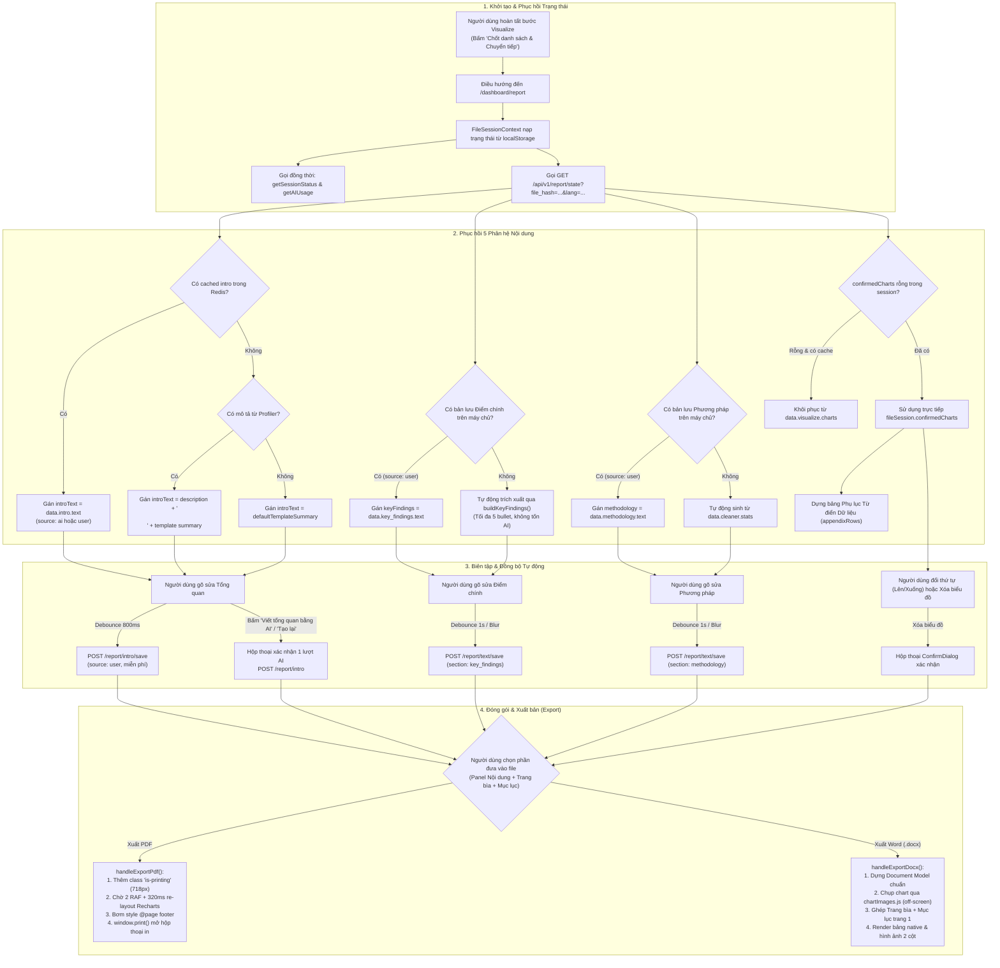

# Hướng dẫn Chuyên sâu & Đặc tả Kỹ thuật Module Report (Báo cáo Phân tích Dữ liệu)

> **Tài liệu tham chiếu chuẩn (Single Source of Truth) dành cho Người dùng cuối, Kỹ sư Dữ liệu và Đội ngũ Phát triển DataMind.**  
> *Mô-đun áp dụng:* Module 4 — Report (`/dashboard/report`) | *Cập nhật:* Tháng 11/2026 | *Định dạng:* UTF-8 (Unicode Normalization Form C - NFC).

---

## MỤC LỤC TỔNG QUAN

- [PART A — Tổng quan cho người dùng & Luồng dữ liệu](#part-a--tổng-quan-cho-người-dùng--luồng-dữ-liệu)
  - [1. Mục đích của Module Report & Dữ liệu tiếp nhận từ các bước trước](#1-mục-đích-của-module-report--dữ-liệu-tiếp-nhận-từ-các-bước-trước)
  - [2. Sơ đồ luồng dữ liệu & Hành trình sử dụng (Mermaid Flowchart)](#2-sơ-đồ-luồng-dữ-liệu--hành-trình-sử-dụng-mermaid-flowchart)
- [PART B — Kiến trúc & API Endpoints](#part-b--kiến-trúc--api-endpoints)
  - [1. Chi tiết 5 API Endpoints của Module Report](#1-chi-tiết-5-api-endpoints-của-module-report)
  - [2. Quản lý Cache Redis, TTLs & Cơ chế Vô hiệu hóa (Invalidation)](#2-quản-lý-cache-redis-ttls--cơ-chế-vô-hiệu-hóa-invalidation)
  - [3. Frontend State, Khôi phục Phiên sau F5 & Đồng bộ Lưu trữ](#3-frontend-state-khôi-phục-phiên-sau-f5--đồng-bộ-lưu-trữ)
- [PART C — Từng thành phần giao diện (UI/UX Elements Deep-Dive)](#part-c--từng-thành-phần-giao-diện-uiux-elements-deep-dive)
  - [Nhóm 1: Thanh Công cụ Đầu trang & Tác vụ Xuất bản (Header & Actions)](#nhóm-1-thanh-công-cụ-đầu-trang--tác-vụ-xuất-bản-header--actions)
  - [Nhóm 2: Cảnh báo Hết hạn Phiên (File Expired Banner)](#nhóm-2-cảnh-báo-hết-hạn-phiên-file-expired-banner)
  - [Nhóm 3: Khung Văn bản Báo cáo & Tiêu đề Chính (Report Title & Container)](#nhóm-3-khung-văn-bản-báo-cáo--tiêu-đề-chính-report-title--container)
  - [Nhóm 4: Bảng chọn "Nội dung đưa vào file", Trang bìa & Mục lục](#nhóm-4-bảng-chọn-nội-dung-đưa-vào-file-trang-bìa--mục-lục)
  - [Nhóm 5: Phần 1 — Tổng quan Báo cáo & AI Intro (Overview Section)](#nhóm-5-phần-1--tổng-quan-báo-cáo--ai-intro-overview-section)
  - [Nhóm 6: Phần 2 — Điểm chính (Key Findings Section)](#nhóm-6-phần-2--điểm-chính-key-findings-section)
  - [Nhóm 7: Phần 3 — Phương pháp & Làm sạch Dữ liệu (Methodology Section)](#nhóm-7-phần-3--phương-pháp--làm-sạch-dữ-liệu-methodology-section)
  - [Nhóm 8: Phần 4 — Phân tích Chi tiết & Quản lý Biểu đồ (Detailed Analysis Section)](#nhóm-8-phần-4--phân-tích-chi-tiết--quản-lý-biểu-đồ-detailed-analysis-section)
  - [Nhóm 9: Phần 5 — Phụ lục: Từ điển Dữ liệu (Appendix Section)](#nhóm-9-phần-5--phụ-lục-từ-điển-dữ-liệu-appendix-section)
- [PART D — Xuất file Báo cáo (Export Deep-Dive)](#part-d--xuất-file-báo-cáo-export-deep-dive)
  - [1. Xuất PDF qua Trình duyệt (Browser Print Flow & Dedicated Stylesheet)](#1-xuất-pdf-qua-trình-duyệt-browser-print-flow--dedicated-stylesheet)
  - [2. Xuất Microsoft Word DOCX (Document Model -> Native Word DOCX)](#2-xuất-microsoft-word-docx-document-model---native-word-docx)
  - [3. Các lỗi xuất file đã phát hiện & Root Cause trong mã nguồn](#3-các-lỗi-xuất-file-đã-phát-hiện--root-cause-trong-mã-nguồn)
  - [4. Bảng So sánh 4 Phương án Cải tiến Xuất file & Lộ trình Khuyến nghị](#4-bảng-so-sánh-4-phương-án-cải-tiến-xuất-file--lộ-trình-khuyến-nghị)
- [PART E — Quy tắc, Ngưỡng & Hằng số Hệ thống](#part-e--quy-tắc-ngưỡng--hằng-số-hệ-thống)
- [PART F — Vấn đề Hiện có & Điểm Không Nhất quán trong Mã nguồn](#part-f--vấn-đề-hiện-có--điểm-không-nhất-quán-trong-mã-nguồn)
- [PART G — Đề xuất Cải tiến Ngoài Xuất file (UX, Performance, AI)](#part-g--đề-xuất-cải-tiến-ngoài-xuất-file-ux-performance-ai)
- [PART H — Checklist Kiểm thử Thủ công (Manual Test Matrix)](#part-h--checklist-kiểm-thử-thủ-công-manual-test-matrix)

---

## PART A — Tổng quan cho người dùng & Luồng dữ liệu

Module **Report (Báo cáo Phân tích Dữ liệu)** là chặng đích (Module 4) trong chuỗi Pipeline xử lý dữ liệu 4 bước của DataMind:
$$\text{Profiler (Khám phá)} \longrightarrow \text{Cleaner (Làm sạch)} \longrightarrow \text{Visualize (Trực quan hóa)} \longrightarrow \text{Report (Báo cáo Tổng hợp)}$$

### 1. Mục đích của Module Report & Dữ liệu tiếp nhận từ các bước trước

#### 1.1. Mục đích nghiệp vụ
Report không phải là một dashboard xem dữ liệu thời gian thực (live BI dashboard) mà đóng vai trò là **trang biên tập và đóng gói báo cáo điều hành (Executive Data Analysis Report)**. Nó tập hợp:
- Cấu trúc 5 phần nội dung tiêu chuẩn:
  1. **Tổng quan (`sec_overview`):** Khái quát quy mô tập dữ liệu, bối cảnh nghiên cứu và đoạn tóm tắt mở đầu do AI tạo hoặc người dùng tự biên soạn.
  2. **Điểm chính (`sec_key_findings`):** Các phát hiện thống kê trọng tâm được trích xuất tự động từ danh sách biểu đồ (kèm số Hình tham chiếu), hoàn toàn không tốn lượt AI, cho phép tự do sửa hoặc khôi phục.
  3. **Phương pháp & Làm sạch (`sec_methodology`):** Minh bạch nhật ký chuẩn hóa dữ liệu từ bước Cleaner, tự động đồng bộ lên máy chủ và cảnh báo khi dữ liệu bị làm sạch lại.
  4. **Phân tích chi tiết (`sec_detailed_analysis`):** Trưng bày các biểu đồ đã chốt từ bước Visualize theo thứ tự tùy biến, kèm số thứ tự Hình/Bảng, nhận xét thống kê tự động và luận giải chuyên sâu của AI. Hỗ trợ toàn diện biểu đồ phân phối, cột rời rạc, xu hướng thời gian, biểu đồ tròn, biểu đồ hộp (Box plot) và phân tích tương quan (`CorrelationReportView`).
  5. **Phụ lục từ điển dữ liệu (`sec_appendix`):** Bảng tổng hợp toàn bộ các cột, ký hiệu chữ cái, kiểu dữ liệu, tỷ lệ khuyết, số giá trị duy nhất và ghi chú nguyên nhân ẩn biểu đồ.
- Bảng điều khiển linh hoạt **"Nội dung đưa vào file"** cho phép bật/tắt từng phần trong 5 phần trên, kèm tùy chọn **Trang bìa** (chỉnh sửa Tên báo cáo, Người thực hiện, Đơn vị/Lớp, Ngày) và **Mục lục**.
- Khả năng xuất bản đa định dạng: **PDF vector chuẩn in A4** (thông qua Browser Print Engine) và **Microsoft Word (.docx)** dạng văn bản và bảng thật có thể tiếp tục chỉnh sửa.

#### 1.2. Các trường dữ liệu chính xác tiếp nhận từ các module trước

Bảng dưới đây liệt kê chính xác các trường dữ liệu mà Report tiêu thụ từ ngữ cảnh chia sẻ (`FileSessionContext.jsx:10-45`) và từ API Backend (`report.py:102-156`):

| Module nguồn | Tên trường / Khóa dữ liệu | Kiểu dữ liệu | Mục đích sử dụng trong Report | Trích dẫn file:line |
| :--- | :--- | :--- | :--- | :--- |
| **Profiler** | `fileSession.fileHash` | `string` | Khóa định danh file để truy vấn Redis và kiểm tra phiên hết hạn | [`Report.jsx:222, 286`](file:///d:/datamind_prod/frontend/src/pages/Report.jsx#L222) |
| **Profiler** | `fileSession.fileName` | `string` | Tên file hiển thị trên tiêu đề báo cáo, trang bìa và tên file xuất | [`Report.jsx:287`](file:///d:/datamind_prod/frontend/src/pages/Report.jsx#L287) |
| **Profiler** | `fileSession.profileData.total_rows` / `row_count` | `number` | Số dòng dữ liệu gốc để tính `totalRows` | [`Report.jsx:290-292`](file:///d:/datamind_prod/frontend/src/pages/Report.jsx#L290) |
| **Profiler** | `fileSession.profileData.total_columns` / `col_count` | `number` | Số cột dữ liệu gốc để tính `totalCols` | [`Report.jsx:293-295`](file:///d:/datamind_prod/frontend/src/pages/Report.jsx#L293) |
| **Profiler** | `fileSession.profileData.columns` | `list[dict]` | Cấu trúc schema các cột gửi kèm payload tạo Intro AI và dựng Phụ lục | [`Report.jsx:657, 741`](file:///d:/datamind_prod/frontend/src/pages/Report.jsx#L657) |
| **Profiler** | `fileSession.userContext` | `dict \| string` | Mô tả mục đích nghiên cứu từ Profiler (`description`, `purpose`) | [`Report.jsx:379-382`](file:///d:/datamind_prod/frontend/src/pages/Report.jsx#L379) |
| **Profiler** | `context` (qua `/report/state`) | `dict` | Thông tin `{description, description_source, domain}` từ Redis | [`Report.jsx:355, 983`](file:///d:/datamind_prod/frontend/src/pages/Report.jsx#L355) |
| **Cleaner** | `cleaner` (qua `/report/state`) | `dict` | Tóm tắt lịch sử làm sạch: `clean_mode`, `stats` (`duplicate_rows_removed`, `missing_filled`, `columns_dropped`, `types_converted`) | [`Report.jsx:147-173, 358`](file:///d:/datamind_prod/frontend/src/pages/Report.jsx#L147) |
| **Cleaner** | `methodology` (qua `/report/state`) | `dict` | Bản lưu trên máy chủ: `{text, source: 'user', cleaning_hash, updated_at}` | [`Report.jsx:388-395`](file:///d:/datamind_prod/frontend/src/pages/Report.jsx#L388) |
| **Cleaner** | `cleaning_hash` (qua `/report/state`) | `string` | Mã băm 12 ký tự của cleaning_log hiện tại để phát hiện dữ liệu bị làm sạch lại | [`Report.jsx:195, 359, 721`](file:///d:/datamind_prod/frontend/src/pages/Report.jsx#L195) |
| **Cleaner** | `fileSession.methodologyText` | `string` | Văn bản phương pháp đã biên tập trong phiên làm việc | [`Report.jsx:306-309`](file:///d:/datamind_prod/frontend/src/pages/Report.jsx#L306) |
| **Visualize** | `fileSession.confirmedCharts` | `list[dict]` | Danh sách biểu đồ đã chốt (`chart_id`, `column`, `type`, `settings`, `payload`, `ai_explanation`, `r`, `n`...) | [`Report.jsx:298-302`](file:///d:/datamind_prod/frontend/src/pages/Report.jsx#L298) |
| **Visualize** | `fileSession.statisticalSummary` | `dict` | Thống kê toán học `columns` (stats từng cột, phân phối, box plot, nhận xét tự động) và ma trận tương quan `correlation_v2` | [`Report.jsx:559, 654, 928`](file:///d:/datamind_prod/frontend/src/pages/Report.jsx#L559) |
| **Visualize** | `fileSession.chartSettings` | `dict` | Cấu hình ghi đè live per-chart (`display_type`, `top_n`, `sort`, `hide_zero`, `method`, `threshold`) | [`Report.jsx:952, 965`](file:///d:/datamind_prod/frontend/src/pages/Report.jsx#L952) |
| **Visualize** | `theme` (qua `ChartThemeContext`) | `object` | Bảng màu đang áp dụng (`primary`, `neutral`, `palette`, v.v.) | [`Report.jsx:178, 953`](file:///d:/datamind_prod/frontend/src/pages/Report.jsx#L178) |
| **Auth** | `subscription`, `user` | `object` | Gói tài khoản người dùng (`free` hoặc `pro`) để quyết định hiển thị logo thương hiệu | [`Report.jsx:180-182`](file:///d:/datamind_prod/frontend/src/pages/Report.jsx#L180) |

---

### 2. Sơ đồ luồng dữ liệu & Hành trình sử dụng (Mermaid Flowchart)



---

## PART B — Kiến trúc & API Endpoints

Mọi tương tác dữ liệu chuyên biệt của module Report được định tuyến tập trung tại [`backend/app/routers/report.py`](file:///d:/datamind_prod/backend/app/routers/report.py).

### 1. Chi tiết 5 API Endpoints của Module Report

#### 1.1. `GET /api/v1/report/state`
- **Tập tin định nghĩa:** [`backend/app/routers/report.py:102-156`](file:///d:/datamind_prod/backend/app/routers/report.py#L102-L156)
- **Phương thức HTTP:** `GET`
- **Mục đích:** Khôi phục trạng thái toàn diện của báo cáo khi mở trang hoặc sau khi nhấn F5 mà **hoàn toàn không gọi LLM Gemini** và **không tiêu tốn hạn mức AI**.
- **Xác thực & Phân quyền:** Bắt buộc JWT hợp lệ (`current_user: dict = Depends(get_current_user)`). Không yêu cầu Pro.
- **Tham số truy vấn (Query Parameters):**
  - `file_hash` (`str`, bắt buộc): Mã băm SHA-256 của file dữ liệu.
  - `lang` (`str`, tùy chọn, mặc định `"vi"`): Ngôn ngữ của bản tóm tắt đã lưu (`"vi"` hoặc `"en"`).
- **Cấu trúc phản hồi (Response Body JSON thực tế):**
  ```json
  {
    "intro": {
      "text": "Tập dữ liệu sales.xlsx gồm 1,000 dòng và 12 cột...",
      "source": "ai",
      "charts_hash": "a4f8c9d1e2b3",
      "hash_version": 2,
      "generated_at": "2026-11-10T06:30:00Z"
    },
    "cleaner": {
      "clean_mode": "auto",
      "stats": {
        "duplicate_rows_removed": 15,
        "missing_filled": { "Age": 8, "Salary": 12 },
        "columns_dropped": ["Unused_Column_X"],
        "types_converted": { "OrderDate": "datetime" }
      },
      "actions_taken": 25,
      "ignored_cells_count": 0,
      "cleaning_hash": "7a8b9c0d1e2f"
    },
    "visualize": {
      "charts": [
        {
          "chart_id": "c_revenue_dist",
          "column": "Revenue",
          "type": "histogram",
          "user_title": "Phân phối Doanh thu"
        }
      ]
    },
    "context": {
      "description": "Dữ liệu bán hàng nội địa năm 2025",
      "description_source": "user",
      "domain": "ecommerce"
    },
    "methodology": {
      "text": "Dữ liệu đã được làm sạch theo chuẩn nội bộ phòng Tài chính...",
      "source": "user",
      "cleaning_hash": "7a8b9c0d1e2f",
      "updated_at": "2026-11-10T07:15:00Z"
    },
    "key_findings": {
      "text": "• Điểm đánh giá cao nhất là 'Chất lượng phục vụ'...",
      "source": "user",
      "charts_hash": "a4f8c9d1e2b3",
      "updated_at": "2026-11-10T07:20:00Z"
    },
    "cleaning_hash": "7a8b9c0d1e2f"
  }
  ```

---

#### 1.2. `POST /api/v1/report/intro`
- **Tập tin định nghĩa:** [`backend/app/routers/report.py:158-236`](file:///d:/datamind_prod/backend/app/routers/report.py#L158-L236)
- **Phương thức HTTP:** `POST`
- **Mục đích:** Sử dụng mô hình ngôn ngữ lớn (Google Gemini) để tạo đoạn tóm tắt mở đầu súc tích (4–5 câu) kết nối thông tin dataset, ngữ cảnh người dùng, kết quả làm sạch và các biểu đồ đã chọn.
- **Giới hạn tần suất:** `@limiter.limit("20/hour")` theo IP/User ([`report.py:159`](file:///d:/datamind_prod/backend/app/routers/report.py#L159)).
- **Xác thực & Hạn mức AI:** Yêu cầu đăng nhập (`get_current_user`), kiểm tra quota qua `check_ai_quota(user_id, db)` ([`report.py:195`](file:///d:/datamind_prod/backend/app/routers/report.py#L195)).
- **Quy tắc trừ lượt:**
  - **Chỉ ghi nhận trừ lượt khi tạo thành công từ AI** (`if not is_fallback:` [`report.py:207-208`](file:///d:/datamind_prod/backend/app/routers/report.py#L207)).
  - Nếu kết quả là câu văn bản dự phòng (`is_fallback: True`) do lỗi LLM, hoặc nếu người dùng bấm "Hủy" khiến request bị đóng (`request.is_disconnected()` -> HTTP 499 [`report.py:202-204`](file:///d:/datamind_prod/backend/app/routers/report.py#L202)), **tuyệt đối không trừ lượt của người dùng**.
- **Cấu trúc phản hồi:** Trả về `{ "intro": "...", "is_fallback": false, "usage": {...}, "charts_hash": "...", "provider": "..." }`.

---

#### 1.3. `POST /api/v1/report/intro/save`
- **Tập tin định nghĩa:** [`backend/app/routers/report.py:238-259`](file:///d:/datamind_prod/backend/app/routers/report.py#L238-L259)
- **Phương thức HTTP:** `POST`
- **Mục đích:** Lưu trữ văn bản tổng quan do người dùng tự tay chỉnh sửa (đánh dấu `source: "user"`). Hoàn toàn miễn phí, không gọi LLM, không trừ hạn mức AI.

---

#### 1.4. `POST /api/v1/report/text/save`
- **Tập tin định nghĩa:** [`backend/app/routers/report.py:261-311`](file:///d:/datamind_prod/backend/app/routers/report.py#L261-L311)
- **Phương thức HTTP:** `POST`
- **Mục đích:** Endpoint hợp nhất lưu văn bản người dùng chỉnh sửa (`source: "user"`) cho cả 2 mục: `"methodology"` và `"key_findings"` vào `report_sections`.
- **Cơ chế đặc biệt:** Nếu `text` rỗng hoặc chỉ khoảng trắng (`not body.text.strip()`), hệ thống sẽ **xóa bản ghi người dùng khỏi Redis** để tự động khôi phục về văn bản tính toán tự động ([`report.py:273-275`](file:///d:/datamind_prod/backend/app/routers/report.py#L273)).
- **Cấu trúc yêu cầu:**
  ```json
  {
    "file_hash": "e3b0c44298fc...",
    "section": "methodology", // hoặc "key_findings"
    "text": "Nội dung người dùng đã sửa...",
    "cleaning_hash": "7a8b9c0d1e2f",
    "charts_hash": "a4f8c9d1e2b3"
  }
  ```

---

#### 1.5. `POST /api/v1/report/methodology/save`
- **Tập tin định nghĩa:** [`backend/app/routers/report.py:312-328`](file:///d:/datamind_prod/backend/app/routers/report.py#L312-L328)
- **Phương thức HTTP:** `POST`
- **Mục đích:** Wrapper tương thích ngược, tự động chuyển tiếp request sang `save_report_text(section="methodology")`.

---

### 2. Quản lý Cache Redis, TTLs & Cơ chế Vô hiệu hóa (Invalidation)

Hệ thống quản lý dữ liệu đệm của Report được xây dựng trên Redis:
- **`report_sections:{user_id}:{file_hash}`** (TTL 24 giờ - 86400s): Lưu trữ từ điển chứa các phân hệ `profiler`, `cleaner`, `visualize`, `methodology`, và `key_findings`.
- **`report_intro:{user_id}:{file_hash}:{lang}`** (TTL 24 giờ - 86400s): Lưu trữ văn bản mở đầu theo từng ngôn ngữ độc lập.
- **`profiler_context:{user_id}:{file_hash}`** (TTL 24 giờ): Đọc ngữ cảnh mô tả và lĩnh vực.

#### 2.1. Thuật toán `charts_hash` Ổn định (v2)
- Được định nghĩa đồng nhất ở cả Backend ([`report.py:43-60`](file:///d:/datamind_prod/backend/app/routers/report.py#L43)) và Frontend ([`Report.jsx:123-130`](file:///d:/datamind_prod/frontend/src/pages/Report.jsx#L123)):
  1. Trích xuất ID ổn định qua `get_stable_chart_id`: Chỉ dùng `chart_id` hoặc `id`. Nếu cả hai thiếu, suy ra từ `{type}:{column}` hoặc `{type}:{column}:{col_y}`. **Tuyệt đối không dùng `user_title` hay `title`**.
  2. Lọc các ID hợp lệ, sắp xếp theo thứ tự bảng chữ cái (`ids.sort()`).
  3. Ghép chuỗi phân cách bởi dấu phẩy `ids.join(",")` và lấy 12 ký tự hex đầu tiên của mã băm MD5.
- *Ý nghĩa:* Khi người dùng đổi tên biểu đồ (`user_title`), đổi thứ tự biểu đồ hoặc thay đổi tùy chọn hiển thị, `charts_hash` **hoàn toàn không thay đổi**. Chỉ khi thêm mới hoặc xóa biểu đồ khỏi báo cáo, hash mới đổi.
- Bản ghi lưu trữ có trường `"hash_version": 2`. Với các bản ghi cũ thiếu trường này, frontend hỗ trợ cơ chế tương thích ngược ([`Report.jsx:986-999`](file:///d:/datamind_prod/frontend/src/pages/Report.jsx#L986)), so sánh với cả hash v2 và hash v1 để tránh báo động giả.

#### 2.2. Thuật toán `cleaning_hash`
- Được tính bằng 12 ký tự hex đầu tiên của MD5 chuỗi JSON tuần tự hóa của `cleaning_log` / `actions_taken` ([`report.py:62-70`](file:///d:/datamind_prod/backend/app/routers/report.py#L62)).
- Khi người dùng quay lại bước Cleaner và làm sạch lại, `currentCleaningHash` sẽ khác với `cleaning_hash` đã lưu trong `serverMethodologyMeta`, từ đó kích hoạt cảnh báo dữ liệu bị làm sạch lại ([`Report.jsx:721-726`](file:///d:/datamind_prod/frontend/src/pages/Report.jsx#L721)).

---

### 3. Frontend State, Khôi phục Phiên sau F5 & Đồng bộ Lưu trữ

Frontend Report kết hợp giữa Bộ nhớ phiên (`FileSessionContext` lưu trong `localStorage` với khóa `"data_mind_file_session"`) và cơ sở dữ liệu đệm Redis:
- `fileSession.confirmedCharts`: Mảng biểu đồ đã chốt từ Visualize.
- `fileSession.reportSectionsIncluded`: Đối tượng cấu hình các phần được đưa vào file (`overview`, `key_findings`, `methodology`, `detailed_analysis`, `appendix`).
- `fileSession.reportCover`: Đối tượng cấu hình trang bìa (`enabled`, `title`, `author`, `organization`, `date`, `toc`).
- `fileSession.methodologyText`: Văn bản phương pháp đã sửa.
- `fileSession.keyFindingsText`: Văn bản điểm chính đã sửa (gán `null` nếu dùng bản trích xuất tự động).

---

## PART C — Từng thành phần giao diện (UI/UX Elements Deep-Dive)

---

### Nhóm 1: Thanh Công cụ Đầu trang & Tác vụ Xuất bản (Header & Actions)

#### 1.1. Tiêu đề Trang & Huy hiệu Hạn mức AI
- Tiêu đề "Báo cáo Tương tác" (`report.title_interactive`) kèm icon `FileText`.
- Huy hiệu hạn mức AI `AIUsageBadge` hiển thị số lượt còn lại trong ngày (Free: 5 lượt/ngày, Pro: 30 lượt/ngày).
- Nút trợ giúp `PageHelpDocs` (`<PageHelpDocs pageId="report" />`) mở modal hướng dẫn nhanh và trỏ link chi tiết về tài liệu in-app `/docs/report/overview`.
- Code: [`Report.jsx:1016-1027`](file:///d:/datamind_prod/frontend/src/pages/Report.jsx#L1016).

#### 1.2. Cụm nút Xuất PDF & Hướng dẫn In
- Nút chính "Xuất PDF" (`report.export_pdf`): Kích hoạt `handleExportPdf()`.
- Nút dấu hỏi chấm `HelpCircle` cạnh nút PDF: Mở popover hướng dẫn in 4 bước (`showPrintGuide`):
  1. **Bước 1 — Máy in đích:** Chọn *"Lưu dưới dạng PDF"* (Save as PDF).
  2. **Bước 2 — Màu sắc:** Chọn *"Màu"* (Color) để giữ nguyên sắc thái biểu đồ.
  3. **Bước 3 — Tùy chọn:** Bỏ chọn *"Đầu trang và chân trang"* (tránh trùng lặp với chân trang DataMind) và BẬT *"Đồ họa nền"* (Background graphics) để in màu nền các ô ma trận tương quan.
  4. **Bước 4 — Lề:** Chọn *"Mặc định"* (Default).
- Code: [`Report.jsx:1029-1083`](file:///d:/datamind_prod/frontend/src/pages/Report.jsx#L1029).

#### 1.3. Nút Xuất Word (.docx)
- Icon `FileType2`, nhãn "Xuất Word (.docx)". Khi đang xử lý, hiển thị tiến trình chụp biểu đồ: `"Đang tạo file Word… (X/Y biểu đồ)"` (`report.export_docx_progress`).
- Code: [`Report.jsx:1085-1103`](file:///d:/datamind_prod/frontend/src/pages/Report.jsx#L1085).

---

### Nhóm 2: Cảnh báo Hết hạn Phiên (File Expired Banner)
- Hiển thị khi `fileExpired === true` (file nhị phân trên Redis hết hạn 5 giờ theo `FILE_BYTES_TTL`), cho phép người dùng tải lại file trực tiếp mà không mất cấu hình báo cáo.
- Code: [`Report.jsx:1106-1116`](file:///d:/datamind_prod/frontend/src/pages/Report.jsx#L1106).

---

### Nhóm 3: Khung Văn bản Báo cáo & Tiêu đề Chính (Report Title & Container)
- Khung tài liệu `reportRef` (`.report-print-root`): Nền trắng, viền `#EAEAEA`, bo góc 12px.
- Khi in hoặc xuất PDF, class `is-printing` ép chiều rộng cố định **718px** (chiều rộng khả dụng của A4 portrait 96 DPI sau khi trừ lề).
- Tiêu đề màn hình hiển thị tên file và ngày tạo; khi in chuyển thành dòng meta thu gọn 1 dòng: `Tên file · X dòng × Y cột · Ngày`.
- Code: [`Report.jsx:1119-1148`](file:///d:/datamind_prod/frontend/src/pages/Report.jsx#L1119).

---

### Nhóm 4: Bảng chọn "Nội dung đưa vào file", Trang bìa & Mục lục
- **Bảng chọn phân hệ (`report.sections_included_label`):**
  - Gồm 5 checkbox: `Tổng quan`, `Điểm chính`, `Phương pháp`, `Phân tích chi tiết`, `Phụ lục`.
  - Cùng 2 checkbox xuất file: `Trang bìa` (`export_cover_label`) và `Mục lục` (`export_toc_label`).
- **Cấu hình Trang bìa (khi bật):**
  - 4 ô nhập liệu: Tên báo cáo, Người thực hiện, Đơn vị / Lớp, Ngày báo cáo.
  - Ghi chú phân hạng tài khoản:
    - Tài khoản Free: Hiển thị dòng ghi chú *"Bản Free: Trang bìa có logo DataMind (~3 cm) ở đầu trang."* kèm liên kết nâng cấp Pro.
    - Tài khoản Pro: Hiển thị dòng *"Bản Pro: Trang bìa không gắn logo thương hiệu DataMind."*.
- Phân giải quyền hạn: Kiểm tra thuộc tính gói qua `(subscription?.plan || user?.tier || user?.plan || "free").toLowerCase()`.
- Code: [`Report.jsx:1151-1275`](file:///d:/datamind_prod/frontend/src/pages/Report.jsx#L1151).

---

### Nhóm 5: Phần 1 — Tổng quan Báo cáo & AI Intro (Overview Section)
- **Huy hiệu nguồn gốc & Cảnh báo:**
  - Huy hiệu `"AI"` hoặc `"Đã chỉnh sửa"`.
  - Huy hiệu màu vàng `"Biểu đồ đã thay đổi"` (`isChartsHashDifferent === true`): Cảnh báo khi danh sách biểu đồ hiện tại khác với danh sách biểu đồ lúc tạo đoạn mở đầu.
- **Tác vụ AI:** Nút "Viết tổng quan bằng AI" / "Tạo lại" tiêu tốn 1 lượt AI, có thanh tiến trình kèm nút "Hủy". Nếu người dùng đã tự tay sửa văn bản trước đó, hệ thống sẽ mở `ConfirmDialog` xác nhận trước khi ghi đè.
- **Lưu trữ tự động:** Textarea tự động gửi `POST /report/intro/save` sau 800ms ngừng gõ. Trong bản in PDF, textarea được thay thế bằng thẻ `div.print-only` giữ nguyên định dạng xuống dòng (`whitespace-pre-wrap`).
- Code: [`Report.jsx:1280-1395`](file:///d:/datamind_prod/frontend/src/pages/Report.jsx#L1280).

---

### Nhóm 6: Phần 2 — Điểm chính (Key Findings Section)
- **Cơ chế hoạt động:** Trích xuất tự động tối đa 5 điểm cốt lõi nhất từ danh sách biểu đồ qua hàm `buildKeyFindings` ([`reportFindings.js:70-384`](file:///d:/datamind_prod/frontend/src/utils/reportFindings.js#L70)):
  - Đánh giá thang đo Likert (cực trị điểm trung bình cao/thấp nhất: 90 điểm; tỷ lệ top box $\ge 70\%$ hoặc $\le 30\%$: 75/50 điểm).
  - Tương quan mạnh nhất từ ma trận tương quan ($|r| \ge 0,5$: 80/70 điểm).
  - Giá trị chiếm ưu thế ở cột danh mục/nhiều lựa chọn ($\ge 70\%$: 85 điểm; $\ge 50\%$: 65 điểm; top 3 chiếm $\ge 70\%$: 55 điểm).
  - Xu hướng chuỗi thời gian tăng/giảm $\ge 30\%$ (60 điểm).
  - Phát hiện giá trị ngoại lai ở biến số liên tục (40 điểm).
  - Tự động gắn số Hình tham chiếu chính xác (ví dụ: `(Hình 1)`, `(Hình 2)`).
  - Giới hạn tối đa 1 bullet cho mỗi biểu đồ và chọn tối đa 5 bullet có điểm cao nhất.
- **Biên tập & Khôi phục:**
  - Bấm "Chỉnh sửa" để mở textarea, tự động lưu lên máy chủ sau 1s ngừng gõ (`POST /report/text/save` với `section: 'key_findings'`).
  - Nút "Khôi phục bản tự động": Mở hộp thoại `ConfirmDialog` xác nhận trước khi xóa bản sửa của người dùng để quay lại danh sách tự động tính toán.
  - Cảnh báo vàng "Biểu đồ đã thay đổi" khi `currentChartsHash` lệch so với lúc lưu điểm chính.
- Code: [`Report.jsx:1400-1520`](file:///d:/datamind_prod/frontend/src/pages/Report.jsx#L1400).

---

### Nhóm 7: Phần 3 — Phương pháp & Làm sạch Dữ liệu (Methodology Section)
- **Tự động sinh nội dung:** Phân tích `cleanerState.stats` từ bước Cleaner:
  - Chế độ tự động / thủ công.
  - Số dòng trùng lặp đã xóa, số ô trống đã điền.
  - Danh sách cột bị xóa bỏ và số lượng cột đã chuyển đổi kiểu dữ liệu.
  - Nếu không qua làm sạch: *"Dữ liệu được giữ nguyên, không làm sạch."*.
- **Lưu trữ trên máy chủ:**
  - Khi gõ sửa, hàm `handleMethodologyChange` tự động debounce 1s và lưu ngay khi blur vào `POST /report/methodology/save`.
  - Huy hiệu trạng thái: `"Đã lưu · HH:mm"` (hoặc `"Đã lưu · DD/MM HH:mm"`).
  - Nút "Khôi phục bản tự động": Mở hộp thoại `ConfirmDialog` xác nhận trước khi khôi phục.
  - Cảnh báo vàng `"Dữ liệu đã được làm sạch lại"` (`isCleaningStale === true`): Xuất hiện khi `cleaning_hash` của dữ liệu hiện tại khác với hash lúc lưu phương pháp.
- Code: [`Report.jsx:1525-1620`](file:///d:/datamind_prod/frontend/src/pages/Report.jsx#L1525).

---

### Nhóm 8: Phần 4 — Phân tích Chi tiết & Quản lý Biểu đồ (Detailed Analysis Section)
- **Đánh số thứ tự Hình/Bảng:**
  - Biểu đồ được gắn số thứ tự qua helper `formatFigureTitle(n, title)`: `Hình 1. <Tên biểu đồ>`, `Hình 2. <Tên biểu đồ>`.
  - Bảng tương quan gắn số thứ tự qua `getCorrTableCaption(m)`: `Bảng 1. Các cặp cột liên quan mạnh nhất`.
- **Thao tác biểu đồ:**
  - Di chuyển Lên (`moveChart(idx, -1)`) / Di chuyển Xuống (`moveChart(idx, 1)`).
  - Xóa biểu đồ (`handleRemoveChart`): Mở hộp thoại `ConfirmDialog` giải thích rõ biểu đồ bị xóa khỏi báo cáo nhưng vẫn còn nguyên ở bước Visualize và cảnh báo cập nhật lại AI Intro.
- **Hỗ trợ đầy đủ các loại biểu đồ:**
  - Histogram (`DistributionChart`), Bar chart (`CategoricalChart`), Đường xu hướng (`TrendChart`), Biểu đồ tròn (`PieChartComponent`).
  - **Biểu đồ hộp (`BoxPlotChart`):** Hiển thị trực quan râu nến (whiskers), Q1, Trung vị (Median), Q3, Trung bình (Mean), điểm ngoại lai và bảng số liệu tóm tắt.
  - **Chế độ xem tương quan tĩnh (`CorrelationReportView`):**
    - Câu tóm tắt phương pháp và ngưỡng tương quan, nêu rõ số lượng cặp và cặp có liên quan mạnh nhất.
    - Bảng Top 8 cặp có hệ số $|r| \ge threshold$.
    - Ma trận tương quan thu gọn (tối đa 12 cột) với các ô màu phân kỳ theo thang độ.
    - Bảng chú giải chữ cái đại diện cho các cột dữ liệu.
  - **Cặp tương quan rời rạc / liên tục (`corr_pair`):** Lưới ô đếm giao thoa hoặc biểu đồ phân tán ScatterChart.
- **Nhận xét tự động & AI giải thích:**
  - Khối "Điểm đáng chú ý" hiển thị các nhận xét thống kê tự động.
  - Khối "AI Phân tích": Hiển thị lời giải thích kinh doanh đã sinh ở bước Visualize. Nếu biểu đồ chưa có giải thích AI, khối này **tự động bị ẩn hoàn toàn trong bản in PDF và file Word**.
- Code: [`Report.jsx:1625-1970`](file:///d:/datamind_prod/frontend/src/pages/Report.jsx#L1625).

---

### Nhóm 9: Phần 5 — Phụ lục: Từ điển Dữ liệu (Appendix Section)
- Khung có thể thu gọn / mở rộng (`isAppendixExpanded`), mặc định thu gọn trên màn hình để tránh choán chỗ nhưng **luôn bung đầy đủ khi in hoặc xuất file**.
- Bảng từ điển liệt kê toàn bộ các cột trong bộ dữ liệu:
  - Cột 1: Tên cột và ký hiệu chữ cái đại diện `[A]`, `[B]`.
  - Cột 2: Kiểu dữ liệu nhận diện (Số liên tục, Thang đo đánh giá, Rời rạc, Phân loại, Nhiều lựa chọn, Thời gian, Văn bản).
  - Cột 3: Tỷ lệ khuyết (% missing).
  - Cột 4: Số lượng giá trị duy nhất (unique count).
  - Cột 5: Ghi chú (mức thang đo min–max; hoặc lý do ẩn biểu đồ: thiếu quá nhiều $\ge 60\%$, chỉ có 1 giá trị duy nhất, hoặc văn bản tự do).
- Code: [`Report.jsx:1975-2055`](file:///d:/datamind_prod/frontend/src/pages/Report.jsx#L1975).

---

## PART D — Xuất file Báo cáo (Export Deep-Dive)

---

### 1. Xuất PDF qua Trình duyệt (Browser Print Flow & Dedicated Stylesheet)

#### 1.1. Luồng thực thi chi tiết của `handleExportPdf`
Định nghĩa tại [`Report.jsx:858-926`](file:///d:/datamind_prod/frontend/src/pages/Report.jsx#L858):
1. **Khóa trạng thái & Đặt tên file in:** Bật `isExportingPdf = true`. Lưu `document.title` cũ và gán `document.title = "DataMind_Report_" + cleanFileName`.
2. **Bơm Dynamic `@page` CSS:** Tạo thẻ `<style id="print-page-style">` chèn trực tiếp vào `<head>`, quy định khổ in A4 portrait (`margin: 16mm 14mm`), chân trang `@bottom-left` chứa tên file và `@bottom-right` chứa số trang song ngữ (`Trang X / Y` hoặc `Page X / Y`).
3. **Kích hoạt Lớp Co giãn Khổ in A4:** Gắn class `html.is-printing`. Chiều rộng container chính co về đúng **718px** (`index.css:171`).
4. **Đồng bộ Layout Recharts:** Chờ font chữ nạp xong (`document.fonts.ready`), chờ 2 frame hoạt họa (`requestAnimationFrame`) và chờ tiếp 320ms để mọi container Recharts tự tính toán lại tọa độ SVG.
5. **Kích hoạt in:** Gọi `window.print()`. Khi đóng hộp thoại in, sự kiện `afterprint` kích hoạt hàm `cleanup()` gỡ bỏ class `is-printing`, xóa thẻ style động và trả lại tiêu đề trang ban đầu.

#### 1.2. Bố cục Biểu đồ 2 Cột khi In (`.report-charts-grid`)
- Được thiết lập tại [`index.css:182-215`](file:///d:/datamind_prod/frontend/src/index.css#L182):
  - Khi in hoặc khi có class `is-printing`, danh sách biểu đồ chuyển thành lưới CSS Grid 2 cột: `grid-template-columns: repeat(2, minmax(0, 1fr))`, khoảng cách `10pt`.
  - Biểu đồ toàn phần (`report-chart-full` như Ma trận tương quan, Cặp biến, Biểu đồ xu hướng): Trải rộng cả 2 cột (`grid-column: 1 / -1`), chiều cao tự động.
  - Biểu đồ bán phần (`report-chart-half` như Histogram, Bar, Boxplot): Chiếm 1 cột (`grid-column: span 1`), chiều cao khung vẽ cố định `170px`.

---

### 2. Xuất Microsoft Word DOCX (Document Model -> Native Word DOCX)

Quy trình xuất DOCX được xây dựng độc lập và chuyên nghiệp qua 3 module: [`reportDocument.js`](file:///d:/datamind_prod/frontend/src/utils/reportDocument.js), [`chartImages.js`](file:///d:/datamind_prod/frontend/src/utils/chartImages.js) và [`exportDocx.js`](file:///d:/datamind_prod/frontend/src/utils/exportDocx.js):

#### 2.1. Cấu trúc Trang 1: Khối Bìa & Mục lục (Cover & TOC on Page 1)
- **Không ngắt trang toàn trang sau bìa:**
  - Khối bìa nằm ở đầu Trang 1:
    - Tài khoản Free: Logo DataMind rộng ~3 cm (113px) căn giữa trên cùng. Tài khoản Pro: không có logo.
    - Tiêu đề báo cáo: Cỡ chữ 22pt in đậm, màu xanh chủ đạo thương hiệu `#1B4324`.
    - Dòng chữ nghiêng: *"Tập dữ liệu: <tên file>"*.
    - Bảng thông tin 2 cột không viền, chỉ hiển thị các trường đã điền (Người thực hiện, Đơn vị/Lớp, Ngày) và Quy mô (`232 dòng × 64 cột`).
  - Nếu bật Mục lục (`documentModel.toc === true`):
    - Mục lục được đặt ngay dưới khối bìa trên cùng Trang 1. Tiêu đề "Mục lục" 14pt bold màu `#1B4324` (dùng thẻ Paragraph thường, không dùng style Heading để tránh tự lọt vào mục lục).
    - Phía sau Mục lục là một lệnh ngắt trang (`PageBreak`), phần thân bài viết bắt đầu từ Trang 2.
  - Nếu tắt Mục lục: Không có lệnh ngắt trang, phần thân bài viết bắt đầu ngay dưới khối thông tin bìa ở Trang 1.
  - Nếu tắt Trang bìa: Không có khối bìa; Mục lục (nếu bật) bắt đầu ngay đầu Trang 1.

#### 2.2. Định dạng Văn bản & Bảng Native
- Font chữ đồng bộ xuyên suốt tài liệu: **Arial**.
- Heading 1: 16pt, bold, màu `#1B4324`, khoảng cách trước 12pt / sau 6pt (`keepNext: true`).
- Heading 2: 13pt, bold, màu `#1B4324`, khoảng cách trước 10pt / sau 4pt (`keepNext: true`).
- Đoạn văn thân bài: 10pt `#121A14`, khoảng cách trước 0pt / sau 6pt, dãn dòng 1.15.
- Gạch đầu dòng: Khoảng cách sau 2pt.
- Chú thích hình ảnh: 9.5pt in nghiêng `#626C65`, khoảng cách sau 8pt.
- Bảng dữ liệu thật (Native Word Tables):
  - Bảng Top 8 cặp tương quan: Viền mảnh `#D1D5DB`, tiêu đề cột nền `#F9F9F8`, hỗ trợ thuộc tính `cantSplit: true` chống cắt đôi hàng.
  - Ma trận tương quan thu gọn: Từng ô tính toán màu nền phân kỳ chính xác theo hệ số $r$, chữ số rõ nét, cho phép bôi đen copy sang Excel.
  - Bảng từ điển dữ liệu: Kẻ viền hoàn chỉnh, cột ký hiệu căn giữa, tỷ lệ khuyết và số giá trị duy nhất căn phải.

#### 2.3. Bố cục 2 Biểu đồ trên 1 Hàng (Two Charts per Row)
- Module [`chartImages.js`](file:///d:/datamind_prod/frontend/src/utils/chartImages.js) dựng container ẩn ngoài màn hình (off-screen stage) với độ phân giải chuẩn (960×440px toàn phần, hoặc 640×400px bán phần; 300px cho Box plot), tắt mọi animation, chờ font và chuyển thành ảnh PNG độ nét cao.
- Trong [`exportDocx.js:518-560`](file:///d:/datamind_prod/frontend/src/utils/exportDocx.js#L518), thuật toán duyệt qua danh sách các block: Khi gặp 2 biểu đồ bán phần liên tiếp (`width: "half"`), hệ thống tự động gom nhóm thành một hàng bảng 2 cột không viền (`cantSplit: true`), mỗi cột rộng 50% chứa ảnh biểu đồ, chú thích hình và các gạch đầu dòng nhận xét tự động.

#### 2.4. Lưu ý Đặc thù khi Mở File Word (Known Limitation)
- Do Microsoft Word sử dụng trường mã nguồn mở `TableOfContents` native của chuẩn OpenXML, khi mở tệp lần đầu, Word sẽ hiển thị hộp thoại cảnh báo:  
  *"This document contains fields that may refer to other files. Do you want to update the fields in this document?"* (Tài liệu này chứa các trường tham chiếu. Bạn có muốn cập nhật không?).  
- **Cách xử lý:** Bấm **Yes** (Có) để Word tự động tính toán số trang chính xác cho bảng Mục lục.

---

### 3. Các lỗi xuất file đã phát hiện & Root Cause trong mã nguồn

| STT | Hiện tượng lỗi | Nguyên nhân gốc rễ trong mã nguồn (Root Cause) | Giải pháp đã xử lý triệt để |
| :---: | :--- | :--- | :--- |
| **1** | **Văn bản trong Textarea bị cuộn mất chữ trong PDF** | `<textarea>` có thuộc tính cuộn ẩn. Blink print engine không tự giãn chiều cao. | Ẩn `<textarea>` trong bản in, hiển thị thẻ `<div className="print-only whitespace-pre-wrap">` ([`Report.jsx:1387, 1611`](file:///d:/datamind_prod/frontend/src/pages/Report.jsx#L1387)). |
| **2** | **Khoảng trắng lớn (gap) thừa thãi trong file Word** | Lệnh ngắt trang tự động trước mỗi tiêu đề và chuỗi `keepNext` kéo dài nối liền ảnh + caption + nhận xét + AI text. | Loại bỏ toàn bộ `pageBreakBefore` ở các heading thân bài; chỉ đặt `keepNext` trên heading -> đoạn kế tiếp và ảnh -> chú thích ([`exportDocx.js:466, 565`](file:///d:/datamind_prod/frontend/src/utils/exportDocx.js#L466)). |
| **3** | **Bảng Mục lục Word tự chèn chính nó vào mục lục** | Tiêu đề "Mục lục" bị gán style Heading 1 khiến Word hiểu lầm là một mục nội dung. | Đổi tiêu đề "Mục lục" thành đoạn văn bản thường (`Paragraph`) cỡ 14pt bold màu `#1B4324` ([`exportDocx.js:418`](file:///d:/datamind_prod/frontend/src/utils/exportDocx.js#L418)). |
| **4** | **Lỗi `ReferenceError: isPie is not defined`** | Biến `isPie` trong `reportDocument.js` được tham chiếu trong nhánh Box plot khi chưa khai báo phạm vi. | Khai báo chuẩn hóa `const isPie = displayType === "pie" || chart.type === "pie"` trước các nhánh xử lý ([`reportDocument.js:388`](file:///d:/datamind_prod/frontend/src/utils/reportDocument.js#L388)). |
| **5** | **Logo DataMind hiển thị sai hạng tài khoản** | Nhận diện plan chỉ đọc từ một trường đơn lẻ thay vì dự phòng đa nguồn. | Hợp nhất kiểm tra plan qua `(subscription?.plan || user?.tier || user?.plan || "free").toLowerCase()` ([`Report.jsx:181`](file:///d:/datamind_prod/frontend/src/pages/Report.jsx#L181), [`exportDocx.js:111`](file:///d:/datamind_prod/frontend/src/utils/exportDocx.js#L111)). |

---

### 4. Bảng So sánh 4 Phương án Cải tiến Xuất file & Lộ trình Khuyến nghị

| Tiêu chí | Phương án A: Browser Print CSS (PDF hiện tại) | Phương án B: Client HTML2Canvas + jsPDF | Phương án C: Document Model -> Native Docx (Word hiện tại) | Phương án D: Server-side PDF (Headless Chromium / R2) |
| :--- | :--- | :--- | :--- | :--- |
| **Cơ chế** | In trực tiếp qua CSS `@media print` và hộp thoại in của trình duyệt | Chụp ảnh toàn bộ DOM rồi cắt lát dán vào PDF | Xây dựng Document Model độc lập; render file `.docx` native với `docx` | Backend chạy Puppeteer/Playwright mở trang và xuất PDF tải thẳng |
| **Chất lượng chữ** | **Vector 100%**, sắc nét, bôi đen tìm kiếm được | Kém (ảnh vỡ hạt, file nặng 10–25MB, không bôi đen chữ) | **Vector 100%**, font Arial chuẩn hóa, chỉnh sửa tự do | **Vector 100%**, đồng nhất tuyệt đối trên mọi OS |
| **Chất lượng biểu đồ** | **Vector SVG sắc nét**, tỷ lệ chuẩn A4 | Mờ vỡ ở trục tọa độ và số liệu | Ảnh PNG sắc nét trích xuất từ off-screen stage; bảng native | **Vector SVG sắc nét tuyệt đối** |
| **Trải nghiệm** | 2 bước: Bấm xuất -> Hộp thoại in hiện lên -> Chọn Lưu PDF | 1 chạm tải file | 1 chạm tải file `.docx` | **1 chạm tải file PDF trực tiếp** |
| **Tài nguyên máy chủ** | **0% RAM/CPU server**, xử lý 100% phía client | Tốn RAM trình duyệt client | Tốn nhẹ RAM client khi render ảnh | **Rất tốn kém:** Cần 300–600MB RAM server, dễ nghẽn khi nhiều người dùng cùng lúc |

---

## PART E — Quy tắc, Ngưỡng & Hằng số Hệ thống

| Tên Hằng số / Quy ước | Giá trị quy ước | Ý nghĩa kỹ thuật | Trích dẫn file:line |
| :--- | :--- | :--- | :--- |
| `CACHE_DEFAULT_TTL` | `86400` giây (24 giờ) | Thời gian sống của cache báo cáo trong Redis (`report_sections`, `report_intro`) | [`backend/app/core/rules.py:123`](file:///d:/datamind_prod/backend/app/core/rules.py#L123) |
| `FILE_BYTES_TTL` | `18000` giây (5 giờ) | Thời gian sống của file nhị phân trong Redis trước khi kích hoạt `FileExpiredBanner` | [`backend/app/core/rules.py:126`](file:///d:/datamind_prod/backend/app/core/rules.py#L126) |
| `AI_FREE_DAILY_LIMIT` | `5` lượt/ngày | Hạn mức AI hàng ngày gói Miễn phí | [`backend/app/core/config.py`](file:///d:/datamind_prod/backend/app/core/config.py) |
| `AI_PRO_DAILY_LIMIT` | `30` lượt/ngày | Hạn mức AI hàng ngày gói Chuyên nghiệp (Pro) | [`backend/app/core/config.py`](file:///d:/datamind_prod/backend/app/core/config.py) |
| Giới hạn `/report/intro` | `20/hour` | Giới hạn tần suất gọi AI tạo intro theo người dùng | [`backend/app/routers/report.py:159`](file:///d:/datamind_prod/backend/app/routers/report.py#L159) |
| Độ dài `charts_hash` | `12` ký tự | Độ dài MD5 rút gọn của danh sách ID biểu đồ ổn định (v2) | [`backend/app/routers/report.py:60`](file:///d:/datamind_prod/backend/app/routers/report.py#L60) |
| Debounce lưu Intro | `800` ms | Thời gian chờ ngừng gõ trước khi gọi `POST /report/intro/save` | [`frontend/src/pages/Report.jsx:456`](file:///d:/datamind_prod/frontend/src/pages/Report.jsx#L456) |
| Debounce lưu Phương pháp | `1000` ms | Thời gian chờ ngừng gõ trước khi gọi `POST /report/methodology/save` | [`frontend/src/pages/Report.jsx:509`](file:///d:/datamind_prod/frontend/src/pages/Report.jsx#L509) |
| Debounce lưu Điểm chính | `1000` ms | Thời gian chờ ngừng gõ trước khi gọi `POST /report/text/save` | [`frontend/src/pages/Report.jsx:601`](file:///d:/datamind_prod/frontend/src/pages/Report.jsx#L601) |
| Khổ in chuẩn A4 (Print Root) | `718` px | Chiều rộng vùng in A4 tại 96 DPI sau khi trừ lề 14mm hai bên | [`frontend/src/index.css:172`](file:///d:/datamind_prod/frontend/src/index.css#L172) |
| Lề in ấn chuẩn | `16mm 14mm` | Lề trên/dưới 16mm, lề trái/phải 14mm | [`frontend/src/index.css:220`](file:///d:/datamind_prod/frontend/src/index.css#L220) |
| Lề tài liệu Word DOCX | `1134` twips (20mm) | Lề 2 cm chuẩn hành chính trong Microsoft Word | [`frontend/src/utils/exportDocx.js:154`](file:///d:/datamind_prod/frontend/src/utils/exportDocx.js#L154) |
| Kích thước logo bìa Free | `113` px (~3 cm) | Chiều rộng logo DataMind căn giữa đầu trang bìa bản Free | [`frontend/src/utils/exportDocx.js:257`](file:///d:/datamind_prod/frontend/src/utils/exportDocx.js#L257) |
| Số cặp tương quan trong Report | Tối đa `8` cặp | Giới hạn số hàng trong bảng tương quan của `CorrelationReportView` | [`CorrelationReportView.jsx:87`](file:///d:/datamind_prod/frontend/src/components/charts/CorrelationReportView.jsx#L87) |
| Số cột ma trận thu gọn | Tối đa `12` cột | Số cột tối đa hiển thị trong ma trận thu gọn để vừa vặn trang in A4 | [`CorrelationReportView.jsx:100`](file:///d:/datamind_prod/frontend/src/components/charts/CorrelationReportView.jsx#L100) |
| Số bullet Điểm chính tối đa | Tối đa `5` điểm | Giới hạn số phát hiện thống kê trọng tâm trích xuất tự động | [`frontend/src/utils/reportFindings.js:370`](file:///d:/datamind_prod/frontend/src/utils/reportFindings.js#L370) |

---

## PART F — Vấn đề Hiện có & Điểm Không Nhất quán trong Mã nguồn

1. **Chưa hỗ trợ đổi tên trực tiếp biểu đồ trong Report:**
   - *Hiện trạng:* Người dùng muốn đổi tiêu đề biểu đồ phải quay ngược lại bước Visualize (`/dashboard/visualize`).
   - *Đề xuất:* Cho phép nhấp đúp vào tiêu đề để sửa trực tiếp (Inline Rename), lưu vào `chartSettings[cid].user_title`.
2. **Xuất PDF vẫn cần qua hộp thoại in của trình duyệt:**
   - *Hiện trạng:* Người dùng phải thực hiện 2 thao tác (Bấm Xuất PDF -> Chọn Lưu PDF trong hộp thoại in).
   - *Đề xuất:* Nghiên cứu tích hợp service xuất PDF tải trực tiếp 1 chạm (Direct PDF Download - R2) chạy bằng Chromium không đầu trên worker độc lập.
3. **Phân tích so sánh theo nhóm ("So sánh theo nhóm"):**
   - *Hiện trạng:* Chưa có chức năng phân tích cắt lát theo nhóm (Group-by Comparison, ví dụ so sánh thu nhập theo Giới tính hoặc Khu vực) ngay trong báo cáo.

---

## PART G — Đề xuất Cải tiến Ngoài Xuất file (UX, Performance, AI)

1. **Tải PDF Trực tiếp 1 Chạm (Direct PDF Download - R2):**
   - Xây dựng worker microservice với Headless Chromium để kết xuất PDF vector và trả thẳng về trình duyệt dưới dạng file đính kèm, loại bỏ hoàn toàn sự phụ thuộc vào thao tác in của người dùng.
2. **Chỉnh sửa Tiêu đề & Chú thích Biểu đồ Trực tiếp (Inline Edit):**
   - Bổ sung icon cây bút `Edit3` cạnh tiêu đề biểu đồ trên giao diện Report để biên tập nhanh tiêu đề mà không làm thay đổi `charts_hash`.
3. **Mô-đun Phân tích "So sánh theo nhóm" (Cross-tabulation & Group Comparisons):**
   - Hỗ trợ biểu đồ nhóm (Grouped Bar, Clustered Column) đối sánh các tiêu chí đánh giá giữa các phân khúc khách hàng hoặc phòng ban.

---

## PART H — Checklist Kiểm thử Thủ công (Manual Test Matrix)

| Mã test | Quy trình kiểm thử từng bước | Kết quả kỳ vọng | Đạt/Chưa đạt |
| :---: | :--- | :--- | :---: |
| **TC-REP-01** | 1. Tải lên file mới, làm sạch, chốt 4 biểu đồ ở Visualize.<br/>2. Chuyển sang bước Report. | Hiển thị đầy đủ 5 phân hệ: Tổng quan, Điểm chính, Phương pháp, Phân tích chi tiết và Phụ lục. | ĐẠT |
| **TC-REP-02** | 1. Bấm nút "Viết tổng quan bằng AI".<br/>2. Quan sát hộp thoại xác nhận.<br/>3. Bấm "Tiếp tục". | Hiện hộp thoại xác nhận 1 lượt AI. Thanh tiến trình chạy với đồng hồ giây. Sau khi hoàn thành, văn bản 4–5 câu xuất hiện, số lượt AI giảm đi 1. | ĐẠT |
| **TC-REP-03** | 1. Sửa văn bản ở mục Điểm chính hoặc Phương pháp.<br/>2. Đợi 1 giây.<br/>3. Nhấn F5 tải lại trang. | Xuất hiện huy hiệu "Đã lưu · HH:mm". Sau khi F5, nội dung đã sửa được nạp lại đầy đủ từ máy chủ. | ĐẠT |
| **TC-REP-04** | 1. Bấm "Khôi phục bản tự động" ở mục Điểm chính hoặc Phương pháp. | Hộp thoại `ConfirmDialog` DataMind mở lên cảnh báo. Bấm "Khôi phục", nội dung tự động được tái lập và bản sửa trên server bị xóa. | ĐẠT |
| **TC-REP-05** | 1. Quay lại Visualize, chọn thêm biểu đồ mới rồi quay lại Report. | Huy hiệu màu vàng "Biểu đồ đã thay đổi" xuất hiện ở cả mục Tổng quan và Điểm chính. | ĐẠT |
| **TC-REP-06** | 1. Bấm nút xóa một biểu đồ trong mục Phân tích chi tiết. | Hộp thoại `ConfirmDialog` giải thích biểu đồ vẫn còn ở Visualize. Bấm xác nhận, biểu đồ biến mất và các số thứ tự Hình tự động đánh số lại. | ĐẠT |
| **TC-REP-07** | 1. Bỏ chọn checkbox "Phương pháp" trong panel "Nội dung đưa vào file".<br/>2. Bấm Xuất PDF. | Mục Phương pháp không xuất hiện trên giao diện in và không có trong bản PDF. | ĐẠT |
| **TC-REP-08** | 1. Cấu hình Trang bìa và Mục lục.<br/>2. Bấm "Xuất Word (.docx)". | File Word tải về mở trang 1 chứa Trang bìa và Mục lục; phân hạng Free có logo DataMind 3 cm ở đầu trang, Pro không có logo; các biểu đồ bán phần được ghép 2 biểu đồ/hàng. | ĐẠT |
