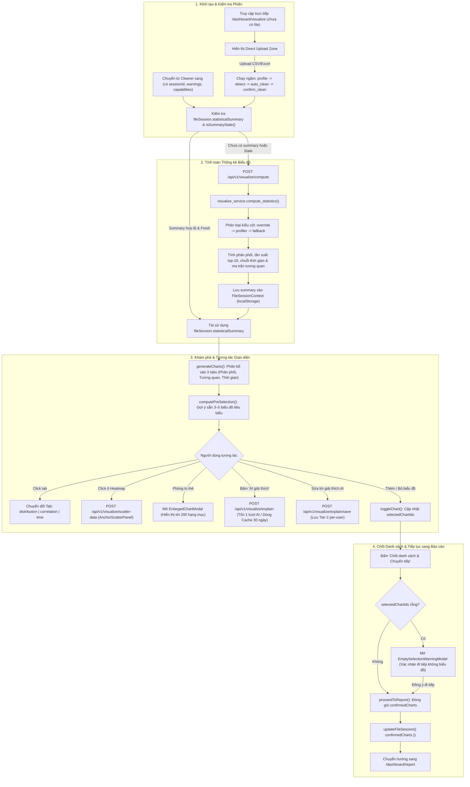

# Hướng dẫn Chuyên sâu & Đặc tả Kỹ thuật Module Visualize (Trực quan hóa Dữ liệu)

> **Tài liệu tham chiếu chuẩn (Single Source of Truth) dành cho Người dùng cuối, Kỹ sư Dữ liệu và Đội ngũ Phát triển DataMind.**  
> *Mô-đun áp dụng:* Module 3 — Visualize (`/dashboard/visualize`) | *Cập nhật:* Tháng 11/2026 | *Định dạng:* UTF-8 (Unicode Normalization Form C - NFC).

---

## MỤC LỤC TỔNG QUAN

- [PART A — Hành trình người dùng & Kiến trúc luồng dữ liệu](#part-a--hành-trình-người-dùng--kiến-trúc-luồng-dữ-liệu)
  - [1. Sơ đồ luồng dữ liệu tổng thể (Mermaid Architecture)](#1-sơ-đồ-luồng-dữ-liệu-tổng-thể-mermaid-architecture)
  - [2. Chi tiết 4 API Endpoints phục vụ Visualize](#2-chi-tiết-4-api-endpoints-phục-vụ-visualize)
  - [3. Cơ chế Cache Invalidation & Quản lý Thời hạn (TTLs)](#3-cơ-chế-cache-invalidation--quản-lý-thời-hạn-ttls)
  - [4. Cơ chế xử lý phiên hết hạn (File Expiry & Session Recovery)](#4-cơ-chế-xử-lý-phiên-hết-hạn-file-expiry--session-recovery)
- [PART B — Mỗi thứ trên màn hình (UI/UX Elements Deep-Dive)](#part-b--mỗi-thứ-trên-màn-hình-uiux-elements-deep-dive)
  - [Nhóm 1: Màn hình Tải trực tiếp (Direct Upload Fallback)](#nhóm-1-màn-hình-tải-trực-tiếp-direct-upload-fallback)
  - [Nhóm 2: Trạng thái Đang xử lý Thống kê (Loading State)](#nhóm-2-trạng-thái-đang-xử-lý-thống-kê-loading-state)
  - [Nhóm 3: Thanh Tiêu đề & Thông báo Hệ thống (Header & Capabilities)](#nhóm-3-thanh-tiêu-đề--thông-báo-hệ-thống-header--capabilities)
  - [Nhóm 4: Thanh Điều hướng Phân loại Biểu đồ (Tabs)](#nhóm-4-thanh-điều-hướng-phân-loại-biểu-đồ-tabs)
  - [Nhóm 5: Thẻ Biểu đồ Đơn lẻ (ChartCard) & Các Loại Biểu đồ](#nhóm-5-thẻ-biểu-đồ-đơn-lẻ-chartcard--các-loại-biểu-đồ)
  - [Nhóm 6: Thẻ Phân tích Chuyên sâu AI (AIInsightsCard)](#nhóm-6-thẻ-phân-tích-chuyên-sâu-ai-aiinsightscard)
  - [Nhóm 7: Khung Khám phá Tương quan Cặp (AnchorScatterPanel)](#nhóm-7-khung-khám-phá-tương-quan-cặp-anchorscatterpanel)
  - [Nhóm 8: Modal Phóng to Toàn màn hình (EnlargedChartModal)](#nhóm-8-modal-phóng-to-toàn-màn-hình-enlargedchartmodal)
  - [Nhóm 9: Thanh Thao tác Cố định Dưới cùng (Sticky Bottom Bar) & Modal Xác nhận](#nhóm-9-thanh-thao-tác-cố-định-dưới-cùng-sticky-bottom-bar--modal-xác-nhận)
- [PART C — Cơ chế Lựa chọn & Vẽ Biểu đồ (Chart Selection Engine)](#part-c--cơ-chế-lựa-chọn--vẽ-biểu-đồ-chart-selection-engine)
  - [1. Thứ bậc phân giải kiểu dữ liệu (Type Hierarchy)](#1-thứ-bậc-phân-giải-kiểu-dữ-liệu-type-hierarchy)
  - [2. Quy tắc bỏ qua biểu đồ (Skip Rules)](#2-quy-tắc-bỏ-qua-biểu-đồ-skip-rules)
  - [3. Histogram (20 bins) vs Bar Chart (unique $\le$ 10)](#3-histogram-20-bins-vs-bar-chart-unique-le-10)
  - [4. Gom nhóm Top-10 + `__other__` & Giới hạn `all_values` (200)](#4-gom-nhóm-top-10--__other__--giới-hạn-all_values-200)
  - [5. Xử lý câu hỏi nhiều lựa chọn (Multiple Choice) & Mẫu số người trả lời](#5-xử-lý-câu-hỏi-nhiều-lựa-chọn-multiple-choice--mẫu-số-người-trả-lời)
  - [6. Chuỗi thời gian (Datetime) & Thuật toán chọn bước chia](#6-chuỗi-thời-gian-datetime--thuật-toán-chọn-bước-chia)
  - [7. Ma trận tương quan Pearson & Lấy mẫu Scatter (500 điểm)](#7-ma-trận-tương-quan-pearson--lấy-mẫu-scatter-500-điểm)
  - [8. Cấu trúc dữ liệu JSON mẫu cho từng loại biểu đồ](#8-cấu-trúc-dữ-liệu-json-mẫu-cho-từng-loại-biểu-đồ)
- [PART D — Động cơ Nhận xét Tự động (Automated Insights Engine)](#part-d--động-cơ-nhận-xét-tự-động-automated-insights-engine)
  - [1. Bảng 9 khóa nhận xét (Insight Keys) & Điều kiện toán học](#1-bảng-9-khóa-nhận-xét-insight-keys--điều-kiện-toán-học)
  - [2. Quy tắc lọc tối đa 2 nhận xét và định dạng Frontend (i18n)](#2-quy-tắc-lọc-tối-đa-2-nhận-xét-và-định-dạng-frontend-i18n)
- [PART E — AI Giải thích Biểu đồ (AI Explain Engine)](#part-e--ai-giải-thích-biểu-đồ-ai-explain-engine)
  - [1. Cấu trúc Prompt gửi sang LLM (Part 1 + Part 2 + Cleaning)](#1-cấu-trúc-prompt-gửi-sang-llm-part-1--part-2--cleaning)
  - [2. Kiến trúc Cache 2 tầng (Original vs Edited) & TTL 30 ngày](#2-kiến-trúc-cache-2-tầng-original-vs-edited--ttl-30-ngày)
  - [3. Quy tắc trừ hạn mức (Quota Usage), Hủy request & Đồng hồ thời gian thực](#3-quy-tắc-trừ-hạn-mức-quota-usage-hủy-request--đồng-hồ-thời-gian-thực)
  - [4. Cơ chế phát hiện Bối cảnh Lỗi thời (Stale Context Detection)](#4-cơ-chế-phát-hiện-bối-cảnh-lỗi-thời-stale-context-detection)
  - [5. Lưu chỉnh sửa người dùng & Kế thừa sang Báo cáo Tổng hợp](#5-lưu-chỉnh-sửa-người-dùng--kế-thừa-sang-báo-cáo-tổng-hợp)
- [PART F — Chọn Biểu đồ cho Báo cáo (Report Chart Selection)](#part-f--chọn-biểu-đồ-cho-báo-cáo-report-chart-selection)
  - [1. Thuật toán gợi ý sẵn 3–5 biểu đồ tiêu biểu (Pre-selection Heuristic)](#1-thuật-toán-gợi-ý-sẵn-35-biểu-đồ-tiêu-biểu-pre-selection-heuristic)
  - [2. Cấu trúc `confirmedCharts` trong FileSessionContext](#2-cấu-trúc-confirmedcharts-trong-filesessioncontext)
  - [3. Cách Module Report tiêu thụ `confirmedCharts`](#3-cách-module-report-tiêu-thụ-confirmedcharts)
  - [4. Tính bền vững khi rời trang và quay lại (Session vs Redis Persistence)](#4-tính-bền-vững-khi-rời-trang-và-quay-lại-session-vs-redis-persistence)
- [PART G — Bảng Số liệu Hệ thống & Kết quả Đo lường Hiệu năng](#part-g--bảng-số-liệu-hệ-thống--kết-quả-đo-lường-hiệu-năng)
  - [1. Bảng số liệu & Ngưỡng định lượng hệ thống](#1-bảng-số-liệu--ngưỡng-định-lượng-hệ-thống)
  - [2. Kết quả đo kiểm hiệu năng thực tế (Benchmark 232x64 & 1000x64)](#2-kết-quả-đo-kiểm-hiệu-năng-thực-tế-benchmark-232x64--1000x64)
- [PART H — Các Vấn đề Phát hiện được trong Mã nguồn (Code Issues & Inconsistencies)](#part-h--các-vấn-đề-phát-hiện-được-trong-mã-nguồn-code-issues--inconsistencies)
- [PART I — Các Điểm Gây Khó hiểu cho Người dùng (UX Friction Points)](#part-i--các-điểm-gây-khó-hiểu-cho-người-dùng-ux-friction-points)

---

## PART A — Hành trình người dùng & Kiến trúc luồng dữ liệu

Module **Visualize (Trực quan hóa Dữ liệu)** là chặng thứ 3 trong chuỗi xử lý (Pipeline) của DataMind, nằm ngay sau Module 2 (**Cleaner**) và đứng trước Module 4 (**Report**).

### 1. Sơ đồ luồng dữ liệu tổng thể (Mermaid Architecture)



### 2. Chi tiết 4 API Endpoints phục vụ Visualize

Tất cả các endpoint của module Visualize được định tuyến thông qua prefix `/api/v1/visualize` tại file [backend/app/routers/visualize.py](file:///d:/datamind_prod/backend/app/routers/visualize.py):

#### Endpoint 1: `POST /api/v1/visualize/compute`
- **Mục đích:** Tính toán toàn bộ thông số phân phối (distribution bins cho histogram, top 10 frequencies cho categorical/multiple choice, trend data cho datetime) và ma trận tương quan Pearson trên toàn bộ file dữ liệu sạch.
- **Request Body:**
  ```json
  {
    "session_id": "c1f7b19a-9e23-4e89-a5c7-9b4317f2bcde",
    "warnings": [],
    "overridden_types": {
      "tuoi": "numeric",
      "nganh_hoc": "categorical"
    }
  }
  ```
- **Hành vi Backend:**
  1. Đọc nội dung file sạch từ Redis `filebytes:{user_id, session_id}` (được xác lập sau bước confirm clean).
  2. Lấy `file_hash` từ `session_metadata:{user_id, session_id}` để đối chiếu thông tin hồ sơ `profile:{user_id, file_hash}` và lịch sử làm sạch `cleaning_log:{user_id, file_hash}`.
  3. Thực hiện vòng lặp qua từng cột để tính toán các chỉ số thống kê toán học (`min`, `max`, `mean`, `median`, `std`, `skewness`, `kurtosis`, `p25`, `p75`, `iqr`, `outlier_count`, `distribution_bins`, `top_values`, `all_values`, `trend_data`).
  4. Nếu có ít nhất 2 cột số, lấy tối đa 20 cột số đầu tiên để tính ma trận tương quan Pearson toàn bộ và trích xuất `top_correlations` có $|r| > 0.5$.
  5. Sinh các nhận xét tự động `auto_insights` (tối đa 2 nhận xét/cột) thông qua `chart_insights.generate_insights()`.
- **Response Status:** `200 OK` (kèm JSON summary), hoặc `422 Unprocessable Entity` (khi có `DataMindException`), hoặc `410 Gone` / `ERR_SYS_CACHE_EXPIRED` (khi cache Redis hết hạn).

#### Endpoint 2: `POST /api/v1/visualize/scatter-data`
- **Mục đích:** Cung cấp tọa độ các điểm $(x, y)$ phục vụ vẽ biểu đồ phân tán (Scatter Plot) khi người dùng bấm vào một ô trong ma trận tương quan Heatmap.
- **Request Body:**
  ```json
  {
    "session_id": "c1f7b19a-9e23-4e89-a5c7-9b4317f2bcde",
    "col_x": "tuoi",
    "col_y": "thu_nhap"
  }
  ```
- **Hành vi Backend:**
  1. Kiểm tra điều kiện $col_x \ne col_y$ (nếu trùng nhau, trả về `400 Bad Request`).
  2. **Short-circuit metadata validation:** Kiểm tra `session_metadata` trong Redis trước khi tải nội dung file; nếu một trong hai cột không tồn tại hoặc không phải là cột số (`numeric_columns`), ném mã lỗi `ERR_VIZ_SCATTER_INVALID_COL`.
  3. Đọc DataFrame, lọc bỏ toàn bộ các dòng có giá trị rỗng (`dropna()`) ở một trong hai cột.
  4. **Downsampling cố định:** Nếu số lượng dòng hợp lệ $N > 500$, backend sử dụng thuật toán lấy mẫu ngẫu nhiên có thiết lập seed cố định (`random.seed(42)`) để chọn đúng 500 điểm phân tán đại diện, giữ cho payload phản hồi luôn nhẹ và giao diện Recharts mượt mà.
- **Response Format:**
  ```json
  {
    "col_x": "tuoi",
    "col_y": "thu_nhap",
    "points": [{"x": 22.0, "y": 8.5}, {"x": 25.0, "y": 12.0}],
    "count": 500,
    "total": 1240
  }
  ```

#### Endpoint 3: `POST /api/v1/visualize/explain`
- **Mục đích:** Phân tích ý nghĩa kinh doanh, tương quan và các điểm dị biệt của một biểu đồ cụ thể bằng mô hình trí tuệ nhân tạo (Google Gemini 2.0 Flash / Groq fallback).
- **Request Body:**
  ```json
  {
    "session_id": "c1f7b19a-9e23-4e89-a5c7-9b4317f2bcde",
    "chart_type": "bar",
    "col_x": "nganh_hoc",
    "col_y": null,
    "tier": "tier1",
    "lang": "vi",
    "is_reanalyze": false,
    "chart_config": {
      "title": "Ngành học",
      "type": "bar"
    },
    "plotted_data": [{"value": "CNTT", "count": 120, "pct": 42.5}]
  }
  ```
- **Hành vi Backend:**
  1. Xác định `file_hash` gốc và băm ngữ cảnh `context_hash = md5(f"{desc}:{desc_src}:{domain}")[:12]`.
  2. **Tra cứu Tier 2 (Bản người dùng đã sửa):** Nếu tìm thấy trong Redis `ai_explain:edited:{lang}:{user_id}:{file_hash}...` và không phải là yêu cầu phân tích lại (`is_reanalyze=false`), trả về ngay lập tức với `from_cache: true`, `source: "user"`, **hoàn toàn miễn phí quota**.
  3. **Tra cứu Tier 1 (Bản gốc AI dùng chung):** Nếu tìm thấy trong Redis `ai_explain:original:{lang}:{file_hash}...` khớp `context_hash`, trả về với `from_cache: true`, `source: "ai"`, **hoàn toàn miễn phí quota**.
  4. **Cache Miss / Re-analyze:**
     - Kiểm tra hạn mức người dùng qua `check_ai_quota(user_id, db)` (trả về HTTP 429 nếu hết hạn mức).
     - Rút trích tối đa 30 điểm dữ liệu mẫu từ `plotted_data` để bảo vệ token.
     - Ghép nối bối cảnh thông qua hàm SSOT `context_builder.build_llm_context()`.
     - Gọi LLM sinh văn bản phân tích (3–5 câu, thuần đoạn văn).
     - Kiểm tra client disconnect (`request.is_disconnected()`): nếu người dùng bấm Hủy giữa chừng, ghi nhận hủy, không trừ quota và trả về HTTP 499.
     - Ghi nhận trừ 1 lượt quota vào cơ sở dữ liệu (`record_ai_feature_usage(..., feature_name="explain")`).
     - Ghi vào cache Tier 1 với TTL 30 ngày.

#### Endpoint 4: `POST /api/v1/visualize/explain/save`
- **Mục đích:** Lưu trữ nội dung phân tích do người dùng tự gõ/chỉnh sửa trực tiếp trên giao diện.
- **Request Body:**
  ```json
  {
    "session_id": "c1f7b19a-9e23-4e89-a5c7-9b4317f2bcde",
    "chart_type": "bar",
    "col_x": "nganh_hoc",
    "col_y": null,
    "tier": "tier1",
    "content": "Phần lớn sinh viên lựa chọn ngành CNTT do nhu cầu tuyển dụng cao...",
    "lang": "vi"
  }
  ```
- **Hành vi Backend:** Lưu trực tiếp vào Redis theo cấu trúc Tier 2 (`ai_explain:edited:{lang}:{user_id}:{file_hash}...`) kèm `context_hash` hiện tại với TTL 30 ngày (2.592.000 giây). Hành động này **không tốn quota AI**.

---

### 3. Cơ chế Cache Invalidation & Quản lý Thời hạn (TTLs)

DataMind áp dụng chiến lược phân tách bộ nhớ đệm nhiều tầng nhằm tối ưu hóa chi phí điện toán và quota API:

| Đối tượng Cache | Cấu trúc Khóa Redis | Thời hạn (TTL) | Phạm vi | Điều kiện Hủy / Ghi đè (Invalidation Trigger) |
| :--- | :--- | :--- | :--- | :--- |
| **Dữ liệu File nhị phân** | `filebytes:{user_id, session_id}` | 18.000s (5 giờ) | Per-user | Tự hủy sau 5 giờ; gia hạn khi có thao tác đọc file hợp lệ. |
| **Metadata Phiên** | `session_metadata:{user_id, session_id}` | 18.000s (5 giờ) | Per-user | Tự hủy theo `filebytes`. |
| **Tóm tắt Thống kê Frontend** | `localStorage` (`datamind_session.statisticalSummary`) | Theo phiên trình duyệt | Per-tab | Bị coi là `stale` và gọi lại `/visualize/compute` khi: `summary_version !== 2`, thay đổi ép kiểu cột (`overrides`), thiếu trường `all_values`, hoặc phiên làm việc đổi `sessionId`. |
| **AI Explain Gốc (Tier 1)** | `ai_explain:original:{lang}:{file_hash}:{chart_type}:{col_x}:{col_y}:{tier}:{context_hash}` | 2.592.000s (30 ngày) | **Shared** (Tất cả user có cùng `file_hash`) | Khi người dùng bấm "Phân tích lại" (`is_reanalyze=true`) hoặc khi mô tả/lĩnh vực ở Profiler thay đổi dẫn đến `context_hash` thay đổi. |
| **AI Explain Chỉnh sửa (Tier 2)** | `ai_explain:edited:{lang}:{user_id}:{file_hash}:{chart_type}:{col_x}:{col_y}:{tier}` | 2.592.000s (30 ngày) | **Per-user** (Riêng từng user) | Ghi đè khi người dùng bấm "Lưu thay đổi". Đánh dấu `is_stale=true` khi `context_hash` trong cache khác với `context_hash` hiện tại. |
| **Phần Visualize trong Báo cáo** | Key `report_sections:{user_id}:{file_hash}` (section `visualize`) | 86.400s (24 giờ) | Per-user | Tự động bị xóa thông qua `invalidate_downstream_state()` khi người dùng quay lại bước Cleaner để sửa hoặc chốt lại dữ liệu sạch. |

---

### 4. Cơ chế xử lý phiên hết hạn (File Expiry & Session Recovery)

Do cơ chế bảo mật và tối ưu chi phí hạ tầng, dữ liệu nhị phân của file tải lên chỉ được lưu tạm thời trong RAM Redis với thời hạn TTL đúng 5 giờ (`_FILE_BYTES_TTL = 18000`).

1. **Kiểm tra chủ động khi nạp trang:**
   Ngay khi người dùng truy cập trang Visualize, hook `useEffect` tại [frontend/src/pages/Visualize.jsx#L475-L486](file:///d:/datamind_prod/frontend/src/pages/Visualize.jsx#L475-L486) lập tức gọi `getSessionStatus(fileSession.fileHash)`. Nếu máy chủ phản hồi `file_available: false`, cờ `fileExpired` được đặt thành `true`.
2. **Bắt lỗi bị động khi gọi API:**
   Nếu phiên làm việc hết hạn trong lúc người dùng đang thao tác trên trang, các lời gọi API `/visualize/compute` hoặc `/visualize/scatter-data` sẽ nhận phản hồi mã lỗi `ERR_SYS_CACHE_EXPIRED` (HTTP 410 hoặc 422). Giao diện bắt lỗi tại [frontend/src/pages/Visualize.jsx#L604](file:///d:/datamind_prod/frontend/src/pages/Visualize.jsx#L604) và kích hoạt trạng thái `fileExpired = true`, **tuyệt đối không để ứng dụng crash hoặc hiển thị lỗi kỹ thuật 500**.
3. **Trải nghiệm phục hồi mượt mà (Zero-Loss Recovery):**
   Khi `fileExpired = true`, thanh thông báo `FileExpiredBanner` xuất hiện nổi bật trên đầu trang. Người dùng có thể kéo thả lại chính file đó ngay tại banner:
   - Hệ thống tính lại mã hash nhị phân. Nếu mã hash trùng khớp với `fileHash` đang lưu trong phiên, hệ thống nạp lại byte vào Redis, reset `lastFetchedKeyRef.current = null` và tự động tính toán lại dữ liệu biểu đồ.
   - Toàn bộ các cấu hình ép kiểu (`overrides`), mô tả dữ liệu AI (`profiler_ctx`), danh sách biểu đồ đã chọn (`confirmedCharts`) và các bản phân tích biểu đồ đã sửa (`chartExplanations`) **được giữ nguyên vẹn 100%**.

---

## PART B — Mỗi thứ trên màn hình (UI/UX Elements Deep-Dive)

Dưới đây là bảng đặc tả toàn diện mọi thành phần giao diện trên trang Visualize, chia theo từng trạng thái màn hình:

### Nhóm 1: Màn hình Tải trực tiếp (Direct Upload Fallback)
*(Xuất hiện khi người dùng truy cập thẳng URL `/dashboard/visualize` khi chưa có file dữ liệu trong phiên)*

#### `direct_upload_zone`
- **Người dùng thấy gì:** Khung chữ nhật viền nét đứt lớn, icon đám mây mũi tên xanh lá, dòng chữ `"Kéo thả file dữ liệu vào đây"` và `"hoặc click để duyệt file — hỗ trợ CSV, XLSX, XLS (tối đa 10MB)"`.
- **Ý nghĩa:** Khu vực tiếp nhận file tải lên trực tiếp để phân tích và trực quan hóa nhanh.
- **Cách tính / quy tắc:** Kiểm tra định dạng đuôi file `.csv`, `.xlsx`, `.xls` và kích thước file $\le$ 10MB.
- **Ví dụ thật:** Người dùng kéo file `khao_sat_sinh_vien.csv` (1.2 MB) thả vào khung.
- **Người dùng có thể làm gì (cost):** Kéo thả hoặc click chuột để chọn file từ máy tính (Miễn phí).
- **Ảnh hưởng tới Report:** Tạo phiên làm việc mới, kích hoạt chuỗi phân tích tự động từ đầu.
- **Trường hợp đặc biệt:** Khi đang xử lý tải file, khung chuyển sang trạng thái mờ (`opacity-60`) và vô hiệu hóa tương tác chuột (`pointer-events-none`).
- **Code (file:line):** [frontend/src/pages/Visualize.jsx#L811-L846](file:///d:/datamind_prod/frontend/src/pages/Visualize.jsx#L811-L846)
- **Tooltip (vi+en):** Kéo thả file dữ liệu vào đây để tự động trực quan hóa. · Drag and drop data file here to automatically visualize.
- **Giải thích ngắn cho bảng Info (vi+en):** Cho phép bạn tải trực tiếp file dữ liệu mà không cần đi qua bước Profiler hay Cleaner trước đó. Hệ thống sẽ tự động quét lỗi, sửa chữa ngầm các vấn đề định dạng cơ bản và chuyển thẳng sang màn hình biểu đồ. Rất tiện lợi khi bạn cần xem nhanh số liệu trực quan của một file dữ liệu đã sạch sẵn.

#### `direct_loading_spinner`
- **Người dùng thấy gì:** Vòng tròn xoay viền xanh lá đậm, dòng chữ `"Đang phân tích & làm sạch ngầm..."` và `"Quá trình này có thể mất vài giây tùy dung lượng file."`.
- **Ý nghĩa:** Thông báo tiến trình pipeline 4 bước ngầm đang chạy (profile $\to$ detect $\to$ auto clean $\to$ confirm clean).
- **Cách tính / quy tắc:** Kích hoạt ngay sau khi file được nhận diện hợp lệ.
- **Ví dụ thật:** Quá trình chạy ngầm mất 2.8 giây cho file Excel 5.000 dòng.
- **Người dùng có thể làm gì (cost):** Chờ đợi hệ thống hoàn tất (Miễn phí).
- **Ảnh hưởng tới Report:** Chuẩn bị sẵn dữ liệu sạch để báo cáo có thể trích xuất sau này.
- **Trường hợp đặc biệt:** Nếu có lỗi xảy ra (file hỏng, sai định dạng), hiển thị toast đỏ `toast_direct_error`.
- **Code (file:line):** [frontend/src/pages/Visualize.jsx#L834-L838](file:///d:/datamind_prod/frontend/src/pages/Visualize.jsx#L834-L838)
- **Tooltip (vi+en):** Đang xử lý phân tích và làm sạch dữ liệu ngầm. · Analyzing and background cleaning dataset.
- **Giải thích ngắn cho bảng Info (vi+en):** Hệ thống đang thực hiện tuần tự các bước thẩm định cấu trúc, phát hiện lỗi dữ liệu và tự động chuẩn hóa định dạng ngầm. Bạn không cần thực hiện bất kỳ thao tác thủ công nào trong giai đoạn này. Sau khi hoàn tất, biểu đồ sẽ xuất hiện ngay lập tức.

#### `direct_done_modal`
- **Người dùng thấy gì:** Hộp thoại thông báo hoàn tất có icon dấu tích xanh lá tròn, tiêu đề `"Dữ liệu đã sẵn sàng"`, tóm tắt số lượng dòng, cột và số lỗi đã sửa tự động. Kèm 3 nút bấm: `"Tiếp tục đến biểu đồ"`, `"Về Profiler"` và `"Chi tiết làm sạch"`.
- **Ý nghĩa:** Tổng kết kết quả làm sạch tự động trước khi người dùng bắt đầu chọn biểu đồ.
- **Cách tính / quy tắc:** Lấy số liệu từ `clean_report` trả về bởi API `confirm-clean`.
- **Ví dụ thật:** `"1.240 dòng · 18 cột · 42 vấn đề tự động xử lý"`.
- **Người dùng có thể làm gì (cost):** Bấm chọn xem biểu đồ ngay hoặc điều hướng sang các bước trước để kiểm tra lại (Miễn phí).
- **Ảnh hưởng tới Report:** Xác lập `sessionId` chính thức cho báo cáo.
- **Trường hợp đặc biệt:** Nếu không có lỗi nào cần sửa, số lỗi hiển thị là 0.
- **Code (file:line):** [frontend/src/pages/Visualize.jsx#L863-L895](file:///d:/datamind_prod/frontend/src/pages/Visualize.jsx#L863-L895)
- **Tooltip (vi+en):** Xem tóm tắt kết quả xử lý và tiếp tục. · View processing summary and continue.
- **Giải thích ngắn cho bảng Info (vi+en):** Bảng tổng kết nhanh số liệu dòng, cột và các lỗi định dạng vừa được DataMind tự động xử lý ngầm. Bạn có thể bấm tiếp tục để khám phá ngay các biểu đồ trực quan, hoặc bấm quay lại Profiler/Cleaner nếu muốn kiểm tra chi tiết các thay đổi dữ liệu.

---

### Nhóm 2: Trạng thái Đang xử lý Thống kê (Loading State)

#### `loading_spinner_view`
- **Người dùng thấy gì:** Màn hình nền xám nhạt `#F3F4F2`, vòng xoay loading xanh lá đậm `#1B4324`, tiêu đề `"Đang xử lý số liệu thống kê..."` và mô tả `"DataMind đang tổng hợp thông số phân phối, tần suất và tương quan trên toàn bộ dataset của bạn."`.
- **Ý nghĩa:** Trạng thái chờ trong khi frontend gọi API `/visualize/compute` để tính toán số liệu thống kê.
- **Cách tính / quy tắc:** Kích hoạt khi `loading === true` trong `useEffect`.
- **Ví dụ thật:** Mất 113.79 ms tính toán trên backend cho file 232 dòng $\times$ 64 cột.
- **Người dùng có thể làm gì (cost):** Chờ đợi giao diện hoàn tất tính toán (Miễn phí).
- **Ảnh hưởng tới Report:** Đảm bảo toàn bộ số liệu biểu đồ được đồng bộ chính xác.
- **Trường hợp đặc biệt:** Nếu backend trả về lỗi `ERR_SYS_CACHE_EXPIRED`, tự động chuyển sang hiển thị banner hết hạn thay vì thông báo lỗi chung.
- **Code (file:line):** [frontend/src/pages/Visualize.jsx#L789-L799](file:///d:/datamind_prod/frontend/src/pages/Visualize.jsx#L789-L799)
- **Tooltip (vi+en):** Đang tính toán số liệu thống kê toàn diện. · Aggregating dataset statistics.
- **Giải thích ngắn cho bảng Info (vi+en):** Hệ thống đang tính toán phân phối tần suất, phân vị tứ phân vị, giá trị ngoại lệ và hệ số tương quan giữa các cột số. Quá trình tính toán này diễn ra trực tiếp trên toàn bộ file dữ liệu sạch nhằm đảm bảo độ chính xác tuyệt đối. Biểu đồ sẽ được hiển thị ngay khi quá trình hoàn tất.

---

### Nhóm 3: Thanh Tiêu đề & Thông báo Hệ thống (Header & Capabilities)

#### `header_counter_badge`
- **Người dùng thấy gì:** Huy hiệu bo tròn nền trắng viền xám ở góc trên bên phải, hiển thị định dạng text: `X/Y đã chọn` (ví dụ: `4/18 đã chọn`).
- **Ý nghĩa:** Cho biết số lượng biểu đồ hiện đang được tích chọn để đưa vào báo cáo tổng kết trên tổng số biểu đồ hợp lệ mà hệ thống đã tạo ra.
- **Cách tính / quy tắc:** `selectedChartIds.size` / `totalCharts`.
- **Ví dụ thật:** `3/12 đã chọn`.
- **Người dùng có thể làm gì (cost):** Quan sát theo dõi trạng thái lựa chọn (Miễn phí).
- **Ảnh hưởng tới Report:** Thể hiện trực tiếp số lượng biểu đồ sẽ xuất hiện trong Module Report.
- **Trường hợp đặc biệt:** Khi chưa chọn biểu đồ nào, hiển thị `0/Y đã chọn`.
- **Code (file:line):** [frontend/src/pages/Visualize.jsx#L911-L913](file:///d:/datamind_prod/frontend/src/pages/Visualize.jsx#L911-L913)
- **Tooltip (vi+en):** Số lượng biểu đồ đã chọn đưa vào báo cáo. · Number of charts selected for the report.
- **Giải thích ngắn cho bảng Info (vi+en):** Bộ đếm thời gian thực phản ánh số lượng biểu đồ bạn đã chọn để xuất bản vào báo cáo cuối cùng. Giúp bạn dễ dàng kiểm soát dung lượng và cấu trúc của báo cáo tổng hợp. Bạn có thể chọn bao nhiêu biểu đồ tùy thích, hoặc bấm vào thanh cố định dưới đáy màn hình để xem danh sách chi tiết.

#### `header_help_docs_btn`
- **Người dùng thấy gì:** Nút tròn icon dấu hỏi chấm `?` nằm cạnh bộ đếm biểu đồ.
- **Ý nghĩa:** Mở ngăn kéo (Drawer/Modal) tài liệu hướng dẫn nhanh cho trang Visualize.
- **Cách tính / quy tắc:** Gọi component `<PageHelpDocs pageId="visualize" />`.
- **Ví dụ thật:** Người dùng bấm vào để đọc 7 bước hướng dẫn sử dụng tính năng Visualize.
- **Người dùng có thể làm gì (cost):** Click để mở xem tài liệu hướng dẫn sử dụng (Miễn phí).
- **Ảnh hưởng tới Report:** Không ảnh hưởng.
- **Trường hợp đặc biệt:** Nội dung tự động chuyển đổi ngôn ngữ Việt / Anh theo i18n (`help_docs_*`).
- **Code (file:line):** [frontend/src/pages/Visualize.jsx#L914](file:///d:/datamind_prod/frontend/src/pages/Visualize.jsx#L914)
- **Tooltip (vi+en):** Xem hướng dẫn sử dụng trang trực quan hóa. · View visualization guide and tips.
- **Giải thích ngắn cho bảng Info (vi+en):** Mở bảng tóm tắt hướng dẫn cách khai thác tối đa trang Trực quan hóa dữ liệu. Hướng dẫn bao gồm cách đọc thẻ biểu đồ, lưu ý về câu hỏi nhiều lựa chọn, cách kích hoạt AI phân tích chuyên sâu và mẹo chọn lọc biểu đồ tối ưu nhất cho báo cáo quản trị.

#### `banner_capabilities`
- **Người dùng thấy gì:** Khung bo tròn viền xám hiển thị tiêu đề `"Đánh giá khả năng trực quan hóa"` kèm 3 mục đánh giá: `"Phân phối"`, `"Tương quan"` và `"Theo thời gian"`. Mỗi mục có icon dấu tích xanh lá hoặc dấu X đỏ.
- **Ý nghĩa:** Thông báo cho người dùng biết bộ dữ liệu hiện tại có đủ điều kiện toán học để vẽ các nhóm biểu đồ tương ứng hay không.
- **Cách tính / quy tắc:** Đối chiếu trường `fileSession.capabilities` sinh ra từ bước xác thực làm sạch:
  - Phân phối: Có ít nhất 1 cột số/danh mục hợp lệ.
  - Tương quan: Có ít nhất 2 cột số và $\ge 10$ dòng dữ liệu.
  - Theo thời gian: Có ít nhất 1 cột ngày tháng và $\ge 2$ dòng dữ liệu.
- **Ví dụ thật:** File chỉ có cột văn bản và danh mục sẽ hiển thị: Phân phối [✓], Tương quan [✕], Theo thời gian [✕].
- **Người dùng có thể làm gì (cost):** Quan sát để biết các giới hạn của tập dữ liệu (Miễn phí).
- **Ảnh hưởng tới Report:** Các nhóm không đủ điều kiện sẽ không có biểu đồ đại diện trong báo cáo.
- **Trường hợp đặc biệt:** Nếu dữ liệu ít hơn 100 dòng, hiển thị kèm huy hiệu vàng cảnh báo `"Dữ liệu ít, kết quả mang tính tham khảo"`.
- **Code (file:line):** [frontend/src/pages/Visualize.jsx#L951-L973](file:///d:/datamind_prod/frontend/src/pages/Visualize.jsx#L951-L973)
- **Tooltip (vi+en):** Khả năng sinh biểu đồ của tập dữ liệu hiện tại. · Visualization feasibility based on dataset structure.
- **Giải thích ngắn cho bảng Info (vi+en):** Khung đánh giá tự động dựa trên cấu trúc cột và số lượng dòng thực tế của file dữ liệu. Giúp bạn hiểu ngay lý do tại sao một số loại biểu đồ (như ma trận tương quan hay chuỗi thời gian) có thể bị khóa hoặc không xuất hiện do thiếu dữ liệu số hoặc thời gian phù hợp.

---

### Nhóm 4: Thanh Điều hướng Phân loại Biểu đồ (Tabs)

#### `tab_distribution`, `tab_correlation`, `tab_time`
- **Người dùng thấy gì:** 3 tab nằm ngang viền gạch chân: `"Phân phối (N)"`, `"Tương quan (N)"`, `"Theo thời gian (N)"`. Tab đang chọn có đường viền chân màu xanh lá đậm `#1B4324`.
- **Ý nghĩa:** Phân loại biểu đồ theo mục đích phân tích dữ liệu giúp người dùng không bị quá tải thông tin.
- **Cách tính / quy tắc:** Số đếm $N$ được tính từ độ dài mảng các biểu đồ hợp lệ trong danh mục tương ứng (`charts.distribution.length`, `charts.correlation.length`, `charts.time.length`).
- **Ví dụ thật:** `"Phân phối (14)"`, `"Tương quan (1)"`, `"Theo thời gian (0)"`.
- **Người dùng có thể làm gì (cost):** Click chuột để chuyển đổi giữa các nhóm biểu đồ (Miễn phí).
- **Ảnh hưởng tới Report:** Không ảnh hưởng; người dùng có thể chọn biểu đồ từ bất kỳ tab nào.
- **Trường hợp đặc biệt:** Nếu một nhóm không được hỗ trợ bởi dữ liệu, tab đó sẽ hiển thị icon tam giác cảnh báo mờ vàng và giảm độ mờ (`opacity-50`).
- **Code (file:line):** [frontend/src/pages/Visualize.jsx#L976-L1001](file:///d:/datamind_prod/frontend/src/pages/Visualize.jsx#L976-L1001)
- **Tooltip (vi+en):** Chuyển sang xem nhóm biểu đồ tương ứng. · Switch to view corresponding chart category.
- **Giải thích ngắn cho bảng Info (vi+en):** Ba không gian phân tích dữ liệu độc lập. Tab Phân phối tập trung vào cấu trúc tần suất và hình thái của từng cột đơn lẻ; tab Tương quan phân tích mối liên hệ qua lại giữa các biến số lượng; tab Theo thời gian thể hiện biến động xu hướng qua các mốc thời gian. Bạn có thể tự do chuyển đổi qua lại mà không làm mất các lựa chọn biểu đồ trước đó.

---

### Nhóm 5: Thẻ Biểu đồ Đơn lẻ (ChartCard) & Các Loại Biểu đồ

#### `chart_title_text` & `chart_title_edit_btn`
- **Người dùng thấy gì:** Tên cột làm tiêu đề biểu đồ (font semibold, ngắt dòng tối đa 2 dòng). Khi rê chuột vào, icon cây bút chì xuất hiện cạnh tiêu đề.
- **Ý nghĩa:** Cho phép xem và tùy biến tiêu đề biểu đồ theo ngôn ngữ nghiệp vụ mong muốn trước khi đưa vào báo cáo tổng hợp.
- **Cách tính / quy tắc:** Hiển thị `chart.user_title || chart.title`. Bấm vào bút chì sẽ chuyển tiêu đề thành ô nhập text `input` tự động lấy nét (`autoFocus`).
- **Ví dụ thật:** Đổi tiêu đề từ `"thu_nhap_thang"` thành `"Thu nhập bình quân hàng tháng (triệu VNĐ)"`.
- **Người dùng có thể làm gì (cost):** Gõ đổi tên tiêu đề và nhấn Enter hoặc bấm ra ngoài để lưu (Miễn phí).
- **Ảnh hưởng tới Report:** Tiêu đề tùy chỉnh sẽ được truyền thẳng vào cấu trúc `confirmedCharts` và hiển thị trên tiêu đề biểu đồ trong báo cáo tổng hợp.
- **Trường hợp đặc biệt:** Nếu tiêu đề dài hơn 40 ký tự, xuất hiện nút `"Xem thêm"` / `"Thu gọn"` để mở rộng toàn bộ tên mà không làm vỡ layout.
- **Code (file:line):** [frontend/src/pages/Visualize.jsx#L126-L157](file:///d:/datamind_prod/frontend/src/pages/Visualize.jsx#L126-L157)
- **Tooltip (vi+en):** Sửa tiêu đề biểu đồ. · Edit title.
- **Giải thích ngắn cho bảng Info (vi+en):** Cho phép bạn cá nhân hóa tên gọi của biểu đồ cho phù hợp với ngữ cảnh báo cáo hoặc thuyết trình. Tiêu đề bạn đặt lại sẽ thay thế tên cột thô mặc định và được giữ nguyên vẹn khi xuất sang Báo cáo AI.

#### `badge_suggested`
- **Người dùng thấy gì:** Huy hiệu nhỏ màu xanh lá nhạt bo tròn có chữ `"Gợi ý"`, nền `#EAF2EB`, chữ `#1B4324`.
- **Ý nghĩa:** Nhận diện biểu đồ này nằm trong danh sách các biểu đồ tiêu biểu nhất được thuật toán của DataMind khuyến nghị đưa vào báo cáo.
- **Cách tính / quy tắc:** Biểu đồ có `id` thuộc tập hợp `suggestedChartIds` (được thuật toán `computePreSelection` tính toán dựa trên mức độ quan trọng, tính đa dạng và có nhận xét tự động).
- **Ví dụ thật:** Biểu đồ histogram của cột `"doanh_thu"` có độ lệch chuẩn cao và nhận xét về ngoại lệ sẽ nhận huy hiệu Gợi ý.
- **Người dùng có thể làm gì (cost):** Quan sát để ưu tiên giữ lại trong báo cáo (Miễn phí).
- **Ảnh hưởng tới Report:** Các biểu đồ có huy hiệu này được tự động chọn sẵn lúc đầu; người dùng có thể bỏ chọn nếu không muốn.
- **Trường hợp đặc biệt:** Nếu người dùng tự bỏ chọn, huy hiệu Gợi ý vẫn hiển thị để nhận diện.
- **Code (file:line):** [frontend/src/pages/Visualize.jsx#L163-L167](file:///d:/datamind_prod/frontend/src/pages/Visualize.jsx#L163-L167)
- **Tooltip (vi+en):** Biểu đồ tiêu biểu được hệ thống gợi ý cho báo cáo. · Recommended chart pre-selected for the final report.
- **Giải thích ngắn cho bảng Info (vi+en):** Biểu đồ được thuật toán chọn lọc tự động nhờ chứa đựng các tín hiệu thống kê nổi bật nhất của tập dữ liệu (như độ biến thiên cao, tương quan mạnh hoặc phát hiện điểm dị biệt). Giúp bạn tiết kiệm thời gian chọn lọc mà vẫn đảm bảo báo cáo có chiều sâu phân tích.

#### `btn_maximize`
- **Người dùng thấy gì:** Icon 4 mũi tên mở rộng góc vuông, kích thước 32x32px ở góc trên bên phải thẻ.
- **Ý nghĩa:** Mở modal xem biểu đồ ở chế độ phóng to toàn màn hình.
- **Cách tính / quy tắc:** Gọi hàm `onMaximize(chart)`, đặt state `enlargedChart`.
- **Ví dụ thật:** Người dùng muốn xem chi tiết biểu đồ cột danh mục có 45 giá trị khác nhau.
- **Người dùng có thể làm gì (cost):** Click để mở modal phóng to (Miễn phí).
- **Ảnh hưởng tới Report:** Không ảnh hưởng.
- **Trường hợp đặc biệt:** Khi phóng to, biểu đồ danh mục hiển thị toàn bộ lên tới 200 giá trị (từ mảng `all_values`) thay vì bị giới hạn top 10 như trên thẻ thu nhỏ.
- **Code (file:line):** [frontend/src/pages/Visualize.jsx#L168-L175](file:///d:/datamind_prod/frontend/src/pages/Visualize.jsx#L168-L175)
- **Tooltip (vi+en):** Phóng to biểu đồ để xem chi tiết. · Enlarge chart to view full details.
- **Giải thích ngắn cho bảng Info (vi+en):** Mở cửa sổ kích thước lớn giúp bạn quan sát rõ ràng toàn bộ các điểm dữ liệu và nhãn danh mục. Đặc biệt hữu ích đối với các biểu đồ cột có nhiều hạng mục (hiển thị đầy đủ tối đa 200 giá trị thay vì chỉ hiển thị top 10 như ở màn hình tổng quan) hoặc ma trận tương quan phức tạp.

#### `auto_insights_box`
- **Người dùng thấy gì:** Khung bo góc nền xám có icon bóng đèn vàng xanh lá và tiêu đề `"Nhận xét tự động"`, bên dưới là 1 đến 2 gạch đầu dòng nhận xét số liệu.
- **Ý nghĩa:** Trích xuất tự động các kết luận định lượng cốt lõi từ dữ liệu mà không cần gọi AI LLM tốn phí.
- **Cách tính / quy tắc:** Sinh bởi `chart_insights.generate_insights()`, format thông qua i18n key `visualize.insight.*`.
- **Ví dụ thật:**
  - `• Giá trị phổ biến nhất là "Hà Nội" (chiếm 48.2%).`
  - `• Phát hiện 14 giá trị ngoại lệ (outliers).`
- **Người dùng có thể làm gì (cost):** Đọc thông tin nhận xét nhanh (Miễn phí).
- **Ảnh hưởng tới Report:** Cung cấp thông tin tham khảo giúp người dùng quyết định có nên chọn biểu đồ này vào báo cáo hay không.
- **Trường hợp đặc biệt:** Không hiển thị trên biểu đồ Heatmap tương quan (Heatmap có khu vực hiển thị top tương quan riêng).
- **Code (file:line):** [frontend/src/pages/Visualize.jsx#L198-L212](file:///d:/datamind_prod/frontend/src/pages/Visualize.jsx#L198-L212)
- **Tooltip (vi+en):** Nhận xét thống kê tự động tính từ dữ liệu. · Automated statistical insights calculated from data.
- **Giải thích ngắn cho bảng Info (vi+en):** Các kết luận toán học được máy tính trích xuất tức thì dựa trên phân phối thực tế của cột dữ liệu. Bao gồm nhận diện giá trị phổ biến nhất, khoảng giá trị tập trung điển hình (IQR), các giá trị bất thường ngoại lệ và xu hướng tăng/giảm theo thời gian. Hoàn toàn tự động và không tiêu tốn lượt AI của bạn.

#### `btn_toggle_report`
- **Người dùng thấy gì:**
  - Khi chưa chọn: Nút viền xám icon dấu cộng `"Thêm vào báo cáo"`.
  - Khi đã chọn: Nút nền xanh lá nhạt viền xanh đậm icon trang giấy tích v `"Đã thêm vào báo cáo"`.
- **Ý nghĩa:** Chuyển đổi trạng thái đưa biểu đồ này vào danh sách xuất bản của báo cáo.
- **Cách tính / quy tắc:** Kiểm tra `selectedChartIds.has(chart.id)`. Khi click, gọi hàm `toggleChart(chart.id)`.
- **Ví dụ thật:** Người dùng bấm vào nút `"Thêm vào báo cáo"` trên thẻ phân phối tuổi. Thẻ lập tức sáng viền xanh lá đậm và bộ đếm nhảy từ 3 lên 4.
- **Người dùng có thể làm gì (cost):** Click để thêm hoặc gỡ bỏ biểu đồ khỏi báo cáo (Miễn phí).
- **Ảnh hưởng tới Report:** Quyết định trực tiếp sự hiện diện của biểu đồ trong báo cáo tổng hợp.
- **Trường hợp đặc biệt:** Khi thẻ được chọn, toàn bộ khung thẻ `ChartCard` được áp viền xanh lá đậm `#1B4324` và hiệu ứng đổ bóng nổi bật.
- **Code (file:line):** [frontend/src/pages/Visualize.jsx#L225-L241](file:///d:/datamind_prod/frontend/src/pages/Visualize.jsx#L225-L241)
- **Tooltip (vi+en):** Thêm hoặc xóa biểu đồ khỏi báo cáo tổng hợp. · Add or remove chart from the final report.
- **Giải thích ngắn cho bảng Info (vi+en):** Công tắc quyết định việc biểu đồ này có xuất hiện trong Báo cáo phân tích AI cuối cùng hay không. Bạn có thể chọn hoặc bỏ chọn bất kỳ lúc nào mà không bị giới hạn số lượng. Trạng thái lựa chọn sẽ được lưu tự động vào phiên làm việc của bạn.

---

### Nhóm 6: Thẻ Phân tích Chuyên sâu AI (AIInsightsCard)

#### `ai_explain_init_btn`
- **Người dùng thấy gì:** Nút bấm màu xanh lá nhạt `#EAF2EB`, chữ xanh đậm `#1B4324` có icon ngôi sao lấp lánh `Sparkles`, nhãn: `"AI giải thích · 1 lượt"`.
- **Ý nghĩa:** Kích hoạt mô hình AI phân tích sâu ý nghĩa kinh doanh, bối cảnh và hàm ý của biểu đồ hiện tại.
- **Cách tính / quy tắc:** Tích hợp qua hook `useAIAction`. Kiểm tra hạn mức AI trong ngày; nếu còn lượt, hiển thị hộp thoại xác nhận trước khi gọi backend.
- **Ví dụ thật:** Người dùng bấm nút trên biểu đồ doanh thu theo tháng để AI chỉ ra nguyên nhân sụt giảm trong quý 2.
- **Người dùng có thể làm gì (cost):** Bấm để kích hoạt phân tích (Tiêu tốn **1 lượt AI** trong hạn mức ngày của tài khoản nếu gọi lần đầu).
- **Ảnh hưởng tới Report:** Lời giải thích AI sinh ra sẽ được tự động đính kèm vào biểu đồ trong báo cáo tổng hợp.
- **Trường hợp đặc biệt:** Nếu kết quả đã có trong bộ nhớ đệm (Cache HIT), hệ thống hiển thị ngay lập tức và **hoàn toàn miễn phí (0 lượt)**.
- **Code (file:line):** [frontend/src/components/charts/AIInsightsCard.jsx#L207-L215](file:///d:/datamind_prod/frontend/src/components/charts/AIInsightsCard.jsx#L207-L215)
- **Tooltip (vi+en):** Dùng 1 lượt AI để phân tích ý nghĩa biểu đồ. · Use 1 AI credit to analyze chart insights.
- **Giải thích ngắn cho bảng Info (vi+en):** Gọi trợ lý AI chuyên gia dữ liệu để đọc hiểu các con số, hình thái phân phối và tìm ra những góc nhìn nghiệp vụ sâu sắc đằng sau biểu đồ. Thao tác này tiêu tốn 1 lượt AI trong hạn mức ngày của bạn đối với các phân tích mới, nhưng sẽ hoàn toàn miễn phí khi mở lại xem bản đã phân tích trước đó.

#### `ai_explain_running_bar`
- **Người dùng thấy gì:** Thanh tiến trình hiển thị văn bản `"Đang phân tích… X giây"` đếm giây thời gian thực, icon quay loading và nút bấm `"Hủy"`. Sau 25 giây, xuất hiện thêm dòng gợi ý: `"Lâu hơn bình thường. Bạn có thể Hủy và thử lại — không bị trừ lượt."`.
- **Ý nghĩa:** Hiển thị trực quan trạng thái yêu cầu đang được xử lý bởi LLM, cho phép người dùng dừng lại nếu mạng chập chờn.
- **Cách tính / quy tắc:** Đồng hồ `setInterval` tăng mỗi giây một lần. Khi bấm `"Hủy"`, gọi `abortController.abort()`.
- **Ví dụ thật:** Đồng hồ đếm đến giây thứ 3 thì nhận được văn bản phản hồi từ Google Gemini.
- **Người dùng có thể làm gì (cost):** Theo dõi thời gian thực hoặc bấm Hủy nếu không muốn tiếp tục (Bấm Hủy **không bị trừ lượt AI**).
- **Ảnh hưởng tới Report:** Nếu hủy, không có phân tích AI nào được lưu vào biểu đồ.
- **Trường hợp đặc biệt:** Phía backend bắt sự kiện `request.is_disconnected()` và trả về HTTP 499 mà không ghi nhận trừ quota vào database.
- **Code (file:line):** [frontend/src/components/charts/AIInsightsCard.jsx#L225](file:///d:/datamind_prod/frontend/src/components/charts/AIInsightsCard.jsx#L225) (từ hook `useAIAction.jsx`)
- **Tooltip (vi+en):** Đang gửi dữ liệu phân tích tới AI. Bấm Hủy nếu không muốn chờ. · AI is analyzing chart. Click Cancel to abort without spending quota.
- **Giải thích ngắn cho bảng Info (vi+en):** Thanh trạng thái thời gian thực thông báo tiến trình kết nối và phản hồi từ mô hình trí tuệ nhân tạo. Nếu hệ thống mạng bị gián đoạn hoặc bạn đổi ý, bạn có thể bấm nút Hủy bất kỳ lúc nào để dừng yêu cầu ngay lập tức mà không lo bị mất lượt AI.

#### `ai_badge_source` & `ai_badge_cached`
- **Người dùng thấy gì:**
  - Nguồn: Huy hiệu `"Tạo bởi AI"` (màu xám nhạt) hoặc `"Đã chỉnh sửa bởi bạn"` (màu xanh dương).
  - Cache: Dòng chữ in nghiêng màu xám nhỏ `"(từ bộ nhớ đệm)"`.
- **Ý nghĩa:** Minh bạch xuất xứ của nội dung phân tích (do AI tự sinh hay đã qua tay người dùng biên tập) và thông báo việc tái sử dụng cache miễn phí.
- **Cách tính / quy tắc:** Đọc từ thuộc tính `insightData.source === "user"` và `insightData.from_cache === true`.
- **Ví dụ thật:** Người dùng mở lại biểu đồ đã giải thích hôm qua, thẻ hiện huy hiệu `Tạo bởi AI · (từ bộ nhớ đệm) · Còn 19/20 lượt`.
- **Người dùng có thể làm gì (cost):** Quan sát thông tin minh bạch (Miễn phí).
- **Ảnh hưởng tới Report:** Giúp báo cáo phân biệt được nhận định tự động và nhận định có can thiệp của chuyên viên.
- **Trường hợp đặc biệt:** Khi người dùng nhấn lưu bản sửa đổi, huy hiệu lập tức chuyển thành `"Đã chỉnh sửa bởi bạn"`.
- **Code (file:line):** [frontend/src/components/charts/AIInsightsCard.jsx#L266-L277](file:///d:/datamind_prod/frontend/src/components/charts/AIInsightsCard.jsx#L266-L277)
- **Tooltip (vi+en):** Nguồn gốc nội dung phân tích và trạng thái bộ nhớ đệm. · Origin of the insight and cache status.
- **Giải thích ngắn cho bảng Info (vi+en):** Nhãn nhận diện minh bạch cho biết đoạn văn phân tích đang hiển thị là nguyên bản do AI sinh ra hay đã được bạn tinh chỉnh lại theo nghiệp vụ thực tế. Nhãn bộ nhớ đệm xác nhận bạn vừa truy cập lại dữ liệu cũ mà không tốn thêm bất kỳ lượt AI nào.

#### `ai_btn_reanalyze`
- **Người dùng thấy gì:** Nút tròn icon mũi tên xoay tròn `RefreshCw` ở góc phải thanh tiêu đề phân tích AI.
- **Ý nghĩa:** Buộc hệ thống bỏ qua bộ nhớ đệm (cache bypass) và gửi yêu cầu tới LLM để viết lại một bản phân tích mới hoàn toàn.
- **Cách tính / quy tắc:** Gọi `handleExplain(true)` với cờ `is_reanalyze: true`. Yêu cầu xác nhận qua modal trước khi thực thi.
- **Ví dụ thật:** Người dùng cảm thấy góc nhìn của AI lần trước chưa bao quát và muốn AI phân tích lại theo góc nhìn khác.
- **Người dùng có thể làm gì (cost):** Click để phân tích lại (Tiêu tốn **1 lượt AI** trong hạn mức ngày).
- **Ảnh hưởng tới Report:** Thay thế đoạn phân tích cũ trong báo cáo bằng đoạn phân tích mới sinh.
- **Trường hợp đặc biệt:** Nếu tài khoản đã hết hạn mức trong ngày, hệ thống chặn lại và hiển thị modal nâng cấp gói tài khoản.
- **Code (file:line):** [frontend/src/components/charts/AIInsightsCard.jsx#L286-L292](file:///d:/datamind_prod/frontend/src/components/charts/AIInsightsCard.jsx#L286-L292)
- **Tooltip (vi+en):** Phân tích lại biểu đồ này (tốn 1 lượt AI). · Re-analyze this chart (consumes 1 AI use).
- **Giải thích ngắn cho bảng Info (vi+en):** Cho phép bạn yêu cầu AI tiếp cận lại dữ liệu và sinh ra một góc nhìn phân tích mới mẻ hơn. Vì thao tác này sẽ kích hoạt lại toàn bộ chu trình xử lý của mô hình ngôn ngữ lớn, hệ thống sẽ trừ 1 lượt AI trong hạn mức ngày của bạn sau khi bạn xác nhận đồng ý.

#### `ai_btn_edit`, `ai_edit_textarea` & `ai_edit_btn_save`
- **Người dùng thấy gì:** Nút icon cây bút chì `Edit2`. Khi bấm vào, đoạn văn biến thành khung soạn thảo văn bản (`textarea`) kèm 2 nút bấm: `"Hủy"` và `"Lưu thay đổi"`.
- **Ý nghĩa:** Trao quyền cho người dùng tự do gọt giũa, bổ sung hoặc điều chỉnh nhận định của AI theo đúng thực tế nghiệp vụ của doanh nghiệp.
- **Cách tính / quy tắc:** Khi bấm Lưu, gọi API `POST /api/v1/visualize/explain/save` để ghi đè vào Redis Tier 2 (per-user) và cập nhật đồng bộ vào `fileSession.chartExplanations`.
- **Ví dụ thật:** Người dùng bổ sung thêm câu: `"Sự sụt giảm doanh thu trong tháng 4 là do đợt bảo trì nâng cấp nhà máy định kỳ"`.
- **Người dùng có thể làm gì (cost):** Tự do chỉnh sửa và lưu lại (Hoàn toàn **miễn phí**, không tốn lượt AI).
- **Ảnh hưởng tới Report:** Lời văn sau khi chỉnh sửa sẽ xuất hiện nguyên văn trong Báo cáo tổng hợp thay cho lời của AI.
- **Trường hợp đặc biệt:** Khung soạn thảo không được phép để trống (nếu để trống, hệ thống hiển thị cảnh báo toast vàng).
- **Code (file:line):** [frontend/src/components/charts/AIInsightsCard.jsx#L363-L391](file:///d:/datamind_prod/frontend/src/components/charts/AIInsightsCard.jsx#L363-L391)
- **Tooltip (vi+en):** Chỉnh sửa nội dung phân tích theo ý bạn. · Edit analysis content.
- **Giải thích ngắn cho bảng Info (vi+en):** Tính năng biên tập linh hoạt giúp bạn hoàn thiện bài phân tích. AI đưa ra bản phác thảo ban đầu, và bạn có toàn quyền bổ sung các nguyên nhân thực tế hoặc thay đổi văn phong báo cáo cho phù hợp với cấp quản lý. Mọi chỉnh sửa được lưu trữ riêng cho tài khoản của bạn và hoàn toàn miễn phí.

#### `ai_stale_warning`
- **Người dùng thấy gì:** Khung cảnh báo màu hổ phách/vàng đất có icon tam giác cảnh báo: `"Bối cảnh dữ liệu đã thay đổi. Giải thích lại?"` kèm nút `"Giải thích lại"`.
- **Ý nghĩa:** Cảnh báo người dùng rằng mô tả ngữ cảnh hoặc lĩnh vực của bộ dữ liệu đã bị sửa đổi ở bước Profiler sau thời điểm đoạn phân tích AI này được tạo ra, khiến nội dung phân tích có thể không còn khớp bối cảnh mới.
- **Cách tính / quy tắc:** Kiểm tra cờ `insightData.is_stale === true` (xảy ra khi `saved_ctx_hash !== context_hash`).
- **Ví dụ thật:** Trước đó dataset được AI đoán là "Bán lẻ", sau đó người dùng vào Profiler sửa mô tả thành "Y tế bệnh viện". Khi quay lại Visualize, thẻ hiện cảnh báo lỗi thời.
- **Người dùng có thể làm gì (cost):** Bấm nút `"Giải thích lại"` để phân tích lại theo bối cảnh mới (Tốn 1 lượt AI), hoặc tiếp tục giữ nguyên bản hiện tại nếu thấy vẫn phù hợp.
- **Ảnh hưởng tới Report:** Nhắc nhở người dùng tránh đưa các nhận định sai ngữ cảnh vào báo cáo.
- **Trường hợp đặc biệt:** Nếu người dùng bấm vào chỉnh sửa và lưu lại bản nháp của mình, cờ `is_stale` tự động được xóa bỏ.
- **Code (file:line):** [frontend/src/components/charts/AIInsightsCard.jsx#L311-L324](file:///d:/datamind_prod/frontend/src/components/charts/AIInsightsCard.jsx#L311-L324)
- **Tooltip (vi+en):** Bối cảnh dữ liệu đã thay đổi so với lúc phân tích. · Data context changed since this analysis was generated.
- **Giải thích ngắn cho bảng Info (vi+en):** Cơ chế giám sát tính toàn vẹn bối cảnh thông minh của DataMind. Khi bạn thay đổi mục tiêu nghiên cứu hoặc mô tả dữ liệu ở các bước trước, hệ thống sẽ phát hiện sự sai lệch bối cảnh và chủ động nhắc nhở bạn cập nhật lại phân tích để báo cáo luôn đảm bảo tính chính xác và nhất quán.

---

### Nhóm 7: Khung Khám phá Tương quan Cặp (AnchorScatterPanel)

#### `scatter_panel_container`
- **Người dùng thấy gì:** Một khung thẻ lớn xuất hiện ngay bên dưới bảng Ma trận tương quan trong tab "Tương quan", gồm tiêu đề `"Khám phá: ColA × ColB"`, badge hiển thị hệ số tương quan `r = X.XXXX`, nút checkbox thêm vào báo cáo và nút `"Bỏ chọn"`. Bên trong là biểu đồ phân tán Recharts ScatterChart.
- **Ý nghĩa:** Trực quan hóa chi tiết mối quan hệ giữa 2 cột số cụ thể bằng các điểm dữ liệu phân tán, giúp kiểm chứng xem tương quan là tuyến tính thật hay do các điểm ngoại lệ tạo nên.
- **Cách tính / quy tắc:** Xuất hiện khi state `anchorPair` khác null (người dùng click vào một ô không nằm trên đường chéo chính của Heatmap).
- **Ví dụ thật:** Người dùng click vào ô giao giữa `"tuoi"` và `"thu_nhap"` ($r = 0.6842$). Panel lập tức tải và vẽ 500 điểm dữ liệu đại diện.
- **Người dùng có thể làm gì (cost):** Rê chuột lên từng điểm để xem tọa độ $(x, y)$, bấm thêm cặp scatter này vào báo cáo, hoặc bấm Bỏ chọn để đóng panel (Miễn phí).
- **Ảnh hưởng tới Report:** Cặp phân tán này có thể được đưa vào báo cáo như một biểu đồ độc lập mang `id: scatter_ColA_ColB`.
- **Trường hợp đặc biệt:** Nếu số lượng dòng thực tế lớn hơn 500, phía dưới đồ thị hiển thị dòng chú thích: `"Hiển thị 500 / 1.240 điểm dữ liệu (được lấy mẫu ngẫu nhiên)"`.
- **Code (file:line):** [frontend/src/components/charts/AnchorScatterPanel.jsx#L8-L131](file:///d:/datamind_prod/frontend/src/components/charts/AnchorScatterPanel.jsx#L8-L131)
- **Tooltip (vi+en):** Khám phá chi tiết cặp tương quan qua biểu đồ phân tán. · Explore correlation pair via scatter plot.
- **Giải thích ngắn cho bảng Info (vi+en):** Không gian đào sâu mối liên hệ giữa hai biến định lượng. Hệ số tương quan con số đơn thuần đôi khi có thể đánh lừa thị giác (như hiện tượng ngoại lệ cục bộ). Biểu đồ phân tán giúp bạn nhìn thấy rõ nét từng đám mây dữ liệu, đường xu hướng và độ phân tán thực tế trước khi đưa ra kết luận kinh doanh.

---

### Nhóm 8: Modal Phóng to Toàn màn hình (EnlargedChartModal)

#### `modal_body_canvas`
- **Người dùng thấy gì:** Cửa sổ nổi toàn màn hình (kích thước tối đa `max-w-5xl` và chiều cao `88vh`), nền mờ phía sau. Hiển thị đồ thị khổ lớn, phụ đề quy mô, toàn bộ nhận xét tự động, khối phân tích AI và nút thêm vào báo cáo.
- **Ý nghĩa:** Cung cấp không gian trực quan rộng rãi để phân tích các biểu đồ phức tạp mà khung thẻ thông thường không hiển thị hết.
- **Cách tính / quy tắc:** Kích hoạt khi `enlargedChart !== null`. Hỗ trợ phím tắt `Esc` để đóng modal.
- **Ví dụ thật:** Phóng to biểu đồ cột ngành nghề: thay vì chỉ xem top 10 ngành, modal mở rộng hiển thị toàn bộ 48 ngành nghề và tự động tính toán chiều cao cuộn lên tới 600px.
- **Người dùng có thể làm gì (cost):** Cuộn xem toàn bộ hạng mục, đọc chi tiết nhận xét, chỉnh sửa phân tích AI hoặc bấm đóng modal (Miễn phí).
- **Ảnh hưởng tới Report:** Các chỉnh sửa tiêu đề hoặc phân tích AI thực hiện trong modal được đồng bộ ngay vào phiên báo cáo.
- **Trường hợp đặc biệt:** Dữ liệu biểu đồ cột trong modal ưu tiên lấy từ mảng `all_values` (lên tới 200 giá trị) thay vì mảng `top_values` (top 10 + other).
- **Code (file:line):** [frontend/src/pages/Visualize.jsx#L246-L388](file:///d:/datamind_prod/frontend/src/pages/Visualize.jsx#L246-L388)
- **Tooltip (vi+en):** Đóng cửa sổ phóng to (phím Esc). · Close enlarged chart modal (Esc).
- **Giải thích ngắn cho bảng Info (vi+en):** Chế độ hiển thị mở rộng chuyên sâu. Giúp bạn xem trọn vẹn các biểu đồ có danh mục dài mà không bị che khuất hay cắt ngắn nhãn chữ. Toàn bộ các công cụ phân tích AI và nút chọn báo cáo vẫn được tích hợp đầy đủ ngay trong khung nhìn này.

---

### Nhóm 9: Thanh Thao tác Cố định Dưới cùng (Sticky Bottom Bar) & Modal Xác nhận

#### `sticky_toggle_selection_btn` & `sticky_selection_panel`
- **Người dùng thấy gì:** Thanh màu trắng đục mờ cố định ở đáy màn hình. Phía bên trái là nút bấm hiển thị số lượng biểu đồ đã chọn kèm mũi tên mở rộng (ví dụ: `[▲] 4 biểu đồ đã chọn`) và một pill xám thông báo: `"Đã chọn sẵn 3 biểu đồ gợi ý. Bạn có thể bỏ hoặc thêm."`. Khi bấm vào mũi tên, ngăn kéo mở lên liệt kê danh sách các thẻ chip mang tên các biểu đồ đã chọn kèm nút icon X đỏ để xóa nhanh.
- **Ý nghĩa:** Giúp người dùng luôn nắm bắt được danh sách các biểu đồ sẽ xuất bản mà không cần cuộn trang lên xuống tìm kiếm.
- **Cách tính / quy tắc:** Bấm nút sẽ đảo trạng thái `selectionExpanded`. Danh sách chip lấy từ `selectedCharts`.
- **Ví dụ thật:** Người dùng bấm mở panel, thấy có 4 biểu đồ: `[Tuổi ×]`, `[Ngành học ×]`, `[Thu nhập ×]`, `[Ma trận tương quan ×]`. Bấm nút X trên chip `Tuổi` để gỡ nhanh.
- **Người dùng có thể làm gì (cost):** Bấm mở/đóng ngăn kéo xem danh sách hoặc bấm X để gỡ nhanh biểu đồ (Miễn phí).
- **Ảnh hưởng tới Report:** Đồng bộ danh sách `selectedChartIds` đưa vào báo cáo.
- **Trường hợp đặc biệt:** Nếu danh sách rỗng, panel hiển thị dòng nhắc nhở: `"Chưa có biểu đồ nào được chọn. Nhấn 'Thêm vào báo cáo' trên biểu đồ để chọn."`.
- **Code (file:line):** [frontend/src/pages/Visualize.jsx#L1132-L1179](file:///d:/datamind_prod/frontend/src/pages/Visualize.jsx#L1132-L1179)
- **Tooltip (vi+en):** Xem danh sách các biểu đồ đã chọn cho báo cáo. · View list of selected charts for the report.
- **Giải thích ngắn cho bảng Info (vi+en):** Bảng quản lý nhanh các biểu đồ bạn đã tích chọn. Bạn có thể mở ngăn kéo này ở bất kỳ đâu trên trang để rà soát lại danh mục biểu đồ sẽ đưa vào báo cáo AI, hoặc loại bỏ nhanh các biểu đồ không cần thiết bằng cách bấm vào dấu X trên từng thẻ chip.

#### `sticky_btn_confirm_proceed`
- **Người dùng thấy gì:** Nút bấm màu xanh lá đậm `#121A14`, chữ trắng, bo góc, font semibold nổi bật ở góc phải đáy màn hình: `"Chốt danh sách & Chuyển tiếp →"`.
- **Ý nghĩa:** Hoàn tất giai đoạn trực quan hóa, đóng gói danh sách biểu đồ và chuyển tiếp người dùng sang Module 4 (**Report**).
- **Cách tính / quy tắc:** Gọi hàm `handleConfirm()`. Thu thập toàn bộ biểu đồ trong `selectedChartIds`, trích xuất tiêu đề tùy chỉnh, loại biểu đồ, tên cột và nội dung giải thích AI tương ứng để tạo thành mảng `confirmedCharts`.
- **Ví dụ thật:** Người dùng chọn xong 4 biểu đồ tiêu biểu, bấm nút này để hệ thống điều hướng sang trang `/dashboard/report`.
- **Người dùng có thể làm gì (cost):** Click để chuyển tiếp sang bước tạo báo cáo (Miễn phí).
- **Ảnh hưởng tới Report:** Kích hoạt việc truyền cấu trúc biểu đồ vào `fileSession.confirmedCharts` để báo cáo tiến hành biên soạn.
- **Trường hợp đặc biệt:** Nếu người dùng chưa chọn bất kỳ biểu đồ nào (`selectedChartIds.size === 0`), hệ thống sẽ chặn lại và mở hộp thoại cảnh báo `empty_confirm_modal`.
- **Code (file:line):** [frontend/src/pages/Visualize.jsx#L1181-L1186](file:///d:/datamind_prod/frontend/src/pages/Visualize.jsx#L1181-L1186)
- **Tooltip (vi+en):** Chốt danh sách biểu đồ và chuyển tiếp sang bước tạo báo cáo. · Confirm chart selection and proceed to report module.
- **Giải thích ngắn cho bảng Info (vi+en):** Bước chốt quyết định kết thúc chặng Trực quan hóa dữ liệu. Toàn bộ các biểu đồ được chọn cùng lời giải thích chuyên sâu của bạn sẽ được đóng gói cẩn thận và chuyển thẳng sang màn hình Báo cáo. Tại đó, DataMind sẽ tích hợp các biểu đồ này vào bài phân tích tổng quan hoàn chỉnh.

#### `empty_confirm_modal`
- **Người dùng thấy gì:** Hộp thoại cảnh báo có icon tam giác màu vàng đất, tiêu đề `"Chưa chọn biểu đồ nào"` và lời nhắn: `"Bạn chưa chọn biểu đồ nào để đưa vào báo cáo. Báo cáo AI sẽ được tạo mà không có biểu đồ trực quan hóa. Bạn có chắc muốn tiếp tục không?"`. Kèm 2 nút bấm: `"Quay lại chọn"` và `"Tiếp tục không có biểu đồ"`.
- **Ý nghĩa:** Ngăn chặn việc người dùng vô tình bấm chuyển tiếp mà quên không chọn biểu đồ minh họa cho báo cáo.
- **Cách tính / quy tắc:** Kích hoạt khi `selectedChartIds.size === 0` lúc bấm nút Chốt danh sách.
- **Ví dụ thật:** Người dùng mới vào xem lướt qua rồi bấm Chốt ngay, modal bật lên nhắc nhở.
- **Người dùng có thể làm gì (cost):** Bấm Quay lại để chọn thêm biểu đồ, hoặc bấm Tiếp tục để tạo báo cáo thuần văn bản không biểu đồ (Miễn phí).
- **Ảnh hưởng tới Report:** Nếu chọn tiếp tục, báo cáo sẽ không có phần minh họa biểu đồ trực quan.
- **Trường hợp đặc biệt:** Khi chọn đi tiếp không có biểu đồ, `proceedToReport([])` lưu mảng rỗng vào phiên làm việc.
- **Code (file:line):** [frontend/src/pages/Visualize.jsx#L1101-L1130](file:///d:/datamind_prod/frontend/src/pages/Visualize.jsx#L1101-L1130)
- **Tooltip (vi+en):** Xác nhận tạo báo cáo khi chưa chọn biểu đồ nào. · Confirm proceeding to report without selecting any charts.
- **Giải thích ngắn cho bảng Info (vi+en):** Lưới bảo vệ thông minh giúp bạn không bị sót dữ liệu quan trọng. Một bản báo cáo quản trị chất lượng luôn cần các biểu đồ số liệu trực quan đi kèm. Hộp thoại này cho phép bạn quay lại chọn các biểu đồ cần thiết, hoặc chủ động chọn tạo một bản báo cáo tóm tắt thuần văn bản nếu muốn.

---

## PART C — Cơ chế Lựa chọn & Vẽ Biểu đồ (Chart Selection Engine)

### 1. Thứ bậc phân giải kiểu dữ liệu (Type Hierarchy)

Để đảm bảo tính nhất quán trên toàn hệ thống (Single Source of Truth - SSOT), backend tại [backend/app/services/visualize_service.py#L75-L113](file:///d:/datamind_prod/backend/app/services/visualize_service.py#L75-L113) xác định kiểu dữ liệu logic của từng cột theo thứ tự ưu tiên nghiêm ngặt:

1. **Ưu tiên 1 (Tuyệt đối): Ghi đè từ Người dùng (`overridden_types`):**
   Nếu cột tồn tại trong từ điển `overridden_types` gửi lên từ frontend (do người dùng chỉnh sửa tại Profiler hoặc Cleaner) và giá trị khác `"auto"`, hệ thống sử dụng ngay kiểu này: `numeric`, `categorical`, `datetime`, `multiple_choice`, hoặc `text`.
2. **Ưu tiên 2: Kết quả nhận diện từ Profiler (`profile_data`):**
   Nếu người dùng không ghi đè, hệ thống đối chiếu hồ sơ phân tích ban đầu được lưu trong Redis `profile:{user_id, file_hash}` để lấy trường `detected_type`.
3. **Ưu tiên 3 (Dự phòng): Tự suy luận toán học (Fallback Inference):**
   Chỉ áp dụng khi hồ sơ Profiler trong Redis đã hết hạn hoặc cột mới xuất hiện:
   - Nếu `is_numeric_dtype(series)` $\to$ `numeric`.
   - Nếu `is_datetime64_any_dtype(series)` $\to$ `datetime`.
   - Nếu dạng văn bản (`object` / `string`): Thử phân tích cú pháp thời gian (`pd.to_datetime(..., errors='coerce')`). Nếu trên 50% số dòng đọc được ngày tháng $\to$ `datetime`.
   - Nếu không phải ngày tháng: Nếu số lượng giá trị duy nhất `unique_count` $\le 20$ hoặc là kiểu boolean $\to$ `categorical`. Ngược lại $\to$ `text`.

---

### 2. Quy tắc bỏ qua biểu đồ (Skip Rules)

Không phải mọi cột trong file đều được vẽ thành biểu đồ. Hệ thống áp dụng 3 quy tắc sàng lọc tự động để loại bỏ các cột không có giá trị phân tích thống kê:

| Điều kiện Sàng lọc | Lý do Kỹ thuật gán vào `skip_reason` | Cách xử lý trên Frontend |
| :--- | :--- | :--- |
| **Tỷ lệ ô trống $\ge 60\%$** (`missing_pct >= 60`) | `"Tỷ lệ thiếu cao (≥ 60%)"` kèm cờ `low_confidence = True` | Bị loại bỏ hoàn toàn khỏi danh sách biểu đồ (`generateCharts` bỏ qua). |
| **Không có độ biến thiên** (`unique_count <= 1`) | `"Không đủ variance (unique_count ≤ 1)"` | Toàn bộ cột chỉ có 1 giá trị duy nhất (hoặc hoàn toàn rỗng); không thể vẽ phân phối. Bị bỏ qua. |
| **Văn bản tự do** (`dtype == "text"`) | `"free_text"` | Các cột văn bản dài (mô tả, địa chỉ, ghi chú tự do, email riêng lẻ) không mang tính quy luật thống kê; bị bỏ qua. |

---

### 3. Histogram (20 bins) vs Bar Chart (unique $\le$ 10)

Đối với các cột có kiểu dữ liệu là `numeric`:
- **Trường hợp `unique_count > 10`:** Hệ thống nhận định đây là biến số định lượng liên tục. Backend chạy thuật toán phân nhóm của thư viện NumPy:
  `counts, bin_edges = np.histogram(valid_series, bins=20)`
  Tạo thành chính xác 20 khoảng giá trị liên tiếp (`bin_start` đến `bin_end`). Frontend sử dụng component `DistributionChart` (BarChart đứng của Recharts) với nhãn trục hoành là mốc đầu của từng bin.
- **Trường hợp `unique_count <= 10`:** Cột số nhưng chỉ mang một vài giá trị rời rạc (ví dụ: số sao đánh giá từ 1 đến 5, hoặc mã nhóm 1, 2, 3). Nếu vẽ histogram sẽ tạo ra nhiều khoảng rỗng vô nghĩa. Hệ thống tự động chuyển sang mô hình biểu đồ tần suất `CategoricalChart` dạng thanh ngang để người dùng thấy rõ số lượng của từng số nguyên cụ thể.

---

### 4. Gom nhóm Top-10 + `__other__` & Giới hạn `all_values` (200)

Đối với cột danh mục (`categorical` / `boolean`):
- Để tránh làm tràn màn hình và vỡ bố cục khi cột có hàng trăm giá trị khác nhau, hàm `_compute_column_stats` chỉ lấy đúng **Top 10 giá trị có tần suất cao nhất**.
- Nếu cột có hơn 10 giá trị khác nhau (`len(value_counts) > 10`), toàn bộ các giá trị còn lại từ hạng thứ 11 trở đi sẽ được gộp thành một phần tử đặc biệt mang nhãn:
  `{"value": "__other__", "count": sum_of_rest, "pct": pct_of_rest, "other_n": hidden_n}`
- **Hiển thị Frontend:** Trong component `CategoricalChart`, thanh `__other__` luôn được tô màu xám `#9CA3AF` (thay vì màu xanh lá thương hiệu) và nhãn trục tung hiển thị định dạng i18n: `"Khác (N giá trị)"` (ví dụ: `"Khác (35 giá trị)"`).
- **Mảng đầy đủ `all_values`:** Nhằm phục vụ tính năng Phóng to toàn màn hình (`EnlargedChartModal`), backend lưu trữ mảng `all_values` đầy đủ nhưng có áp trần chặn cứng ở mức **200 phần tử** (`all_values[:200]`) để ngăn chặn tình trạng phình to payload JSON (Out of Memory).

---

### 5. Xử lý câu hỏi nhiều lựa chọn (Multiple Choice) & Mẫu số người trả lời

Dữ liệu khảo sát thường chứa các câu hỏi nhiều lựa chọn (Multiple Choice / Checkbox), trong đó các đáp án được lưu gộp trong một ô và phân tách bằng dấu phẩy (ví dụ: `"Facebook, TikTok, Youtube"`).

Backend tại [backend/app/services/visualize_service.py#L228-L264](file:///d:/datamind_prod/backend/app/services/visualize_service.py#L228-L264) xử lý theo nguyên tắc thống kê xã hội học chuẩn mực:
1. **Tách token:** Từng ô được tách chuỗi theo dấu phẩy: `[t.strip() for t in x.split(",") if t.strip()]`.
2. **Mẫu số phần trăm (`respondents`):** Mẫu số để tính tỷ lệ % của mỗi đáp án là **tổng số người tham gia trả lời hợp lệ** (`len(valid_series)`), **TUYỆT ĐỐI KHÔNG PHẢI** tổng số lượt tích chọn.
   $$\text{pct} = \text{round}\left(\frac{\text{count}}{\text{respondents}} \times 100, 2\right)$$
   *Do một người có thể chọn nhiều đáp án, tổng tỷ lệ phần trăm giữa các thanh có thể vượt quá 100%.*
3. **Số lựa chọn trung bình (`avg_choices`):**
   $$\text{avg\_choices} = \text{round}\left(\frac{\text{tổng số lượt tích}}{\text{số người trả lời}}, 1\right)$$
4. **Cảnh báo minh bạch trên giao diện:** Ngay dưới biểu đồ dạng này, hệ thống luôn hiển thị dòng ghi chú in nghiêng:
   `"Mỗi người có thể chọn nhiều đáp án, nên tổng có thể vượt 100%."` (vi)  
   `"Respondents can select multiple options, so totals may exceed 100%."` (en).

---

### 6. Chuỗi thời gian (Datetime) & Thuật toán chọn bước chia

Đối với cột ngày tháng (`datetime`), backend tự động đo khoảng cách thời gian giữa mốc nhỏ nhất và lớn nhất: `time_range = max_date - min_date`. Dựa vào độ dài khoảng thời gian này, thuật toán lựa chọn bước chia tần suất (`freq`) tối ưu:

| Khoảng thời gian thực tế (`time_range`) | Bước chia tần suất (`freq`) | Ý nghĩa trục hoành |
| :--- | :--- | :--- |
| $\le 48 \text{ giờ}$ (`total_seconds <= 48*3600`) | `"h"` (Hour) | Thống kê biến động theo từng khung giờ trong ngày. |
| $\le 60 \text{ ngày}$ (`days <= 60`) | `"D"` (Day) | Thống kê biến động theo từng ngày trong tháng. |
| $\le 730 \text{ ngày}$ ($\le 2 \text{ năm}$) | `"M"` (Month) | Thống kê xu hướng theo từng tháng trong năm. |
| $> 730 \text{ ngày}$ ($> 2 \text{ năm}$) | `"Y"` (Year) | Thống kê xu hướng biến động theo từng năm. |

Dữ liệu chuỗi thời gian sau đó được tổng hợp qua Pandas: `valid_series.dt.to_period(freq).value_counts().sort_index()` và vẽ thành đường cong mềm mại trong `TrendChart`.

---

### 7. Ma trận tương quan Pearson & Lấy mẫu Scatter (500 điểm)

- **Điều kiện kích hoạt:** Bắt buộc bộ dữ liệu phải có **tối thiểu 2 cột số** (`len(numeric_cols) >= 2`). Nếu không đủ, backend trả về thông báo lỗi `correlation_error: "Dữ liệu không đủ cột dạng số để vẽ biểu đồ tương quan (cần tối thiểu 2 cột)."` và frontend hiển thị giao diện thông báo thiếu cột.
- **Giới hạn 20 cột:** Nếu dataset có nhiều hơn 20 cột số, backend chỉ chọn đúng **20 cột số đầu tiên** (`corr_cols = numeric_cols[:20]`) để tính toán ma trận Pearson $20 \times 20$. Điều này bảo vệ CPU máy chủ không bị quá tải do độ phức tạp thuật toán tăng theo cấp số nhân $O(N^2)$.
- **Lọc tương quan mạnh:** Mọi cặp có $|r| > 0.5$ và không trùng lặp đối xứng ($i < j$) được trích xuất vào danh sách `top_correlations`, sắp xếp giảm dần theo giá trị tuyệt đối $|r|$.
- **Biểu đồ phân tán (Scatter Plot):** Khi người dùng click vào bất kỳ ô giao nhau nào trên Heatmap, component `AnchorScatterPanel` được kích hoạt. Backend nạp 2 cột số, loại bỏ NaN và áp dụng thuật toán chọn mẫu có hạt giống cố định (`random.seed(42)`):
  - Nếu số dòng $\le 500$: Giữ nguyên toàn bộ các điểm.
  - Nếu số dòng $> 500$: Rút trích đúng **500 điểm ngẫu nhiên**. Đảm bảo đồ thị phân tán thể hiện trung thực hình thái đám mây dữ liệu mà trình duyệt không bao giờ bị giật lag.

---

### 8. Cấu trúc dữ liệu JSON mẫu cho từng loại biểu đồ

Dưới đây là cấu trúc JSON thực tế mà backend trả về cho 6 loại biểu đồ cốt lõi:

#### a. Histogram (Phân phối số lượng)
```json
{
  "dtype": "numeric",
  "missing_pct": 0.0,
  "unique_count": 215,
  "min": 18.0,
  "max": 65.0,
  "mean": 32.45,
  "median": 30.0,
  "std": 10.12,
  "skewness": 0.85,
  "kurtosis": 0.12,
  "p25": 24.0,
  "p75": 39.0,
  "iqr": 15.0,
  "outlier_count": 6,
  "distribution_bins": [
    { "bin_start": 18.0, "bin_end": 20.35, "count": 14 },
    { "bin_start": 20.35, "bin_end": 22.7, "count": 28 },
    { "bin_start": 22.7, "bin_end": 25.05, "count": 45 },
    { "bin_start": 25.05, "bin_end": 27.4, "count": 32 }
  ],
  "auto_insights": [
    { "key": "typical_range", "params": { "low": 24.0, "high": 39.0 } },
    { "key": "outliers", "params": { "n": 6 } }
  ]
}
```

#### b. Categorical Bar (Biểu đồ cột danh mục top 10 + `__other__`)
```json
{
  "dtype": "categorical",
  "missing_pct": 1.25,
  "unique_count": 16,
  "mode": "Kinh doanh",
  "top_values": [
    { "value": "Kinh doanh", "count": 85, "pct": 36.64 },
    { "value": "Công nghệ thông tin", "count": 54, "pct": 23.28 },
    { "value": "Ngôn ngữ Anh", "count": 25, "pct": 10.78 },
    { "value": "__other__", "count": 68, "pct": 29.31, "other_n": 6 }
  ],
  "all_values": [
    { "value": "Kinh doanh", "count": 85, "pct": 36.64 },
    { "value": "Công nghệ thông tin", "count": 54, "pct": 23.28 },
    { "value": "Ngôn ngữ Anh", "count": 25, "pct": 10.78 },
    { "value": "Thiết kế đồ họa", "count": 18, "pct": 7.76 }
  ],
  "auto_insights": [
    { "key": "top_value", "params": { "value": "Kinh doanh", "pct": 36.64 } },
    { "key": "top3_share", "params": { "pct": 70.7 } }
  ]
}
```

#### c. Multiple Choice Bar (Câu hỏi nhiều lựa chọn)
```json
{
  "dtype": "multiple_choice",
  "missing_pct": 0.0,
  "unique_count": 128,
  "respondents": 232,
  "avg_choices": 2.4,
  "mode": "Laptop",
  "top_values": [
    { "value": "Laptop", "count": 210, "pct": 90.52 },
    { "value": "Smartphone", "count": 195, "pct": 84.05 },
    { "value": "Máy tính bảng", "count": 82, "pct": 35.34 },
    { "value": "Máy tính để bàn (PC)", "count": 48, "pct": 20.69 },
    { "value": "__other__", "count": 22, "pct": 9.48, "other_n": 3 }
  ],
  "auto_insights": [
    { "key": "mc_top", "params": { "value": "Laptop", "pct": 90.52 } },
    { "key": "mc_avg", "params": { "avg": 2.4 } }
  ]
}
```

#### d. Datetime Trend (Xu hướng chuỗi thời gian)
```json
{
  "dtype": "datetime",
  "missing_pct": 0.43,
  "unique_count": 89,
  "min_date": "2026-01-01T08:00:00",
  "max_date": "2026-06-30T17:30:00",
  "range_days": 180,
  "trend_data": [
    { "period": "2026-01", "count": 25 },
    { "period": "2026-02", "count": 42 },
    { "period": "2026-03", "count": 68 },
    { "period": "2026-04", "count": 55 },
    { "period": "2026-05", "count": 30 },
    { "period": "2026-06", "count": 12 }
  ],
  "auto_insights": [
    { "key": "peak", "params": { "period": "2026-03" } },
    { "key": "trend_down", "params": { "pct": 52.0 } }
  ]
}
```

#### e. Correlation Heatmap (Ma trận tương quan Pearson)
```json
{
  "correlation_matrix": {
    "tuoi": { "tuoi": 1.0, "kinh_nghiem": 0.8924, "thu_nhap": 0.6512 },
    "kinh_nghiem": { "tuoi": 0.8924, "kinh_nghiem": 1.0, "thu_nhap": 0.7421 },
    "thu_nhap": { "tuoi": 0.6512, "kinh_nghiem": 0.7421, "thu_nhap": 1.0 }
  },
  "top_correlations": [
    { "col_a": "tuoi", "col_b": "kinh_nghiem", "r": 0.8924 },
    { "col_a": "kinh_nghiem", "col_b": "thu_nhap", "r": 0.7421 },
    { "col_a": "tuoi", "col_b": "thu_nhap", "r": 0.6512 }
  ]
}
```

#### f. Anchor Scatter Plot (Dữ liệu phân tán 500 điểm)
```json
{
  "col_x": "kinh_nghiem",
  "col_y": "thu_nhap",
  "count": 500,
  "total": 1240,
  "points": [
    { "x": 1.5, "y": 9.2 },
    { "x": 3.0, "y": 14.5 },
    { "x": 5.2, "y": 22.0 },
    { "x": 8.0, "y": 35.4 }
  ]
}
```

---

## PART D — Động cơ Nhận xét Tự động (Automated Insights Engine)

### 1. Bảng 9 khóa nhận xét (Insight Keys) & Điều kiện toán học

Toàn bộ nhận xét tự động được định nghĩa tại file [backend/app/services/chart_insights.py](file:///d:/datamind_prod/backend/app/services/chart_insights.py). Động cơ này vận hành thuần toán học, **hoàn toàn không gọi LLM**, đảm bảo tốc độ phản hồi tính bằng mili-giây:

| Khóa (`key`) | Kiểu Cột áp dụng | Điều kiện Kích hoạt Toán học | Tham số trả về (`params`) | Chuỗi định dạng hiển thị (Tiếng Việt) |
| :--- | :--- | :--- | :--- | :--- |
| `top_value` | `categorical`, `boolean` | Phần tử đầu tiên trong `top_values` có giá trị khác `"__other__"`. | `value` (str), `pct` (float) | `"Giá trị phổ biến nhất là \"{value}\" (chiếm {pct}%)."` |
| `top3_share` | `categorical`, `boolean` | Có $\ge 3$ giá trị (không tính other) và tổng thị phần $\sum \text{pct}_{\text{top3}} \ge 70\%$. | `pct` (float) | `"Top 3 giá trị chiếm {pct}% tổng số."` |
| `mc_top` | `multiple_choice` | Lựa chọn đầu tiên trong `top_values` khác `"__other__"`. | `value` (str), `pct` (float) | `"Lựa chọn phổ biến nhất là \"{value}\" ({pct}% người chọn)."` |
| `mc_avg` | `multiple_choice` | Số lựa chọn trung bình trên mỗi người $\ge 1.5$ (`avg_choices >= 1.5`). | `avg` (float) | `"Trung bình mỗi người chọn {avg} đáp án."` |
| `typical_range` | `numeric` | Cột có tính được phân vị $Q_1$ (p25) và $Q_3$ (p75). | `low` (float), `high` (float) | `"Khoảng giá trị điển hình (Q1–Q3): từ {low} đến {high}."` |
| `outliers` | `numeric` | Số lượng giá trị ngoại lệ theo tiêu chuẩn Tukey's IQR $> 0$ (`outlier_count > 0`). | `n` (int) | `"Phát hiện {n} giá trị ngoại lệ (outliers)."` |
| `trend_up` | `datetime` | Có $\ge 2$ mốc thời gian và tỷ lệ tăng giữa mốc cuối so với mốc đầu $\ge 10\%$. | `pct` (float) | `"Xu hướng tăng {pct}% so với kỳ đầu."` |
| `trend_down` | `datetime` | Có $\ge 2$ mốc thời gian và tỷ lệ giảm giữa mốc cuối so với mốc đầu $\le -10\%$. | `pct` (float) | `"Xu hướng giảm {pct}% so với kỳ đầu."` |
| `peak` | `datetime` | Mốc thời gian có số lượng bản ghi cao nhất toàn chuỗi (`count > 0`). | `period` (str) | `"Đạt đỉnh vào kỳ {period}."` |

---

### 2. Quy tắc lọc tối đa 2 nhận xét và định dạng Frontend (i18n)

- **Quy tắc trần 2 nhận xét:** Để tránh gây nhiễu thị giác trên thẻ biểu đồ, hàm `generate_insights` luôn cắt lấy tối đa 2 nhận xét đầu tiên: `return insights[:2]`.
- **Phân tách trách nhiệm (Separation of Concerns):** Backend chỉ trả về danh sách đối tượng có cấu trúc chứa `key` và `params`. Frontend chịu trách nhiệm hoàn toàn việc đa ngôn ngữ hóa thông qua hàm `formatInsight(ins, t)` tại [frontend/src/pages/Visualize.jsx#L22-L42](file:///d:/datamind_prod/frontend/src/pages/Visualize.jsx#L22-L42), sử dụng các mẫu câu định nghĩa trong `vi.json` và `en.json` dưới nhánh `visualize.insight.*`.

---

## PART E — AI Giải thích Biểu đồ (AI Explain Engine)

### 1. Cấu trúc Prompt gửi sang LLM (Part 1 + Part 2 + Cleaning)

Prompt gửi tới mô hình AI được xây dựng độc quyền bởi module SSOT [backend/app/services/context_builder.py](file:///d:/datamind_prod/backend/app/services/context_builder.py). Cấu trúc bao gồm 4 phần tuần tự:

1. **Part 1 — Dataset Overview & Column Schema:**
   Tên file, số dòng, số cột, lĩnh vực dự đoán kèm độ tin cậy (ví dụ: `Thương mại điện tử (85%)`), và bảng lược đồ các cột liên quan đến biểu đồ kèm tỷ lệ ô trống.
2. **Data Cleaning History:**
   Chế độ làm sạch đã thực hiện (`auto` hoặc `manual`), số lượng thao tác đã áp dụng trên cột này và số ô lỗi được bỏ qua (nếu có).
3. **Dataset Domain & User Context:**
   Mô tả ngữ cảnh do người dùng tự gõ hoặc do AI phân tích ở Profiler. *Lưu ý đặc biệt: Nếu mô tả là bản nháp AI chưa qua chỉnh sửa (`description_source === "ai_draft"`), prompt bổ sung chỉ dẫn: "Mô tả ngữ cảnh là bản nháp tự động từ AI chưa qua xác nhận; hãy lưu ý ngắn gọn về giới hạn ngữ cảnh dữ liệu trong lời giải thích".*
4. **Part 2 — Chart Details & Plotted Data Points:**
   Tên biểu đồ, kiểu biểu đồ, các chỉ số thống kê (Mean, Median, Std, IQR, Outliers đối với cột số; Mode, Top values đối với cột danh mục; Hệ số $r$ đối với tương quan) kèm tối đa **30 điểm dữ liệu mẫu** (`plotted_data[:30]`).
5. **Chỉ thị nghiêm ngặt (Strict Instructions):**
   - **CẤM:** Bịa đặt số liệu không có trong prompt.
   - **ĐƯỢC PHÉP:** Đưa ra góc nhìn kinh doanh, quy luật xu hướng và hàm ý quản trị.
   - Trả về đúng **MỘT ĐOẠN VĂN DUY NHẤT** (3–5 câu), không sử dụng gạch đầu dòng (bullet points) hay định dạng markdown phức tạp.
   - Ràng buộc ngôn ngữ: Viết 100% bằng TIẾNG VIỆT (khi `lang="vi"`) hoặc TIẾNG ANH (khi `lang="en"`).

---

### 2. Kiến trúc Cache 2 tầng (Original vs Edited) & TTL 30 ngày

Hệ thống lưu trữ lời giải thích AI trong Redis theo kiến trúc 2 tầng độc lập, thời hạn TTL là **30 ngày (2.592.000 giây)**:

```
[Người dùng yêu cầu Phân tích AI]
               │
               ▼
       1. Kiểm tra Tier 2 (Edited - Bản người dùng sửa)
       Key: ai_explain:edited:{lang}:{user_id}:{file_hash}:{chart_type}:{col_x}:{col_y}:{tier}
               │
       ├──[HIT]──> Trả về ngay (source: "user", cached: true) -> MIỄN PHÍ
       │
       └──[MISS]──> 2. Kiểm tra Tier 1 (Original - Bản AI sinh dùng chung)
                    Key: ai_explain:original:{lang}:{file_hash}:{chart_type}:{col_x}:{col_y}:{tier}:{context_hash}
                            │
                    ├──[HIT]──> Trả về ngay (source: "ai", cached: true) -> MIỄN PHÍ
                    │
                    └──[MISS]──> 3. Kiểm tra Quota -> Gọi Google Gemini -> Lưu Tier 1 (TRỪ 1 LƯỢT)
```

- **Tại sao Tier 1 dùng chung (`shared`):** Khóa Tier 1 không chứa `user_id`. Nếu hai người dùng khác nhau tải lên cùng một file dữ liệu (trùng `file_hash`) và giữ nguyên bối cảnh (`context_hash`), người thứ hai mở phân tích sẽ nhận ngay kết quả từ Tier 1 mà không tốn chi phí gọi lại LLM và không bị trừ quota.
- **Tại sao Tier 2 riêng biệt (`per-user`):** Khóa Tier 2 bắt buộc có `user_id`. Đảm bảo những câu chữ, ghi chú nghiệp vụ riêng tư mà người dùng A chỉnh sửa sẽ không bao giờ bị ghi đè hay lộ sang phiên làm việc của người dùng B.

---

### 3. Quy tắc trừ hạn mức (Quota Usage), Hủy request & Đồng hồ thời gian thực

- **Quy tắc trừ quota:**
  - **Mất 1 lượt:** Khi gọi phân tích biểu đồ lần đầu tiên (Cache MISS) hoặc khi người dùng chủ động bấm icon vòng xoay `"Phân tích lại"` (`is_reanalyze = true`).
  - **0 lượt (Miễn phí):** Khi mở lại một biểu đồ đã từng phân tích (Cache HIT ở Tier 1 hoặc Tier 2); khi chuyển đổi qua lại giữa các tab; khi phóng to biểu đồ; khi tự gõ chỉnh sửa nội dung và bấm `"Lưu thay đổi"`.
- **Hủy bỏ giữa chừng (Cancel with Zero Penalty):**
  Khi người dùng bấm nút `"Hủy"` trên thanh tiến trình đang chạy (`AIRunningBar`), frontend phát tín hiệu qua `AbortController`. Backend bắt được trạng thái ngắt kết nối `await request.is_disconnected()` trước khi ghi nhận trừ lượt vào database. Kết quả: tiến trình dừng ngay lập tức, **người dùng không bị trừ hạn mức AI**.

---

### 4. Cơ chế phát hiện Bối cảnh Lỗi thời (Stale Context Detection)

Ngữ cảnh của tập dữ liệu được băm thành một chuỗi MD5 12 ký tự:
$$\text{context\_hash} = \text{md5}(f"\text{\{desc\}}:\text{\{desc\_src\}}:\text{\{domain\}}")[:12]$$

Khi người dùng quay lại bước Profiler để đổi mô tả dữ liệu hoặc nhận diện lại lĩnh vực kinh doanh:
- Trong Tier 1: Khóa cache cũ không còn khớp `context_hash` mới, tự động kích hoạt tính toán mới.
- Trong Tier 2: Bản chỉnh sửa cũ của người dùng có chứa `saved_ctx_hash`. Backend kiểm tra `saved_ctx_hash != context_hash` và trả về cờ `is_stale: true`.
- Giao diện lập tức hiển thị dải banner màu hổ phách cảnh báo:  
  `"Bối cảnh dữ liệu đã thay đổi. Giải thích lại?"` (vi) / `"Data context changed. Re-explain?"` (en).

---

### 5. Lưu chỉnh sửa người dùng & Kế thừa sang Báo cáo Tổng hợp

Khi người dùng bấm nút `"Lưu thay đổi"` sau khi sửa lời giải thích:
1. Gửi request `POST /api/v1/visualize/explain/save` lên máy chủ để cập nhật Redis Tier 2.
2. Cập nhật state `fileSession.chartExplanations[chartId] = { content, source: "user", lang }` trong `FileSessionContext` và đồng bộ xuống `localStorage`.
3. Khi người dùng bấm `"Chốt danh sách & Chuyển tiếp"`, hàm `handleConfirm()` trích xuất trường `ai_explanation` từ `fileSession.chartExplanations` để gắn trực tiếp vào từng phần tử của danh sách `confirmedCharts`.
4. Khi bước Báo cáo (Report) được mở ra, các đoạn văn này được dùng làm bối cảnh đầu vào để AI tổng hợp thành Báo cáo điều hành hoàn chỉnh, đảm bảo giữ trọn vẹn các nhận định thực tế của người dùng.

---

## PART F — Chọn Biểu đồ cho Báo cáo (Report Chart Selection)

### 1. Thuật toán gợi ý sẵn 3–5 biểu đồ tiêu biểu (Pre-selection Heuristic)

Nhằm giúp người dùng không phải bối rối lựa chọn thủ công giữa hàng chục biểu đồ, hàm `computePreSelection` tại [frontend/src/pages/Visualize.jsx#L500-L546](file:///d:/datamind_prod/frontend/src/pages/Visualize.jsx#L500-L546) tự động tuyển chọn sẵn từ 3 đến 5 biểu đồ tiêu biểu nhất theo thuật toán 3 bước:

```
[Bắt đầu tuyển chọn 3–5 biểu đồ gợi ý]
       │
       ▼
1. Đảm bảo tính đa dạng danh mục (Mỗi danh mục có ít nhất 1 đại diện):
   - Nhóm Phân phối (Distribution): Chọn biểu đồ có nhận xét tự động (auto_insights), nếu không lấy biểu đồ có điểm cao nhất.
   - Nhóm Tương quan (Correlation): Chọn Ma trận tương quan Heatmap (nếu có).
   - Nhóm Thời gian (Time): Chọn biểu đồ chuỗi thời gian có nhận xét tự động (nếu có).
       │
       ▼
2. Lấp đầy chỉ tiêu 5 biểu đồ (Ưu tiên chất lượng thông tin):
   - Duyệt qua toàn bộ danh sách biểu đồ còn lại theo thứ tự điểm score giảm dần.
   - Ưu tiên chọn các biểu đồ có auto_insights cho đến khi đủ 5 biểu đồ.
       │
       ▼
3. Dự phòng số lượng tối thiểu (Fallback to fill at least 3):
   - Nếu sau bước 2 vẫn chưa đủ 3 biểu đồ, tiếp tục lấy thêm các biểu đồ hợp lệ còn lại cho đến khi đạt tối thiểu 3 biểu đồ.
```

- **Công thức tính điểm ưu tiên (`score`):**
  - Cột số (Distribution): $\text{score} = \left(1 - \frac{\text{missing\_pct}}{100}\right) + \left(\frac{\text{std}}{|\text{mean}| + 1} \times 0.5\right)$ (Ưu tiên cột ít khuyết và có độ biến thiên cao).
  - Cột danh mục (Categorical): $\text{score} = 1 - \frac{\text{missing\_pct}}{100}$.
  - Cột thời gian (Trend): $\text{score} = 1.0$.
  - Ma trận tương quan (Heatmap): $\text{score} = 1.0$.

---

### 2. Cấu trúc `confirmedCharts` trong FileSessionContext

Khi người dùng bấm nút Chốt danh sách, mảng `confirmedCharts` được đóng gói với cấu trúc chuẩn mực:

```typescript
interface ConfirmedChart {
  chart_id: string;          // Ví dụ: "dist_tuoi", "cat_nganh_hoc", "corr_heatmap"
  user_title: string;        // Tiêu đề do người dùng tự gõ (hoặc lấy mặc định từ cột)
  auto_title: string;        // Tiêu đề tự động mặc định ban đầu
  type: string;              // "histogram" | "bar" | "line" | "heatmap" | "scatter"
  column: string;            // Tên cột tương ứng (hoặc null nếu là heatmap)
  ai_explanation: string | null; // Đoạn văn phân tích của AI hoặc bản do user sửa
}
```

---

### 3. Cách Module Report tiêu thụ `confirmedCharts`

1. Khi màn hình Report khởi tạo, hook `useEffect` tại [frontend/src/pages/Report.jsx#L113-L117](file:///d:/datamind_prod/frontend/src/pages/Report.jsx#L113-L117) đọc `fileSession.confirmedCharts` để nạp vào state `charts`.
2. Khi người dùng bấm tạo báo cáo AI tổng hợp, danh sách `confirmedCharts` được gửi lên backend qua endpoint `/report/generate`.
3. Backend lưu danh sách này vào Redis:
   `cache.set_report_section(user_id, file_hash, "visualize", {"charts": confirmedCharts})`
4. Mô hình AI tại bước Report sẽ đọc toàn bộ các biểu đồ này kèm lời giải thích của từng biểu đồ để viết nên bài phân tích tổng kết, liên kết các biểu đồ thành một câu chuyện dữ liệu hoàn chỉnh.

---

### 4. Tính bền vững khi rời trang và quay lại (Session vs Redis Persistence)

- **Lưu trữ Frontend (`FileSessionContext`):** Mọi trạng thái bao gồm `statisticalSummary`, `confirmedCharts`, `chartExplanations` đều được đồng bộ thời gian thực vào khóa `datamind_session` trong `localStorage`. Do đó, người dùng có thể tải lại trang (F5), đóng tab hoặc mở lại trình duyệt mà không làm mất danh sách biểu đồ đã chọn.
- **Tính tự làm mới (Smart Invalidation):** Nếu người dùng quay lại bước Cleaner để sửa thêm một cột dữ liệu và chốt lại dữ liệu sạch, hàm `invalidate_downstream_state` ở backend sẽ xóa bỏ phần `visualize` cũ trong `report_sections`. Đồng thời khi người dùng vào lại Visualize, hàm `isSummaryStale()` phát hiện ra sự thay đổi và tự động tính toán lại dữ liệu mới nhất mà không gây xung đột số liệu cũ.

---

## PART G — Bảng Số liệu Hệ thống & Kết quả Đo lường Hiệu năng

### 1. Bảng số liệu & Ngưỡng định lượng hệ thống

| Tên Hằng số / Ngưỡng | Giá trị | Ý nghĩa nghiệp vụ | Vị trí Mã nguồn (file:line) |
| :--- | :--- | :--- | :--- |
| `CURRENT_SUMMARY_VERSION` | `2` | Phiên bản cấu trúc dữ liệu summary của Visualize; dùng để phát hiện cache lỗi thời. | [Visualize.jsx#L14](file:///d:/datamind_prod/frontend/src/pages/Visualize.jsx#L14) |
| Ngưỡng bỏ qua ô trống | $\ge 60\%$ | Cột có tỷ lệ thiếu từ 60% trở lên sẽ bị bỏ qua, không vẽ biểu đồ. | [visualize_service.py#L143](file:///d:/datamind_prod/backend/app/services/visualize_service.py#L143) |
| Ngưỡng phương sai tối thiểu | $\le 1$ | Cột chỉ có $\le 1$ giá trị duy nhất sẽ bị bỏ qua do không có biến thiên. | [visualize_service.py#L148](file:///d:/datamind_prod/backend/app/services/visualize_service.py#L148) |
| Số lượng bin Histogram | `20` | Số khoảng phân chia cố định cho biểu đồ phân phối định lượng liên tục. | [visualize_service.py#L190](file:///d:/datamind_prod/backend/app/services/visualize_service.py#L190) |
| Ngưỡng chuyển Histogram sang Bar | $\le 10$ | Cột số có $\le 10$ giá trị duy nhất sẽ được vẽ dạng biểu đồ cột rời rạc. | [visualize_service.py#L188](file:///d:/datamind_prod/backend/app/services/visualize_service.py#L188) |
| Giới hạn Top danh mục trên thẻ | `10` | Số lượng hạng mục tối đa hiển thị trên thẻ thu nhỏ trước khi gom thành `__other__`. | [visualize_service.py#L209](file:///d:/datamind_prod/backend/app/services/visualize_service.py#L209) |
| Giới hạn phần tử `all_values` | `200` | Số lượng hạng mục tối đa lưu trữ phục vụ xem chi tiết trong modal phóng to. | [visualize_service.py#L226](file:///d:/datamind_prod/backend/app/services/visualize_service.py#L226) |
| Ngưỡng thị phần Top 3 | $\ge 70\%$ | Kích hoạt nhận xét tự động `top3_share` khi 3 giá trị đầu chiếm $\ge 70\%$ dữ liệu. | [chart_insights.py#L27](file:///d:/datamind_prod/backend/app/services/chart_insights.py#L27) |
| Ngưỡng lựa chọn trung bình | $\ge 1.5$ | Kích hoạt nhận xét tự động `mc_avg` cho câu hỏi nhiều lựa chọn. | [chart_insights.py#L44](file:///d:/datamind_prod/backend/app/services/chart_insights.py#L44) |
| Ngưỡng xu hướng tăng/giảm | $\pm 10\%$ | Kích hoạt nhận xét tự động `trend_up` hoặc `trend_down` cho chuỗi thời gian. | [chart_insights.py#L76-L85](file:///d:/datamind_prod/backend/app/services/chart_insights.py#L76-L85) |
| Số nhận xét tối đa mỗi biểu đồ | `2` | Giới hạn tối đa số lượng nhận xét tự động hiển thị trên mỗi thẻ. | [chart_insights.py#L95](file:///d:/datamind_prod/backend/app/services/chart_insights.py#L95) |
| Giới hạn cột tính tương quan | `20` | Số cột số tối đa đưa vào ma trận Pearson để bảo vệ hiệu năng CPU. | [visualize_service.py#L315](file:///d:/datamind_prod/backend/app/services/visualize_service.py#L315) |
| Ngưỡng lọc tương quan mạnh | $\|r\| > 0.5$ | Ngưỡng đưa cặp tương quan vào danh sách `top_correlations`. | [visualize_service.py#L330](file:///d:/datamind_prod/backend/app/services/visualize_service.py#L330) |
| Giới hạn điểm phân tán (Scatter) | `500` | Số điểm tối đa được lấy mẫu để vẽ đồ thị phân tán Recharts. | [visualize_service.py#L339](file:///d:/datamind_prod/backend/app/services/visualize_service.py#L339) |
| Hạt giống ngẫu nhiên Scatter | `42` | Hạt giống `random.seed(42)` đảm bảo lấy mẫu phân tán luôn nhất quán. | [visualize_service.py#L415](file:///d:/datamind_prod/backend/app/services/visualize_service.py#L415) |
| Giới hạn điểm gửi prompt LLM | `30` | Số lượng điểm dữ liệu vẽ mẫu tối đa được truyền vào prompt AI để tiết kiệm token. | [AIInsightsCard.jsx#L12](file:///d:/datamind_prod/frontend/src/components/charts/AIInsightsCard.jsx#L12) |
| Độ dài băm ngữ cảnh | `12` | Ký tự MD5 đầu tiên của bối cảnh dùng để phát hiện phân tích AI lỗi thời. | [visualize.py#L222](file:///d:/datamind_prod/backend/app/routers/visualize.py#L222) |
| `_FILE_BYTES_TTL` | 18.000s (5h) | Thời gian sống của dữ liệu file nhị phân trong Redis. | [cache.py#L14](file:///d:/datamind_prod/backend/app/core/cache.py#L14) |
| `_AI_EXPLAIN_TTL` | 2.592.000s (30d) | Thời gian sống của bộ nhớ đệm lời giải thích AI (cả Tier 1 và Tier 2). | [cache.py#L241](file:///d:/datamind_prod/backend/app/core/cache.py#L241) |

---

### 2. Kết quả đo kiểm hiệu năng thực tế (Benchmark 232x64 & 1000x64)

Các phép đo được thực hiện trực tiếp trên môi trường thực tế thông qua việc chạy thuật toán `compute_statistics` trên hai bộ dữ liệu khảo sát tổng hợp gồm đúng **64 cột** (16 cột số, 24 cột danh mục, 16 cột câu hỏi nhiều lựa chọn, 8 cột thời gian, tỷ lệ ô trống $\sim 40\%$ rải rác, tiêu đề cột tiếng Việt):

| Tiêu chí Đo lường | Tập dữ liệu A (232 dòng $\times$ 64 cột) | Tập dữ liệu B (1.000 dòng $\times$ 64 cột) | Ghi chú & Đánh giá Kỹ thuật |
| :--- | :--- | :--- | :--- |
| **Thời gian tính toán Cột & Nhận xét** | **105.71 ms** (92.9% tổng thời gian) | **116.73 ms** (95.7% tổng thời gian) | Giai đoạn chiếm ưu thế tuyệt đối do phải tính toán phân vị, histogram và tách chuỗi token cho 16 cột multiple choice. |
| **Thời gian tính Ma trận Tương quan** | **8.08 ms** (7.1% tổng thời gian) | **5.25 ms** (4.3% tổng thời gian) | Tối ưu hóa nhờ thuật toán vectorized correlation của Pandas trên 16 cột số. |
| **Tổng thời gian xử lý Backend** | **113.79 ms** | **121.98 ms** | Thời gian xử lý rất nhanh ($\approx 0.12$ giây), mang lại trải nghiệm tức thì cho người dùng. |
| **Kích thước Payload JSON trả về** | **101.46 KB** (103.898 bytes) | **102.06 KB** (104.506 bytes) | Dung lượng payload gần như không đổi khi số dòng tăng gấp 4 lần nhờ cơ chế gom nhóm top 10 và cố định 20 bins histogram. |
| **Giai đoạn chiếm thời gian lớn nhất** | Thống kê cột & Auto Insights | Thống kê cột & Auto Insights | Chiếm từ **93% đến 96%** tổng thời gian thực thi của hàm `compute_statistics`. |

---

## PART H — Các Vấn đề Phát hiện được trong Mã nguồn (Code Issues & Inconsistencies)

Qua quá trình rà soát toàn diện mã nguồn frontend và backend của module Visualize, chúng tôi phát hiện 6 vấn đề kỹ thuật và điểm bất cập sau:

1. **Sai lệch Phương thức HTTP tại Endpoint Lưu Giải thích AI:**
   - *Vị trí:* [backend/app/routers/visualize.py#L396](file:///d:/datamind_prod/backend/app/routers/visualize.py#L396)
   - *Mô tả:* Endpoint lưu nội dung chỉnh sửa giải thích của người dùng đang sử dụng phương thức `@router.post("/explain/save")`, trong khi theo quy chuẩn thiết kế RESTful API (và đặc tả kỹ thuật chung của hệ thống), thao tác cập nhật/ghi đè tài nguyên chỉnh sửa idempotent nên sử dụng `PUT /explain/save`.
   - *Khuyến nghị sửa:* Bổ sung route alias `@router.put("/explain/save")` song song với route POST hiện tại để tương thích hoàn toàn chuẩn RESTful.

2. **Các Thành phần Biểu đồ Rác / Không bao giờ được gọi (Dead Chart Components):**
   - *Vị trí:* [frontend/src/components/charts/ChartComponents.jsx#L245-L294](file:///d:/datamind_prod/frontend/src/components/charts/ChartComponents.jsx#L245-L294) và [frontend/src/pages/Visualize.jsx#L390-L449](file:///d:/datamind_prod/frontend/src/pages/Visualize.jsx#L390-L449)
   - *Mô tả:* Trong `ChartComponents.jsx` có định nghĩa 2 component trực quan hóa là `PieChartComponent` (biểu đồ tròn Donut) và `BoxPlotChart` (biểu đồ hộp). Hai component này cũng được import vào `EnlargedChartModal`. Tuy nhiên, trong hàm sinh biểu đồ `generateCharts` tại `Visualize.jsx`, hệ thống **CHỈ sinh 4 loại** là `histogram`, `bar`, `line`, và `heatmap`. Hệ thống không bao giờ gán `type: "pie"` hay `type: "box"`, khiến hai component này trở thành mã nguồn chết.
   - *Khuyến nghị sửa:* Bổ sung tùy chọn chuyển đổi biểu đồ trên giao diện thẻ (ví dụ cho phép người dùng chuyển đổi biểu đồ phân phối từ Histogram sang Boxplot, hoặc chuyển Categorical sang PieChart nếu $N \le 5$).

3. **Lệch Hash File tại Endpoint Batch Explain:**
   - *Vị trí:* [backend/app/routers/visualize.py#L463](file:///d:/datamind_prod/backend/app/routers/visualize.py#L463)
   - *Mô tả:* Endpoint `POST /explain/batch` tính toán khóa file hash bằng lệnh thuần: `file_hash = "v5:" + hashlib.md5(cached_file["bytes"]).hexdigest()`. Trong khi đó, toàn bộ các endpoint khác (`/compute`, `/explain`, `/confirm-clean`) đều ưu tiên đọc `file_hash` gốc từ provenance `session_metadata.get("file_hash")` (vốn có thể mang tiền tố `v4:` từ Profiler). Sự sai lệch này dẫn tới việc nếu phiên làm việc có nguồn gốc `v4:`, API batch explain sẽ bị Miss toàn bộ cache.
   - *Khuyến nghị sửa:* Đọc `provenance_hash = session_meta.get("file_hash")` tương tự như cách triển khai tại dòng 417 của `visualize.py`.

4. **Trực quan Hóa Scatter bị Khuất Dưới Nếp Gấp Màn hình (Below-the-fold Friction):**
   - *Vị trí:* [frontend/src/pages/Visualize.jsx#L1061-L1083](file:///d:/datamind_prod/frontend/src/pages/Visualize.jsx#L1061-L1083)
   - *Mô tả:* Khi người dùng ở tab Tương quan bấm vào một ô trong bảng Heatmap, panel phân tán `AnchorScatterPanel` được render ở tận đáy trang (bên dưới bảng Heatmap vốn có chiều cao lên tới $65\text{vh}$). Trên các màn hình laptop tiêu chuẩn (13–14 inch), panel này xuất hiện hoàn toàn ngoài tầm mắt (off-screen) mà không có hiệu ứng cuộn tự động, khiến nhiều người dùng tưởng nhầm rằng thao tác click bị liệt.
   - *Khuyến nghị sửa:* Bổ sung lệnh `scrollIntoView({ behavior: 'smooth' })` khi `anchorPair` được kích hoạt, hoặc mở Scatter Plot trong một Drawer/Modal nổi bên phải màn hình.

5. **Nguy cơ Mất Lời Giải thích AI khi Chốt Danh sách:**
   - *Vị trí:* [frontend/src/pages/Visualize.jsx#L769](file:///d:/datamind_prod/frontend/src/pages/Visualize.jsx#L769)
   - *Mô tả:* Trong hàm `handleConfirm`, trường `ai_explanation` được lấy từ `fileSession.chartExplanations?.[c.id]?.content || null`. Nếu người dùng đã từng bấm AI giải thích thành công nhưng do độ trễ đồng bộ state giữa các component mà `fileSession.chartExplanations` chưa kịp cập nhật, trường này sẽ bị gán `null` vào `confirmedCharts`, khiến Báo cáo tổng hợp không nhận được lời giải thích dù trên Redis vẫn có cache.
   - *Khuyến nghị sửa:* Bổ sung cơ chế fallback đọc từ cache local của component hoặc gọi nhanh API kiểm tra trước khi xác nhận.

6. **Mã màu và Kiểu dáng bị Cố định cứng (Hardcoded Styling):**
   - *Vị trí:* [frontend/src/components/charts/AnchorScatterPanel.jsx#L89-L106](file:///d:/datamind_prod/frontend/src/components/charts/AnchorScatterPanel.jsx#L89-L106)
   - *Mô tả:* Component `AnchorScatterPanel` đang cố định cứng các mã màu như `#ffffff`, `#EAEAEA`, `#121A14`, `#1B4324` trực tiếp trong mã JSX thay vì sử dụng các biến quy chuẩn giao diện `CARD`, `TEXT`, hoặc token của Tailwind/UI constants.
   - *Khuyến nghị sửa:* Đồng bộ hóa các mã màu này vào file hằng số dùng chung `frontend/src/constants/ui.js`.

---

## PART I — Các Điểm Gây Khó hiểu cho Người dùng (UX Friction Points)

Dưới đây là các điểm gây cản trở và khó hiểu nhất đối với người dùng cuối, được đối chiếu trực tiếp từ giao diện thực tế:

1. **Nút "Chốt danh sách & Chuyển tiếp" không nêu rõ đích đến:**
   - *Giao diện thực tế:* Nút chính ở thanh đáy hiển thị nhãn: `"Chốt danh sách & Chuyển tiếp"` (`visualize.btn_confirm_proceed`) [Visualize.jsx:1184](file:///d:/datamind_prod/frontend/src/pages/Visualize.jsx#L1184).
   - *Điểm gây khó hiểu:* Người dùng không rõ bấm vào nút này thì dữ liệu sẽ được chuyển đi đâu (sang bước tạo Báo cáo AI hay xuất file tải về máy). Điều này tạo tâm lý do dự trước khi click.
   - *Khuyến nghị:* Đổi nhãn nút thành `"Tiếp tục: Tạo báo cáo tổng hợp →"` để thống nhất với nút `"Tiếp tục: Làm sạch →"` ở Profiler và `"Tiếp tục: Trực quan hóa dữ liệu →"` ở Cleaner.

2. **Cách tính Phần trăm của Câu hỏi Nhiều lựa chọn gây hiểu lầm:**
   - *Giao diện thực tế:* Dòng phụ đề hiển thị `"Số người chọn mỗi đáp án · 232 câu trả lời"` [Visualize.jsx:32](file:///d:/datamind_prod/frontend/src/pages/Visualize.jsx#L32) và dòng disclaimer: `"Mỗi người có thể chọn nhiều đáp án, nên tổng có thể vượt 100%."` [Visualize.jsx:193](file:///d:/datamind_prod/frontend/src/pages/Visualize.jsx#L193).
   - *Điểm gây khó hiểu:* Khi cộng nhẩm các con số phần trăm trên các thanh biểu đồ, người dùng thấy tổng lên tới $230\%$ và tưởng rằng hệ thống bị lỗi tính toán số liệu, mặc dù đây là tỷ lệ chuẩn tính trên số người trả lời ($N=232$).
   - *Khuyến nghị:* Hiển thị rõ ràng trên trục hoành hoặc tooltip chú thích: `"% trên số người tham gia (N=232)"` thay vì chỉ để một dòng chữ nhỏ in nghiêng phía dưới.

3. **Cơ chế Pre-selection tự động chọn 3–5 biểu đồ gây băn khoăn:**
   - *Giao diện thực tế:* Khi vừa bước vào trang, người dùng thấy một số biểu đồ đã được tích sẵn viền xanh và mang huy hiệu `"Gợi ý"` kèm thông báo: `"Đã chọn sẵn 3 biểu đồ gợi ý. Bạn có thể bỏ hoặc thêm."` [Visualize.jsx:1176](file:///d:/datamind_prod/frontend/src/pages/Visualize.jsx#L1176).
   - *Điểm gây khó hiểu:* Người dùng không hiểu tại sao những biểu đồ này lại được chọn mà không phải là biểu đồ khác, và không biết liệu mình có bắt buộc phải giữ lại những biểu đồ này hay không.
   - *Khuyến nghị:* Bổ sung tooltip giải thích lý do gợi ý trên huy hiệu (ví dụ: *"Gợi ý: Cột này có độ biến thiên cao nhất"* hoặc *"Gợi ý: Phát hiện tương quan mạnh r = 0.89"*).

4. **Không thể đổi kiểu biểu đồ trực tiếp trên thẻ:**
   - *Giao diện thực tế:* Mỗi cột được cố định một loại biểu đồ duy nhất (Cột số $> 10$ unique buộc phải là Histogram 20 bins; cột danh mục buộc phải là Horizontal Bar).
   - *Điểm gây khó hiểu:* Người dùng muốn xem cột số dưới dạng Boxplot để nhìn rõ tứ phân vị, hoặc muốn xem cột danh mục 3 giá trị dưới dạng biểu đồ tròn Donut nhưng giao diện hoàn toàn không có nút chuyển đổi loại biểu đồ.
   - *Khuyến nghị:* Thêm một dropdown nhỏ dạng icon trên thanh toolbar của thẻ cho phép chuyển đổi giữa các dạng biểu đồ tương thích (Histogram $\leftrightarrow$ Boxplot; Bar $\leftrightarrow$ Pie).

5. **Hiện tượng "Mất tích" các cột dữ liệu không có lời giải thích tại chỗ:**
   - *Giao diện thực tế:* Các cột bị bỏ qua do thiếu $\ge 60\%$ hoặc chỉ có 1 giá trị duy nhất sẽ biến mất hoàn toàn khỏi trang Visualize mà không để lại dấu vết.
   - *Điểm gây khó hiểu:* Người dùng tìm kiếm một cột dữ liệu quan trọng của mình nhưng không thấy trên màn hình và tưởng rằng DataMind đã làm mất cột trong quá trình làm sạch.
   - *Khuyến nghị:* Thêm một tab phụ hoặc khu vực thu gọn: `"Các cột không vẽ được biểu đồ (3 cột)"`, khi bấm vào sẽ liệt kê rõ lý do kỹ thuật (ví dụ: *"Cột 'ghi_chu': dạng văn bản tự do"*, *"Cột 'email': tỷ lệ khuyết 72%"*) để người dùng hoàn toàn an tâm.

