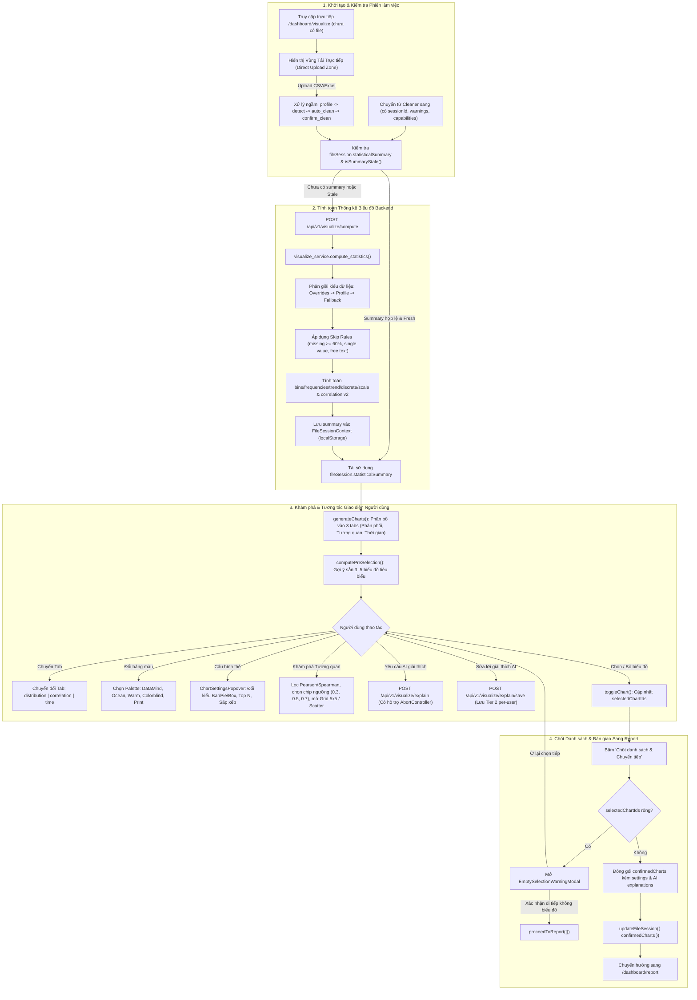

# Hướng dẫn Chuyên sâu & Đặc tả Kỹ thuật Module Visualize (Trực quan hóa Dữ liệu)

> **Tài liệu tham chiếu chuẩn (Single Source of Truth) dành cho Kỹ sư Phát triển, Chuyên viên Phân tích Dữ liệu và Đội ngũ Vận hành DataMind.**  
> *Phiên bản áp dụng:* `2026.11-v3` (Phù hợp sau Phases 1a–3c, bảng màu Palette, thang đo Likert/Rating, và bộ chọn báo cáo) | *Cập nhật:* Tháng 11/2026 | *Định dạng mã hóa:* UTF-8 (Unicode Normalization Form C - NFC).

---

## MỤC LỤC TỔNG QUAN

- [PART A — Tổng quan Người dùng & Luồng Hoạt động (User Journey & Flow)](#part-a--tổng-quan-người-dùng--luồng-hoạt-động-user-journey--flow)
  - [1. Sơ đồ Kiến trúc & Luồng Dữ liệu Tổng thể (Mermaid Architecture)](#1-sơ-đồ-kiến-trúc--luồng-dữ-liệu-tổng-thể-mermaid-architecture)
  - [2. Các Chặng trong Hành trình Trực quan hóa](#2-các-chặng-trong-hành-trình-trực-quan-hóa)
  - [3. Tính Bền vững Phiên làm việc (Session & Cache Persistence)](#3-tính-bền-vững-phiên-làm-việc-session--cache-persistence)
- [PART B — API Endpoints & Cấu trúc Dữ liệu Chi tiết](#part-b--api-endpoints--cấu-trúc-dữ-liệu-chi-tiết)
  - [1. `POST /api/v1/visualize/compute`](#1-post-apiv1visualizecompute)
  - [2. `POST /api/v1/visualize/scatter-data`](#2-post-apiv1visualizescatter-data)
  - [3. `POST /api/v1/visualize/explain`](#3-post-apiv1visualizeexplain)
  - [4. `POST /api/v1/visualize/explain/save`](#4-post-apiv1visualizeexplainsave)
- [PART C — Quy tắc Lựa chọn & Vẽ Biểu đồ (Chart Selection Engine)](#part-c--quy-tắc-lựa-chọn--vẽ-biểu-đồ-chart-selection-engine)
  - [1. Thứ bậc Phân giải Kiểu Dữ liệu (Type Resolution Order)](#1-thứ-bậc-phân-giải-kiểu-dữ-liệu-type-resolution-order)
  - [2. Bộ Quy tắc Bỏ qua Cột (Skip Rules & `skip_key`)](#2-bộ-quy-tắc-bỏ-qua-cột-skip-rules--skip_key)
  - [3. Phân biệt Biến Rời rạc (`is_discrete`) & Thang đo Đánh giá (`is_scale`)](#3-phân-biệt-biến-rời-rạc-is_discrete--thang-đo-đánh-giá-is_scale)
  - [4. Cột Định lượng Liên tục (Continuous Numeric — 20 Bins Histogram)](#4-cột-định-lượng-liên-tục-continuous-numeric--20-bins-histogram)
  - [5. Cột Định danh & Nhị phân (Categorical / Boolean — Top-10 + `__other__`)](#5-cột-định-danh--nhị-phân-categorical--boolean--top-10--__other__)
  - [6. Câu hỏi Nhiều Lựa chọn (Multiple Choice — Mẫu số Người tham gia)](#6-câu-hỏi-nhiều-lựa-chọn-multiple-choice--mẫu-số-người-tham-gia)
  - [7. Chuỗi Thời gian (Datetime — Tự động Chọn Bước chia Tần suất)](#7-chuỗi-thời-gian-datetime--tự-động-chọn-bước-chia-tần-suất)
  - [8. Động cơ Nhận xét Tự động (Auto Insights) & Quy tắc Làm tròn Half-Up](#8-động-cơ-nhận-xét-tự-động-auto-insights--quy-tắc-làm-tròn-half-up)
  - [9. Thuật toán Tính Điểm Gợi ý (Suggestion Score & Pre-selection)](#9-thuật-toán-tính-điểm-gợi-ý-suggestion-score--pre-selection)
- [PART D — Chi tiết Từng Thành phần Giao diện (UI Components Deep-Dive)](#part-d--chi-tiết-từng-thành-phần-giao-diện-ui-components-deep-dive)
  - [1. Màn hình Tải Trực tiếp (Direct Upload Fallback)](#1-màn-hình-tải-trực-tiếp-direct-upload-fallback)
  - [2. Trạng thái Đang Xử lý Thống kê (Loading State)](#2-trạng-thái-đang-xử-lý-thống-kê-loading-state)
  - [3. Thanh Tiêu đề Trang & Trợ giúp (Page Header & Actions)](#3-thanh-tiêu-đề-trang--trợ-giúp-page-header--actions)
  - [4. Khung Cảnh báo & Khả năng Xử lý (Capabilities Banner)](#4-khung-cảnh-báo--khả-năng-xử-lý-capabilities-banner)
  - [5. Bộ chọn Bảng màu Chủ đề (Palette Selector Dropdown)](#5-bộ-chọn-bảng-màu-chủ-đề-palette-selector-dropdown)
  - [6. Thanh Điều hướng Phân loại Biểu đồ (Tabs)](#6-thanh-điều-hướng-phân-loại-biểu-đồ-tabs)
  - [7. Thẻ Biểu đồ Đơn lẻ (ChartCard)](#7-thẻ-biểu-đồ-đơn-lẻ-chartcard)
  - [8. Menu Cài đặt Cấu hình Biểu đồ (ChartSettingsPopover)](#8-menu-cài-đặt-cấu-hình-biểu-đồ-chartsettingspopover)
  - [9. Khung Danh sách Cột Bị Bỏ qua (SkippedColumnsPanel)](#9-khung-danh-sách-cột-bị-bỏ-qua-skippedcolumnspanel)
  - [10. Modal Phóng to Toàn diện (EnlargedChartModal)](#10-modal-phóng-to-toàn-diện-enlargedchartmodal)
  - [11. Thanh Thao tác Cố định Dưới cùng (Sticky Bottom Bar)](#11-thanh-thao-tác-cố-định-dưới-cùng-sticky-bottom-bar)
  - [12. Hộp thoại Cảnh báo Chưa chọn Biểu đồ (EmptySelectionWarningModal)](#12-hộp- thoại-cảnh-báo-chưa-chọn-biểu-đồ-emptyselectionwarningmodal)
- [PART E — Khám phá Tương quan Toàn diện (Correlation V2 Engine)](#part-e--khám-phá-tương-quan-toàn-diện-correlation-v2-engine)
  - [1. Hệ số Pearson vs Spearman & Tiêu chí Lựa chọn](#1-hệ-số-pearson-vs-spearman--tiêu-chí-lựa-chọn)
  - [2. Tuyển chọn Ứng viên Cột Tương quan (`VIZ_CORR_MAX_COLS = 40`)](#2-tuyển-chọn-ứng-viên-cột-tương-quan-viz_corr_max_cols--40)
  - [3. Chip Lọc Ngưỡng Tương quan (`0.3`, `0.5`, `0.7`)](#3-chip-lọc-ngưỡng-tương-quan-03-05-07)
  - [4. Danh sách Cặp Tương quan (Pairs List & Accordion)](#4-danh-sách-cặp-tương-quan-pairs-list--accordion)
  - [5. Tìm kiếm theo Cột & Lọc Đa năng (Find-by-Column)](#5-tìm-kiếm-theo-cột--lọc-đa-năng-find-by-column)
  - [6. Ma trận Đầy đủ (Full Matrix Table)](#6-ma-trận-đầy-đủ-full-matrix-table)
  - [7. Trực quan Hóa Chi tiết Cặp: Bảng Lưới Tần suất (5x5 Grid) vs Đồ thị Phân tán (Scatter Plot)](#7-trực-quan-hóa-chi-tiết-cặp-bảng-lưới-tần-suất-5x5-grid-vs-đồ-thị-phân-tán-scatter-plot)
  - [8. Khung Kiến thức Thống kê "r là gì?"](#8-khung-kiến-thức-thống-kê-r-là-gì)
  - [9. AI Giải thích Tương quan Cặp & Nguyên tắc Nhân quả](#9-ai-giải-thích-tương-quan-cặp--nguyên-tắc-nhân-quả)
- [PART F — Bàn giao Sang Module Báo cáo (Report Hand-off)](#part-f--bàn-giao-sang-module-báo-cáo-report-hand-off)
  - [1. Cấu trúc Mảng `confirmedCharts` trong `FileSessionContext`](#1-cấu-trúc-mảng-confirmedcharts-trong-filesessioncontext)
  - [2. Kế thừa Cài đặt Hiển thị & Bảng màu Chủ đề](#2-kế-thừa-cài-đặt-hiển-thị--bảng-màu-chủ-đề)
  - [3. Cơ chế Khởi tạo Thực tế của Module Report (Xóa bỏ hiểu lầm `/report/generate`)](#3-cơ-chế-khởi-tạo-thực-tế-của-module-report-xóa-bỏ-hiểu-lầm-reportgenerate)
  - [4. Thành phần Báo cáo Chuyên dụng: `CorrelationReportView`](#4-thành-phần-báo-cáo-chuyên-dụng-correlationreportview)
- [PART G — Bảng Hằng số, Ngưỡng & Giới hạn Hệ thống](#part-g--bảng-hằng-số-ngưỡng--giới-hạn-hệ-thống)
- [PART H — Kiến trúc Hiệu năng & Tối ưu Giao diện](#part-h--kiến-trúc-hiệu-năng--tối-ưu-giao-diện)
  - [1. Tải Lười Thành phần Biểu đồ (`LazyChart` qua `IntersectionObserver`)](#1-tải-lười-thành-phần-biểu-đồ-lazychart-qua-intersectionobserver)
  - [2. Ghi nhớ Tính toán (`React.memo`, `useMemo`, `useCallback`)](#2-ghi-nhớ-tính-toán-reactmemo-usememo-usecallback)
  - [3. Tối ưu Payload JSON & Lấy mẫu Cố định](#3-tối-ưu-payload-json--lấy-mẫu-cố-định)
- [PART I — Vấn đề Kỹ thuật Tồn đọng & Đề xuất Nâng cấp](#part-i--vấn-đề-kỹ-thuật-tồn-đọng--đề-xuất-nâng-cấp)
  - [1. Tiêu đề Nút Đóng/Mở Phần Ma trận Tương quan (`FullMatrixSection`)](#1-tiêu-đề-nút-đóngmở-phần-ma-trận-tương-quan-fullmatrixsection)
  - [2. Đề xuất Hỗ trợ Tương quan Biến Định danh (Cramér's V / Correlation Ratio $\eta$)](#2-đề-xuất-hỗ-trợ-tương-quan-biến-định-danh-cramérs-v--correlation-ratio-eta)
- [PART J — Checklist Kiểm thử Thủ công Dành cho QA / Tester](#part-j--checklist-kiểm-thử-thủ-công-dành-cho-qa--tester)
- [PART K — Bảng Đối chiếu Thay đổi so với Tài liệu Cũ](#part-k--bảng-đối-chiếu-thay-đổi-so-với-tài-liệu-cũ)

---

## PART A — Tổng quan Người dùng & Luồng Hoạt động (User Journey & Flow)

Module **Visualize (Trực quan hóa Dữ liệu)** là chặng thứ 3 trong chuỗi xử lý (Pipeline) của DataMind, nằm ngay sau Module 2 (**Cleaner**) và đứng trước Module 4 (**Report**). Vai trò trọng tâm của Visualize là chuyển đổi các trường dữ liệu định lượng, định danh, nhị phân, nhiều lựa chọn và chuỗi thời gian thành các biểu đồ trực quan chuẩn mực khoa học dữ liệu, hỗ trợ người dùng khám phá tương quan chuyên sâu và lựa chọn các biểu đồ đắt giá nhất để đưa vào Báo cáo Điều hành.

### 1. Sơ đồ Kiến trúc & Luồng Dữ liệu Tổng thể (Mermaid Architecture)



### 2. Các Chặng trong Hành trình Trực quan hóa

1. **Chặng Khởi tạo:** Khi người dùng hoàn thành bước làm sạch tại Cleaner, hệ thống điều hướng sang Visualize kèm theo định danh phiên `sessionId`, các cảnh báo xác thực `warnings`, và quyền năng phân tích `capabilities` trong [frontend/src/contexts/FileSessionContext.jsx](file:///d:/datamind_prod/frontend/src/contexts/FileSessionContext.jsx).
2. **Chặng Tính toán Thống kê:** Hàm `isSummaryStale` tại [frontend/src/pages/Visualize.jsx#L181-L205](file:///d:/datamind_prod/frontend/src/pages/Visualize.jsx#L181-L205) kiểm tra tính toàn vẹn của dữ liệu summary. Nếu dữ liệu chưa có hoặc bị lỗi thời (do người dùng thay đổi ép kiểu dữ liệu `overrides` hoặc phiên bản cấu trúc dữ liệu `summary_version !== CURRENT_SUMMARY_VERSION`), hệ thống gửi request `POST /api/v1/visualize/compute` lên backend.
3. **Chặng Khám phá & Cá nhân hóa:** Giao diện phân loại biểu đồ thành 3 tab chính:
   - *Tab Phân phối:* Chứa biểu đồ phân phối định lượng (Histogram), biểu đồ cột rời rạc (Bar/Pie cho thang đo Likert), và biểu đồ hạng mục (Bar/Pie cho Categorical / Multiple Choice). Dưới đáy tab này hiển thị bảng các cột không đủ điều kiện vẽ biểu đồ (`SkippedColumnsPanel`).
   - *Tab Tương quan:* Chứa không gian `CorrelationView` hỗ trợ chọn hệ số tương quan (Spearman vs Pearson), lọc cặp theo ngưỡng ($|r| \ge 0.3, 0.5, 0.7$), tìm kiếm theo cột, mở bảng ma trận đầy đủ, và xem chi tiết cặp dưới dạng lưới tần suất 5x5 (`CorrelationGrid`) hoặc đồ thị phân tán (`ScatterChart`).
   - *Tab Thời gian:* Chứa biểu đồ đường xu hướng (Trend Line Chart) cho các trường ngày tháng/thời gian.
4. **Chặng Chốt Báo cáo:** Người dùng lựa chọn các biểu đồ ưng ý (hoặc sử dụng danh sách 3–5 biểu đồ do hệ thống tự động gợi ý sẵn), sau đó bấm `"Chốt danh sách & Chuyển tiếp"` để đóng gói mảng `confirmedCharts` và điều hướng sang trang Báo cáo (`/dashboard/report`).

### 3. Tính Bền vững Phiên làm việc (Session & Cache Persistence)

- **Lưu trữ Frontend (`FileSessionContext`):** Toàn bộ trạng thái bao gồm `statisticalSummary`, danh sách biểu đồ đã chọn `confirmedCharts`, các lời giải thích do AI sinh ra hoặc do người dùng biên tập `chartExplanations`, và cấu hình hiển thị từng biểu đồ `chartSettings` được đồng bộ thời gian thực vào khóa `datamind_session` trong `localStorage` [FileSessionContext.jsx#L102-L138](file:///d:/datamind_prod/frontend/src/contexts/FileSessionContext.jsx#L102-L138). Do đó, người dùng có thể tải lại trang (F5), đóng tab hoặc mở lại trình duyệt mà không bị mất dữ liệu.
- **Lưu trữ Backend (Redis TTL):**
  - File dữ liệu sạch được lưu dưới dạng byte nhị phân trong Redis tại khóa `filebytes:{user_id}:{session_id}` với thời gian sống 5 giờ (`_FILE_BYTES_TTL = 18000s`) [backend/app/core/cache.py#L14](file:///d:/datamind_prod/backend/app/core/cache.py#L14).
  - Lời giải thích AI được lưu trữ trong bộ nhớ đệm 2 tầng (Tier 1 cho bản gốc và Tier 2 cho bản sửa đổi cá nhân) với thời gian sống 30 ngày (`_AI_EXPLAIN_TTL = 2592000s`) [cache.py#L241](file:///d:/datamind_prod/backend/app/core/cache.py#L241).

---

## PART B — API Endpoints & Cấu trúc Dữ liệu Chi tiết

Mọi endpoint của module Visualize được định tuyến thông qua router `/visualize` tại [backend/app/routers/visualize.py](file:///d:/datamind_prod/backend/app/routers/visualize.py).

### 1. `POST /api/v1/visualize/compute`
- **Mã nguồn:** [backend/app/routers/visualize.py#L31-L57](file:///d:/datamind_prod/backend/app/routers/visualize.py#L31-L57) và [backend/app/services/visualize_service.py#L600-L640](file:///d:/datamind_prod/backend/app/services/visualize_service.py#L600-L640).
- **Mục đích:** Tính toán phân phối số học, tần suất hạng mục, chuỗi thời gian, nhận xét tự động, phân tích biến rời rạc/thang đo và ma trận tương quan V2 trên file dữ liệu đã làm sạch.
- **Request Body:**
  ```json
  {
    "session_id": "c1f7b19a-9e23-4e89-a5c7-9b4317f2bcde",
    "warnings": [],
    "overridden_types": {
      "tuoi": "numeric",
      "muc_do_hai_long": "numeric"
    }
  }
  ```
- **Response Format (Trích xuất từ dữ liệu thực tế):**
  ```json
  {
    "session_id": "c1f7b19a-9e23-4e89-a5c7-9b4317f2bcde",
    "file_hash": "a8f3b4c1...",
    "shape": [232, 64],
    "columns": {
      "tuoi": {
        "letter": "A",
        "dtype": "numeric",
        "missing_pct": 2.1,
        "respondents": 227,
        "is_discrete": false,
        "min": 18.0,
        "max": 65.0,
        "mean": 31.42,
        "median": 29.0,
        "std": 9.15,
        "p25": 24.0,
        "p75": 37.0,
        "box": {
          "q1": 24.0,
          "median": 29.0,
          "q3": 37.0,
          "iqr": 13.0,
          "whisker_low": 18.0,
          "whisker_high": 55.0,
          "mean": 31.42,
          "outliers": [60.0, 65.0],
          "outliers_total": 2
        },
        "distribution_bins": [
          {"value": 18.0, "count": 12, "pct": 5.3},
          {"value": 20.35, "count": 28, "pct": 12.3}
        ],
        "auto_insights": [
          {"key": "typical_range", "params": {"low": 24.0, "high": 37.0}}
        ]
      },
      "muc_do_hai_long": {
        "letter": "B",
        "dtype": "numeric",
        "missing_pct": 0.0,
        "respondents": 232,
        "is_discrete": true,
        "is_scale": true,
        "scale_min": 1,
        "scale_max": 5,
        "mean": 4.12,
        "distribution_bins": [
          {"value": 1, "count": 4, "pct": 1.7},
          {"value": 2, "count": 10, "pct": 4.3},
          {"value": 3, "count": 32, "pct": 13.8},
          {"value": 4, "count": 96, "pct": 41.4},
          {"value": 5, "count": 90, "pct": 38.8}
        ],
        "auto_insights": [
          {"key": "scale_mean", "type": "scale_mean", "params": {"mean": 4.12, "max": 5, "n": 232}},
          {"key": "scale_top_box", "type": "scale_top_box", "params": {"pct": 80, "low": 4, "high": 5, "count": 186, "n": 232}}
        ]
      }
    },
    "skipped_columns": [
      {
        "column": "ghi_chu_khao_sat",
        "letter": "BA",
        "reason": "free_text",
        "missing_pct": 14.5
      }
    ],
    "correlation_v2": {
      "columns": [
        {"name": "tuoi", "letter": "A", "is_discrete": false, "missing_pct": 2.1},
        {"name": "muc_do_hai_long", "letter": "B", "is_discrete": true, "missing_pct": 0.0}
      ],
      "default_method": "spearman",
      "pairs": [
        {
          "a": "tuoi",
          "b": "muc_do_hai_long",
          "a_letter": "A",
          "b_letter": "B",
          "pearson": 0.3421,
          "spearman": 0.3685,
          "n": 227
        }
      ],
      "dropped_columns": []
    }
  }
  ```

### 2. `POST /api/v1/visualize/scatter-data`
- **Mã nguồn:** [backend/app/routers/visualize.py#L65-L157](file:///d:/datamind_prod/backend/app/routers/visualize.py#L65-L157) và [backend/app/services/visualize_service.py#L643-L805](file:///d:/datamind_prod/backend/app/services/visualize_service.py#L643-L805).
- **Mục đích:** Cung cấp dữ liệu trực quan hóa chi tiết cho một cặp biến tương quan $(col_x, col_y)$.
- **Hành vi Đa hình (Polymorphic Behavior):**
  - Nếu **cả hai cột đều là biến rời rạc** (`stats_x.is_discrete && stats_y.is_discrete`): Trả về ma trận lưới tần suất chéo (`mode: "grid"`), với các mức `x_levels`, `y_levels`, và danh sách các ô lưới có số lượng người trả lời (`grid`). Mảng `points` vẫn được sinh ra để tương thích ngược.
  - Nếu **ít nhất một cột là định lượng liên tục**: Trả về danh sách tọa độ các điểm (`mode: "points"`). Nếu tổng số quan sát $N > 500$, backend thực hiện lấy mẫu ngẫu nhiên cố định với hạt giống `random.seed(42)` để lấy chính xác 500 điểm đại diện.
- **Request Body:**
  ```json
  {
    "session_id": "c1f7b19a-9e23-4e89-a5c7-9b4317f2bcde",
    "col_x": "tuoi",
    "col_y": "muc_do_hai_long"
  }
  ```
- **Response Format (Chế độ Grid):**
  ```json
  {
    "mode": "grid",
    "col_x": "muc_do_gan_ket",
    "col_y": "muc_do_hai_long",
    "letter_x": "C",
    "letter_y": "B",
    "x_levels": [1, 2, 3, 4, 5],
    "y_levels": [1, 2, 3, 4, 5],
    "grid": [
      {"x": 1, "y": 1, "count": 2},
      {"x": 5, "y": 5, "count": 74}
    ],
    "points": [{"x": 1, "y": 1}, {"x": 5, "y": 5}],
    "n": 232,
    "count": 232,
    "total": 232
  }
  ```

### 3. `POST /api/v1/visualize/explain`
- **Mã nguồn:** [backend/app/routers/visualize.py#L171-L412](file:///d:/datamind_prod/backend/app/routers/visualize.py#L171-L412), [backend/app/core/ai_client.py#L278-L335](file:///d:/datamind_prod/backend/app/core/ai_client.py#L278-L335), và [backend/app/services/ai_usage_service.py#L119-L152](file:///d:/datamind_prod/backend/app/services/ai_usage_service.py#L119-L152).
- **Mục đích:** Sử dụng mô hình AI qua tầng `ai_client` (Google Gemini chính, dự phòng Groq) để phân tích ý nghĩa nghiệp vụ của biểu đồ đơn lẻ hoặc toàn bộ ma trận tương quan.
- **Quy trình Kiểm tra, Dự phòng Nhà cung cấp & Quản lý Hạn mức (Provider Flow & Quota):**
  1. **Kiểm tra bộ nhớ đệm Tier 2 (Bản người dùng đã chỉnh sửa):** Nạp qua `cache.get_ai_explain_edited` [visualize.py#L214-L245]. Nếu có và bối cảnh dữ liệu không bị thay đổi (`context_hash == saved_ctx_hash`), trả về ngay lập tức với `source: "user"`, không gọi AI, không trừ quota.
  2. **Kiểm tra bộ nhớ đệm Tier 1 (Bản do AI sinh tự động ban đầu):** Nạp qua `cache.get_ai_explain_original` [visualize.py#L248-L282]. Nếu có và không phải yêu cầu phân tích lại (`is_reanalyze = False`), trả về ngay với `source: "ai"`, không gọi AI, không trừ quota.
  3. **Kiểm tra hạn mức tiêu thụ (Quota Check):** Router gọi `check_ai_quota(current_user["user_id"], db)` [backend/app/services/ai_usage_service.py#L119-L152]. Nếu số lượt đã dùng đạt giới hạn (`usage.runs_used >= usage.runs_limit`), ném `HTTPException` với mã trạng thái `429 Too Many Requests` và cấu trúc chi tiết:
     ```json
     {
       "code": "ERR_AI_QUOTA_EXCEEDED",
       "message": "Bạn đã dùng hết {runs_limit} lượt hôm nay.",
       "reset_at": "2026-11-09T00:00:00+07:00",
       "is_pro": false
     }
     ```
     Tại frontend, `AIInsightsCard.jsx#L206-L215` bắt các mã lỗi `ERR_AI_QUOTA_EXCEEDED` hoặc HTTP 429 / 402 để thông báo toast lỗi vượt hạn mức và vô hiệu hóa nút bấm.
  4. **Tạo ngữ cảnh prompt & Luồng gọi AI đa nhà cung cấp (Multi-provider Fallback):**
     Router xây dựng prompt qua `build_llm_context` [backend/app/services/context_builder.py](file:///d:/datamind_prod/backend/app/services/context_builder.py) và gọi `call_gemini_explain(prompt, lang)` [backend/app/services/ai_explain_service.py#L31-L33](file:///d:/datamind_prod/backend/app/services/ai_explain_service.py#L31-L33). Bên dưới, `ai_client.generate_text` [backend/app/core/ai_client.py#L278-L335](file:///d:/datamind_prod/backend/app/core/ai_client.py#L278-L335) vận hành tuần tự:
     - *Nhà cung cấp chính (Primary):* Gọi Google Gemini (`_call_gemini`, model `gemini-2.0-flash`), tự động thử lại 1 lần nếu gặp lỗi mạng 5xx hoặc timeout [ai_client.py#L201-L235]. Nếu gặp lỗi 429 rate limit hoặc sau khi retry vẫn lỗi, lập tức chuyển sang Groq.
     - *Nhà cung cấp dự phòng (Fallback):* Nếu cấu hình `GROQ_API_KEY` và `GROQ_MODEL`, hệ thống gọi API Groq (`_call_groq`, tương thích chuẩn OpenAI) kèm hàm cắt gọn mẫu chuỗi an toàn `_trim_prompt_for_groq` [ai_client.py#L237-L276].
     - *Trường hợp cả hai nhà cung cấp đều thất bại:* Hàm `_raise_ai_unavailable` [ai_client.py#L181-L195] ném ngoại lệ `DataMindException` với mã lỗi `ERR_AI_UNAVAILABLE` (mức độ `BLOCKING`), thông điệp người dùng: *"Hiện chưa sử dụng được AI. Bạn không bị trừ lượt, vui lòng thử lại sau."* Hệ thống **HOÀN TOÀN KHÔNG trừ lượt quota** và không lưu cache.
  5. **Cơ chế Hủy Yêu cầu Phía Máy chủ (Server Disconnection Check):**
     Ngay sau khi lời gọi AI hoàn tất, router kiểm tra kết nối mạng từ máy khách [visualize.py#L380-L382]:
     ```python
     if await request.is_disconnected():
         logger.info(f"ai.cancelled feature={feature_name}")
         return JSONResponse(status_code=499, content={"detail": "Client closed request", "cancelled": True})
     ```
     Nếu người dùng đã bấm nút Hủy trên giao diện (kích hoạt `AbortController` của trình duyệt tại [AIInsightsCard.jsx#L143-L162](file:///d:/datamind_prod/frontend/src/components/charts/AIInsightsCard.jsx#L143-L162)), backend trả về HTTP 499, **TUYỆT ĐỐI KHÔNG trừ quota** (`record_ai_feature_usage` bị bỏ qua) và **KHÔNG lưu vào bộ nhớ đệm**.
  6. **Ghi nhận sử dụng & Lưu cache:** Nếu kết nối còn nguyên vẹn, router gọi `record_ai_feature_usage` [visualize.py#L385] trừ 1 lượt trong ngày và lưu văn bản vào Redis Tier 1 với thời hạn 30 ngày (`set_ai_explain_original`) [visualize.py#L388-L390].

### 4. `POST /api/v1/visualize/explain/save`
- **Mã nguồn:** [backend/app/routers/visualize.py#L423-L463](file:///d:/datamind_prod/backend/app/routers/visualize.py#L423-L463).
- **Mục đích:** Lưu trữ văn bản phân tích do người dùng tự tay chỉnh sửa vào bộ nhớ đệm Tier 2 của Redis (`set_ai_explain_edited`) gắn với mã băm ngữ cảnh `context_hash`. Lần tải sau sẽ ưu tiên nạp bản này mà không gọi lại AI.

---

## PART C — Quy tắc Lựa chọn & Vẽ Biểu đồ (Chart Selection Engine)

### 1. Thứ bậc Phân giải Kiểu Dữ liệu (Type Hierarchy)
Tại [backend/app/services/visualize_service.py#L110-L127](file:///d:/datamind_prod/backend/app/services/visualize_service.py#L110-L127), kiểu dữ liệu của mỗi cột được giải quyết tuần tự theo thứ bậc ưu tiên 3 cấp:
1. **Ép kiểu do người dùng thiết lập (`overridden_types`):** Nhận từ tham số đầu vào (ví dụ người dùng ép một cột số nguyên thành `categorical` tại bước Profiler).
2. **Kiểu phân tích từ Profiler (`profile_col.get("data_type")`):** Nhận diện từ bước khám phá hồ sơ (hỗ trợ `numeric`, `categorical`, `boolean`, `datetime`, `multiple_choice`, `text`).
3. **Phân giải dự phòng (Fallback resolution):** Nếu không có hồ sơ, backend kiểm tra kiểu nội tại của Pandas (`is_numeric_dtype`, `is_datetime64_any_dtype`, v.v.).

### 2. Bộ Quy tắc Bỏ qua Cột (Skip Rules & `skip_key`)
Các cột không thỏa mãn điều kiện trực quan hóa sẽ được gán cờ `skip_chart: True` và đưa vào danh sách `skipped_columns` với `skip_key` rõ ràng:
- **Tỷ lệ ô trống quá cao (`missing_high`):** Nếu tỷ lệ giá trị thiếu của cột $\ge 60\%$ (`HIGH_MISSING_PCT = 60` định nghĩa tại [backend/app/core/rules.py#L56](file:///d:/datamind_prod/backend/app/core/rules.py#L56) và kiểm tra tại [visualize_service.py#L131](file:///d:/datamind_prod/backend/app/services/visualize_service.py#L131)). Cột này bị bỏ qua vì biểu đồ sẽ mất tính đại diện thống kê.
- **Phương sai bằng 0 / Đơn giá trị (`single_value`):** Nếu số giá trị duy nhất $nunique \le 1$ [visualize_service.py#L137](file:///d:/datamind_prod/backend/app/services/visualize_service.py#L137). Cột chỉ có 1 giá trị duy nhất (hoặc toàn rỗng) không mang thông tin phân phối.
- **Văn bản tự do (`free_text`):** Cột có kiểu `text`, hoặc cột `categorical` nhưng có số giá trị phân biệt $nunique > 50$ và độ dài trung bình chuỗi ký tự $> 30$ [visualize_service.py#L143](file:///d:/datamind_prod/backend/app/services/visualize_service.py#L143).

### 3. Phân biệt Biến Rời rạc (`is_discrete`) & Thang đo Đánh giá (`is_scale`)
Thuật toán phân tích biến rời rạc được cài đặt tại `_inspect_discrete` [backend/app/services/visualize_service.py#L33-L78](file:///d:/datamind_prod/backend/app/services/visualize_service.py#L33-L78), tuân thủ nghiêm ngặt các ngưỡng định nghĩa tại [backend/app/core/rules.py#L62-L69](file:///d:/datamind_prod/backend/app/core/rules.py#L62-L69):
- **Điều kiện biến rời rạc (`is_discrete = True`):**
  Cột số có số giá trị phân biệt hợp lệ nằm trong khoảng:
  $$2 \le nunique \le 10 \quad (\text{ngưỡng } \texttt{VIZ\_DISCRETE\_MAX\_UNIQUE} = 10)$$
- **Điều kiện thang đo đánh giá (`is_scale = True`):**
  Biến rời rạc được phân loại nâng cao thành thang đo chuẩn (ví dụ Likert 1–5, điểm NPS 0–10, điểm hài lòng 1–7) khi thỏa mãn toàn bộ 4 điều kiện:
  1. Là số nguyên (`is_integer = True`).
  2. Giá trị nhỏ nhất không âm: $min \ge 0$.
  3. Giá trị lớn nhất thuộc bộ thang đo chuẩn: $max \in \{5, 7, 10\}$ (`VIZ_SCALE_MAX_VALUES = (5, 7, 10)`).
  4. Khoảng biến thiên hẹp: $max - min \le 10$ (`VIZ_DISCRETE_MAX_RANGE = 10`).
- **Quy tắc Bù Mức Không (Zero-padding Logic cho Thang đo):**
  Đối với cột được định danh là `is_scale`, backend tự động lặp qua toàn bộ các mức nguyên từ $scale\_min$ (0 hoặc 1) đến $scale\_max$. Nếu trong dữ liệu thực tế có mức điểm không ai chọn (ví dụ không ai cho 1 sao hay 2 sao), backend vẫn đưa mức đó vào `distribution_bins` với `count: 0` và `pct: 0.0`. Điều này đảm bảo trục đo không bị đứt đoạn, giúp người đọc nắm bắt được toàn cảnh thang đo.
  *Ngược lại, nếu chỉ là `is_discrete` thông thường (không phải scale), hệ thống chỉ giữ các giá trị thực tế xuất hiện, sắp xếp tăng dần và không bù giá trị 0.*

### 4. Cột Định lượng Liên tục (Continuous Numeric — 20 Bins Histogram)
- Cột số không phải biến rời rạc (`!is_discrete`) được tính toán 20 khoảng đều nhau (20 bins) thông qua hàm `np.histogram` [visualize_service.py#L189-L218](file:///d:/datamind_prod/backend/app/services/visualize_service.py#L189-L218).
- Dữ liệu trả về bao gồm các mốc giá trị (`value`), số lượng phần tử (`count`), và tỷ lệ phần trăm (`pct`). Đồng thời backend tính toán đầy đủ các thông số mô tả: `min`, `max`, `mean`, `median`, `std`, `skewness`, `kurtosis`, `p25`, `p75`, `iqr`, và số lượng điểm ngoại lai `outlier_count` dựa trên khoảng tứ phân vị $1.5 \times IQR$.

### 5. Cột Định danh & Nhị phân (Categorical / Boolean — Top-10 + `__other__` & Tùy biến Frontend)
- **Xử lý Backend:**
  Backend trích xuất các hạng mục theo số lượt xuất hiện giảm dần và lấy ra tối đa 10 giá trị đầu tiên (`top_values`) [visualize_service.py#L257-L290](file:///d:/datamind_prod/backend/app/services/visualize_service.py#L257-L290). Nếu tổng số hạng mục $unique > 10$, các hạng mục còn lại được gom chung vào mục dự phòng `__other__`. Đồng thời, backend lưu toàn bộ danh sách các hạng mục (tối đa 200 hạng mục đầu tiên) vào trường `all_values` [visualize_service.py#L292-L318](file:///d:/datamind_prod/backend/app/services/visualize_service.py#L292-L318).
- **Tái cấu trúc Hiển thị Top N trên Frontend (`computeEffectiveChart`):**
  Tại [frontend/src/utils/chartView.js#L183-L269](file:///d:/datamind_prod/frontend/src/utils/chartView.js#L183-L269), dữ liệu hiển thị được tính toán lại linh hoạt theo cài đặt của người dùng (`settings.top_n`):
  - `top_n === "auto"` (mặc định): Nếu tổng số hạng mục $uniqueCount \le 15$, hệ thống hiển thị toàn bộ không gom nhóm; nếu $uniqueCount > 15$, giới hạn ở mức 10 hạng mục đầu tiên và gom phần còn lại vào `"Khác"`.
  - `top_n === 10`: Giới hạn chính xác 10 hạng mục đầu tiên.
  - `top_n === 15`: Giới hạn chính xác 15 hạng mục đầu tiên.
  - `top_n === "all"`: Hiển thị toàn bộ các hạng mục từ `all_values`.
  - *Cảnh báo giới hạn 200 hạng mục:* Khi người dùng chọn `"Tất cả"` (`top_n === "all"`) và số lượng hạng mục $uniqueCount > 200$ (hoặc độ dài `cleanValues >= 200`), cờ `isCapped200` được bật thành `true` [chartView.js#L258], kích hoạt dòng ghi chú in nghiêng trên giao diện: *"Chỉ hiển thị tối đa 200 giá trị phổ biến nhất"* (`visualize.capped_200_note`) [Visualize.jsx#L788-L792](file:///d:/datamind_prod/frontend/src/pages/Visualize.jsx#L788-L792).
- **Cơ chế Tái tạo Mục "Khác" (`__other__`) Kèm Danh sách Ẩn khi Hover:**
  Khi danh sách hạng mục bị cắt ngắn theo giới hạn $limit$, frontend tự động tổng hợp các mục bị cắt bớt thành một đối tượng `otherItem` [chartView.js#L236-L249]:
  ```javascript
  otherItem = {
    value: "__other__",
    count: sumCount,
    pct: sumPct,
    other_n: rest.length,
    hidden_items: rest, // lưu toàn bộ các mục bị ẩn
  };
  ```
  Tại component hiển thị [frontend/src/components/charts/ChartComponents.jsx#L173-L177](file:///d:/datamind_prod/frontend/src/components/charts/ChartComponents.jsx#L173-L177) và [ChartComponents.jsx#L203-L208](file:///d:/datamind_prod/frontend/src/components/charts/ChartComponents.jsx#L203-L208), nhãn hiển thị được định dạng thành `"Khác (N mục)"` (`visualize.other_label`). Khi người dùng di chuột (hover) vào thanh cột hoặc nhãn trục, tooltip sẽ liệt kê danh sách 10 mục ẩn đầu tiên dạng `tên (số lượng)` và hiển thị thêm `+K mục nữa` nếu danh sách ẩn vượt quá 10.
- **Thuật toán Sắp xếp Hạng mục (`sortCategories` & `parseSortKey`):**
  Quy tắc sắp xếp được cài đặt tại [frontend/src/utils/chartView.js#L6-L54](file:///d:/datamind_prod/frontend/src/utils/chartView.js#L6-L54):
  - *Theo tần suất (`sort === "by_count"` — mặc định):* Sắp xếp giảm dần theo số lượng quan sát `(b.count || 0) - (a.count || 0)`.
  - *Theo giá trị (`sort === "by_value"`):*
    1. Mục `"__other__"` luôn luôn được đặt ở vị trí cuối cùng của biểu đồ.
    2. Các mục còn lại được phân tích số học qua hàm `parseSortKey(label)` [chartView.js#L6-L19]: hàm bóc tách số đầu tiên trong chuỗi ký tự; nếu chuỗi bắt đầu bằng các từ chỉ cận dưới như `"dưới"`, `"under"`, `"<"`, giá trị số tự động được trừ đi 0.5 (ví dụ `"Dưới 20 tuổi"` được gán giá trị khóa $19.5$, đảm bảo đứng trước mốc `"20–25 tuổi"`).
    3. Nếu cả hai mục đều chứa số: so sánh theo giá trị số tăng dần.
    4. Nếu chỉ một mục chứa số: mục có số được ưu tiên đứng trước.
    5. Nếu cả hai mục đều là chữ thuần túy: so sánh theo thứ tự bảng chữ cái bản địa hóa thông qua `Intl.Collator(locale, { numeric: true, sensitivity: "base" })`. Nếu hòa điểm thì giữ theo thứ tự tần suất count.

### 6. Câu hỏi Nhiều Lựa chọn (Multiple Choice — Mẫu số Người tham gia)
- Đối với cột khảo sát nhiều lựa chọn (các đáp án ngăn cách bởi dấu phẩy, chấm phẩy hoặc dấu gạch đứng), backend thực hiện bóc tách chuỗi (tokenization) và đếm tần suất độc lập cho từng lựa chọn [visualize_service.py#L320-L371](file:///d:/datamind_prod/backend/app/services/visualize_service.py#L320-L371).
- **Công thức phần trăm chuẩn xác:** Mẫu số để tính tỷ lệ phần trăm là **tổng số người tham gia trả lời câu hỏi** ($N = respondents$), **KHÔNG PHẢI** tổng số lượt tick chọn:
  $$pct_i = \frac{count_i}{respondents} \times 100$$
  *Hệ quả thống kê:* Tổng tỷ lệ phần trăm cộng dồn của tất cả các đáp án thường sẽ vượt quá $100\%$. Giao diện Visualize luôn hiển thị dòng lưu ý in nghiêng: *"Mỗi người có thể chọn nhiều đáp án, nên tổng tỷ lệ có thể vượt 100%."*

### 7. Chuỗi Thời gian (Datetime — Tự động Chọn Bước chia Tần suất)
Tại [backend/app/services/visualize_service.py#L373-L380](file:///d:/datamind_prod/backend/app/services/visualize_service.py#L373-L380), hệ thống đo khoảng thời gian giữa mốc nhỏ nhất và lớn nhất của cột ngày tháng (`time_range = max_date - min_date`) để tự động quyết định bước gom nhóm thời gian (`freq`) theo các ngưỡng chính xác trong mã nguồn:
- `time_range.total_seconds() <= 48 * 3600` ($\le 48$ giờ): Gom nhóm theo giờ (`freq = "h"`).
- `time_range.days <= 60` ($\le 60$ ngày): Gom nhóm theo ngày (`freq = "D"`).
- `time_range.days <= 730` ($\le 730$ ngày / 2 năm): Gom nhóm theo tháng (`freq = "M"`).
- `time_range.days > 730` ($> 730$ ngày): Gom nhóm theo năm (`freq = "Y"`).

### 8. Động cơ Nhận xét Tự động (Auto Insights) & Quy tắc Làm tròn Half-Up
Toàn bộ nhận xét tự động được sinh thuần túy qua các phép toán thống kê tiền định (deterministic, không gọi LLM) tại [backend/app/services/chart_insights.py](file:///d:/datamind_prod/backend/app/services/chart_insights.py). Mỗi biểu đồ nhận tối đa 2 nhận xét (`insights[:2]`).
- **Quy tắc làm tròn Half-Up (`_round_half_up` L4–13):**
  Để loại bỏ hiện tượng sai lệch làm tròn của số thực dấu phẩy động (Banker's rounding làm tròn số tận cùng 5 về số chẵn gần nhất, ví dụ $3.25 \to 3.2$), DataMind sử dụng module `decimal` với cơ chế `ROUND_HALF_UP` ($3.25 \to 3.3$, $0.5 \to 1.0$).
- **Bảng Tra cứu Khóa Nhận xét Tự động:**

| Kiểu dữ liệu | Mã khóa (`key`) | Điều kiện kích hoạt toán học | Tham số trả về (`params`) |
| :--- | :--- | :--- | :--- |
| **Categorical / Boolean** | `top_value` | Hạng mục có tần suất cao nhất (khác `__other__`) | `{ value: str, pct: float }` |
| **Categorical / Boolean** | `top3_share` | Tổng thị phần của 3 hạng mục đầu tiên $\ge 70\%$ | `{ pct: float }` |
| **Multiple Choice** | `mc_top` | Lựa chọn được chọn nhiều nhất | `{ value: str, pct: float }` |
| **Multiple Choice** | `mc_avg` | Số lựa chọn trung bình trên một người $\ge 1.5$ | `{ avg: float }` |
| **Discrete (Scale)** | `scale_mean` | Cột có thuộc tính `is_scale = True` | `{ mean: float, max: int, n: int }` |
| **Discrete (Scale)** | `scale_top_box` | Tỷ lệ chọn 2 mức cao nhất ($max-1$ và $max$) | `{ pct: int, low: int, high: int, count: int, n: int }` |
| **Discrete (Non-scale)**| `discrete_mean` | Biến rời rạc nhưng không phải scale | `{ mean: float, n: int }` |
| **Discrete (Non-scale)**| `discrete_top` | Mức điểm có số lượng người chọn nhiều nhất | `{ value: int/float, pct: int, count: int, n: int }` |
| **Continuous Numeric** | `typical_range`| Khoảng biến thiên giữa tứ phân vị $P_{25}$ và $P_{75}$ | `{ low: float, high: float }` |
| **Continuous Numeric** | `outliers` | Số lượng phần tử ngoại lai ngoài dải IQR $> 0$ | `{ n: int }` |
| **Datetime** | `trend_up` | Tần suất điểm cuối tăng $\ge 10\%$ so với điểm đầu | `{ pct: float }` |
| **Datetime** | `trend_down` | Tần suất điểm cuối giảm $\ge 10\%$ so với điểm đầu | `{ pct: float }` |
| **Datetime** | `peak` | Điểm thời gian đạt giá trị đỉnh cao nhất | `{ period: str }` |

### 9. Thuật toán Tính Điểm Gợi ý (Suggestion Score & Pre-selection)
Nhằm giúp người dùng nhanh chóng xác định các thông tin đắt giá nhất, hàm `generateCharts` tại [frontend/src/pages/Visualize.jsx#L1080-L1142](file:///d:/datamind_prod/frontend/src/pages/Visualize.jsx#L1080-L1142) tính điểm ưu tiên (`score`) cho từng biểu đồ:
- Cột số (Distribution):
  $$\text{score} = \left(1 - \frac{\text{missing\_pct}}{100}\right) + \left(\frac{\text{std}}{|\text{mean}| + 1} \times 0.5\right)$$
- Cột danh mục / nhiều lựa chọn:
  $$\text{score} = 1 - \frac{\text{missing\_pct}}{100}$$
- Cột chuỗi thời gian & Ma trận tương quan: Điểm cố định $\text{score} = 1.0$.

Hàm `computePreSelection` [Visualize.jsx#L1278-L1340](file:///d:/datamind_prod/frontend/src/pages/Visualize.jsx#L1278-L1340) tự động chọn sẵn từ 3 đến 5 biểu đồ tiêu biểu nhất khi vừa nạp dữ liệu:
1. Đảm bảo tính đa dạng danh mục: Chọn ít nhất 1 biểu đồ tốt nhất từ tab Phân phối, 1 ma trận Tương quan (nếu có ít nhất một cặp có $|r| \ge 0.5$), và 1 biểu đồ Thời gian.
2. Lấp đầy chỉ tiêu 5 biểu đồ: Duyệt qua các biểu đồ còn lại, ưu tiên các biểu đồ có nhận xét tự động `auto_insights`.
3. Dự phòng tối thiểu: Bổ sung thêm các biểu đồ có điểm cao nhất cho đến khi đạt tối thiểu 3 biểu đồ.

---

## PART D — Chi tiết Từng Thành phần Giao diện (UI Components Deep-Dive)

### 1. Màn hình Tải Trực tiếp (Direct Upload Fallback)
- **Người dùng thấy gì:** Khung kéo thả file viền nét đứt lớn, biểu tượng Upload xanh lá, nút chọn file máy tính (.csv, .xlsx, .xls), kèm khung thông tin ghi chú tính năng.
- **Khi nào:** Xuất hiện khi người dùng truy cập trực tiếp vào URL `/dashboard/visualize` mà chưa trải qua các bước tải file trước đó, hoặc sau khi bấm nút `"Đổi file dữ liệu"` [Visualize.jsx#L1655-L1715](file:///d:/datamind_prod/frontend/src/pages/Visualize.jsx#L1655-L1715).
- **Tooltip (vi / en):** Không có tooltip. Hướng dẫn trực tiếp bằng văn bản trên màn hình.
- **Quy tắc:** Khi người dùng thả file vào đây, hệ thống tự động chạy quy trình ngầm toàn chuỗi: `profileFile` $\to$ `detectIssues` $\to$ `autoClean` $\to$ `confirmClean` và chuyển thẳng vào màn hình trực quan hóa [Visualize.jsx#L1436-L1460](file:///d:/datamind_prod/frontend/src/pages/Visualize.jsx#L1436-L1460).
- **Vị trí mã nguồn:** [frontend/src/pages/Visualize.jsx#L1655-L1715](file:///d:/datamind_prod/frontend/src/pages/Visualize.jsx#L1655-L1715).

### 2. Trạng thái Đang Xử lý Thống kê (Loading State)
- **Người dùng thấy gì:** Vòng quay tròn màu xanh lá đậm (`border-[#1B4324] animate-spin`), tiêu đề `"Đang tính toán thống kê biểu đồ..."` và mô tả giải thích hệ thống đang phân tích các phân phối số học.
- **Khi nào:** Xuất hiện trong quá trình frontend chờ phản hồi từ API `POST /visualize/compute` [Visualize.jsx#L1643-L1653](file:///d:/datamind_prod/frontend/src/pages/Visualize.jsx#L1643-L1653).
- **Quy tắc:** Chặn toàn bộ thao tác giao diện cho đến khi dữ liệu summary được nạp xong.

### 3. Thanh Tiêu đề Trang & Trợ giúp (Page Header & Actions)
- **Người dùng thấy gì:** Tiêu đề `"Trực quan hóa dữ liệu"`, phụ đề, badge đếm tổng số biểu đồ đã chọn dạng viên thuốc `"Đã chọn X/Y biểu đồ"`, nút tài liệu trợ giúp (`PageHelpDocs`), nút `"Quay lại Cleaner"` và nút `"Tải file khác"` [Visualize.jsx#L1760-L1791](file:///d:/datamind_prod/frontend/src/pages/Visualize.jsx#L1760-L1791).
- **Khi nào:** Hiển thị thường trực ở phần trên cùng của trang.
- **Quy tắc:** Nếu đang chạy trong chế độ Pipeline hướng dẫn (`pipelineMode = True`), các nút quay lại tự do được ẩn để tránh người dùng rời luồng công việc ngoài ý muốn.

### 4. Khung Cảnh báo & Khả năng Xử lý (Capabilities Banner)
- **Người dùng thấy gì:** Hộp thông báo màu trắng bo góc, hiển thị trạng thái hỗ trợ của 3 nhóm biểu đồ (Phân phối, Tương quan, Thời gian) bằng biểu tượng tích xanh hoặc dấu chéo đỏ. Kèm nhãn màu vàng hổ phách `"Dữ liệu ít dòng"` nếu có cảnh báo `LOW_ROW_COUNT` [Visualize.jsx#L1805-L1827](file:///d:/datamind_prod/frontend/src/pages/Visualize.jsx#L1805-L1827).
- **Khi nào:** Hiển thị khi `fileSession.capabilities` tồn tại.
- **Quy tắc:** Được xác định từ bước thẩm định file ban đầu của Validator, giúp người dùng biết trước bộ dữ liệu có đủ điều kiện để tính tương quan hay vẽ chuỗi thời gian hay không.

### 5. Bộ chọn Bảng màu Chủ đề (Palette Selector Dropdown)
- **Người dùng thấy gì:** Menu dropdown nhỏ gọn ở góc phải thanh tab, hiển thị tên bảng màu hiện tại kèm 4 chấm màu xem trước. Khi mở ra, liệt kê 5 bảng màu chuẩn: *DataMind (Mặc định)*, *Đại dương (Ocean)*, *Ấm (Warm)*, *Dễ phân biệt cho người mù màu (Colorblind-friendly)*, và *Đen trắng in ấn (Grayscale print)* [frontend/src/utils/chartPalettes.js](file:///d:/datamind_prod/frontend/src/utils/chartPalettes.js).
- **Khi nào:** Hiển thị thường trực ngang hàng với các Tab phân loại [Visualize.jsx#L1858-L1860](file:///d:/datamind_prod/frontend/src/pages/Visualize.jsx#L1858-L1860).
- **Quy tắc:** Khi người dùng đổi bảng màu, giá trị mới được lưu vào `ChartThemeContext` và cập nhật tức thì trên toàn bộ biểu đồ, đồng thời chuyển tiếp nguyên vẹn sang Báo cáo và file xuất Word/PDF.

### 6. Thanh Điều hướng Phân loại Biểu đồ (Tabs)
- **Người dùng thấy gì:** 3 tab chọn ngang: `"Phân phối (N)"`, `"Tương quan (N)"`, và `"Thời gian (N)"`. Tab đang chọn có gạch chân màu xanh đậm `#1B4324` [Visualize.jsx#L1831-L1856](file:///d:/datamind_prod/frontend/src/pages/Visualize.jsx#L1831-L1856).
- **Khi nào:** Luôn hiển thị.
- **Quy tắc:** Nếu một tab không có biểu đồ nào hoặc dữ liệu không đủ khả năng đáp ứng, tab đó hiển thị biểu tượng cảnh báo nhỏ và mờ 50%. Khi nạp trang, hệ thống tự động kích hoạt tab có dữ liệu đầu tiên.

### 7. Thẻ Biểu đồ Đơn lẻ (ChartCard)
- **Người dùng thấy gì:** Thẻ trắng bo tròn viền xám (hoặc viền xanh lá kèm đổ bóng nhẹ khi được chọn). Bao gồm:
  1. Hộp kiểm (Checkbox) chọn biểu đồ vào báo cáo [Visualize.jsx#L663-L673](file:///d:/datamind_prod/frontend/src/pages/Visualize.jsx#L663-L673).
  2. Tiêu đề biểu đồ: Có thể bấm vào biểu tượng cây bút để sửa trực tiếp tại chỗ (`isEditingTitle`) [Visualize.jsx#L675-L705](file:///d:/datamind_prod/frontend/src/pages/Visualize.jsx#L675-L705). Nếu tiêu đề dài quá 40 ký tự, có nút `"Xem thêm"` / `"Thu gọn"`.
  3. Dòng phụ đề thống kê: Nêu rõ quy mô mẫu, ví dụ: *"Số người chọn mỗi đáp án · 232 câu trả lời"* [Visualize.jsx#L153-L179](file:///d:/datamind_prod/frontend/src/pages/Visualize.jsx#L153-L179).
  4. Huy hiệu `"Gợi ý"` (`badge_suggested`): Nhãn màu xanh ngọc nhạt, hiển thị tooltip giải thích lý do gợi ý [Visualize.jsx#L712-L719](file:///d:/datamind_prod/frontend/src/pages/Visualize.jsx#L712-L719).
  5. Nút Cài đặt biểu đồ (`ChartSettingsPopover`) [Visualize.jsx#L720-L728](file:///d:/datamind_prod/frontend/src/pages/Visualize.jsx#L720-L728).
  6. Nút Phóng to (`Maximize2` icon) [Visualize.jsx#L729-L735](file:///d:/datamind_prod/frontend/src/pages/Visualize.jsx#L729-L735).
  7. Khung vẽ biểu đồ tải lười `LazyChart` [Visualize.jsx#L740-L787](file:///d:/datamind_prod/frontend/src/pages/Visualize.jsx#L740-L787).
  8. Khung Nhận xét tự động (Auto Insights) kèm bóng đèn vàng [Visualize.jsx#L813-L835](file:///d:/datamind_prod/frontend/src/pages/Visualize.jsx#L813-L835).
  9. Khung Phân tích AI (`AIInsightsCard`) [Visualize.jsx#L838-L846](file:///d:/datamind_prod/frontend/src/pages/Visualize.jsx#L838-L846).
- **Tooltip (vi / en):**
  - Checkbox: `"Đã thêm vào báo cáo"` / `"Thêm vào báo cáo"` (`Added to report` / `Add to report`).
  - Huy hiệu Gợi ý: Nêu rõ tỷ lệ thiếu và phát hiện nổi bật, ví dụ: `"Chọn sẵn cho báo cáo vì chỉ trống 0%, và giá trị trung bình 4,12/5 (n = 232). Bấm 'Đã thêm vào báo cáo' để bỏ chọn."` [Visualize.jsx#L256-L262](file:///d:/datamind_prod/frontend/src/pages/Visualize.jsx#L256-L262).
  - Nhận xét tự động dạng trung bình: `"Giá trị trung bình số học tính trên các dòng hợp lệ"` (`Arithmetic mean calculated across valid rows`).
  - Nhận xét tự động dạng phần trăm: `"Chiếm X trên tổng số Y dòng"` (`Accounts for X out of Y total rows`).
- **Vị trí mã nguồn:** [frontend/src/pages/Visualize.jsx#L609-L850](file:///d:/datamind_prod/frontend/src/pages/Visualize.jsx#L609-L850).

### 8. Menu Cài đặt Cấu hình Biểu đồ (ChartSettingsPopover)
- **Người dùng thấy gì:** Hộp popover nhỏ mở ra khi bấm biểu tượng bánh răng cài đặt trên thẻ.
- **Khi nào:** Hiển thị cho các biểu đồ phân phối định lượng hoặc định danh, không hiển thị cho Heatmap và chuỗi thời gian [Visualize.jsx#L281-L283](file:///d:/datamind_prod/frontend/src/pages/Visualize.jsx#L281-L283).
- **Tùy chọn tương tác:**
  - *Dạng biểu đồ:* Chuyển đổi giữa Cột (Histogram/Bar) $\leftrightarrow$ Tròn (Pie/Donut) cho Categorical và Discrete, hoặc Histogram $\leftrightarrow$ Hộp (Boxplot) cho định lượng liên tục (chỉ hiển thị khi cột có thông số `"box"`) [Visualize.jsx#L291-L300](file:///d:/datamind_prod/frontend/src/pages/Visualize.jsx#L291-L300), [chartView.js#L96-L104](file:///d:/datamind_prod/frontend/src/utils/chartView.js#L96-L104).
  - *Số lượng hiển thị (Top N):* Chọn `Auto` (tự động $\le 15$), `Top 10`, `Top 15`, hoặc `Tất cả` (tối đa 200) [Visualize.jsx#L349-L373](file:///d:/datamind_prod/frontend/src/pages/Visualize.jsx#L349-L373).
  - *Sắp xếp:* Xếp theo `"Tần suất (nhiều → ít)"` hoặc `"Theo giá trị"` (hỗ trợ nhận diện số thông minh qua `parseSortKey`) [Visualize.jsx#L375-L395](file:///d:/datamind_prod/frontend/src/pages/Visualize.jsx#L375-L395).
  - *Ẩn mức 0:* Hộp kiểm ẩn các mức điểm có 0 người chọn đối với thang đo Likert [Visualize.jsx#L397-L410](file:///d:/datamind_prod/frontend/src/pages/Visualize.jsx#L397-L410).

#### Quy tắc Vẽ Biểu đồ Hộp Toàn diện (BoxPlotChart)
- **Cấu trúc trường dữ liệu `box` backend:** [backend/app/services/visualize_service.py#L288-L322](file:///d:/datamind_prod/backend/app/services/visualize_service.py#L288-L322) tính toán độc quyền cho cột định lượng liên tục (không tính cho biến rời rạc `is_discrete`):
  - `q1`, `median`, `q3`, `iqr`, `mean`: Các mốc phân vị và trung bình chuẩn số thực.
  - `whisker_low`: Giá trị nhỏ nhất $\ge q1 - 1,5 \times iqr$ (chuẩn Tukey).
  - `whisker_high`: Giá trị lớn nhất $\le q3 + 1,5 \times iqr$ (chuẩn Tukey).
  - `outliers`: Mảng giá trị ngoại lai duy nhất, đã sắp xếp tăng dần (tối đa 50 giá trị).
  - `outliers_total`: Tổng số lượng bản ghi ngoại lai thực tế trong tập dữ liệu.
- **Quy tắc hiển thị SVG ngang responsive:** [frontend/src/components/charts/ChartComponents.jsx#L600-L750](file:///d:/datamind_prod/frontend/src/components/charts/ChartComponents.jsx#L600-L750):
  - Tự động đo và thích ứng độ rộng vùng chứa bằng `ResizeObserver`.
  - Hộp chữ nhật từ Q1 đến Q3: nền `palette.primary` độ mờ ~25%, viền `palette.primary`.
  - Vạch trung vị đậm (`strokeWidth: 3`, `palette.primary`).
  - Điểm trung bình hình kim cương ◆ nhỏ.
  - Hai râu kéo tới `whisker_low` và `whisker_high` kèm vạch chặn hai đầu (end caps).
  - Điểm ngoại lai: chấm tròn màu `palette.negative` (jitter nhẹ theo trục dọc nếu có nhiều điểm để chống chồng đè).
  - 5 nhãn số (`whisker_low`, `q1`, `median`, `q3`, `whisker_high`) nằm phía trên hộp; nếu 2 nhãn gần nhau $< 36$px, nhãn sau tự động chuyển xuống phía dưới hộp.
  - Trục số bên dưới với 5–6 vạch chia đều theo định dạng số địa phương (locale).
  - Dòng chú thích (legend) tóm tắt phạm vi hộp, trung vị, trung bình, râu và số lượng ngoại lai.
  - Khung hướng dẫn có thể thu gọn ("ⓘ Cách đọc biểu đồ hộp") ở bên dưới (bị ẩn trong file xuất Word/PDF).
- **Các thông điệp Tooltip (vi / en):**
  - Q1: `"Q1 = {{v}}: 25% giá trị nhỏ hơn mức này."` (`Q1 = {{v}}: 25% of values are lower than this.`)
  - Median: `"Trung vị = {{v}}: một nửa giá trị nhỏ hơn, một nửa lớn hơn."` (`Median = {{v}}: half the values are lower, half are higher.`)
  - Q3: `"Q3 = {{v}}: 75% giá trị nhỏ hơn mức này."` (`Q3 = {{v}}: 75% of values are lower than this.`)
  - Whiskers: `"Râu: giá trị nhỏ nhất / lớn nhất không tính ngoại lai ({{low}} – {{high}})."` (`Whiskers: min / max values excluding outliers ({{low}} – {{high}}).`)
  - Mean: `"Trung bình = {{v}}."` (`Mean = {{v}}.`)
  - Outlier: `"Ngoại lai: {{v}} (nằm ngoài 1,5 × IQR)."` (`Outlier: {{v}} (beyond 1.5 × IQR).`)
- **Vị trí mã nguồn:** [frontend/src/pages/Visualize.jsx#L265-L420](file:///d:/datamind_prod/frontend/src/pages/Visualize.jsx#L265-L420).

### 9. Khung Danh sách Cột Bị Bỏ qua (SkippedColumnsPanel)
- **Người dùng thấy gì:** Khung thu gọn màu xám nhạt ở đáy tab Phân phối, có tiêu đề `"Các cột không vẽ biểu đồ (X cột)"`. Khi bấm mở rộng, hiển thị danh sách từng cột kèm ký tự đại diện (`letter`, ví dụ `[BA]`), tên cột, và lý do kỹ thuật chi tiết [Visualize.jsx#L1144-L1210](file:///d:/datamind_prod/frontend/src/pages/Visualize.jsx#L1144-L1210).
- **Lý do & Tương tác:**
  - `missing_high`: *"Tỷ lệ trống cao (X%)"*.
  - `single_value`: *"Chỉ có 1 giá trị duy nhất"*.
  - `free_text`: *"Văn bản tự do dài · "* kèm liên kết có thể bấm: `"Đổi kiểu tại Profiler"` để chuyển nhanh về Profiler cấu hình lại nếu muốn.
- **Vị trí mã nguồn:** [frontend/src/pages/Visualize.jsx#L1144-L1210](file:///d:/datamind_prod/frontend/src/pages/Visualize.jsx#L1144-L1210).

### 10. Modal Phóng to Toàn diện (EnlargedChartModal)
- **Người dùng thấy gì:** Hộp thoại toàn màn hình nền tối mờ, hiển thị biểu đồ với kích thước lớn, trục tọa độ rõ ràng, hiển thị tối đa 200 hạng mục chi tiết thay vì bị cắt gọn như trên thẻ nhỏ [Visualize.jsx#L1938-L1954](file:///d:/datamind_prod/frontend/src/pages/Visualize.jsx#L1938-L1954).
- **Khi nào:** Kích hoạt khi bấm nút phóng to trên bất kỳ thẻ biểu đồ nào.

### 11. Thanh Thao tác Cố định Dưới cùng (Sticky Bottom Bar)
- **Người dùng thấy gì:** Thanh đáy màu trắng bán trong suốt cố định ở chân màn hình (`sticky bottom-0 z-40 backdrop-blur-md`). Gồm:
  1. Nút mở rộng danh sách: Biểu tượng mũi tên kèm dòng chữ `"X biểu đồ đã chọn"`. Bấm vào sẽ mở ra ngăn kéo liệt kê từng thẻ tag biểu đồ đã chọn kèm nút X để bỏ chọn nhanh [Visualize.jsx#L1989-L2038](file:///d:/datamind_prod/frontend/src/pages/Visualize.jsx#L1989-L2038).
  2. Gợi ý số lượng: Dòng chữ `"Đã chọn sẵn X biểu đồ gợi ý"`.
  3. Nút hành động chính: `"Chốt danh sách & Chuyển tiếp"` màu xanh đen sang trọng [Visualize.jsx#L2040-L2045](file:///d:/datamind_prod/frontend/src/pages/Visualize.jsx#L2040-L2045).
- **Vị trí mã nguồn:** [frontend/src/pages/Visualize.jsx#L1989-L2047](file:///d:/datamind_prod/frontend/src/pages/Visualize.jsx#L1989-L2047).

### 12. Hộp thoại Cảnh báo Chưa chọn Biểu đồ (EmptySelectionWarningModal)
- **Người dùng thấy gì:** Hộp thoại xác nhận với biểu tượng cảnh báo màu vàng tam giác, tiêu đề `"Bạn chưa chọn biểu đồ nào"`, và mô tả giải thích: Báo cáo AI sẽ chỉ có phần tóm tắt tổng quan mà không có số liệu minh họa [Visualize.jsx#L1957-L1986](file:///d:/datamind_prod/frontend/src/pages/Visualize.jsx#L1957-L1986).
- **Khi nào:** Xuất hiện khi người dùng bấm `"Chốt danh sách & Chuyển tiếp"` trong khi số lượng biểu đồ đã chọn bằng 0 (`selectedChartIds.size === 0`).
- **Lựa chọn:** Bấm `"Ở lại chọn biểu đồ"` để tiếp tục chọn, hoặc `"Vẫn tiếp tục"` để chuyển sang Report với danh sách rỗng.

---

## PART E — Khám phá Tương quan Toàn diện (Correlation V2 Engine)

Phân hệ Tương quan V2 được cài đặt tập trung tại [frontend/src/components/charts/CorrelationView.jsx](file:///d:/datamind_prod/frontend/src/components/charts/CorrelationView.jsx) và dịch vụ xử lý backend [backend/app/services/visualize_service.py#L407-L598](file:///d:/datamind_prod/backend/app/services/visualize_service.py#L407-L598).

### 1. Hệ số Pearson vs Spearman & Tiêu chí Lựa chọn
- **Pearson ($r$ tuyến tính):** Đo lường mức độ tương quan tuyến tính giữa hai biến định lượng liên tục có phân phối chuẩn. Nhạy cảm với các điểm ngoại lai.
- **Spearman ($\rho$ thứ bậc):** Đo lường mối quan hệ đơn điệu (monotonic) dựa trên thứ hạng (ranks) của các giá trị. Đặc biệt tối ưu và chính xác cho các biến rời rạc, thang đo Likert/Rating, hoặc dữ liệu bị lệch phân phối.
- **Quy tắc Chọn Phương pháp Mặc định Tự động của Backend:**
  Tại [visualize_service.py#L524-L532](file:///d:/datamind_prod/backend/app/services/visualize_service.py#L524-L532), backend đếm tỷ lệ các cột là biến rời rạc (`is_discrete = True`) trong số các ứng viên tương quan:
  - Nếu **tỷ lệ biến rời rạc $\ge 50\%$**, backend tự động chọn `default_method = "spearman"`.
  - Nếu **tỷ lệ biến rời rạc $< 50\%$**, backend chọn `default_method = "pearson"`.
  *Người dùng hoàn toàn có thể chuyển đổi thủ công giữa Spearman và Pearson qua bộ nút chuyển đổi trên giao diện.*

### 2. Tuyển chọn Ứng viên Cột Tương quan (`VIZ_CORR_MAX_COLS = 40`)
Tại [visualize_service.py#L492-L522](file:///d:/datamind_prod/backend/app/services/visualize_service.py#L492-L522), backend áp dụng thuật toán lọc ứng viên chặt chẽ:
1. **Lọc biến thiên:** Loại bỏ ngay các cột có phương sai bằng 0 ($std \le 0$ hoặc $nunique \le 1$) và ghi nhận vào `dropped_columns` với lý do `no_variance`.
2. **Khống chế giới hạn 40 cột:** Để bảo vệ hiệu năng CPU và tránh nghẽn tính toán tổ hợp ($\binom{N}{2}$ cặp), nếu số lượng cột số vượt quá ngưỡng `VIZ_CORR_MAX_COLS = 40` ([backend/app/core/rules.py#L72](file:///d:/datamind_prod/backend/app/core/rules.py#L72)), backend sắp xếp các cột theo tỷ lệ khuyết tăng dần (ưu tiên cột đầy đủ dữ liệu nhất). Các cột có tỷ lệ trống cao nhất vượt quá 40 cột sẽ bị loại và ghi nhận vào `dropped_columns` với lý do `too_many_columns`.
3. **Ngưỡng quan sát tối thiểu cho từng cặp (`VIZ_CORR_MIN_PAIR_N = 10`):**
   Khi tính toán cho từng cặp $(col_a, col_b)$, hàm sử dụng tham số `min_periods = 10` [rules.py#L75](file:///d:/datamind_prod/backend/app/core/rules.py#L75). Nếu số lượng dòng có đủ giá trị ở cả hai cột $n < 10$, hệ số tương quan được gán `null` (hiển thị dấu gạch ngang `—` trên ma trận và ghi chú: *"Cần tối thiểu 10 quan sát hoàn chỉnh"*).

### 3. Chip Lọc Ngưỡng Tương quan (`0.3`, `0.5`, `0.7`)
Giao diện cung cấp 3 nút bấm chip lọc nhanh theo độ lớn tuyệt đối của hệ số $|r|$ [CorrelationView.jsx#L1084-L1105](file:///d:/datamind_prod/frontend/src/components/charts/CorrelationView.jsx#L1084-L1105):
- **`0.7` — Mạnh (`Strong`):** Lọc các cặp có tương quan rất rõ nét.
- **`0.5` — Khá mạnh (`Fairly strong`):** Ngưỡng mặc định cân bằng giữa số lượng và ý nghĩa thống kê.
- **`0.3` — Vừa (`Moderate`):** Lọc bao quát các cặp có xu hướng đồng biến/nghịch biến mức độ trung bình.

### 4. Danh sách Cặp Tương quan (Pairs List & Phân trang)
- **Tiêu đề phân mục:**
  Dòng tiêu đề hiển thị số lượng cặp thực tế vượt ngưỡng hiện tại [CorrelationView.jsx#L1185-L1188](file:///d:/datamind_prod/frontend/src/components/charts/CorrelationView.jsx#L1185-L1188):
  `t("visualize.corr_main_title_with_count", { n: thresholdCount, t: formatThreshold(threshold, locale) })`
  - Tiếng Việt (vi): `"Các cặp liên quan rõ · {{n}} cặp có |r| ≥ {{t}}"`
  - Tiếng Anh (en): `"Clearly related pairs · {{n}} pairs with |r| ≥ {{t}}"`
- **Cơ chế Phân trang (Pagination):**
  Danh sách mặc định hiển thị **3 cặp đầu tiên** (`visibleCount = 3` tại [CorrelationView.jsx#L883](file:///d:/datamind_prod/frontend/src/components/charts/CorrelationView.jsx#L883)).
  - Bấm nút `"Xem thêm"` (`visualize.corr_show_more` [L1383]): Tăng thêm 10 cặp (`visibleCount += 10` [L891]).
  - Bấm nút `"Thu gọn"` (`visualize.corr_show_less` [L1392]): Đưa số lượng hiển thị về lại 3 cặp (`visibleCount = 3` [L895]) và cuộn mượt màn hình về vị trí đầu danh sách (`listTopRef.current?.scrollIntoView({ behavior: "smooth", block: "nearest" })` [L897]).
- **Cấu trúc Mỗi Dòng Cặp Tương quan [CorrelationView.jsx#L1274-L1353]:**
  - *Dòng 1:* Ký tự đại diện và tên hai cột dạng chip: `[colA.letter] colA.name ↔ [colB.letter] colB.name` kèm icon mũi tên thu gọn/mở rộng (`ChevronDown` / `ChevronUp`).
  - *Dòng 2:*
    - Hệ số tương quan: `r = {formatR(rVal, locale)}` (in đậm, 2 chữ số thập phân).
    - Nhãn mức độ tương quan (`strengthText`, ví dụ: `"Khá mạnh"` / `"Fairly strong"`), kèm tooltip `corr_strength_tooltip`.
    - Chiều hướng tương quan (`directionText`: `"cùng chiều"` màu xanh lá nếu $r > 0$, hoặc `"ngược chiều"` màu đỏ nâu nếu $r < 0$), kèm tooltip `corr_direction_tooltip`.
    - Thanh đo ngang nhỏ (horizontal bar): chiều dài tương ứng với $|r|$ ($0\% \to 100\%$), màu sắc theo chiều tương quan.
    - Quy mô mẫu hợp lệ: `n = {p.n}` căn lề phải, kèm tooltip `corr_n_tooltip`.
  - *Dòng 3 (Câu diễn giải trực quan luôn hiển thị):*
    Đoạn văn giải thích bằng lời đời thường được hiển thị thường trực ngay dưới mỗi cặp, sử dụng chính xác các chuỗi từ từ điển i18n [CorrelationView.jsx#L1240-L1256]:
    - *Cặp 2 biến rời rạc, cùng chiều ($r > 0$):* `"Người chọn mức cao ở [{{colA}}] thường cũng chọn mức cao ở [{{colB}}]."` (`corr_discrete_positive`) (en: `"Respondents who chose high levels in [{{colA}}] also tended to choose high levels in [{{colB}}]."`)
    - *Cặp 2 biến rời rạc, ngược chiều ($r < 0$):* `"Người chọn mức cao ở [{{colA}}] thường chọn mức thấp ở [{{colB}}]."` (`corr_discrete_negative`) (en: `"Respondents who chose high levels in [{{colA}}] tended to choose low levels in [{{colB}}]."`)
    - *Cặp có biến liên tục, cùng chiều ($r > 0$):* `"Người có giá trị cao ở [{{colA}}] thường cũng có giá trị cao ở [{{colB}}]."` (`corr_continuous_positive`) (en: `"Those with high values in [{{colA}}] also tended to have high values in [{{colB}}]."`)
    - *Cặp có biến liên tục, ngược chiều ($r < 0$):* `"Người có giá trị cao ở [{{colA}}] thường có giá trị thấp ở [{{colB}}]."` (`corr_continuous_negative`) (en: `"Those with high values in [{{colA}}] tended to have low values in [{{colB}}]."`)
    - *Trường hợp thiếu dữ liệu ($n < 10$):* `"Cần tối thiểu 10 dòng quan sát hoàn chỉnh."` (en: `"Requires at least 10 complete observations."`).

### 5. Tìm kiếm theo Cột (Find-by-Column) & Xếp hạng Tương quan
Ô tìm kiếm tại [CorrelationView.jsx#L834-L844](file:///d:/datamind_prod/frontend/src/components/charts/CorrelationView.jsx#L834-L844) hỗ trợ tìm theo chữ cái đại diện hoặc từ khóa tiếng Việt không dấu (nhờ hàm `normalizeVietnamese` [L32-L40]). Khi người dùng chọn một cột `[M]` (`selectedFilterCol`):
- **Tiêu đề phân mục:** Tự động chuyển thành `t("visualize.corr_correlated_with", { letter: selectedFilterCol.letter, name: selectedFilterCol.name })` [CorrelationView.jsx#L1180-L1184] (vi: `"Liên quan với [{{letter}}] {{name}}"`, en: `"Correlated with [{{letter}}] {{name}}"`).
- **Quy tắc Lọc & Xếp hạng Đặc thù:**
  Tại [CorrelationView.jsx#L855-L871](file:///d:/datamind_prod/frontend/src/components/charts/CorrelationView.jsx#L855-L871), danh sách hiển thị **toàn bộ các cột có tạo cặp với [M]**, được sắp xếp giảm dần theo $|r|$ dựa trên phương pháp hiện tại (Spearman hoặc Pearson). **HOÀN TOÀN KHÔNG ÁP DỤNG BỘ LỌC NGƯỠNG THRESHOLD** (toàn bộ các cặp chứa `[M]` đều được hiển thị đầy đủ để người dùng nắm trọn bức tranh tương quan của cột đó, kể cả các cặp có $|r| < 0.3$).
- **Giao diện & Phân trang:**
  Bắt đầu hiển thị 3 cặp cao nhất, kèm nút `"Xem thêm"` (+10 cặp) và `"Thu gọn"`. Phía trên xuất hiện khung/pill thông tin `"Liên quan với [M] Tên cột"` kèm nút $\times$ (`handleClearSearchCol` [L939-L944]) để hủy trạng thái tìm kiếm và quay về danh sách lọc theo ngưỡng ban đầu.
- **Dải Làm Nổi Bật Chữ Thập trong Ma trận (Cross-band Highlight):**
  Khi chọn cột `[M]`, state `highlightState = { type: "column", colName: col.name }` được kích hoạt [L913]:
  1. Ô tiêu đề hàng và ô tiêu đề cột của `[M]` được đổi sang nền màu xanh đậm `#1B4324` với chữ trắng in đậm [L544, L573].
  2. Toàn bộ các ô giao cắt nằm trong hàng và cột của `[M]` nhận cờ `isBandCell` [L602-L604], được phủ lớp viền sáng phân biệt (`boxShadow: inset 0 0 0 1.5px rgba(27, 67, 36, 0.3)` [L654]).
  3. Hệ thống tự động tính toán tọa độ cuộn (`scrollTop`, `scrollLeft`) để đưa hàng và cột của `[M]` vào giữa tầm nhìn của khung ma trận [L915-L934].

### 6. Ma trận Đầy đủ (Full Matrix Table)
Bảng ma trận nhiệt hiển thị trực quan toàn bộ các giao điểm giữa các cột ứng viên [CorrelationView.jsx#L523-L680](file:///d:/datamind_prod/frontend/src/components/charts/CorrelationView.jsx#L523-L680):
- **Hiển thị Số trong Từng Ô:** Mọi ô ma trận đều hiển thị trực tiếp giá trị số của hệ số tương quan `{formatR(rVal, locale)}` (làm tròn 2 chữ số thập phân, dùng dấu phẩy cho tiếng Việt và dấu chấm cho tiếng Anh).
- **Tiêu đề Hàng & Cột Cố định (Sticky Headers):**
  - Tiêu đề hàng (Row header): Cố định bên trái (`sticky left-0 z-20`), bao gồm chip ký tự đại diện in đậm (ví dụ `[A]`) và tên cột được cắt ngắn tối đa 150px (`rowCol.name`).
  - Tiêu đề cột (Column header): Cố định phía trên (`sticky top-0 z-20`), hiển thị ký tự đại diện (`c.letter`).
  - Ô góc trên cùng bên trái: Cố định tuyệt đối cả hai chiều (`sticky top-0 left-0 z-30`).
- **Màu sắc & Độ mờ theo Ngưỡng (`getMatrixCellStyle` [L74-136]):**
  - Các ô có hệ số đạt ngưỡng ($|r| \ge threshold$) hiển thị màu sắc đầy đủ: phân kỳ từ trung tính `#ECEEEC` sang xanh đậm `#1B4324` ($r > 0$) hoặc nâu đỏ `#A24936` ($r < 0$).
  - Các ô có hệ số dưới ngưỡng ($|r| < threshold$) bị giảm độ mờ (`textColor` chuyển sang màu xám mờ `#2A342D`, opacity giảm) để làm nổi bật các mối tương quan quan trọng.
- **Ô Đường chéo & Ô Thiếu dữ liệu:**
  - Ô đường chéo ($col_A \equiv col_B$): Hiển thị dấu gạch ngang `—` trên nền xám `#EAEAEA` (`title="[A] ↔ [A]: 1.0"` [L606-L618]).
  - Ô không đủ dữ liệu quan sát ($n < 10$): Hiển thị ký tự `–` trên nền xám nhạt `#F5F5F4` (`title="Không đủ dữ liệu (n < 10)"` `corr_insufficient_data_tooltip` [L630-L643]).
- **Tương tác Nhấp Chuột (Click to Select Pair) & Cuộn Tự động:**
  - Khi nhấp chuột vào một ô ma trận, hàm `handleSelectPairFromMatrix` [CorrelationView.jsx#L989-L1004](file:///d:/datamind_prod/frontend/src/components/charts/CorrelationView.jsx#L989-L1004) kích hoạt `setHighlightState({ type: "cell", colA, colB })`. Ô được chọn lập tức nhận viền xanh đậm kép (`outline-2 outline-[#1B4324] ring-2 ring-[#1B4324]/50 shadow-md font-bold`).
  - Đồng thời, cặp tương ứng được mở rộng trong danh sách (`expandedPairKey = pairKey`) và tự động cuộn mượt vào giữa màn hình (`el.scrollIntoView({ behavior: "smooth", block: "center" })`).
  - *Cặp nằm ngoài danh sách lọc:* Nếu ô được bấm có $|r| < threshold$ (không nằm trong danh sách chính), cặp đó vẫn được hiển thị chi tiết trong khung riêng biệt ở ngay phía trên danh sách (`matrixSelectedPair` / `Off-list selected pair from matrix` [L1192-L1207]).
  - *Lưu ý cơ chế tương tác:* Hệ thống **không hỗ trợ** hiệu ứng hover liên kết hai chiều giữa ma trận và danh sách (di chuột chỉ tạo hiệu ứng viền `:hover` CSS cục bộ trên chính ô ma trận; việc liên kết điều hướng chỉ diễn ra khi người dùng thực hiện nhấp chuột có chủ đích).

### 7. Trực quan Hóa Chi tiết Cặp: Bảng Lưới Tần suất (5x5 Grid) vs Đồ thị Phân tán (Scatter Plot)
Khi người dùng mở chi tiết một cặp tương quan, hệ thống tự động lựa chọn dạng trực quan hóa phù hợp nhất [CorrelationView.jsx#L1355-L1370](file:///d:/datamind_prod/frontend/src/components/charts/CorrelationView.jsx#L1355-L1370):
1. **Trường hợp Cả hai biến đều là Biến rời rạc (`bothDiscrete`):**
   Thay vì vẽ các điểm chấm đè lên nhau gây rối mắt, hệ thống hiển thị **Bảng Lưới Tần suất (`CorrelationGrid`)** [CorrelationView.jsx#L140-L258](file:///d:/datamind_prod/frontend/src/components/charts/CorrelationView.jsx#L140-L258). Mỗi ô lưới hiển thị số lượng người trả lời rơi vào cặp giá trị $(x, y)$ cụ thể, với sắc độ xanh đậm tăng dần theo mật độ người chọn. Dưới bảng có chú thích rõ: *"n = X người trả lời cả hai câu"*, kèm tooltip giải thích `corr_grid_caption_tooltip`.
2. **Trường hợp Có biến định lượng liên tục:**
   Hệ thống vẽ **Đồ thị Phân tán (`PairScatterPlot` qua Recharts)** [CorrelationView.jsx#L270-L488](file:///d:/datamind_prod/frontend/src/components/charts/CorrelationView.jsx#L270-L488). Nếu dữ liệu được lấy mẫu ngẫu nhiên, phía dưới hiển thị dòng chú thích: *"Hiển thị 500 điểm đại diện (ngẫu nhiên) trên tổng số X dòng hợp lệ"* (`scatter_downsample`).

### 8. Khung Kiến thức Thống kê "r là gì?" & Toàn bộ Bảng Chú giải Tooltip
Khung giải thích kiến thức thống kê được thu gọn mặc định tại [CorrelationView.jsx#L1020-L1036](file:///d:/datamind_prod/frontend/src/components/charts/CorrelationView.jsx#L1020-L1036). Khi người dùng bấm mở, hiển thị nguyên văn nội dung giải thích từ i18n [vi.json#L703-L704](file:///d:/datamind_prod/frontend/src/i18n/locales/vi.json#L703-L704) / [en.json#L703-L704](file:///d:/datamind_prod/frontend/src/i18n/locales/en.json#L703-L704):
- **Tiêu đề (`corr_what_is_r_title`):** `"ⓘ r là gì?"` (en: `"ⓘ What is r?"`)
- **Nội dung (`corr_what_is_r_content`):**
  > *vi:* "r (hệ số tương quan) cho biết câu trả lời của hai câu hỏi có xu hướng thay đổi cùng nhau hay không. r nằm trong khoảng từ −1 đến 1. Gần 1: ai chọn mức cao ở câu này thường cũng chọn mức cao ở câu kia. Gần −1: ngược lại, chọn cao ở câu này thường chọn thấp ở câu kia. Gần 0: gần như không liên quan. Mức độ: dưới 0,3 yếu · 0,3–0,5 vừa · 0,5–0,7 khá mạnh · từ 0,7 mạnh. n là số người trả lời cả hai câu. Liên quan không có nghĩa là cái này gây ra cái kia."  
  > *en:* "r (correlation coefficient) indicates whether the answers to two questions tend to change together. r ranges from −1 to 1. Near 1: respondents who chose high levels for one usually chose high for the other. Near −1: respondents who chose high for one tended to choose low for the other. Near 0: little to no relationship. Strength: under 0.3 weak · 0.3–0.5 moderate · 0.5–0.7 fairly strong · 0.7 and above strong. n is the number of respondents who answered both questions. Correlation does not imply causation."

**Bảng Danh mục Toàn bộ 7 Tooltip trong Phân hệ Tương quan:**

| Mã khóa i18n | Nội dung Tiếng Việt (`vi.json`) | Nội dung Tiếng Anh (`en.json`) |
| :--- | :--- | :--- |
| `corr_method_tooltip` | Spearman phù hợp cho thang điểm và dữ liệu có thứ bậc; Pearson cho số liên tục. Hệ thống chọn sẵn theo dữ liệu của bạn. | Spearman is suitable for rating scales and ordinal data; Pearson for continuous numbers. Auto-selected based on your data. |
| `corr_threshold_tooltip` | Chỉ liệt kê các cặp có độ lớn r từ mức này trở lên. Danh sách luôn xếp cặp mạnh nhất lên đầu, nên đổi ngưỡng chủ yếu làm thay đổi số cặp. | Only list pairs with correlation magnitude r at or above this level. The list always ranks the strongest pairs first, so changing the threshold mainly alters the number of pairs shown. |
| `corr_strength_tooltip` | Mức độ dựa trên độ lớn của r: dưới 0,3 yếu, 0,3–0,5 vừa, 0,5–0,7 khá mạnh, từ 0,7 mạnh. | Strength based on the magnitude of r: under 0.3 weak, 0.3–0.5 moderate, 0.5–0.7 fairly strong, from 0.7 strong. |
| `corr_direction_tooltip`| Cùng chiều: hai câu cùng tăng cùng giảm. Ngược chiều: câu này tăng thì câu kia giảm. | Positive: both variables increase or decrease together. Negative: one increases while the other decreases. |
| `corr_n_tooltip` | Số người trả lời cả hai câu. n càng lớn, kết quả càng đáng tin. | Number of respondents who answered both questions. Larger n yields more reliable results. |
| `corr_grid_caption_tooltip` | Mỗi ô là số người chọn tổ hợp mức đó. Ô đậm = nhiều người. | Each cell is the number of respondents who chose that level combination. Darker cells = more respondents. |
| `corr_insufficient_data_tooltip` | Không đủ dữ liệu (n < 10) | Insufficient data (n < 10) |

### 9. Phân tích AI cho Tương quan (Phạm vi Cấp Thẻ & Top 10 Cặp)
- **Phạm vi Áp dụng:**
  Trong phân hệ Tương quan, **HOÀN TOÀN KHÔNG CÓ nút AI giải thích cho từng cặp riêng lẻ**. Nút `"AI giải thích"` chỉ xuất hiện duy nhất một lần ở chân thẻ Ma trận Tương quan tổng thể (`AIInsightsCard.jsx` tích hợp trong `ChartCard` [Visualize.jsx#L838-L846](file:///d:/datamind_prod/frontend/src/pages/Visualize.jsx#L838-L846)).
- **Cấu trúc Payload Gửi Lên (`correlationData`):**
  Tại [frontend/src/components/charts/AIInsightsCard.jsx#L97-L124](file:///d:/datamind_prod/frontend/src/components/charts/AIInsightsCard.jsx#L97-L124), component lọc và trích xuất đúng **Top 10 cặp có $|r|$ mạnh nhất** theo phương pháp mặc định `default_method` (Spearman hoặc Pearson):
  ```javascript
  const top10 = sortedPairs.slice(0, 10).map(p => ({
    a_letter: colLetterMap.get(p.a) || "A",
    a: p.a,
    b_letter: colLetterMap.get(p.b) || "B",
    b: p.b,
    r: p[defaultMethod],
    n: p.n
  }));
  ```
  Trường hợp người dùng không truyền cấu hình, backend tại [backend/app/routers/visualize.py#L293-L316](file:///d:/datamind_prod/backend/app/routers/visualize.py#L293-L316) cũng thực hiện trích xuất tương tự từ `summary["correlation_v2"]` để tạo mảng 10 cặp mạnh nhất.
- **Chỉ thị Prompt Bắt buộc về Nguyên tắc Nhân quả:**
  Hàm xây dựng ngữ cảnh `build_llm_context` tại [backend/app/services/context_builder.py#L113-L125](file:///d:/datamind_prod/backend/app/services/context_builder.py#L113-L125) và [L253-L260](file:///d:/datamind_prod/backend/app/services/context_builder.py#L253-L260) đưa danh sách 10 cặp này vào prompt kèm chỉ thị bắt buộc không thể lược bỏ:
  > *"HƯỚNG DẪN RIÊNG CHO PHÂN TÍCH TƯƠNG QUAN: Hãy giải thích bằng ngôn ngữ đời thường, dễ hiểu về ý nghĩa thực tế mà các cặp tương quan mạnh nhất gợi ra. BẮT BUỘC nhắc đến nguyên tắc: tương quan không đồng nghĩa với quan hệ nhân quả (correlation does not imply causation). Khi nhắc đến các cột, hãy quy chiếu bằng ký tự đại diện và tên ngắn gọn (ví dụ: [A] Tên cột)."*

---

## PART F — Bàn giao Sang Module Báo cáo (Report Hand-off)

### 1. Cấu trúc Mảng `confirmedCharts` trong `FileSessionContext`
Khi người dùng bấm `"Chốt danh sách & Chuyển tiếp"` [frontend/src/pages/Visualize.jsx#L1584-L1627](file:///d:/datamind_prod/frontend/src/pages/Visualize.jsx#L1584-L1627), danh sách các biểu đồ được chuẩn hóa thành mảng đối tượng `confirmedCharts` lưu vào `FileSessionContext`:

```typescript
interface ConfirmedChart {
  chart_id: string;              // "dist_tuoi", "cat_nganh_hoc", "corr_heatmap", hoặc "corr_pair_A_B"
  user_title: string;            // Tiêu đề do người dùng tự gõ (hoặc mặc định)
  auto_title: string;            // Tiêu đề gốc ban đầu
  type: string;                  // Kiểu cơ sở: "histogram" | "bar" | "line" | "heatmap" | "corr_pair"
  display_type: string;          // Kiểu hiển thị đã chọn: "histogram" | "bar" | "pie" | "box"
  settings: {                    // Cấu hình riêng của từng biểu đồ
    display_type?: string;
    top_n?: number | "all" | "auto";
    sort?: "by_count" | "by_value";
    hide_zero?: boolean;
    method?: "spearman" | "pearson";
    threshold?: number;
  };
  column?: string;               // Tên cột (đối với biểu đồ đơn lẻ)
  col_x?: string;                // Tên cột X (đối với corr_pair)
  col_y?: string;                // Tên cột Y (đối với corr_pair)
  letter_x?: string;             // Ký tự đại diện cột X (đối với corr_pair)
  letter_y?: string;             // Ký tự đại diện cột Y (đối với corr_pair)
  r?: number;                    // Hệ số tương quan r (đối với corr_pair)
  n?: number;                    // Số quan sát hợp lệ n (đối với corr_pair)
  ai_explanation?: string | null;// Đoạn văn phân tích của AI hoặc bản sửa đổi của người dùng
}
```

### 2. Kế thừa Cài đặt Hiển thị & Bảng màu Chủ đề
Mọi cấu hình người dùng đã tinh chỉnh tại Visualize (như chuyển cột sang biểu đồ tròn, chuyển sang dạng hộp, ẩn mức 0, sắp xếp theo giá trị, đổi phương pháp Spearman/Pearson) đều được lưu trữ trong `settings` và tôn trọng tuyệt đối khi kết xuất sang màn hình Report, bản in PDF và file tài liệu Word (.docx). Bảng màu đã chọn qua `ChartThemeContext` cũng được đồng bộ đồng nhất.

### 3. Cơ chế Khởi tạo Thực tế của Module Report (Xóa bỏ hiểu lầm `/report/generate`)
> [!IMPORTANT]
> **Xác minh Kỹ thuật:** Trong các tài liệu cũ có đề cập đến một endpoint gọi là `POST /report/generate`. **Endpoint này hoàn toàn KHÔNG tồn tại** trong mã nguồn backend DataMind.

**Quy trình Bàn giao & Khởi tạo Thực tế:**
1. Tại Visualize: Hàm `proceedToReport` gọi `updateFileSession({ confirmedCharts })` và chuyển hướng sang `/dashboard/report` qua React Router [Visualize.jsx#L1558-L1566](file:///d:/datamind_prod/frontend/src/pages/Visualize.jsx#L1558-L1566).
2. Tại Report: Component `Report.jsx` nạp trực tiếp danh sách biểu đồ từ `fileSession.confirmedCharts` vào state hiển thị nội bộ [frontend/src/pages/Report.jsx#L238-L255](file:///d:/datamind_prod/frontend/src/pages/Report.jsx#L238-L255).
3. Nạp Trạng thái Văn bản Server: Màn hình Report gọi `GET /api/v1/report/state?file_hash=...&lang=...` [backend/app/routers/report.py#L90-L125](file:///d:/datamind_prod/backend/app/routers/report.py#L90-L125) để lấy các phần văn bản đã lưu trong cache (lời mở đầu, phương pháp làm sạch, điểm chính).
4. Khởi tạo Lời mở đầu AI (nếu chưa có): Khi cần sinh mới lời mở đầu, Report gọi `POST /api/v1/report/intro` [backend/app/routers/report.py#L130-L210](file:///d:/datamind_prod/backend/app/routers/report.py#L130-L210) với danh sách các biểu đồ đã chọn làm ngữ cảnh đầu vào.

### 4. Thành phần Báo cáo Chuyên dụng: `CorrelationReportView`
Tại [frontend/src/components/charts/CorrelationReportView.jsx](file:///d:/datamind_prod/frontend/src/components/charts/CorrelationReportView.jsx), hệ thống cung cấp chế độ xem tương quan tĩnh dành riêng cho Báo cáo:
- Loại bỏ toàn bộ các nút bấm tương tác, thanh công cụ, ô tìm kiếm và thanh cuộn.
- Bảng hiển thị cố định số thứ tự bảng (ví dụ *"Bảng 1: Ma trận tương quan Spearman (ngưỡng \|r\| ≥ 0,5)"* qua hàm `getCorrTableCaption` [reportNumbering.js](file:///d:/datamind_prod/frontend/src/utils/reportNumbering.js)).
- Tự động hiển thị bảng chú giải ký tự các cột bên cạnh ma trận để người đọc báo cáo tiện tra cứu.

---

## PART G — Bảng Hằng số, Ngưỡng & Giới hạn Hệ thống

Toàn bộ các ngưỡng định lượng được kiểm chứng trực tiếp từ mã nguồn:

| Tên Hằng số / Ngưỡng | Giá trị | Ý nghĩa Nghiệp vụ & Kỹ thuật | Vị trí Mã nguồn (`file:line`) |
| :--- | :--- | :--- | :--- |
| `HIGH_MISSING_PCT` | `60` | Ngưỡng tỷ lệ khuyết $\ge 60\%$ để bỏ qua vẽ biểu đồ (`missing_high`). Thống nhất giữa Profiler và Visualize. | [backend/app/core/rules.py#L56](file:///d:/datamind_prod/backend/app/core/rules.py#L56) |
| `VIZ_DISCRETE_MAX_UNIQUE` | `10` | Số giá trị duy nhất tối đa ($2 \le nunique \le 10$) để nhận diện biến rời rạc `is_discrete`. | [backend/app/core/rules.py#L62](file:///d:/datamind_prod/backend/app/core/rules.py#L62) |
| `VIZ_DISCRETE_MAX_RANGE` | `10` | Khoảng biến thiên tối đa ($max - min \le 10$) để nhận diện thang đo chuẩn `is_scale`. | [backend/app/core/rules.py#L65](file:///d:/datamind_prod/backend/app/core/rules.py#L65) |
| `VIZ_SCALE_MAX_VALUES` | `(5, 7, 10)` | Tập các giá trị lớn nhất hợp lệ của thang đo đánh giá chuẩn (5 sao, 7 điểm, 10 điểm). | [backend/app/core/rules.py#L68](file:///d:/datamind_prod/backend/app/core/rules.py#L68) |
| `VIZ_CORR_MAX_COLS` | `40` | Số cột số tối đa được tuyển chọn đưa vào tính toán ma trận tương quan V2. | [backend/app/core/rules.py#L72](file:///d:/datamind_prod/backend/app/core/rules.py#L72) |
| `VIZ_CORR_MIN_PAIR_N` | `10` | Số lượng quan sát hoàn chỉnh tối thiểu để tính hệ số tương quan cho một cặp ($r = null$ nếu $n < 10$). | [backend/app/core/rules.py#L75](file:///d:/datamind_prod/backend/app/core/rules.py#L75) |
| `CURRENT_SUMMARY_VERSION` | `5` | Phiên bản cấu trúc dữ liệu summary; dùng để phát hiện cache phía client bị lỗi thời. | [frontend/src/pages/Visualize.jsx#L32](file:///d:/datamind_prod/frontend/src/pages/Visualize.jsx#L32) |
| Số bin Histogram liên tục | `20` | Số lượng khoảng phân chia cố định cho phân phối định lượng liên tục. | [backend/app/services/visualize_service.py#L190](file:///d:/datamind_prod/backend/app/services/visualize_service.py#L190) |
| Giới hạn Top hạng mục | `10` | Số hạng mục tối đa hiển thị trên thẻ trước khi gom nhóm thành `__other__`. | [visualize_service.py#L257](file:///d:/datamind_prod/backend/app/services/visualize_service.py#L257) |
| Giới hạn mảng `all_values` | `200` | Số hạng mục tối đa được lưu trữ để hiển thị trong modal phóng to toàn màn hình. | [visualize_service.py#L292](file:///d:/datamind_prod/backend/app/services/visualize_service.py#L292) |
| Giới hạn điểm phân tán Scatter | `500` | Số điểm tối đa được lấy mẫu ngẫu nhiên (`seed=42`) khi vẽ Scatter Plot liên tục. | [visualize_service.py#L785](file:///d:/datamind_prod/backend/app/services/visualize_service.py#L785) |
| Giới hạn điểm truyền vào Prompt | `30` | Số lượng điểm dữ liệu vẽ mẫu tối đa truyền cho Gemini trong `plotted_data`. | [frontend/src/components/charts/AIInsightsCard.jsx#L13](file:///d:/datamind_prod/frontend/src/components/charts/AIInsightsCard.jsx#L13) |
| Số nhận xét tự động tối đa | `2` | Số lượng nhận xét tự động tối đa được phép hiển thị trên mỗi thẻ biểu đồ. | [backend/app/services/chart_insights.py#L177](file:///d:/datamind_prod/backend/app/services/chart_insights.py#L177) |
| `_FILE_BYTES_TTL` | 18.000s (5h) | Thời gian sống của nội dung file sạch trong bộ nhớ Redis. | [backend/app/core/cache.py#L14](file:///d:/datamind_prod/backend/app/core/cache.py#L14) |
| `_AI_EXPLAIN_TTL` | 2.592.000s (30d) | Thời gian sống của bộ nhớ đệm lời giải thích AI (Tier 1 và Tier 2) trong Redis. | [backend/app/core/cache.py#L241](file:///d:/datamind_prod/backend/app/core/cache.py#L241) |

---

## PART H — Kiến trúc Hiệu năng & Tối ưu Giao diện

### 1. Tải Lười Thành phần Biểu đồ (`LazyChart` qua `IntersectionObserver`)
Trong các bộ dữ liệu khảo sát có tới 50–60 cột, việc render đồng thời hàng chục biểu đồ Recharts (với hàng ngàn thẻ SVG và canvas) sẽ gây đơ nghẽn DOM và giảm tốc độ khung hình (FPS).
- Component `LazyChart` tại [frontend/src/pages/Visualize.jsx#L36-L76](file:///d:/datamind_prod/frontend/src/pages/Visualize.jsx#L36-L76) sử dụng API trình duyệt `IntersectionObserver` với vùng đệm trước `rootMargin: "200px"`.
- Khi biểu đồ còn nằm ngoài tầm nhìn cuộn của người dùng, hệ thống chỉ vẽ một khung giữ chỗ nhẹ (`animate-pulse`). Biểu đồ thực tế chỉ được render khi người dùng cuộn đến gần, sau đó observer tự động hủy (`observer.disconnect()`) để giải phóng tài nguyên CPU.

### 2. Ghi nhớ Tính toán (`React.memo`, `useMemo`, `useCallback`)
- **Danh sách Các Component Được Bọc `React.memo` (Đã kiểm chứng từng component):**
  1. `ChartCard` tại [frontend/src/pages/Visualize.jsx#L607](file:///d:/datamind_prod/frontend/src/pages/Visualize.jsx#L607) (bọc bằng `memo`).
  2. `DistributionChart` tại [frontend/src/components/charts/ChartComponents.jsx#L31](file:///d:/datamind_prod/frontend/src/components/charts/ChartComponents.jsx#L31).
  3. `CategoricalChart` tại [frontend/src/components/charts/ChartComponents.jsx#L135](file:///d:/datamind_prod/frontend/src/components/charts/ChartComponents.jsx#L135).
  4. `TrendChart` tại [frontend/src/components/charts/ChartComponents.jsx#L274](file:///d:/datamind_prod/frontend/src/components/charts/ChartComponents.jsx#L274).
  5. `CorrelationHeatmap` tại [frontend/src/components/charts/ChartComponents.jsx#L305](file:///d:/datamind_prod/frontend/src/components/charts/ChartComponents.jsx#L305).
  6. `PieChartComponent` tại [frontend/src/components/charts/ChartComponents.jsx#L442](file:///d:/datamind_prod/frontend/src/components/charts/ChartComponents.jsx#L442).
  7. `BoxPlotChart` tại [frontend/src/components/charts/ChartComponents.jsx#L600](file:///d:/datamind_prod/frontend/src/components/charts/ChartComponents.jsx#L600).  
  *(Lưu ý kỹ thuật: `CorrelationView` không bọc `React.memo` ở mức component gốc, nhưng toàn bộ các khối tính toán nặng bên trong như `colMap`, `pairsMap`, `thresholdCount`, `filteredPairs`, `matrixSelectedPair` đều được tối ưu hóa qua hook `useMemo`).*
- Hàm tính toán dữ liệu hiệu dụng `computeEffectiveChart` được bọc qua `useMemo` [Visualize.jsx#L637-L639](file:///d:/datamind_prod/frontend/src/pages/Visualize.jsx#L637-L639), đảm bảo các phép sắp xếp và lọc mảng chỉ chạy lại khi cài đặt của chính biểu đồ đó thay đổi.

### 3. Tối ưu Payload JSON & Yếu tố Phình to Kích thước
- **Đặc tính Tổng hợp Dữ liệu:** Kích thước payload phản hồi của API `/visualize/compute` không bị phình to trực tiếp theo số lượng dòng của tập dữ liệu gốc, bởi vì dữ liệu thô đã được tổng hợp ở backend thành các khoảng phân phối (20 bins cho histogram, top 10 cho categorical, tối đa 200 hạng mục cho `all_values`).
- **Tác động từ `correlation_v2`:** Dung lượng JSON phụ thuộc chủ yếu vào số lượng cột được đưa vào phân tích, đặc biệt là cấu trúc dữ liệu tương quan `correlation_v2`: khi có tối đa 40 cột ứng viên (`VIZ_CORR_MAX_COLS = 40`), danh sách `correlation_v2.pairs` chứa tới $\binom{40}{2} = 780$ cặp dữ liệu chi tiết (mỗi cặp gồm `a`, `b`, `a_letter`, `b_letter`, `pearson`, `spearman`, `n`). Do đó, các tập dữ liệu có số lượng cột số lớn sẽ có kích thước payload tăng tương ứng với số lượng cặp tương quan được sinh ra.

---

## PART I — Vấn đề Kỹ thuật Tồn đọng & Đề xuất Nâng cấp

Qua rà soát toàn diện mã nguồn, hai vấn đề kỹ thuật và điểm đề xuất nâng cấp được ghi nhận:

### 1. Tiêu đề Nút Đóng/Mở Phần Ma trận Tương quan (`FullMatrixSection`) — *Vấn đề Đang Mở (Open Issue)*
- **Vị trí mã nguồn:** [frontend/src/components/charts/CorrelationView.jsx#L508-L519](file:///d:/datamind_prod/frontend/src/components/charts/CorrelationView.jsx#L508-L519).
- **Thực trạng:**
  Nút toggle hiển thị văn bản động từ i18n:
  ```jsx
  <span>
    {isExpanded
      ? t("visualize.corr_matrix_toggle_collapse") // "Thu gọn ma trận"
      : t("visualize.corr_matrix_toggle_expand")}   // "Xem ma trận"
  </span>
  ```
  Khi ma trận đang mở (trạng thái mặc định), nút bấm này chỉ ghi vỏn vẹn dòng chữ `"Thu gọn ma trận"` nằm ngay trên đầu bảng ma trận mà không có một tiêu đề định danh phân mục rõ ràng (như *"Bảng ma trận tương quan toàn bộ (N cột)"*). Điều này khiến người dùng lần đầu vào tab Tương quan cảm thấy nút bấm này cụt ngủn và không nêu bật được tầm vóc của bảng phân tích phía dưới.
- **Trạng thái:** **Đang mở (Open Issue)** — Chưa được khắc phục trong mã nguồn hiện tại.
- **Khuyến nghị khắc phục:** Bổ sung tiêu đề phần tĩnh rõ ràng phía trên nút bấm (ví dụ: `<h4 className="type-card-title">Ma trận tương quan tổng thể</h4>`) và đổi nhãn nút thành nút đóng/mở dạng phụ tá.

### 2. Đề xuất Hỗ trợ Tương quan Biến Định danh (Cramér's V / Correlation Ratio $\eta$)
- **Thực trạng:**
  Hiện tại, động cơ tương quan chỉ tiếp nhận các cột định lượng số học (`_compute_column_stats` chỉ đưa các cột `numeric` vào danh sách ứng viên ma trận tương quan tại [visualize_service.py#L492](file:///d:/datamind_prod/backend/app/services/visualize_service.py#L492)). Toàn bộ các cột danh mục (`categorical`, `boolean`, `multiple_choice`) đều bị loại bỏ khỏi phân tích tương quan.
- **Hạn chế Nghiệp vụ:** Trong dữ liệu khảo sát xã hội học và tiếp thị (Survey Analytics), mối tương quan giữa các biến định danh với nhau (ví dụ: *Ngành học $\times$ Giới tính*, *Tỉnh thành $\times$ Nhãn hiệu ưa thích*) hoặc giữa định danh với số học (ví dụ: *Chức vụ $\times$ Thu nhập*) là cực kỳ phổ biến và quan trọng.
- **Đề xuất Giải pháp Kỹ thuật:**
  1. Hỗ trợ hệ số **Cramér's V** (dựa trên kiểm định Chi-square $\chi^2$) cho các cặp Categorical vs Categorical.
  2. Hỗ trợ tỷ số tương quan **Correlation Ratio $\eta$ (Eta / ANOVA)** cho các cặp Categorical vs Numeric.

---

## PART J — Checklist Kiểm thử Thủ công Dành cho QA / Tester

Để kiểm tra toàn diện chất lượng tính năng của module Visualize, đội ngũ kiểm thử thực hiện tuần tự các kịch bản sau:

1. **Kiểm tra Tải trực tiếp (Direct Upload):**
   - [ ] Truy cập trực tiếp URL `/dashboard/visualize` khi chưa có file.
   - [ ] Kéo thả file `survey_sample.csv`. Xác nhận hệ thống chạy ngầm hồ sơ, làm sạch và nạp vào trang Visualize thành công.
2. **Kiểm tra Tỷ lệ Khuyết $\ge 60\%$ & Cột Bị Bỏ qua:**
   - [ ] Nạp file có cột khuyết đúng $60\%$ và $> 60\%$.
   - [ ] Xác nhận cột không xuất hiện trên lưới biểu đồ.
   - [ ] Mở khung `SkippedColumnsPanel` ở chân tab Phân phối, kiểm tra cột xuất hiện kèm nhãn `missing_high` và tỷ lệ phần trăm chính xác.
3. **Kiểm tra Biến Rời rạc & Thang đo Likert (Discrete & Scale):**
   - [ ] Nạp cột điểm hài lòng nguyên từ 1 đến 5 sao. Xác nhận hiển thị nhãn thang đo `is_scale`.
   - [ ] Xác nhận các mức điểm có 0 lượt chọn vẫn được bù đầy đủ trên trục hoành.
   - [ ] Bấm vào Menu Cài đặt biểu đồ, chuyển sang dạng Pie; xác nhận biểu đồ tròn hiển thị chuẩn xác.
   - [ ] Bật hộp kiểm `"Ẩn mức 0"`; xác nhận các mức điểm 0 người lập tức biến mất khỏi biểu đồ.
4. **Kiểm tra Câu hỏi Nhiều Lựa chọn (Multiple Choice):**
   - [ ] Kiểm tra biểu đồ câu hỏi nhiều lựa chọn; xác nhận tổng phần trăm các cột vượt $100\%$.
   - [ ] Xác nhận dòng phụ đề ghi đúng số người trả lời ($N = respondents$).
5. **Kiểm tra Bộ chọn Bảng màu Chủ đề (Palette Selector):**
   - [ ] Mở dropdown Palette, chọn lần lượt *Ocean*, *Warm*, *Colorblind*, *Print*.
   - [ ] Xác nhận toàn bộ biểu đồ, màu ô ma trận và chú thích lập tức đổi màu đồng bộ.
6. **Kiểm tra Khám phá Tương quan V2 (Correlation View):**
   - [ ] Chuyển giữa Spearman và Pearson; xác nhận giá trị hệ số thay đổi tương ứng.
   - [ ] Bấm các chip ngưỡng `0.7`, `0.5`, `0.3`; xác nhận danh sách cặp co giãn chuẩn xác.
   - [ ] Tìm kiếm cột tiếng Việt có dấu và không dấu; xác nhận lọc đúng cặp.
   - [ ] Bấm mở một cặp 2 biến rời rạc: xác nhận hiển thị bảng lưới tần suất 5x5 (`CorrelationGrid`).
   - [ ] Bấm mở một cặp có biến liên tục: xác nhận hiển thị đồ thị phân tán Recharts (`ScatterChart`).
7. **Kiểm tra Cơ chế Hủy AI Giải thích (Abort Request & Quota Integrity):**
   - [ ] Bấm nút `"AI giải thích"` trên một thẻ biểu đồ.
   - [ ] Trong khi AI đang chạy, bấm ngay nút `"Hủy"`.
   - [ ] Kiểm tra Network tab: request bị cancel / aborted; Backend trả về mã 499.
   - [ ] Kiểm tra số lượt AI còn lại của tài khoản: xác nhận **KHÔNG bị trừ lượt nào**.
8. **Kiểm tra Bàn giao Sang Báo cáo (Report Hand-off):**
   - [ ] Chọn 3 biểu đồ bất kỳ. Bấm nút `"Chốt danh sách & Chuyển tiếp"`.
   - [ ] Chuyển sang trang Report; xác nhận đúng 3 biểu đồ xuất hiện kèm tiêu đề và cấu hình đã chọn.
   - [ ] Bỏ chọn toàn bộ về 0; bấm tiếp tục; xác nhận hộp thoại cảnh báo `EmptySelectionWarningModal` xuất hiện.

---

## PART K — Bảng Đối chiếu Thay đổi so với Tài liệu Cũ

| Nội dung Đặc tả | Phiên bản Tài liệu Cũ (Outdated) | Phiên bản Tài liệu Hiện tại (Current Code) | Căn cứ Xác minh Mã nguồn |
| :--- | :--- | :--- | :--- |
| **Endpoint bàn giao sang Report** | Đề cập endpoint không có thật: `POST /report/generate`. | **Không có `/report/generate`**. Visualize cập nhật `confirmedCharts` vào `FileSessionContext`. Report đọc `confirmedCharts` tại chỗ, gọi `GET /report/state` để lấy văn bản và `POST /report/intro` khi sinh mở đầu. | [Visualize.jsx#L1558](file:///d:/datamind_prod/frontend/src/pages/Visualize.jsx#L1558), [Report.jsx#L238](file:///d:/datamind_prod/frontend/src/pages/Report.jsx#L238), [report.py#L90](file:///d:/datamind_prod/backend/app/routers/report.py#L90) |
| **Cơ chế Hủy Giải thích AI** | Mô tả sơ sài rằng backend ngắt ngay tác vụ LLM. | **Đặc tả cơ chế HTTP 499 chính xác:** Client hủy qua `AbortController.abort()`. Gemini vẫn có thể chạy xong trên server, nhưng backend kiểm tra `await request.is_disconnected()` $\to$ trả về HTTP 499, **bỏ qua trừ quota** và **không lưu cache**. | [visualize.py#L380-L383](file:///d:/datamind_prod/backend/app/routers/visualize.py#L380-L383), [AIInsightsCard.jsx#L161](file:///d:/datamind_prod/frontend/src/components/charts/AIInsightsCard.jsx#L161) |
| **Quy tắc Cột số $\le 10$ unique** | Quy định sai: "Mọi cột số $\le 10$ unique đều biến thành Bar chart". | **Phân tách `is_discrete` vs `is_scale`:** $2 \le nunique \le 10$ là biến rời rạc. Chỉ biến nguyên, $min \ge 0$, $max \in \{5, 7, 10\}$ và $range \le 10$ mới là `is_scale` (tự bù mức 0). Người dùng có thể tùy biến Bar/Pie/Histogram qua `ChartSettingsPopover`. | [rules.py#L62-L69](file:///d:/datamind_prod/backend/app/core/rules.py#L62-L69), [visualize_service.py#L33-L78](file:///d:/datamind_prod/backend/app/services/visualize_service.py#L33-L78), [chartView.js#L115-L180](file:///d:/datamind_prod/frontend/src/utils/chartView.js#L115-L180) |
| **Ngưỡng Cột Khuyết Cao** | Không nhất quán: Profiler $> 60\%$, Visualize $\ge 60\%$. | **Đồng nhất hóa tuyệt đối:** Cả Profiler và Visualize đều áp dụng hằng số chung `HIGH_MISSING_PCT = 60` với toán tử lớn hơn hoặc bằng ($\ge 60\%$). | [rules.py#L56](file:///d:/datamind_prod/backend/app/core/rules.py#L56), [visualize_service.py#L131](file:///d:/datamind_prod/backend/app/services/visualize_service.py#L131) |
| **Batch AI Explain** | Đề cập `POST /explain/batch`. | **Đã xóa bỏ:** Endpoint này đã bị xóa khỏi hệ thống để chuyển sang gọi giải thích theo từng biểu đồ có kiểm soát quota trực tiếp. | [backend/app/routers/visualize.py](file:///d:/datamind_prod/backend/app/routers/visualize.py) |
| **Tùy biến Kiểu dáng & Bảng màu** | Từng nhận định là "mã nguồn chết", không thể đổi kiểu biểu đồ. | **Tích hợp toàn diện:** Bổ sung `ChartSettingsPopover` (Histogram $\leftrightarrow$ Boxplot, Bar $\leftrightarrow$ Pie, Top N, sắp xếp theo giá trị), và 5 bảng màu chủ đề qua `ChartPalettes`. | [Visualize.jsx#L265](file:///d:/datamind_prod/frontend/src/pages/Visualize.jsx#L265), [chartPalettes.js#L7-L67](file:///d:/datamind_prod/frontend/src/utils/chartPalettes.js#L7-L67) |
| **Khám phá Tương quan** | Chỉ có ma trận tương quan Pearson tĩnh 20 cột. | **Correlation V2:** Hệ số Pearson & Spearman tự động, mở rộng tới 40 cột (`VIZ_CORR_MAX_COLS`), chip lọc ngưỡng (0.3, 0.5, 0.7), tìm kiếm cột không dấu, bảng lưới tần suất 5x5 (`CorrelationGrid`), và khung "r là gì?". | [rules.py#L72](file:///d:/datamind_prod/backend/app/core/rules.py#L72), [visualize_service.py#L407-L598](file:///d:/datamind_prod/backend/app/services/visualize_service.py#L407-L598), [CorrelationView.jsx](file:///d:/datamind_prod/frontend/src/components/charts/CorrelationView.jsx) |
